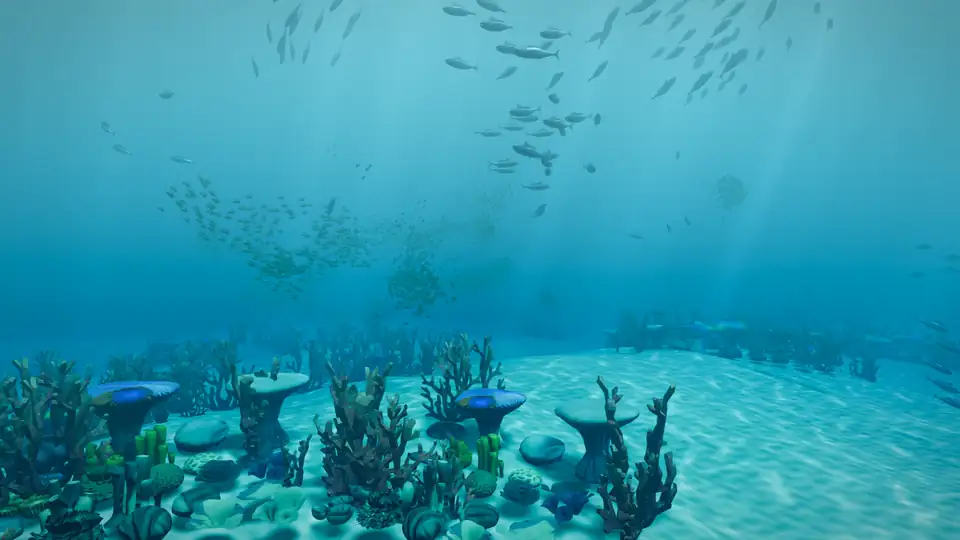

# Supercharge Your Game


[](docs/media/reef.mp4)

<sub>The [Reef](examples/Reef) example: 6,240 schooling fish. Click for the full 20-second video.</sub>

A modern C# game engine you use as a library, with a 3D renderer built in. Super is
made so a coding agent can build, run, test and see a game with no editor and no
person at the mouse.

```csharp
using System.Numerics;
using Super;

Game.StartWindowsGameLoop<Spinner>(new GameOptions { Title = "Spinner" });

class Spinner : IGame
{
    float angle;

    public void Update(GameTime time) => angle += time.TickSeconds;

    public void Draw(View view)
    {
        view.Camera(position: new Vector3(0, 2, 5), lookAt: Vector3.Zero);
        view.Sun(direction: new Vector3(1, 2, 1), color: new Vector3(3f));
        view.Model(key: 1, ModelRef.Cube, Matrix4x4.CreateRotationY(angle));
    }
}
```

## Why Super

**AI-first and friendly to agents.** Everything is code and plain text. There's no
editor, no scene files and no binary project format, so an agent reads and writes the
whole game.

- Every game runs headless. A test plays it through the same `Update` and `Draw` code,
  with no window and no GPU, and fails with the seed and tick that replay the problem.
- Every game has the same command line. `--screenshot`, `--record`, `--profile` and
  `--script` give an agent a picture, a video, a timing report or a scripted click, all
  repeatable from a seed.
- Content is JSON with generated schemas. Mistakes are reported with file and line, such
  as `items/axe.json:4: chopPower must be a number`.
- The interface is laid out for real in headless runs, so a test can check what text is
  on screen and where.

**A game engine, used as a library.** You write a normal .NET program. Super gives you
the window, a fixed-tick game loop, input, game states, cameras, an interface toolkit,
JSON content, seeded randomness and an optional ECS. Your state lives in your own
classes, and you call your own systems in the order you choose.

**Modern C#.** .NET 10, records, primary constructors and
`Microsoft.Extensions.DependencyInjection`. The interface is SwiftUI-style records.
Hot paths allocate nothing, and Super keeps no global state, so many games can run in
one test process.

**A modern 3D renderer.** [Rendition](src/Rendition/README.md) is a deferred,
physically based Vulkan renderer: cascaded soft shadows, image-based lighting,
screen-space reflections, temporal anti-aliasing, ambient occlusion, bloom, colour
grading and your own surface shaders. It also works on its own, without the engine.

## How a game is shaped

| Member | When it runs | What it's for |
| --- | --- | --- |
| `Load()` | Once, optional | Build the starting world |
| `Update(GameTime)` | A fixed number of times per second, 30 by default | Change game state |
| `Draw(View)` | Once per displayed frame | Describe the 3D world. It only reads state |
| `Ui` | Once per displayed frame, optional | Describe the interface on top. It only reads state |

`Update` is the game. `Draw` only looks at it, so the game runs with no screen at all,
and the same seed always plays the same way.

## Try it

You need Windows, a GPU with Vulkan 1.3, the .NET 10 SDK and the Vulkan SDK
(`winget install KhronosGroup.VulkanSDK`). Super isn't on NuGet yet, so clone this
repository:

```
dotnet build Super.slnx -c Release
dotnet test Super.slnx -c Release
dotnet run -c Release --project examples/Terrain
```

## Documentation

Start with [Getting started](docs/getting-started.md), then read what you need:

- [Working with coding agents](docs/agents.md)
- [Drawing with views](docs/views.md), [cameras and clicking](docs/cameras.md) and [rendering](docs/rendering.md)
- [Interfaces](docs/interfaces.md), [input](docs/input.md) and [game states](docs/states.md)
- [JSON content](docs/content.md) and [random numbers](docs/random.md)
- [Testing](docs/testing.md), [the command line](docs/command-line.md) and [profiling](docs/profiling.md)
- [The ECS](docs/ecs.md)
- [What's not here yet](docs/roadmap.md)

The [docs index](docs/README.md) lists every page, and [design.md](docs/design.md)
records why things are the way they are.

## Status

Super is early and changes often. Everything in the docs works today unless it's
marked as planned. The examples are the best place to see it running:

| Example | Shows |
| --- | --- |
| [ColorCube](examples/ColorCube) | The game loop, input actions and seeded randomness |
| [Shapes](examples/Shapes) | Every built-in shape, and shapes made in code with `Shapes` |
| [Rooms](examples/Rooms) | Game states, a loading screen, JSON content, clicking the ground and huts that rise on a curve |
| [Courtyard](examples/Courtyard) | Material graphs: bricks, flagstones, dirt, wood, leather and rusty metal made in code, on a courtyard modelled in Blender |
| [Crafting](examples/Crafting) | An inventory and crafting bench driven entirely by the mouse |
| [Terrain](examples/Terrain) | Endless generated hills with a custom surface shader, a road built along a spline with a cart driving it, and a flyover on F |
| [Reef](examples/Reef) | 6,240 schooling fish with the ECS, water and a stats panel |
| [Fox](examples/Fox) | A skinned character blending walk into run, with a head turn played over it |
| [Archer](examples/Archer) | A short film: a cutscene with slow motion, root motion, a sky and a forest clearing |
| [Dust](examples/Dust) | Trees falling in a clearing, throwing up soft particle dust along where they land |
| [Forest](examples/Forest) | Sound: a looping ambience and music, a hammering builder whose sound pans as the camera circles, and channel volumes |

## License

The code is under the [MIT license](LICENSE). Some assets have their own terms, listed
in [CREDITS.md](CREDITS.md).
