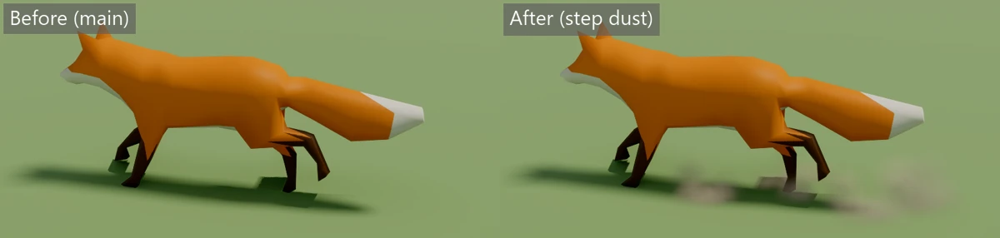

# Animation

Super plays skeletal animation on rigged models. You import a character and its clips,
describe its **states** (idling, walking, running, sitting) and its **actions** (waving,
shooting, looking), and an `Animator` blends between them. The GPU skins the model, and
its shadow bends with it.

`examples/Fox` is a working character: a walk-to-run blend driven by speed, dust kicked up
by each paw and a footstep it sounds from the clips' events, an idle when it stops, and a head turn played over
either. Put the Khronos
[Fox.glb](https://github.com/KhronosGroup/glTF-Sample-Assets/tree/main/Models/Fox) in
the shared assets folder as `assets/fox/fox.glb` (see [assets/README.md](../assets/README.md)),
and the build cooks it.

W and S, or up and down, change the pace, and Space or a click looks around.

## Importing a rigged model

A rigged FBX or glTF goes through the same model cooker as any model (see
[Rendering](rendering.md#models)). When a mesh has bones, the cooker keeps the
skeleton, the bone weights and every clip in the file, sampled at 30 frames a second.

Mixamo and similar tools hand out one file per animation. List the extra files in the
model's `<file>.cook.json` sidecar, by their path from the model's folder. Their clips
are matched to the model's joints by name, so they must be from the same rig:

```json
// characters/hero.fbx.cook.json
{
  "targetLength": 1.8,
  "animations": [
    { "file": "walk.fbx", "name": "Walk" },
    { "file": "run.fbx", "name": "Run" },
    { "file": "wave.fbx" }
  ]
}
```

Without a `name`, a clip is named after its file. Download Mixamo clips "without skin"
to keep them small; the character itself comes from one file "with skin".

The engine doesn't move a character with its clip, so a clip that walks or steps back
plays its steps and then snaps back when the next clip takes over. `"inPlace": true` cooks
it on the spot: the clip's root, the first joint it moves (Mixamo's hips), stays over the
ground where the first frame puts it, and still rises and falls. Use it for clips that
travel when Mixamo offers no "in place" download, such as a cheer that wanders:

```json
{ "file": "rallying.fbx", "name": "Rallying", "inPlace": true }
```

A model drawn with no pose, such as a fish that only swims (see `Swim` in
[the world](ecs.md#drawing-entities)), stands as the file shows it at rest, not as it was bound. Many
files bind the skin a turn away from the rest pose, such as an armature turned up from z-up,
and the cooker moves the vertices to the rest pose so such a model doesn't lie on its side.
Played clips look the same either way.

A mesh without bones, such as a sword or a head, follows its container node: the parent of
the node that holds the mesh, such as a hand or a neck. That container is a joint of its own,
so it plays the clips that move it, and a container with no clip moving it stays at rest with
its parent. At rest the mesh sits where the file's node tree puts it, even when its bone was
bound in another pose. The mesh follows its container, not its own node, so a clip that
moves the mesh's own node, such as a lantern swinging on its hook, doesn't move it. Each
container that isn't a bone already counts towards the 256
joints a model can have, so a file with hundreds of loose meshes in their own empty nodes
can run out.

## The rig

`content.Rig(path)` reads the skeleton and clips of a cooked model, and names the model
too, so you don't need `content.Model` for a character:

```csharp
var rig = content.Rig("fox/fox.glb");

ClipRef walk = rig.Clip("Walk");          // Throws, listing the clips, if there's none.
BoneMask head = rig.Mask("b_Neck_04");    // This joint and everything under it.
Motion pace = rig.Blend((walk, 0.6f), (rig.Clip("Run"), 2.4f));
```

A [content record](content.md) can hold a `Rig` field too, written as the model's name, so
which model a character animates lives in its file beside the rest of its data.

A **mask** limits an action to part of the body: the upper body for shooting while the
legs keep walking, or an arm for a wave. A `BoneMask` masks joints, so it decides which
bones a clip moves. A `MeshMask` is different: it decides which meshes of a model are drawn
at all. See [Showing some meshes](views.md#showing-some-meshes). A **blend** picks between
clips by a number, such as speed. Between two points it mixes the two clips, and beyond the
ends it plays the nearest one.

## The controller

An `AnimationController` describes a kind of character once. Its states and actions are
your own enums:

```csharp
enum FoxState { Idle, Moving }
enum FoxAction { Look }

var controller = new AnimationController<FoxState, FoxAction>(rig) { CrossFadeSeconds = 0.3f }
    .State(FoxState.Idle, rig.Clip("Survey"))
    .State(FoxState.Moving, rig.Blend((rig.Clip("Walk"), 0.6f), (rig.Clip("Run"), 2.4f)))
    .Action(FoxAction.Look, rig.Clip("Survey"), rig.Mask("b_Neck_04"), fadeSeconds: 0.4f);
```

| Call | What it does |
| --- | --- |
| `State(state, clip, speed)` | A base state that loops one clip |
| `State(state, motion, speed)` | A base state that loops a blend, picked by `Parameter` |
| `Action(action, clip, mask, fadeSeconds, speed)` | A one-shot clip played over the state. Without a mask it covers the whole body |
| `CrossFadeSeconds` | How long a change of state blends, 0.2 by default |
| `EventThreshold` | The share a fading state needs for its clip events to count, a half by default. See [Events](#events) |
| `PickSound` | Picks the sound each clip event plays, such as by the ground underfoot, or null to play none. See [Sounds from events](#sounds-from-events) |
| `Start(state)` | An `Animator` for one character, in this state |

Share one controller between every character of a kind, and give each its own animator.

## The animator

The animator is gameplay state. Your `Update` says what the character is doing, and the
engine does the rest: after every `Update`, the game loop moves each animator on by one
tick. You never step it yourself.

```csharp
public void Update(GameTime time)
{
    _animator.Set(Speed < 0.05f ? FoxState.Idle : FoxState.Moving);
    _animator.Parameter = Speed;
    if (actions.Pressed(Control.Look))
    {
        _animator.Moves.Play(FoxAction.Look);
    }
}

public void Draw(View view) => view.Model(FoxKey, _animator, transform);
```

`view.Model(key, animator, transform)` draws the rig's model in the animator's current
pose. Only the transform is yours to give, since where the character stands is game
state. With the ECS, even that goes away; see below.

| Member | What it does |
| --- | --- |
| `Set(state)` | Changes the base state, cross-fading from the old one. Setting the same state does nothing |
| `IsIn(state)` | Whether it's in that state |
| `Parameter` | Picks the mix in a blended state |
| `Phase` | How far through the state's cycle, from 0 to 1 |
| `IsCrossFading` | Whether a change of state is still blending |
| `Moves.Play(action)` | Plays an action from its start. Playing it again restarts it |
| `Moves.Stop(action)` | Ends an action early |
| `Moves.IsPlaying(action)` | Whether an action is still playing. It ends when its clip does |
| `Moves.Crossed(action, seconds)` | True on the one tick an action passed that moment of its clip |
| `Moves.TimeOf(action)` | How far into its clip an action is, in seconds, as of the last tick, or null when it isn't playing |
| `Events` | The clip events the last tick passed, in order. See [Events](#events) |
| `IsActive(name)` | Whether a window event with that name is open now |
| `Speed` | How fast everything plays, 1 by default. 0 holds the character still, such as while the game is paused |
| `Pose` | What to draw, for `view.Model(key, model, transform, pose)` when you pick the model yourself |

**Clips in step.** A state keeps one cycle phase. A blended state plays its clips at
speeds that make them finish their cycles together, so a walk and a run mixed half and
half don't kick out of step, and changing state keeps the phase, so feet land where
they would have.

**Actions over states.** Actions fade in and out over their `fadeSeconds` and play over
whatever the state is doing. With a mask, the rest of the body carries on: walk and wave,
walk and shoot. Several actions can play at once; later ones in the enum go on top.

**Moments in an action.** Use `Moves.Crossed` to make things happen partway through a clip,
so a shot fires when the trigger is squeezed rather than when the clip starts:

```csharp
if (_animator.Moves.Crossed(SoldierAction.Shoot, 0.25f))
{
    FireBullet();
}
```

`Moves.Crossed(action, 0)` is true on the tick the action starts, right after `Moves.Play`. Later
moments come true in a later `Update`, once the engine has moved the clip past them. For moments
that belong to the clip wherever it plays, such as footsteps in a walk, mark them as
[events](#events) instead.

**Who runs it.** Every animator started from a rig that came from `content.Rig` is run
by the game loop, until nothing in the game holds it any more. Drop a character, or
destroy its entity, and its animator stops with it. Animators move on game ticks, not
frames, so a seed replays the same. Pausing doesn't stop them, because the loop keeps
ticking, so set `Speed = 0` on the characters you want frozen.

**Between ticks.** The game ticks 30 times a second, but the pose keeps moving between
ticks when drawn, so animation is as smooth as the frame rate.

**Slow motion.** Animators from content move by `GameTime.DeltaSeconds`, so they slow
down with [`GameTime.Scale`](getting-started.md#a-first-game), as in a
[cutscene](cutscenes.md#slow-motion).

## Events

An event marks a moment in a clip, such as a paw landing or a sword connecting, or a
window, such as the half second a hitbox is live. The animator reports the events it passed
on each tick, from whatever clip passed them: the state's, a blended state's, or an action's.
That's how a game learns when an attack hits without timing it by hand.

Mark them in the model's sidecar, next to the clips. A `time` is a moment and a `from` and
`to` is a window, both in seconds into the clip. Name a `joint` to be told where it was:

```json
// fox/fox.glb.cook.json
{
  "events": [
    { "clip": "Walk", "time": 0.05, "name": "step", "joint": "b_RightFoot02_022" },
    { "clip": "Walk", "time": 0.6, "name": "step", "joint": "b_LeftFoot02_018" }
  ]
}
```

```json
// characters/hero.fbx.cook.json
{ "clip": "Slash", "from": 0.3, "to": 0.45, "name": "hit", "joint": "RightHand" }
```

The cook fails on an event that names a clip or joint the model doesn't have, that runs
past its clip, or that gives both a `time` and a window. Or mark them from code, before the
animators that play them start ticking:

```csharp
var rig = content.Rig("characters/hero.fbx");
rig.Event(rig.Clip("Slash"), "hit", from: 0.3f, to: 0.45f, joint: "RightHand");
rig.Event(rig.Clip("Slash"), "whoosh", at: 0.2f);
```

Then read them in `Update`. `Events` holds what the last tick passed, in the order it
happened, and reading it doesn't allocate:

```csharp
foreach (var e in _animator.Events)
{
    if (e is { Name: "step", Kind: AnimationEventKind.Moment, Joint: { } paw })
    {
        KickUpDust((paw * foxTransform).Translation);
    }
}

if (_animator.IsActive("hit"))
{
    DamageWhatTheSwordTouches();
}
```

Each event has its `Name`, its `Kind` (a `Moment`, or the `Begin` or `End` of a window), the
`Clip` it came from, the `Weight` that clip had, from 0 to 1, and `Joint`, where the named
joint was at the end of the tick in the model's space, or null when the event names none.
Multiply it by the character's transform to put it in the world, as the Fox does to put dust
under each paw. `IsActive(name)` says whether a window with that name is open now, which
suits damage that lasts as long as the swing.

A looping clip reports its events every time round, and a long tick, such as after a hitch,
reports every event it skipped, in order. A window begins and ends once each, even if a
tick passes all of it, and an action stopped or restarted mid-window ends it, so every
`Begin` gets its `End`.

A blended state reports the events of its heavier clip only, so a walk mixed with a run
doesn't land twice as many feet. A clip fading in or out of a change of state reports while
its share is at or above the controller's `EventThreshold`, a half by default, so the
outgoing walk and the incoming run don't both step during a cross-fade. Set it to 0 to hear
from every clip with any weight. Actions report in full while they play, however far they
have faded.

Events come from the tick after `Update`, like `Crossed`, so an `Update` sees the events of
the tick before it. An action's event at time 0 shows up in the `Update` after `Play`.

The Fox kicks up a puff of dust from each landing paw, from the `step` events in its sidecar.



### Sounds from events

An event can play a sound by itself, such as a footstep or the whoosh of a swing. Give it a
`sound` by its content name, and the game loop plays it at the event's joint on the tick the
clip passes it, with no code in `Update`:

```json
// fox/fox.glb.cook.json
{ "clip": "Walk", "time": 0.6, "name": "step", "joint": "b_LeftFoot02_018",
  "sound": "sounds/step.wav", "volume": 0.6, "pitchVariation": 0.08 }
```

`volume` is from 0, 1 by default, and `pitchVariation` moves each play's pitch up or down by up
to that much, from 0 up to but not including 1, so 0.08 is ±8% and a run of steps doesn't
sound like one sample repeated. An event with a sound needs no name; it's named after its
sound. The cook fails on a negative volume, a pitch variation of 1 or more, an empty sound,
or a volume or pitch variation with no sound. From code, pass a `ClipSound`:

```csharp
rig.Event(rig.Clip("Slash"), "whoosh", at: 0.2f, joint: "RightHand", sound: new ClipSound("sounds/whoosh.wav", volume: 0.8f));
```

The sound plays like an [`audio.Play`](audio.md#playing-sounds) with a place: on the Effects
channel, full volume within 2 metres and silent from 50, following
[`GameTime.Scale`](audio.md#time-scale-and-pausing), with its pitch from the audio's own random
stream so a seed replays the same. It plays where the joint is in the world: at the joint
times the transform the model was last drawn with, whether you draw it with `view.Model` or
it's an [`Animated` entity](#with-the-ecs). An animator that hasn't been drawn plays nothing,
since it isn't anywhere yet. An event without a joint plays at the model's origin.

A window plays its sound as it begins, not as it ends. The same rules choose which events
play as which are reported: a blended state plays its heavier clip's, a clip fading in or out
plays while its share is at or above `EventThreshold`, and an action plays in full. The volume
is scaled by the clip's `Weight`, so a step from a clip at 0.6 of a cross-fade plays at 0.6 of
its volume.

Every sound is named in content when the rig is read with `content.Rig`, or when
`rig.Event` adds one, so a missing file stops the game at load with a `ContentException`
naming it, not on the first step.

To pick the sound by what the character stands on, set `PickSound` on the controller. It
gets where the sound would play, the event and the sound from the clip, and returns the
sound to play, or null to play nothing:

```csharp
controller.PickSound = (at, e, sound) => Ground.At(at) switch
{
    Surface.Stone => _stoneStep,
    Surface.Water => _splash,
    _ => sound,
};
```

The Fox plays a soft paw thud with each step: [the recording, with sound](media/fox-footsteps.mp4).

## Root motion

Mixamo's dodges, rolls and dives move the body across the ground. Played as they are,
the mesh leaves the character behind and snaps back when the clip ends. Root motion
takes that travel out of the clips and hands it to your game instead:

```csharp
var rig = content.Rig("archer.glb");
rig.RootMotion("mixamorig:Hips");
```

Name the joint that carries the body. Its travel over the ground comes out of every clip,
while its height and turns stay in, so a jump still leaves the ground. Each tick,
`animator.RootMotion` says how far the clips carried the character, in the model's
space. Turn it by the character's rotation and scale, then add it to where they stand:

```csharp
_position += Vector3.Transform(_animator.RootMotion, Matrix4x4.CreateScale(scale) * Matrix4x4.CreateRotationY(_facing));
```

Blends and actions mix it as they mix the pose, so a dodge fading in moves the
character a little at first, and a loop carries on from where its last cycle ended.
Call `RootMotion` once per rig, before starting animators. Asking again for the same
joint does nothing, and asking for another throws.

## Joints

`animator.Joint(name)` is where a joint is in the model this tick, such as the hand an
arrow leaves from. Multiply it by the character's own transform to place it in the world:

```csharp
var nock = _animator.Joint("mixamorig:arrow") * transform;
var arrow = new Arrow(nock.Translation, direction);
```

An unknown name throws, listing the joints the rig has. It's worked out once per tick,
however often you ask, and again if the pose's joints are turned or reached since.

To plan ahead, `rig.Joint(clip, seconds, name)` says where a joint is at a moment of a
clip played alone, in the same model space: where the sword will be at the height of a
swing, say, before the swing is played. It works out the whole skeleton each time, so
it's for searching a clip once, not for every frame.

## Setting joints yourself

For procedural motion, such as feet placed on uneven ground by IK or a head turned to
look at something, set joints directly through `pose.Joints`. `pose.Joints.Set` takes a joint's local pose,
relative to its parent, and puts it over whatever the clips give. The others still
follow the clips, or stay at rest if there are none:

```csharp
var rig = content.Rig("bug.glb");
var pose = new AnimationPose(rig);
int knee = pose.Joints.Index("Leg_F_Tibia_L");

public void Draw(View view)
{
    // Work out from state already blended with view.Blend; set joints aren't moved ahead.
    pose.Joints.Set(knee, new JointPose(rest.Position, kneeTurn, Vector3.One));
    view.Model(BugKey, rig.Model!.Value, transform, pose);
}
```

A set joint stays until it's set again or `pose.Joints.Clear()` hands every joint back to
the clips. `Clear()` only takes away the layers. It works on an animator's pose too
(`animator.Pose`), so IK can go over a walk clip. The skeleton's `Rest`, `Parents` and
`Names` give what's needed to work out where joints are in the model.

**Turns.** `pose.Joints.Turn(joint, turn)` swings a joint, and everything under it, about the
joint itself, by a turn in the model's space, on top of what the clips give. A struck
body bending back, or a head turned to look, is a turn shared along a few joints. Turns
go on in order down the skeleton, so turning the waist and the chest each by half bends
the back by the whole. `Quaternion.Identity` takes the turn away.

**Reaching.** `pose.Reach(limb, goal)` bends an arm or a leg so its end reaches a point
in the model's space, solved after the clips, set joints and turns. Name the limb once
from the rig, upper to lower to end, with the joint that's carried to the goal if it
isn't the end:

```csharp
var arm = rig.Limb("R_shoulder", "R_elbow", "R_wrist", tip: "R_sword");

// A point on the blade, in the sword joint's own units, brought to where the blow lands.
animator.Pose.Reach(arm, goalInModel, weight, point: new Vector3(80f, 0f, 0f));
```

The hand keeps the turn the clip gives it, so a sword is brought over without twisting,
and the elbow stays bent the way the clip bends it. A goal out of reach straightens the
limb towards it. `weight` mixes from the clip at 0 to the goal at 1; easing it in and out
around a moment, read from `animator.Moves.TimeOf(action)` and the view's blend, lands a swing
on its mark and lets it go on. A reach on the same limb replaces the last, weight 0 takes
it away, and `Joints.Clear()` takes away turns and reaches too. Like set joints, turns and
reaches aren't moved ahead between ticks, so set them in Draw from blended values; the
clips under them still are.

## Ragdolls

A [ragdoll](physics.md#ragdolls) from `Super.Physics` drives the joints it simulates
over everything else: the clips, set joints, turns and reaches. The animator keeps
playing underneath, so a ragdoll with some `Strength` pulls towards the clip, and one
switched off blends back into whatever the animator plays by then, such as a get-up.
Only the joints' turns are taken, apart from the pelvis's place, so bones keep their
length. `animator.Joint(name)` gives where a joint is as of the last tick, ragdoll and all.

## With the ECS

Give an entity a `Transform` and an `Animated`, and the world draws the rig's
model in the animator's pose. There's nothing to update and nothing more to draw:

```csharp
var fox = world.Create();
world.Add(fox, Transform.At(position));
world.Add(fox, new Animated(controller.Start(FoxState.Idle)));
```

Systems only change what it's doing, such as
`world.Get<Animated>(fox).Value.Set(FoxState.Moving)`. Add a `Model` too when you want
a tint, or to draw a different model with the same rig.

To hold something in a hand, give it a `Parent` that names a bone of the character. Its
`Transform` then counts from that joint, and it follows the joint between ticks just as
smoothly as the character's own model:

```csharp
world.Spawn(
    Transform.At(new Vector3(0f, 0.05f, 0f)),
    new Model(content.Model("weapons/sword.glb")),
    new Parent(fighter, Bone: "mixamorig:RightHand"));
```

A bone the rig lacks throws when the frame is drawn, naming the bone and the entity, and
so does a bone on a parent that isn't `Animated`. Destroying the character destroys the
sword too. Physics places a body on a bone where the joint is as of the tick.

## Limits

- A model can have up to 256 joints, and a frame can draw up to 16,384 bones. Models
  past that in one frame are drawn in their bind pose.
- The pose given to `view.Model` must come from the model's own rig, and the model must
  have been cooked with a skeleton. Drawing a pose whose joint count differs throws.
- A masked draw still skins the whole skeleton once. A `MeshMask` saves triangles, not
  bones, so it doesn't make a model cheaper to animate.
- Clips are sampled at 30 frames a second when imported, and blended linearly between
  frames.
- Root motion only carries travel over the ground. Turns in a clip, such as a turn on
  the spot, stay in the pose and don't turn the character.
- A separate model follows a bone only as an entity with a bone `Parent`. Drawn with
  `view.Model`, place it yourself at `animator.Joint(name)` times the character's
  transform. A sword that is a mesh in the character's own file already follows its
  hand, and a [mesh mask](views.md#showing-some-meshes) picks which of several to show.
- Events don't sync clips. Blends keep their clips in step by phase, not by markers such
  as a left foot down.
- An event's sound plays once, where the joint was on that tick. It doesn't follow the
  joint while it plays, and it can't be held for as long as a window is open.
