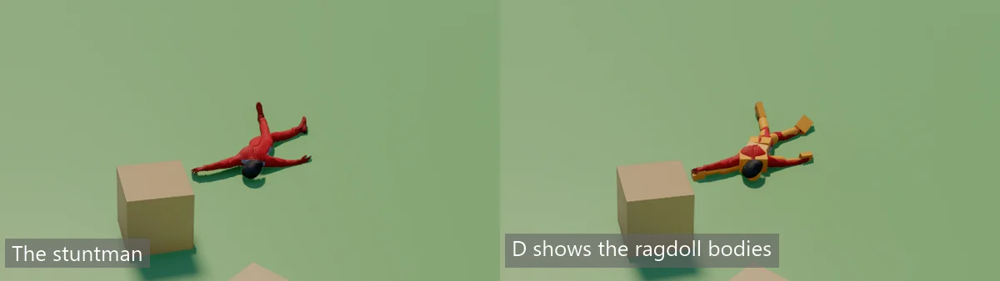

# Debug drawing

Lines, boxes, spheres and labels drawn into the world, to see what the game is thinking:
where an enemy is heading, what a ray hit, how big a trigger is. They're drawn over the
finished picture in flat colour, at a fixed thickness in pixels, so they stay readable however
the scene is lit or graded. Where the world is in front of them they still show, faintly.



There are two places to draw. `view.Debug` lasts one frame, like the rest of
[`Draw`](views.md):

```csharp
public void Draw(View view)
{
    view.Debug.Arrow(guard.Position, guard.Target, Color.Yellow, "ai");
    view.Debug.Text(guard.Position + Vector3.UnitY * 2f, guard.State.ToString(), Color.White, "ai");
}
```

`DebugDraw` is a service, for drawing from `Update`, a system or anything else that has no
view. A shape drawn there shows until the next tick, so one drawn every tick stays up as long
as it keeps being drawn. `For(seconds)` keeps one for longer, such as where a shot landed:

```csharp
public sealed class MyGame(Physics physics, DebugDraw debug) : IGame
{
    public void Update(GameTime time)
    {
        if (physics.Queries.Raycast(new Ray(muzzle, aim), reach: 50f) is { } hit)
        {
            debug.For(2f).Sphere(hit.Point, 0.1f, Color.Red, "shots");
        }
    }
}
```

`For` hands back the same canvas each time it's given the same time, so asking every tick
doesn't allocate.

## Shapes

Both places have the same calls. Each takes a colour and a look, and draws in world units.

| Call | Draws |
| --- | --- |
| `Line(from, to, color)` | A line between two points |
| `Ray(origin, direction, color)` | A line from a point along a direction, as long as the direction |
| `Arrow(from, to, color)` | A line with a head at `to`, a quarter of the line long |
| `Path(points, color, closed)` | Lines through the points in order, and back to the first when `closed` |
| `Box(center, size, color)` | A box lined up with the axes |
| `Box(transform, color)` | The box from -0.5 to 0.5 moved by a transform, for one that's turned or scaled |
| `Circle(center, normal, radius, color)` | A circle facing along the normal, of 32 lines |
| `Sphere(center, radius, color)` | Three circles, one round each axis |
| `Capsule(from, to, radius, color)` | A capsule whose middle runs between the two points |
| `Axes(transform, size)` | A transform's x, y and z, in red, green and blue |
| `Text(position, text, color)` | A label centred just above a point, on a dark backing |

Colours are written as anywhere else in Super, such as `Color.Red` or `new Color(1f, 0.45f, 0.1f)`.
Labels are 13 points, at the [interface's scale](interfaces.md#scale), and a label whose point
is behind the camera isn't drawn.

## The look

The last argument is a `DebugLook`:

| Field | What it does |
| --- | --- |
| `Channel` | The group the shape belongs to, such as `"ai"` or `"physics"`. A shape with no channel always shows |
| `Thickness` | How thick its lines are, in window pixels, up to 64. 0, the default, means 2 |
| `OnTop` | Shows the shape in full where the world is in front of it, instead of at a quarter |

A channel's name on its own converts to a look, so `Color.Red, "ai"` is enough for most
shapes. For more, write the look out: `new DebugLook("bodies", Thickness: 3f, OnTop: true)`.
A thickness below 0, above 64 or not a number throws.

## Channels

Shapes in a named channel are hidden until the channel is shown, so a game can leave its
debug drawing in and turn it on when it's needed. Show them from the command line:

```
dotnet run --project MyGame -- --debug ai,physics
```

Or from code, through the `DebugDraw` service, such as on a key:

```csharp
if (input.Pressed(Key.F4))
{
    debug.Toggle("ai");
}
```

`Show`, `Hide`, `Toggle` and `Shows` take a channel's name, and case doesn't matter. Hiding a
channel hides the shapes `For` is keeping in it too. A shape in a hidden channel costs only
the check: nothing is stored, and its look isn't checked either. When working out what to draw
costs something itself, check `debug.Shows("ai")` first. The
[Cannonball](../examples/Cannonball) example draws its ragdoll's bodies in the `bodies`
channel, shown with D or `--debug bodies`.

`--debug` is not `--debug-view`, which shows one of the renderer's own buffers, such as the
normals or the light probes. See [the command line](command-line.md).

## In tests

`run.Debug` in a [headless run](testing.md) is the last frame's `view.Debug`, with the shapes
`DebugDraw` kept copied in. `Lines` lists every line the shapes broke into, with its ends,
colour and look, and `Labels` every label. `Count(channel)` counts the lines in a channel, or
those with none for `null`. Shapes in hidden channels aren't there. Labels also show in
`run.ShownText`, since they're drawn by the interface.

## Limits

- Shapes are lines: there are no filled shapes, and spheres and capsules are outlines.
- Labels are always 13 points in the interface's default font; there's no size or font of their own.
- Grids have their own overlays, `Grid`, `GridLabels`, `GridHeat` and `Cells`, described
  in [grids](grids.md#seeing-a-grid-while-you-work).
- Debug shapes have no switch in the graphics settings. They're off until a channel is shown,
  and shapes with no channel always draw.
