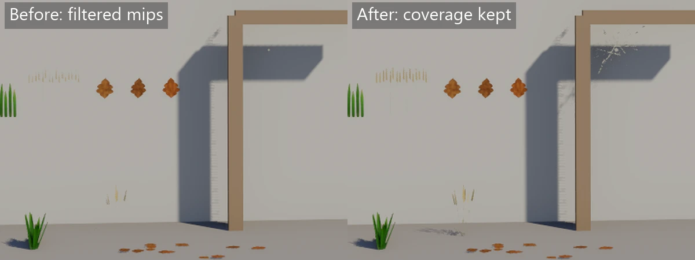

# Super design

Super is a C# game engine used as a library, with no editor. Rendition is its
renderer and stays a separate project. The other pages in `docs` describe the engine as a user
would meet it. This file records the reasons behind it, then Rendition's design.

## Engine decisions

These are decided. The game loop, window, randomness, input, game states, JSON content, cameras, picking, view memory, user data and headless runs are built;
the rest is not yet.

| Area | Choice | Why |
| --- | --- | --- |
| Projects | `Super`, `Super.Random`, optional `Super.Ecs` and `Super.Testing`, and `Rendition`, which knows nothing of the others | Each layer stays usable without those above it |
| Namespaces | `Super.Random` keeps its types in the `Super` namespace | `using Super;` is enough, and it can't hide `System.Random` |
| Random generator | xoshiro256**, with streams seeded by hashing their name with FNV-1a | Fast and well tested. `string.GetHashCode` changes between runs, so it can't be used. A test pins the sequence, because changing it breaks every recorded seed |
| Per-draw color | A tint pushed with each draw, multiplied into the model's own material | Textured models keep their textures, and no draw needs a material of its own, so the 1024 material slots can't run out however many colors a game uses |
| Falling behind | The clock drops time beyond 0.25 seconds of backlog | Trying to catch up after a stall would slow a struggling game further |
| Structure | Game code is plain classes behind `IGame`, with no built-in scheduler | The game's author owns the logic and the order it runs in |
| Time | `Update` runs on fixed ticks, `Draw` once per displayed frame and blends between ticks | Repeatable simulation, whatever the frame rate |
| Drawing | Views are plain functions of state, called every frame | Nothing to keep in sync, and loading needs no special cases |
| View memory | Kept by Super under a key and the calling line. A new key goes straight to its target, and a key not drawn for a frame is forgotten | A loaded game appears finished, with no animations replaying, and memory can't grow forever |
| Virtual tree for the world | None, unlike React and SwiftUI | Games redraw most things each frame, so comparing trees gains little and allocates |
| Virtual tree for interfaces | Yes, with SwiftUI's layout and React's hook-style state | Interfaces are trees that mostly stay the same, so skipping unchanged parts pays. They can allocate a little, and live apart from the render path |
| Interface code | CPU only, in `Super.Ui`. Rendition only sees textured quads | Layout and text run for real in headless tests, and Rendition stays usable alone |
| Interface mouse | Two speeds: hover, press and scrolling follow the mouse each frame, while clicks and drops queue and run just before `Update` | Ticks are too slow to feel right under a cursor, but anything that changes game state has to land on a tick for a seed to replay |
| Interface clipping | Per pixel in `overlay.frag`, each quad carrying a rounded clip rectangle, not scissor rectangles | One draw call, draw order kept, and rounded corners clip what's inside them |
| Interface scale | Layout runs in units, the screen divided by `UiTree.Scale`, and `UiTree.Add` multiplies each quad into pixels. `GlyphAtlas` rasterises, measures and wraps at the size in pixels and hands lengths back in units. `UiPointer` divides the mouse by the scale | Text stays sharp instead of stretched, measuring and drawing wrap at the same words, and no view has to know about the scale |
| Interface box | Background, border, radius, opacity and margin written side by side merge into one box. Padding and frame go by order | It reads like CSS, where these never depend on order, and `UiNode` only sees one box |
| Hierarchy | Flat, with attachment by transform or bone | Colony and dungeon games have thousands of independent things and little nesting |
| Cameras | A `Camera` is a plain value the game keeps, since picking happens in `Update` and showing in `Draw` | Input can only be read in `Update`, so the camera can't belong to `Draw` alone |
| Camera kinds | Perspective by default, orthographic with `Size`, asymmetric with `Shift` in half screens | A shift keeps working when the window changes shape, which fixed frustum edges wouldn't |
| Tall screens | `Camera.WideAs` widens the vertical field of view or `Size` in `Camera.Fitted(aspect)`, which the projection, `Ray` and shadow radius all go through. Off by default | One place keeps drawing and clicking in step, and games made for one window shape don't change |
| Camera boom | The game tests `BoomCamera.Arm` against its own walls and passes in the distance, by hand or with a `Super.Physics` shape cast | Super.Physics is optional, so the core can't call it, and this needs no delegate |
| Orthographic shading | Super gives the renderer an eye far behind the camera | Shaders keep one way of finding the view direction |
| Unchanging objects | `View.Cached`, by key and version number | Static worlds aren't described again each frame |
| Dependency injection | `Microsoft.Extensions.DependencyInjection`, resolved at startup only | Familiar, makes fakes one line, and costs nothing per frame |
| Global state | None | Many headless games can share one process |
| Randomness | `GameRandom` with named streams from one seed | A new roll in one system doesn't disturb another |
| Content | JSON read by `System.Text.Json` into records, loaded up front | No extra library, and data errors surface at load time |
| Input sampling | Per-tick snapshot rolled before `Update`; a tap inside one tick is Down and Pressed now, Released next tick | The window polls faster than the game ticks, and a short tap must not vanish |
| Input reads | Only in `Update`; `Draw`, `Ui` and `Load` throw | The screen stays a function of state, so a seed replays the same |
| Actions | The game's own enum, bound to a list of `Binding` values | Typed, no strings, and the list is plain data a settings screen can edit later |
| Game states | `States<TEnum>`, checked with a plain `Is`, not systems registered per state | There's no scheduler, so the game's author keeps the order, and a check costs nothing |
| State changes | Requested with `Set`, landing at the end of the tick after `Update` | Every system in a tick sees one state, and the Draw after it shows the new one |
| Scene-owned entities | A `ScopedTo<TEnum>` tag, cleared by `World` through `IStateHook` | Everything else carries through for free, so there's no scene to hand things across. Children aren't cascaded, since that would make every destroy cost a search |
| Asset loading | Prepared on background threads, uploaded one per frame, and a drawn model is waited for. Only the interactive window streams | A loading screen stays alive, nothing pops in, and disk speed can't change what a seed does |
| JSON content | One record per file, read into a `Catalog<T>` by `LoadAll` from the cooked data under a folder. JSON that doesn't parse fails the cook, not the load. Live reload runs only in the window and only from source: when `content.dev.json` sits beside the cooked folder, the window writes the schemas into the first root, starts `super-cook --watch` as a child process (killed with its tree when the game stops or exits, and stopped by stdin closing if the game dies), and watches `content.manifest`; a manifest written again sets `ReloadWanted`, and the next tick's `Reload` calls `Refresh` before reading the catalogs again | Every mistake is reported with its file and line at load, and a reload can't change a seeded run. See `docs/superpowers/specs/2026-11-01-json-content-design.md` |
| Saves and levels | JSON early on, expected to be replaced | Easy to read and repair during development |
| User data | `UserData` keeps one JSON file per class in the platform's per-user folder, named by `GameOptions.Id`. `Get` loads once and shares the copy; `Save` writes a `.tmp` file and moves it over the old one; a broken file is renamed `.broken` and defaults are used. `GameHost` uses a throwaway temp folder unless given one, and the window only passes the player's folder when it's visible | Players can read and fix the files, a crash mid-save can't lose settings, and a screenshot, recording or test can neither read nor change the player's own settings, so it repeats the same anywhere |
| Physics | `Super.Physics`, an optional package on Jolt Physics (JoltPhysicsSharp). A `Collider` component, with an optional `Body` (static, kinematic or dynamic), `Trigger` or `Character`. An `ITickHook` steps the world before each Update, after the ECS remembers transforms for smoothing: sync colliders to `Transform`, simulate, write dynamic Transforms, check triggers. Rays, shape casts and overlaps are filtered by 16 layer bits, with hits sorted by distance then entity | Jolt is deterministic for the same build, fast, and has a maintained C# binding; a separate package keeps the native library out of games that don't need it. Sorting hits and events keeps a seeded run from depending on Jolt's callback order. Stepping before Update means Update sees where things are drawn, and smoothing blends from where they were |
| Physics layers | Each body's Jolt object layer packs its collider's layers as the group and what it collides with as the mask (`ObjectLayerPairFilterMask`); two bodies collide when each one's group is in the other's mask. Triggers have an empty mask | Sixteen layer bits fit both halves of Jolt's 32-bit layer, so no table is needed |
| Kinematic colliders | A collider with no `Body` is kinematic. When its Transform changes, the step's sync calls `MoveKinematic`, so it sweeps there and pushes dynamic bodies; once it stops, its velocity is cleared. `Physics.Sync()` in Update teleports instead | Doors and platforms push crates without extra code, and the old ray-only behaviour stays the same |
| Dynamic bodies | Physics writes a dynamic body's world Transform after each step, so it can't have a `Parent`. It remembers what it wrote, and a Transform that differs at the next step was set by the game: the body teleports there, keeping its velocity. A new shape or `Body` rebuilds the body, keeping its velocity | The ECS Transform stays the one source of truth for drawing, and teleporting needs no extra call |
| Triggers | Jolt sensors with an empty layer mask, so they take no part in the simulation. After each step Super asks Jolt for each trigger's overlaps (`CollideShape` with the body's own centre-of-mass transform) and compares them with last step's sorted list | Jolt's sensor contact callbacks arrive on worker threads in no promised order, and miss static bodies by default; a query per trigger is simple, sorted and sees everything |
| Characters | A Jolt `CharacterVirtual` per `Character` entity, built from its collider and moved by `Physics.Move` with `ExtendedUpdate`, which climbs stairs and sticks to the floor. Its collider is also a kinematic body for rays, triggers and falling things, which the character's own move skips | `CharacterVirtual` is Jolt's controller for players: it isn't simulated, so the game decides gravity and jumps and it moves at once in Update |
| Physics queries | Query shapes are cached by collider and scale. Overlaps collect body IDs through an `[UnmanagedCallersOnly]` callback, because JoltPhysicsSharp's list overload allocates every call. Jolt matrices act on column vectors, so Super transposes System.Numerics matrices it passes in. `CollideShape` takes a centre-of-mass transform, `CastShape` the shape's own | Stepping and querying a settled world allocate nothing, which a test checks |
| Physics threads | Each `Physics` has its own Jolt job system, made at its first step. joltc shares one scratch allocator between all physics systems, so stepping and `Move` take a process-wide lock | Without it, games stepping in parallel test threads crash; with it they only take turns |
| Animation | An `Animator` per character is gameplay state. The game sets it in `Update`, and `GameHost` moves every animator from a `content.Rig` rig on one tick right after, through `Content.Animators`, which holds them weakly. It writes its blend as clip layers into an `AnimationPose`, which the renderer samples at draw time, `PoseAhead` seconds past the tick. Joints the game sets itself with `SetJoint`, such as IK, are copied over the layers last and not moved ahead, since the game blends them in Draw | Games never step or hand over poses themselves, dropped characters stop being run without a call, clips stay smooth at any frame rate, gameplay can wait on moments in a clip, and a seed replays the same, since an animator nothing holds can't affect the game |
| Root motion | `Rig.RootMotion` strips one joint's travel over the ground out of every clip at load and keeps it as a track per clip; the animator mixes it by layer weight into `RootMotion` each tick | The game owns where a character stands, so travel has to come back as state rather than live in the pose |
| Cutscenes | A `Cutscene` is a list of shots, moments and slow stretches built in code; the `Director` runs it on the tick clock, cueing before `Update` and placing the camera after it, and sets `GameTime.Scale` | Moments land on ticks, so a recorded film replays the same. Shots keep real time while the world slows. The camera sees where things are once they've moved |
| Time scale | `GameTime.Scale` scales `DeltaSeconds`, never the tick rate | Input and the camera stay smooth in slow motion, and a frozen world still ticks |
| Tweens | `Tween<T>` is a struct the game keeps and moves with `Update(time)`, blending by checking `typeof(T)` for the six supported types. Curves are cubic Hermite with slopes worked out once when built | No allocation per tick, no scheduler to own them, and they follow the tick clock and `Scale`, so a seed replays the same. Checking the type compiles away for each struct, so no interface is needed on `Vector3` or `Color` |
| Splines | Every spline is stored as cubic Bézier pieces; points become pieces by centripetal Catmull-Rom (Barry–Goldman). Length is a table of 16 Gauss–Legendre steps per piece, refined to the curve by Newton steps. Minimal frames come from double reflection, with a closed spline's leftover twist spread by distance. `SplineFollower` is a struct that keeps distance within one trip | One evaluator serves both kinds of spline. Centripetal points don't overshoot or loop. Distances come out within a millimetre on a few-metre piece without a big table, frames never flip and close without a snap, and a follower running for hours keeps its place since its float never grows |
| Content folder | The game reads only cooked content, through `IContentFiles`: `CookedFolder` over the `content` folder beside the program, which holds `content.manifest` and objects stored by hash. Names are the source path with its extension, compared ordinally, and `Content` checks each name's kind in the manifest when it's named. Textures carry their kind and normal-map flag in the cooked header. `MemoryContent` cooks a test's sources with the built-in cookers and the material cooker on first read. The manifest sits in a volatile field, replaced whole by `Refresh` | A typo or a wrong case fails where it's named, on every OS, instead of when it's drawn. Settings live in cook rules rather than code. Background texture loads always see one whole manifest. Tests run the same cookers a build does |
| Material graphs | A material is a C# recipe of lazy nodes, run on the CPU at cook time into ordinary textures. Sine, cosine, power, exponent, log and atan2 come from `DMath`, never `Math`. Each node gets its seed from the graph's seed and its place in the graph, through a stream name written with the invariant culture. Each graph compiles alone, and the cooker's version comes from module ids | The renderer can't tell a graph from a texture set, and nothing runs at play time. The same graph, settings and seed give the same bytes on any thread count, and on any machine because `DMath` replaces the functions that can differ between CPUs. The GPU can't promise that, and the cache and tests rely on it. A node's pixels depend on the seed and its position, so adding a node later in the graph moves nothing before it |
| Animation states | States and actions are the game's enums. One base state loops, keeping its phase across changes; actions play once over it, optionally masked to part of the skeleton | Walk and wave, or run and shoot, need no state per combination |
| Audio mixing | Super's own `Mixer` writes 48 kHz stereo floats into a span, with a fixed 64 voice slots; OpenAL only plays the result. See [Audio mixer](#audio-mixer) | The same code runs with a device or without one, so headless runs and tests hear exactly what a player would, sample for sample |

The rule for dividing data: if gameplay cares, it's state; if only the eyes care, it's
view. Views read state and never write it, so animation can't change a simulation's
outcome. Repeatability is promised for the same build on the same kind of CPU, because
floating point results can differ between CPU types. Cooked material graphs are held to more:
their sine, cosine, power, exponent, log and atan2 come from `DMath`, so a graph cooks to the
same bytes on any machine.

Keys are passed through to per-object motion vectors (`DrawItem.Key`; see "Motion vectors"
below). Rendition still needs a check of how it copes with many thousands of draws. Skeletal animation
is in: the model cooker keeps skeletons and clips, and the vertex shader skins. Particles
are in too: a `ParticleEffect` of chained emitters turns a key and an age into particles with no state
from frame to frame; see [Particles](#particles).

## Audio mixer

`Mixer` (in `src/Super/Audio`) owns every playing voice. `Mix(span)` clears the span,
adds each voice into it and moves the sample clock (`Clock`, frames mixed) on by the
span's frame count. It allocates nothing: voices live in 64 slots made up front, each
with its own read buffer, and a slot keeps the reader of the last decoded clip it played
and rebinds it for the next one. A streamed clip (over 10 s) opens a decoder when it
starts, which is the one allocation allowed, and disposes it when the voice ends or is
cut for a newer one. A decoder that throws as it is disposed is ignored, so it can't stop
the next sound starting. A looping clip goes back to its start with `Seek(0)`; nothing else seeks while mixing.
`Seek(0)` rewinds the decoder the voice already has rather than opening a new one, which
for an ogg costs about 800 KB of codebooks. NVorbis rewinds exactly unless all the audio
is in one Ogg page (a second or so, never a streamed clip), where it starts a packet late,
so the ogg reader reopens only then. An exact seek anywhere else decodes forward from the
start, because both decoders' own seeks land off. The decoders themselves allocate as they
decode (NVorbis about 10 bytes a frame, and about 25 KB per rewind; NLayer a few tens of KB
per pass), so a streamed compressed clip is the one place mixing still allocates.

**Gain.** A voice's gain is its volume × its fade × distance falloff × its channel ×
Master (a voice on `Master` is scaled once). Volume and fade move per frame along
straight ramps, so a fade-in of 0.1 s is exactly 0.5 at 2400 frames. Channel volumes,
the listener and voice positions are read once per `Mix` call, and each voice's left and
right gain is worked out from them. A voice ramps those two gains in a straight line from
where the last block left them to this block's values, frame by frame, so a camera turn,
a moving source or a channel change never steps at a block edge (that would be zipper
noise). A voice's first block starts at its gains, so there is no fade from 0 beyond its
own fade-in. Once the gains are steady the ramp is flat and the output is exact.

**Pitch and rate.** Each output frame steps through the source by
`clip rate / 48000 × pitch`, times the world rate for voices that follow `Scale`, and
reads between source frames with linear interpolation. So a 44.1 kHz clip plays at its
own length and pitch. At a world rate of 0 a voice holds its place and is silent, then
carries on from the same frame. Fades still run while it's held. So a pause doesn't
click, the voice fades out over 5 ms (240 frames) while it keeps playing at its last
speed, and fades back in over 5 ms when it resumes.

**Placing.** A voice with a position is folded to mono, `(L + R) / 2`, then scaled by
the falloff and panned. A voice without one keeps its own stereo and isn't panned.

- Falloff is 1 up to `near`, 0 from `far` on, and `(near/d − near/far) / (1 − near/far)`
  in between: the inverse-distance curve, shifted and stretched to reach 0 exactly at
  `far`. With near 2 and far 50 that's 0.48 at 4 m and 0.17 at 10 m.
- Pan is the dot of the direction to the source with the listener's right,
  `normalize(cross(forward, up))`, from −1 (left) to 1 (right). It's 0 at the listener
  and when looking straight up or down.
- Equal-power panning: left `cos((pan + 1)·π/4)`, right `sin((pan + 1)·π/4)`, so the centre
  is 0.707 on each side and a sound keeps the same power as it moves across.

**Voice limit.** With all 64 slots taken, starting a voice drops the quietest voice
that isn't music or an ambience layer, judged by the volume it's heading for × falloff × channel (a stopping
voice counts at its current fade). If the new voice would be quieter than every
candidate, or every voice is protected, the new one is dropped instead and `Start` returns
`Mixer.Dropped` (−1). Music and ambience layers are never dropped, and starting one drops
the quietest other voice whatever its own volume. A dropped voice is cut at once, without a
fade, since its slot is needed now. A voice can carry a `Tag` (the game's id for it); when
the limit drops a tagged voice, refused at its start or cut for a newer one, the mixer calls
`OnDropped` with the tag. Voices that end or fail aren't reported.

**Voice ids.** An id is the slot in the low 8 bits and the slot's start count above
them. An id kept after its voice ended can't reach the next sound in that slot, and calls
on unknown, ended or dropped ids do nothing.

**Bad voices.** A voice whose reader throws while mixing (say a corrupt frame far into a
streamed ogg) is ended and the rest carry on. Only the clip's reader is guarded, so any
other exception still reaches the caller. `FailedVoices` and `LastFailure` on the mixer
count these, skipped scattered sounds, and ambience layers that found no free voice
(`RecordFailure`). The device's audio thread logs a line when the count grows; manual
mixing (headless, tests) logs nothing. Starting a voice opens its reader before the
slot is marked in use, so a clip that fails to open throws from `Start` and leaves the
slot free; a voice that was to be dropped for it keeps playing until the new one has begun.

**Ambience.** `StartAmbience(definition, volume, fadeSeconds)` makes the layers and
scattered timers of an `AmbienceDefinition` and returns an id (`NoAmbience`, −1, when
`MaxAmbiences`, 8, are already playing). `SetAmbienceVolume` and `StopAmbience` take that
id; stale or unknown ids do nothing. The mixer is built with a `RandomStream` (the game
gives it `new GameRandom(seed).Stream("audio")`, never its own), and everything random
below comes from it, so one seed gives the same ambience every run.

- Each layer is a looping voice on the Ambience channel at `layer volume × ambience volume`,
  fading in over `fadeSeconds`, starting at a random frame of its clip. A decoded clip
  just starts its cursor there; a streamed clip uses its decoder's own seek
  (`ISampleReader.SeekNear`) once, as the ambience starts. That is quick but lands a little
  off (a few dozen frames for an ogg, up to 1152 early for an mp3), which a random start
  doesn't mind. Decoding up to the frame, as an exact seek does, could take longer than the
  speakers' buffer.
- Each scattered entry waits a random `MinSeconds..MaxSeconds` of the sample clock, then
  plays a random one of its clips once, at a random volume within its range times the
  ambience volume as it is at that moment (it rises from 0 over `fadeSeconds` with the
  layers, so a scattered sound during the fade-in is quiet too), pitch `1 ± PitchVariation`, and a random flat pan in −0.8..0.8 (the
  balance law `Spatial.Balance`: both ears at 1 in the centre, the far ear turned down),
  and waits again. The next wait counts from the time it was due, not from when the block
  happened to start, so the gaps don't drift. A sound starts at the start of the block
  that it is due in, so it starts early, by less than one block.
- Ambience voices count against the 64 slots and show up in `Snapshot`. Layers are
  protected from the voice limit like music; scattered sounds are ordinary voices and can
  be dropped. If a layer can't start, the layers already started are stopped and the
  error reaches the caller of `StartAmbience`. A layer the limit refuses, which only
  happens when all 64 voices are music or layers, is counted with `RecordFailure` and the
  rest of the ambience plays. If a scattered sound can't start (say its
  clip fails to open), that one play is skipped and the next is timed as usual.
- `SetAmbienceVolume` fades the layers (and the volume new scattered sounds use) to the new
  level over the seconds given. A scattered sound already playing keeps the volume it began with.
- `StopAmbience` fades every layer out over the seconds given and starts no more
  scattered sounds. A scattered sound already playing plays to its end without a fade.
- Nothing allocates while mixing: the players are made when the mixer is built, and their
  layer and timer arrays only grow when an ambience starts, and every voice slot holds a
  decoded-clip reader from the moment the mixer is built. Streamed clips are the
  exception: one opens a decoder as it starts, and the decoders allocate as they decode
  (see the audio mixer section above).

A voice that isn't looping is removed when its clip runs out. `Stop` fades the voice to
0 over the seconds given (0 removes it at once) and removes it then.

## Audio service

`Audio` (in `src/Super/Audio`) is what games call. It owns a `Mixer` but the game thread
never touches it: every change (starts, stops, volumes, positions, channel volumes, the
listener, the world rate, ambiences) becomes an `AudioCommand` pushed into
`AudioCommands`, and the mixer side applies them in order before it mixes.

**The command ring.** `AudioCommands` is a single-producer single-consumer ring of 4096
commands, made once. The producer's pushes stay hidden until `Publish`, so a frame's
changes arrive together. Its counters only grow, so full and empty can't be confused. A
push into a full ring drops the command and counts it (`Audio.DroppedCommands`); the game
thread never waits. The size is far beyond any normal frame, and a dropped command is
recovered from where it matters. A dropped start frees its id again and returns −1; for
music, the next `Music` call with that track tries again. A dropped stop would leave a
loop, an ambience or a protected music track playing for ever. So when a start reaches a
mixer-side slot that still holds a game id, that id's stop must have been dropped, and the
old voice or ambience is stopped over 0.3 s before the slot is reused. Ids are freed and
taken last in, first out, so the next start usually lands in that slot soon after.
`TryPop` clears each slot it reads, so the ring doesn't keep an ambience definition alive.

**Ids.** `StartLoop`, `StartAmbience` and `Music` pick ids on the game thread from
preallocated pools (1024 voice ids, 64 ambience ids): a slot in the low 16 bits and the
slot's use count above, as in the mixer. They return at once, with no round trip.
Releasing an id frees it straight away, which is safe because the ring keeps order: the
stop reaches the mixer before any later start in that slot. The game side ignores calls
on ids it doesn't hold. The mixer side keeps, per slot, the game id last started there and
the mixer voice or ambience id it got, `Mixer.Dropped` or `Mixer.NoAmbience` if the
mixer refused it. A command reaches a mixer voice only if its game id matches the one
stored, so a command whose start was dropped can't reach an older sound. One-shots have
no id and no mapping. A start whose clip fails to open is counted in the mixer's
`FailedVoices` and mapped to `Dropped`, so one bad clip can't stop the mixer.

**Fades.** Loops fade in over 0.1 s, change volume over 0.1 s and fade out over 0.3 s.
Ambiences fade in, change and fade out over 2 s. Music cross-fades over `fadeSeconds`:
the old track's voice stops with that fade and the new one starts with it as its fade-in.
Music takes its ids from the same pool as loops.

**Sounds from entities.** `SoundSync` (in `src/Super.Ecs/Audio`) is an `IDrawHook` that
`AddSuperEcs` registers. After each frame's Draw it walks the entities with `Sound` and
with `Ambience` and compares them with what it sent last frame, keyed by `Entity` (id and
generation, so an id reused in the same tick is a new sound). Per entity it remembers the
loop's id and the clip, channel, near, far, volume and world position it last sent. A new
entity starts a loop, a changed clip/channel/near/far/placement stops and restarts it, a
changed position sends `Move` (an exact compare) and a changed volume sends
`ChangeVolume`; whatever wasn't seen is stopped. A still entity sends nothing, which
matters because draw hooks run every frame while the ring drains once a tick in manual
mode (`Audio.CommandsQueued` is what the test reads). Two dictionaries swap roles each
frame so nothing allocates once warm. The position is `ViewExtensions.WorldMatrix`, the
same transform, `Smoothed` blend and `Parent` chain `Models` draws with. A start that
returned id -1 is tried again next frame. A loop the voice limit dropped is started again
(stopped, then started under a fresh id) once the mixer has a slot free. The mixer side
tags each loop's voice with its game id, and `OnDropped` writes that id into
`_droppedIds[slot]` with a volatile write; `Audio.WasDropped(id)` compares it on the game
thread, and taking an id clears its slot, so a stale entry can't match a new id. After each
`Render` the mixer side publishes how many slots are free and bumps a mix count;
`Audio.TryClaimVoice` lets the game claim each of those free slots once until the next mix.
So restarts follow free slots instead of retrying every frame against a full mixer. A
restarted loop usually lands in a free slot, but a one-shot sent in the same frame can take
it first, and then the loop cuts the quietest voice, which is reported and comes back in its turn.
A dropped `Move` or `ChangeVolume` is not resent until the
value changes again. Values are checked before `Audio` is called, so a bad one throws an
`ArgumentOutOfRangeException` naming the entity and field; a `finally` still completes the swap and
keeps entities not yet reached tracked as they were, so the next frame neither restarts nor leaks.

**Randomness.** `Audio` is built with an audio seed and makes `new GameRandom(seed)`
from it: the `"audio"` stream goes to the mixer (ambiences) and `"audio pitch"` stays on
the game thread for `Play`'s pitch variation. Two streams, because each is used by one
thread only. `GameHost` takes `int? audioSeed`; null is 1. `Game.StartWindowsGameLoop`
passes `Random.Shared.Next()` for live play only, so screenshots, recordings, profiles,
headless runs and tests all sound the same each run.

**The game loop.** In `GameHost.Draw`: the game's `Draw`, then a playing cutscene's
camera, then every `IDrawHook.AfterDraw(view)`, then `Audio.EndFrame(View.Shot,
Time.Scale)`, which pushes the listener (the camera's position, facing `Target −
Position`) and the world rate and publishes the frame's commands. In manual mode
(`Audio.Manual`: no device, or the device paused) `GameHost.Tick` calls
`Audio.Advance(TickSeconds)` before `Update`. `Advance` publishes anything still queued, as
a frame would, so ticks with no `Draw` between them lose nothing; then it drains the ring
and mixes `round(seconds × 48000)` frames into a scratch buffer in blocks of up to 2048,
carrying the fraction of a frame to the next call so a long run doesn't drift. The mix
itself is thrown away. A sound started in `Update` is handed over at that tick's `Draw` and
first mixed by the next tick's `Advance`. `Render(span)` drains then mixes one span; it's
the one call the audio thread makes.

**Reading it.** `Audio.Playing` (manual mode only, else `InvalidOperationException`)
drains what's been published, so it shows what the mixer has been told so far, and
copies `Mixer.Snapshot` into a new list. `HeadlessRun.Sounds` returns it.
`Audio.MixedFrames` is the mixer's sample clock (`Mixer.Clock`, a volatile field), the
one piece of mixer state any thread may read.

## Audio output

`DeviceOutput` (in `src/Super/Audio/DeviceOutput.cs`) plays the mix through the speakers.
`Game.StartWindowsGameLoop` calls `Audio.UseDevice(Console.Error)` just before
`window.Run`, so only live play opens a device; screenshots, recordings and profiles
return earlier and stay manual. `UseDevice` returns false and stays manual if the device
won't open, so the game loop keeps advancing the mixer per tick and voices still end on
time. It writes one line, `No sound device ({reason}); playing silently.`, where the
reason is the exception message from opening. Tests force this with `openOverride`, a
`Func<string?>` whose non-null result fails the open with that reason.

**The device.** `OpenAlSpeakers` opens the default device through OpenAL Soft
(`Silk.NET.OpenAL` with the `Silk.NET.OpenAL.Soft.Native` binaries, so nothing has to be
installed), asks for a 48 kHz context, needs `AL_EXT_float32` and queues
`AL_FORMAT_STEREO_FLOAT32` buffers on one source: 4 buffers of 512 frames, about 43 ms.
OpenAL only plays what Super mixed; none of its 3D features are used. It sits behind
`IAudioSink` (`Free`, `Queue`, `KeepPlaying`), so tests run the real audio thread into a
stand-in with no sound card.

**The audio thread.** `DeviceOutput` starts one background thread, "Super audio", above
normal priority. Each pass it asks the sink how many buffers have finished playing,
renders one 512-frame block through `Audio.Render` for each (which drains the command
ring, then mixes) and queues it, then makes sure the source is playing. It then waits
up to 2 ms (often about 15 ms on Windows) on an event that `Resume` and `Dispose` set. If
it falls behind, every processed buffer is refilled in one pass, and a source that ran
dry and stopped is played again, so it never stays stopped. It allocates nothing per
pass. After each pass it compares `Mixer.FailedVoices` with the count it last saw, and
when it grew writes `A sound failed and stopped ({count} so far): {LastFailure}` to the
log given to `UseDevice`, a plain `WriteLine` inside a `try`. Anything else that throws
on the thread is caught: it logs `Sound stopped: {message}` and stops rendering for good,
because the mixer may be half way through a change; the game carries on in silence. The
thread stays alive and keeps emptying the command ring with `Audio.Discard()`, so the
game's commands don't pile up and count as dropped. `OpenAlSpeakers.Queue` checks
`alGetError` after queueing and throws on an error, which lands here, so a device error
gives exactly one line. If opening fails part way, `Open` deletes whatever source and
buffers it made before closing the context and device.

**Known limit.** The four buffers hold about 43 ms, and the thread wakes about every
15.6 ms (the Windows timer tick), so there is about 27 ms of margin before the speakers
run dry. A long pause, such as a big garbage collection, can use that up and cause an
audible gap. The thread recovers on its next pass.

**Handing the mixer over.** Each pass runs while holding a lock. `Pause` takes the same
lock and sets a flag, so when it returns the thread has finished its block and won't
touch the mixer until `Resume` clears it; the lock also makes each side's writes to the
mixer visible to the other. `Audio.PauseDevice()` pauses and makes `Manual` true, so
`Advance`, `Playing` and `Render` work on the calling thread and the game loop advances
the mixer per tick again. `Audio.ResumeDevice()` hands it back. Both do nothing without
a device. Pausing is the one time the game thread waits on the audio thread, for at most
one block; it's there for recording sound from live play. The speakers run dry while paused, and the
first pass after `Resume` refills them and starts the source again.

**Recording.** `Audio.StartRecording(wavPath)` makes the audio manual (pausing a device
if there is one, which `Audio.StopRecording()` resumes) and opens an `AudioRecording`, a
48 kHz stereo float WAV writer. `Advance` writes each block it mixes to it from the
scratch buffer it already uses, so nothing is allocated per tick, and the fractional
frames carried between ticks mean the file holds exactly the frames the clock mixed.
`StopRecording` goes back and fixes the header sizes. `GameCapture` starts it when the video gets its first frame
and stops it first in `StopRecording`, in a `finally` so the video is still finished; then `VideoFile.AddSound` runs
`ffmpeg -nostdin -y -i video -i wav -c:v copy -c:a aac -shortest` into a temp file beside the
video, moves it over the video and deletes the WAV. On any failure it deletes the temp
file, keeps both and writes the one-line message. Tests give it a stand-in for the
ffmpeg run.

**Closing.** `GameHost.Dispose` calls `Audio.Close()` before the services go: it stops
the thread, joins it, closes the source, buffers, context and device, then
`Mixer.StopAll()` ends every ambience and voice, so streamed clips close their readers.
`Audio.Close()` runs inside a `try`, so the services and the throwaway content folder are
still disposed if it throws.
`Mixer` itself isn't `IDisposable`; this is the only place voices still playing are
released.

## Asset pipeline

A game reads only cooked content: a `content.manifest` and `objects/<hash[0..2]>/<hash>`.
It never decodes a PNG or parses a glTF or FBX. `Super.Cook` makes that folder from the
sources, and the `Super` runtime only knows the manifest format (`ContentManifest`) and
reads it through `CookedFolder`.

`IContentFiles.Read` gives an asset's bytes whole, which suits data, textures and sounds.
Models are big (162 MB for a rigged FBX with its clips), so they go through
`IContentFiles.Open`, a stream: `SceneRenderer.LoadModel` reads the model piece by piece on
the loading thread, `Content.Rig` reads only the rig at the front of the file and
`Content.Meshes` only the mesh names before it, so the raw file is never held whole beside what's built from it. `CookedFolder.Open` is a `FileStream`
with a 64 KB buffer, small enough to stay off the large object heap, opened with
`FileShare.Read | FileShare.Delete` so a cook running beside the game can still replace or
delete the object. Content in memory gets a `MemoryStream` over `Read` by default.

**Cooking is a pure function.** An `ICooker` turns one source's bytes, its settings and the
target into output bytes. The bytes never hold a timestamp or an absolute path, and never
depend on the order the disk lists files in; every sort is `StringComparer.Ordinal`. So the
same sources always make the same objects, and objects are named by the SHA-256 of their
bytes: two assets with equal bytes are stored once.

**The cache key** is the SHA-256 of the cooker id, the cooker's version, the target, the
settings as canonical JSON (keys sorted, so their order in the file doesn't matter) and the
hash of the source. Other files the cooker read, such as a model's textures, aren't part of
the key: the cache record lists them with their hashes, and a record only counts while every
one still matches, so editing a texture cooks its model again. A
cooker that changes its output bumps its version, which misses every old entry. `CookCache`
keeps what a cook made under that key, in `~/.super/cache` or the folder in `SUPER_CACHE`, and
restores it into the store when the key matches, checking the objects' hashes first.
Deleting it is always safe. A cooker reads the files beside its source only through
`CookInput.Read` and `Find`, which check names against the root's listing ordinally, so a
name that differs only in case fails with a message naming the file that is there, even
though Windows would open it. The pipeline wraps each root in a `ListedRoot`, which lists it
once per cook, and every source shares that listing. A root's `Only` globs pick which of its
files `Sources.Gather` turns into sources, but the listing stays whole, so a cooker still
reads a file `Only` leaves out. The models cooker is `Super.Cook.Models`, a separate project, so
`Super.Cook` carries no Assimp.

**The manifest** lists every name with its kind, hash and size, and the shared objects that
have no name (see textures below). `CookPipeline` writes
objects to an `ICookedStore` as it goes, and replaces the manifest only when nothing
went wrong, so a failed cook leaves the last good content. After writing the manifest,
`FolderStore.Commit` deletes the objects kept by neither the new manifest nor the one it
replaced: a running game may have read the old manifest and still be loading from it, so an
object outlives its last name by one commit. An object that can't be deleted yet, because
something has it open, is left for the next commit. A name is the path from its root
with forward slashes and the extension, and parts are `name#part`, which is a split made at
cook time. The names of the meshes inside a model are a different thing, see Models below. Names are compared
ordinally on every OS. A name two sources make is an error that names both, which is why
several content roots can't yet override each other. Settings come from `cook.json` rules,
deeper folders winning, then `<source>.cook.json`, which wins over all of them. A sidecar
with no source is a warning, not an error, so a clone without its licensed models still builds.

**Cooking in parallel.** `CookPipeline.Cook` lists the sources and reads their settings on
one thread, then cooks the sources with `Parallel.For` on `CookOptions.WorkerCount` workers,
one per processor up to 8. A model can hold hundreds of megabytes of decoded textures, so
more workers than that cost memory without gaining much. Each worker fills its own slot of
an array, and the merge that follows walks the slots in source order. That's why problems,
duplicate-name errors and the manifest come out the same with any number of workers. The
first exception out of the loop is rethrown as itself, not as an `AggregateException`, so
`CookPipeline.InUse` still recognises a locked file. An `ICookedStore` is called from several
workers at once. `StoreWriter` holds a lock per hash, so two workers never write the same
object at once, and an object already in the store isn't made twice. `CookCache` guards its
hash memo with a lock and writes each object under a lock of its own.

**Hard links.** A fresh cook saves to the cache before it writes the store, so
`StoreWriter.Put` can ask `ICookedStore.TryLink` to link the store's file to the cache's copy
(`CookCache.SavedObject`). A cache hit links too, after checking the cached object's hash.
`FolderStore.TryLink` makes the link at a temp name beside the object and moves it into place,
like any write. `HardLink` calls `CreateHardLinkW` on Windows and `link` elsewhere; when it
fails, such as across volumes, the bytes are written as before. Linking is safe because
neither side ever changes an object in place: the cache and the store both write a temp file
and move it over the name, which leaves the other link holding the old bytes.

Each source reports where its time went in a `CookedFile`: the pipeline's own phases (hash
source, restore from cache, read source, hash output, write cache, write store) and the
cooker's, which it times with `CookInput.Time`. Time the cooker spent outside its own phases
shows as `<id> cooker, untimed`. `CookCache.TryRestore` says why it missed, and
`CookReport` adds it all up for `--timings`.

**The step cache.** A record is all or nothing per source, and one model can run a dozen
graphs, bake masks and compress fifty textures. So inside a cook a cooker can keep a slow
step's result with `CookInput.Keep(step, key, bytes)` and look it up with `Recall`. `StepCache`
stores each at `steps/<step>/<hh>/<sha256 of key>` in the cook cache, with the SHA-256 of the
bytes after them, so a damaged or cut-short entry is a miss. It writes a temp file and moves
it into place, like the rest of the cache, so workers and builds can share it; a failed write
is ignored. Without a cache folder, as with `--no-cache`, both do nothing. The key must name
everything the result depends on, its code's version included. Three steps use it:

- `MaterialGraphs.RunPacked` keys a graph run by `MaterialGraphs.Version`, the size, the graph's
  name from the root, and the SHA-256 of the graph or variant and of the graph a variant points
  to. Images aren't in the key, since which ones a graph reads is only known by running it:
  `CookImages` records each image's path and hash, the entry lists them, and a hit reads each
  image again through `CookInput.Read`, which also tracks it for the record, and misses if a
  hash differs. That's sound because the graph compiler lets a graph read nothing else. The
  entry holds the packed RGBA8 pixels, the height as one channel.
- The model cooker keys a mask bake by the SHA-256 of the model's positions and second UVs and
  of the material's triangles, which part each is in, and the other triangles it traces against, with the
  `Super.Cook.Models` build and the mask size.
- `TextureCompression` keys a compressed texture by the SHA-256 of every level's pixels, the
  size, the format and the encoder's version: the `Super.Cook.Models` build, `Bc7Encoder.Version`,
  BCnEncoder.Net's version and the quality. Lookups and compressions run in parallel over the
  model's textures.

The models cooker shares decoded textures between the models of a cook, and the cooks after
it in the same process. They're keyed by the SHA-256 of the image bytes (and of the alpha
image), the texture kind, whether it's a normal map or a glTF surface map, and the alpha
cutoff its mips keep coverage for, so a hit is always the same pixels. The memo is cleared when it passes 1 GiB. `TextureData` turns bytes
into floats through two 256-entry tables made with the same arithmetic as before, so mips
come out bit for bit the same.

Models don't hold their textures. The models cooker writes each texture as an object of its
own (`TextureData.ToBytes`, an `RTEX` file) through `CookOutput.AddObject`, and the model
names it by the SHA-256 of those bytes. Objects with equal bytes are one file, so the thirty
pieces of a kit that share one atlas store it once instead of thirty times. A shared object
has no name, so the manifest lists it in `objects`, after `assets`, and `FolderStore.Commit`
keeps and prunes it like an asset's object. `ContentManifest.AllObjects` is both. A cache
record lists its objects too, and a hit restores and checks them with its outputs; a record
whose object is gone from the cache is a miss. Each texture is written and hashed once per
process, through a `ConditionalWeakTable` on the shared `TextureData`. That works only for
the decoded image every model of the cook shares. A texture a model makes for itself,
such as a widened surface texture, a graph's textures or baked masks, is a new object each
time, so it's written and hashed again, though equal bytes still make one stored object.

`SceneRenderer.LoadModel` reads a texture through `IContentFiles.OpenObject(hash)`.
`CookedFolder` opens only a hash the manifest lists, so a damaged model can't name a file
outside the folder. The GPU still gets a copy of a shared texture per model, since
`Renderer` frees textures with their model; sharing them there needs reference counts.
`super-cook file` writes a model with its textures inside (`ModelCookers.StandAlone`), since a
file on its own has no store to find them in, and `ModelData.Read` without a texture
resolver refuses a model that names them by hash.

**Models.** `Super.Cook.Models` reads FBX, glTF and OBJ with Assimp at cook time and writes
`.rmodel` data (`ModelData` in Rendition). An alpha cutoff
that would cut nothing or everything (see the foliage section below) is an error that stops
the cook of that model.

Material graphs are cooked by `Super.Cook.Materials`. Each `*.material.cs` file is
compiled by itself with Roslyn, against `Super.Materials`, `Super.Random` and a few
runtime assemblies taken from the trusted platform list, so the file's bytes are the whole
input and editing game code never cooks a material again. The assembly is emitted with an
embedded portable PDB and loaded into a collectible `AssemblyLoadContext` that hands back
the cooker's own `Super.Materials`, so `MaterialGraph` is one type on both sides. An
exception's line is the first stack frame in that assembly. `GraphCompiler` reports
through a callback rather than to `CookOutput`, because `CookPipeline` files every problem
under the file being cooked: for a `.material.json` variant, `MaterialGraphs` moves the
graph's line into the message as `bricks.material.cs line 9: ` and passes no line.
`MaterialGraphs` holds the compile, variant and run steps for both cookers. The material
cooker runs its own source through it, and the model cooker calls `MaterialGraphs.Run`
with a graph's path from the model, so a graph's errors read the same in both, with the
model's `material <name>: ` in front. Every file it reads goes through `CookInput.Read`,
which tracks it, and images are read from the folder of the graph or variant named. Compiles are cached by the
SHA-256 of the source, 32 at most, and the oldest is dropped when a 33rd comes. It isn't
unloaded, since another cook may still be running it, so its context goes once nothing
holds it. Graphs compile in debug, so error lines are exact, at the cost of
unoptimised code in `Pixel` bodies. A second tree, `GlobalUsings.g.cs`, gives each
graph `System`, `System.Collections.Generic` and `System.Linq`, and nullable is on. A game with
`ImplicitUsings` gets those three and more, such as `System.IO`. The cook turns Nullable
on, and a game may or may not. The usings tree is fixed text, so it adds no errors of its
own, but a graph's compile errors are reported with their lines as usual.

Leaving `System.IO` out of the usings doesn't keep a graph from files, since
`System.Private.CoreLib` holds `File`, `Thread`, `DateTime.Now` and `System.Random`, and
`System.Runtime` forwards them. So once the graph emits, `GraphCompiler` walks its own
tree (not the usings tree) with the semantic model, top down. Each expression that binds
to a banned symbol is one error on its line, and its children aren't checked, so
`System.IO.File.Exists` is one error, not three. Banned are the namespaces `System.IO`,
`System.Net`, `System.Threading`, `System.Diagnostics`, `System.Reflection` and
`System.Runtime.InteropServices` with everything under them (except
`System.Diagnostics.CodeAnalysis`, the nullable attributes), the types `System.Random`,
`System.Environment`, `TimeProvider`, `HashCode` and `Activator`, and the members `Now`,
`UtcNow` and `Today` on `DateTime` and `DateTimeOffset`, `Guid.NewGuid`,
`Guid.CreateVersion7`, `GetHashCode` on `string` and `object` (seeded per process),
`Type.GetType` and `Delegate.CreateDelegate`. A namespace on the left of a longer dotted
name isn't judged alone, so `System.Diagnostics.CodeAnalysis.NotNull` passes. A type or
member there still is, so `Environment.ProcessorCount.ToString()` doesn't. The list catches
mistakes. It isn't a sandbox, since graphs are the project's own trusted code. A `using`
line names a namespace, so `using System.IO;` is an error even when nothing uses it. Symbols declared in the graph itself are never
banned. A constructor is named by its type and an extension method by its declaring
class, and an error is reported once per line and symbol, so `var r = new Random();` is
one error. A graph that fails the check isn't loaded or cached. `System.Threading.Tasks`
falls under `System.Threading`, which costs nothing, because the runner already spreads
each node's rows over the cores.

`Blur` is two passes, across then down, each working a whole row at a time so it reads
memory in order. Its kernel stops at 3 deviations. When that is longer than the image, the
weights are folded onto the pixels they wrap to, summed in doubles, so a pass never takes
more than `size` taps. At 2048 pixels a blur of radius 0.1 went from 17 seconds to 5, and
one of radius 1, whose kernel is 12,289 taps, from 225 seconds to 8. The folded weights
are the same numbers in the same order on every run, and each tap is a multiply then an
add, never fused, so the bytes stay the same on any thread count.

Graphs compile twice on purpose. The cook compiles each alone so its bytes are the whole
input, and the game's build compiles them all together, via a `ProjectReference` to `Super.Materials` in
`Super.targets`, only so the editor can complete and check them. That output is never used, and `Private="false"` keeps
the library out of the game's folder. The cooker's `Version` is
folded from the module version ids of `Super.Materials`, `Super.Random` and
`Super.Cook.Materials`, so rebuilding any of them with a change cooks every graph again.
The model cooker's list and `MemoryContent` both include it.

A model's material rule can name a graph with `graph`. The model cooker runs each
distinct path and size once per cook of the model, parts included, packs the images into
RGBA8 with `MaterialPixels`, the same code `MaterialWriter` uses, and hands the colour,
normal and surface pixels to `ModelTextures.AddPixels`, deduplicated by path, size and
part. A graph material's UVs are divided by the graph's `Width` as the vertices are read,
before the turn and `targetLength`. Assimp's `FlipUVs` has already made v `1 - v` of the
file's bottom-up v, so the cook turns v back, divides and turns it again, `1 - (1 - v) / w`:
v keeps its direction and a tile's edge stays at the file's UV origin. The model cooker's
`Version` folds in `MaterialGraphs.Version`, so a change to `Super.Materials` cooks every
model again, not only those with graphs, which is simpler and correct.

A rigged model keeps each mesh of the source as its own part, one per material, in the order
the nodes hold them, and the rig importer places each mesh by its node. Each part is named by
the node that holds its mesh, falling back to the mesh's own name when the node has none, so
the names are the ones an artist sees in the outliner and a multi-material mesh repeats its
name. The names go in `ModelData.MeshNames`, the same length as `Parts`.

A mesh without bones follows a joint. Its container node (the parent of the node that holds
it) becomes a joint of its own when it isn't a bone already, so a head under a neck or a sword
in a hand node moves with that container's animated chain. Each such container counts towards
`Skeleton.MaxJoints`. The mesh is placed by `global * inverse(restGlobal[J]) * inverse(inverseBind[J])`
for its joint `J`, so at rest it skins back to where the node tree put it. That matters when
`J` is a real bone: its inverse bind is the bone's offset matrix, which comes from the bind
pose, and the bind pose need not be the rest pose.

A static model is flattened by Assimp's `PreTransformVertices` by default, which merges the
meshes that share a material into one part and gives no names. With the opt-in `keepMeshes`
setting, a static model keeps its node tree instead, and `Placements` applies each mesh's node
transform by hand: points by the transform, normals by its inverse transpose, and the tangent
sign flips for a mirroring transform. Each mesh then stays its own named part, and its own
draw call. `ModelData.ToBytes` refuses a name count that isn't zero or the part count, so a
model with no names writes none. The names are the first thing after the header in the
`.rmodel`, before the rig, so `ModelData.ReadMeshNames` and `Content.Meshes` read them without
the geometry, and `ModelData.ReadRig` reads them on its way to the rig, so `Content.Rig` caches
them for `Content.Meshes`. `Content` caches each model's names by index and drops them when the
model is unloaded.

At draw time a `MeshMask` is a bitset over the model's parts, made for one `ModelRef`.
`View.Model` checks the mask's model, and `SceneRenderer.AddShown` copies only the shown parts
into the frame's draw list, checking that the mask's part count matches the loaded model. A
masked draw still skins the whole skeleton once. The profiler keys copies by model and mask,
so `ShownTriangles` counts only what each mask shows.

The `.rmodel` format is version 12 and the model cook version 13, with the material graphs'
version folded in. Their history is in the comments on `ModelData.Version` and
`ModelCooker.Version`, and an old file fails with "Cook it again" when it is read.

A material rule's `shader`, `shaderParameters` and `shaderTextures` are written after the
materials as `ModelData.MaterialShaders`, empty or one entry (or none) per material, by name: the
shader's file name, its parameters as `Vector4`s padded with zeros, and the source names of its
textures. Rendition can't resolve names, so `SceneRenderer.PrepareModel` reads the shaders and
cooked textures on the loading thread, and `UploadModel` makes them and hands them to
`Renderer.CreateModel` through its `finish` callback, which can change each material before it is
made. The shaders are kept for the renderer's life, one per name. The textures are made for each
model, since `DestroyModel` frees every texture its materials name.

**The build.** `Super.targets` gives a game a `ProjectReference` to `Super.Cook.Tool` that
only builds it: `ReferenceOutputAssembly="false"` and `Private="false"` keep the tool's
assembly and files out of the game, `PrivateAssets="all"` keeps it from the game's tests, and
`GlobalPropertiesToRemove` drops what a publish sets, such as the runtime, so the tool always
builds for the machine doing the build. `OutputItemType` hands the tool's path to the
`SuperCook` target, which runs after `Build`. Because it's an ordinary reference, the game's
own restore covers the tool and the tool builds alongside the engine. An earlier version
restored and built it with `MSBuild` tasks inside `SuperCook`, which added about half a second
to every build of a game with content. A game published with a runtime gets
`PublishReadyToRun`, unless it sets it itself, so the shipped program doesn't compile the
engine's code just in time as it starts.

**`content.dev.json`** is written beside the cooked folder by the build, and
only for a game run from source. It names the content roots, each root's `Only` globs, the
`super-cook` tool and the target, and `CookProcess` passes the globs on as `--only`. `Content.GoLive` reads it through `CookedFolder.Dev`; a published game has none and
never watches anything. When the game's content goes live (`Content.GoLive`):

1. It writes the JSON schemas into the first content root.
2. It starts a `ContentWatcher` on the cooked folder, filtered to `content.manifest`. The
   watcher waits for 100 ms of quiet before it says anything, since a manifest is written in
   several steps and writers rename a temp file over it.
3. It starts `super-cook --watch` through `CookProcess`: `dotnet <tool> --watch --content
   <root>... --out <folder> --target <target>`. Its output goes to the game's error stream
   so cook errors show where the game's own messages do. The tool's stdin is a pipe the game
   holds open and never writes to, so when the game dies the pipe closes and the tool stops. A game with no `dotnet` on the path still runs, and a cook
   started by hand is still heard.

The tool cooks once, then again after the sources have been quiet for 100 ms. A file another
program has open is tried again after the same wait; `CookPipeline.InUse` knows Windows'
sharing and lock violations. Replacing the manifest while the game is reading it fails with
access denied instead, so `FolderStore` turns access denied on its atomic move, and nowhere
else, into a `FileInUseException` carrying a sharing violation, after deleting its temp file.
When it
commits a new manifest the watcher's timer fires on a thread-pool thread, which only sets
`Content.ReloadWanted`. `GameHost` checks that flag at the start of a tick and calls
`Content.Reload` on the game thread, so no catalog is ever read from two threads.

`Reload` refreshes `CookedFolder`, which parses the new manifest and swaps it in, then
reads every catalog again. The catalogs are all or nothing: a mistake in the new data is
written to the log and every catalog keeps its old data. The reload as a whole isn't:
`CookedFolder` already holds the new manifest, so reading something not yet loaded, such
as a model named later, sees the new content while the catalogs show the old. The next
successful cook sets this right. A file that can't be read yet, because the cook is still
writing it, asks for another reload on the next tick.

Only catalogs reload so far. Models, textures and sounds that are already loaded keep what
they have; see the [roadmap](roadmap.md).

## Hot reload

Super doesn't reload code itself. `dotnet watch` or an IDE applies the change through the
runtime, and Super only reacts to it. See [the user guide](hot-reload.md).

**Hearing about a change.** `[assembly: MetadataUpdateHandler(typeof(HotReload))]` makes
the runtime call `HotReload.UpdateApplication` after each update, from its own thread. All
it does is increment a counter. Each `GameHost` remembers the count it last saw, and at
the start of a tick, after the content reload, it calls `IGame.CodeReloaded` if the count
moved. So the game hears about the change on its own thread, between ticks, the same way
content reload works. `ClearCache` is empty. Hot reload keeps type identity, so the ECS
component ids keyed by `Type` stay right. System.Text.Json clears its own reflection cache,
so a property added to a content record is read on the next reload.

**Stopping instead of closing.** `GameHost.KeepsRunningAfterErrors` is set only by the
window, and only when `MetadataUpdater.IsSupported` is true and nothing is being captured.
`Tick` and `Draw` then catch exceptions and call `Stop`. `Stop` keeps the first error
only and reports it once. It also sets `Input.Readable` back to false, since Update may
have thrown with input still open. A stopped `Tick` returns without doing anything, so
`Time.Tick` doesn't move, until the change counter moves or `Content.ReloadWanted` is set.
Then it clears the stop and runs the tick, which delivers the reload and `CodeReloaded`
before `Update`.

When `Update` stopped the game, `Draw` still runs the game's `Draw`, and only the interface
is swapped for `StoppedPanel`. When `Draw` or `Ui` threw, `_drawStopped` is set and later
frames run `DrawStopped` instead. It begins an empty view, ends the audio frame and shows
the panel without calling any of the game's code, so a broken Draw isn't hit every frame.
Both paths end with `StateChanges.Open` set to true again, because a Draw that threw never
reached the line that opens it.

The tick that threw isn't undone. Rolling back would mean copying the whole game every
tick, and a hot reload session is for development, where carrying on from a half-finished
tick is good enough.

**Keeping the seed across restarts.** A rude edit makes `dotnet watch` kill the process
and start it again, setting `DOTNET_WATCH_ITERATION` to 1 for its first run and counting
up for each restart. `RestartSeed.Pick` writes the seed to `super-restart-seed.txt` beside
the program on the first run, and reads it back on later ones. Without the variable it
writes nothing, so plain runs and published games are unaffected. The seed is written with
the invariant culture: under a culture such as `sv-SE`, a negative number is written with
U+2212 for the minus sign, which an invariant parse rejects.

# Rendition design

Rendition is a deferred, PBR renderer in modern .NET, generic enough for any 3D game.
It only does rendering and owns nothing beyond the window it draws into.

## Goals

- AAA-style architecture from the first commit: the rotating cube goes through
  the real deferred path, not a throwaway demo.
- No managed allocations per frame, measured and enforced by `--check`.
- Clean under the Vulkan validation layers.

## Non-goals (for now)

Editor, physics, audio, game logic and non-Windows platforms. Rendition keeps to
rendering. Game-facing features belong in Super, which has the audio (see
[Audio](audio.md)).

## Decisions

| Area | Choice | Why |
| --- | --- | --- |
| Runtime | .NET 10, unsafe code enabled | Current LTS; direct control over memory |
| Graphics API | Vulkan 1.3 minimum | Dynamic rendering and synchronization2 remove boilerplate; leaves Linux open |
| Bindings | Silk.NET.Vulkan | Thin, no per-call allocations |
| Window | Silk.NET.GLFW | Small and portable; the renderer never depends on it directly |
| Shaders | GLSL compiled to SPIR-V by `glslc` at build time | No compiler in the shipped game; a game compiles its custom shaders the same way |
| Math | System.Numerics | SIMD-accelerated value types |
| Model import | Cooked by `Super.Cook.Models` through the asset pipeline, using Assimp, writing our own `.rmodel` | The game loads a fast flat file and never ships an FBX or glTF parser; see [Asset pipeline](#asset-pipeline) |
| Textures and materials | One global descriptor set indexed by material | Adding materials adds no binding work per draw |
| Skinning | Four joints and weights per vertex, packed as bytes. Each frame's bone matrices go in one storage buffer (set 0, binding 1, up to `Renderer.MaxBones` = 16,384, with room for as many again after them for last frame's, which motion vectors use), and a draw's push constants hold its first bone, or -1 when it has none | Unskinned models use the same shaders and vertex format, and many characters cost one upload |

## Frame structure

```
ShadowPass    scene geometry   -> depth from the key light (1024, 2048 or 4096 square, up to 4 cascades)
              scene geometry   -> point and spot light shadows, tiles of one 4096 x 4096 atlas
cluster.comp  compute          -> the point and spot lights reaching each of 16 x 9 x 24 clusters
GBufferPass   scene geometry   -> albedo+metallic, normal+roughness+AO, emissive+clearcoat, motion, depth
DecalPass     decal boxes      -> colour, normal and roughness laid over the G-buffer, reading a copy of its normals
AoPass        fullscreen       -> GTAO from depth and normals: bent normal (view space, octahedral) and visibility, RGBA8
AoBlurPass    fullscreen       -> the same with the grain averaged away
LightingPass  fullscreen       -> HDR colour (Cook-Torrance GGX PBR, traced reflections, probes), subsurface diffuse apart
SssBlurPass   fullscreen x 2   -> subsurface diffuse spread across, then down and added to HDR colour
TransparentPass  glass and particles -> blended over HDR colour together, back to front;
                                  glass forward shaded, seeing a mipped copy of HDR
TaaPass       fullscreen       -> this frame blended with history, then copied to history
  or FsrPass  fullscreen x 2, FSR -> with Upscaler.Fsr, motion and exposure for FSR, then FSR's own
                                  compute passes rebuild the frame at the window's size; see "Upscaling"
DepthOfFieldPass fullscreen x 3 -> with an open aperture, circles and near and far layers at half size, blended over the frame
BloomPass     fullscreen x 9   -> glow, by shrinking and regrowing the image
exposure_*.comp compute x 2     -> with auto exposure, a histogram of the lit frame, then the adapted exposure in a buffer
TonemapPass   fullscreen       -> display colour (white balance, colour grade, AgX or ACES)
FinishPass    fullscreen       -> swapchain, with sharpening, a transition, vignette, grain and dither
```

Everything before `FinishPass` draws at the scene size, and the finish pass, the overlay and
the capture draw at the window size. `Renderer.SceneSize` gives the scene size from the
window and `RenderScale` (0.5 to 2). At 1 it is the window size exactly, odd sizes included,
so a scale of 1 draws the same pixels as before render scale existed. At any other scale
both sides are rounded to the nearest even number, at least 2, so half a scene pixel never
lands on a window pixel's edge. The G-buffer and the images inside it (HDR, AO, TAA
history), bloom's chain, the exposure histogram, the light clusters' tiles (`frame.screen`),
the TAA jitter and the pixel size that picks a mesh's LOD all follow the G-buffer's extent,
so they follow the scene size with no code of their own. When the scale changes, the next
frame waits for the device to go idle once and rebuilds the targets (`RebuildTargets`), the
same way a window resize does, and history starts again. Probes have their own small
G-buffers, and `RenderScale` isn't part of `FrameView`, so it never changes the lighting
hash or photographs a probe again.

When the scene and window sizes differ, the renderer sets `TransitionConstants.Style.z` to
1, and `finish.frag` reads its centre sample with a Catmull-Rom filter (`catmullRom` in
`sampling.glsl`, five bilinear taps, the same function TAA uses for history) instead of one
bilinear tap. That keeps edges sharp when the scene is stretched up from 0.5. When it is
shrunk from 2, each window pixel's centre falls between four scene pixels, and the filter
comes out close to an average of those two by two, a little sharpened by its negative lobes.
A wider filter would average more of the 2x scene, but two by two was enough to smooth the
edges. If a scene side would be longer than the device's `maxImageDimension2D`, `SceneSize`
shrinks both sides by the same factor so the longest side fits, rounded down to even
numbers. `--screenshot` copies the swapchain, so it is always the window size.

G-buffer layout:

| Target | Format | Contents |
| --- | --- | --- |
| 0 | `R8G8B8A8_SRGB` | base colour, metallic |
| 1 | `R16G16B16A16_SFLOAT` | octahedral normal (xy), roughness, AO |
| 2 | `R16G16B16A16_SFLOAT` | emissive colour, clearcoat (or minus the translucency, for foliage, or 2 plus the material index, for subsurface) |
| 3 | `R16G16_SFLOAT` | motion since last frame, in scene pixels; see "Motion vectors" |
| depth | `D32_SFLOAT` | reversed-Z, position is reconstructed from it |

### Motion vectors

The G-buffer pass writes how far each pixel's surface moved on screen since last frame
(`GBuffer.Motion`, `Passes/Motion.cs`). The vertex shader places each vertex twice: this
frame, as it always has, and last frame, with last frame's model matrix, skin palette, swim
and wind time, seen by last frame's camera (`frame.previousViewProjection`). Both ends leave
out the anti-aliasing shift, so a still surface under a still camera writes exactly 0.

The encoding is two 16-bit floats in scene pixels, pointing from where the surface is now
back to where it was, with x to the right and y down the picture, as texture coordinates
run. Last frame's point is at `uv + motion / sceneSize`, so something moving right one
pixel a frame writes (-1, 0). Sky, where no draw writes, is cleared to (0, 0) and has a
depth of 0, so a reader works out the camera's motion there itself. A vertex that was
behind last frame's camera writes -60,000 (`MOTION_OFF_PICTURE` in `surface.glsl`), which
reads as off the picture. An upscaler such as FSR that wants camera motion in the sky has
to add it, since the target only holds what the draws wrote.

Last frame's placing comes from `MotionHistory`, keyed by `DrawItem.Key`, the game's name
for one thing it draws (Super passes the entity). Each frame it remembers each key's
mesh, matrix, swim and bone range, and gives a draw its last placing only when the key was drawn
last frame, every draw with that key this frame and last stands in one place (the parts of
one model do), the key's first draw has the same mesh as last frame (a model's parts share
one mesh, so a key reused for another model doesn't borrow the old one's placing), and its
bone count hasn't changed. Anything else, a draw with no key, one new
this frame, the first frame, the frame after a resize or render scale change, or after
anti-aliasing comes back on, has no history and moves with the camera alone, as before
motion vectors existed. Last frame's placing goes in a buffer beside the instance matrices,
set 0 binding 9, 96 bytes a copy (`PreviousInstance`), and last frame's skin matrices are
copied into the bone buffer right after this frame's, so the buffer holds twice
`Renderer.MaxBones`. Probe captures use no history. Glass and particles write no
motion.

Games talk to the renderer with plain structs: `Renderer.Render(in FrameView,
ReadOnlySpan<DrawItem>)`. Meshes, textures and materials are created up front and
referenced by handles. A `DrawItem` is an index range of a mesh plus a material,
so one model shares a vertex buffer across its parts.

Models and meshes from `CreateModel` and `CreateDrawItem` also carry a bounding sphere
and up to four simpler versions, made while loading. Vertices that share a grid cell and
face the same way merge into one of them, so a simpler version is only another index
range, with no new vertices. Each frame, the camera and the shadow map each skip what
they can't see and pick the simplest version that strays by at most 1 pixel on screen
or 2 texels in the shadow map. `DrawItem`s written by hand have neither, and always draw
in full.

Model files often link only colour and normal maps. Each model's
`<file>.cook.json` sidecar connects the remaining textures and sets material
values. The surface texture holds metalness in red, roughness in green
and opacity in alpha.

A cut-out's opacity is the colour texture's alpha times the colour's alpha times the
surface texture's alpha. Asset packs and glTF keep leaf alpha in the colour texture, so
it works without a surface texture. The model cooker fails when a cutoff can't cut: no
pixel has alpha below it, or none has alpha above it. A `foliage` rule is for a tree's
leaves. It points the normals out of the crown, so the crown is lit as one shape and
not as a pile of separate cards (unless the rule says `"crown": false`, which keeps the
model's normals, for ivy and grass whose leaves aren't one shape), draws both sides, and keeps back faces from flipping
their normal. The lighting pass then lets sunlight through the leaves from behind, by the
material's own translucency. That rides in `GpuMaterial.Transmission` (`ResourceTable.Transmission` picks it), which subsurface
uses for its own and foliage can share since the two exclude each other, and `writeSurface`
writes it negated into the clearcoat channel (`foliageChannel`, never above `-1/1024` so 0
still reads as foliage). The lighting pass reads the size of a negative channel back as the
translucency.

Copies are drawn instanced. `SceneDraws.Batch` sorts a pass's opaque and shadow draws
by mesh, part, material, tint, ghost and swim, and each run of draws that match is one
`vkCmdDrawIndexed`. Skinned draws never match. The order is safe because the depth test
decides what shows. Glass is sorted by `TransparentPlan` and drawn one at a time. Each copy's model
matrix goes into the frame's `InstanceBuffer` (set 0, binding 2, `instances.glsl`), and
the vertex shaders read it by `gl_InstanceIndex`. The buffer grows before a frame is
recorded, sized from the selected draws. The push constants hold only what copies
share. Coplanar surfaces can trade places in a depth tie, which moved 0.03% of the
pixels in Archer by at most 3 of 255.

A draw's tint rides in its push constants and multiplies the material's colour in
`writeSurface()`, so every surface shader gets it, and copies of one textured model can
each have their own hue.

A ghost rides in the same push constants, as a colour and an opacity, with opacity 0
meaning no ghost. `writeSurface()` then keeps only the surface's normal and writes one
matte colour with a little of it as emission (`GHOST_GLOW` in `material.glsl`), so a
ghost reads the same over any material and in shadow. A ghost picks its pass by its own
opacity, not its material's: solid ghosts go to the G-buffer and see-through ones to
the glass pass, where `transparent.frag` does the same swap. `SceneDraws.Belongs`
decides this, and keeps ghosts out of the shadow maps. Glass that isn't a ghost casts a
shadow.

glTF files (`.glb`, `.gltf`) carry more of this themselves, so the model cooker reads their
embedded images, the link to their metal and roughness texture, and their colour,
metal and roughness values. glTF keeps metalness in blue, so the cooker moves it to
red. A rule in the sidecar still wins over the model file. The renderer has one
UV set, and the cooker keeps the first. That's fine for the adventurer model, whose four
sets are identical.

Shadows blur with distance from the object casting them: the lighting pass finds
how far away the blocker is, then widens its sampling to match, by the sun's size
(`ShadowSettings.LightAngle`, from `view.Shadows`' `sunSize`). The game says
which area the shadow map covers through `FrameView.Shadows`. A smaller area gives
sharper shadows, so the sample fits it to the model. A wide outdoor scene asks for up
to four cascades, each a ball three times the radius of the one before.

`Renderer.FitCascades` lays the balls along the view. `ShadowPass.Spread` reads how far a
frustum corner leaves the view axis per metre of depth, and `ShadowPass.FitSlice` finds the
deepest slice of the frustum, starting where the last one ended, whose corners still fit in
a ball of the cascade's radius. The ball's size never depends on the camera's angle, and
`CreateMatrix` snaps its centre to whole texels in the light's view, so edges don't crawl
as the camera turns or moves. An orthographic view, and a probe's capture, keep every ball
centred on the target instead. The light's depth range reaches past the ball towards the
sun at least as far as a ball round the target would, so a tall caster just out of view
still shadows the ground in front of the camera. It also reaches far enough to take in
every draw whose ball overlaps the column the map sees towards the sun
(`ShadowPass.CasterReach`, over the balls `DrawSelection.Bounds` works out each frame), so
a tree out of frame still dapples a wall in it. A caster can stretch the reach to no more
than six radii (`ShadowPass.MaxReach`). A longer reach spreads depth thinner, and
`FrameUniforms.ShadowDepthScales` carries the ratio so the shaders scale their bias to match.

The lighting pass picks the first cascade a point falls inside. In the outer tenth of a map
(`ShadowPass.HandOver`) a point uses the next cascade with a chance that grows towards the
edge, so the seam turns into noise that temporal anti-aliasing smooths. Shadows fade out
with distance over the last 15% of the furthest slice (`ShadowPass.FadeShare`) and near the
edge of the last map. The shadow pass draws each cascade into its own layer of the same
depth image, with its own culling and detail choice. Anything outside the last cascade, in
depth as well as sideways, counts as lit.

The image is `ShadowPass.Resolution` texels square, 2048 unless `RendererOptions.ShadowResolution`
or `Renderer.ShadowResolution` (Super's `Graphics.ShadowResolution`) asks for 1024 or 4096.
A change takes effect at the start of the next `Render`: the renderer waits for the device to
go idle, `ShadowPass.Resize` replaces the image, and `WriteTargetDescriptors` points the AO,
lighting and particle sets at it. That rewrite also drops a held transition picture, as a
window resize does. The texel size feeds `CreateMatrix`'s snapping, the normal offset and the
shadow passes' detail choice.

Contact shadows (`contactShadow` in `lighting.frag`) cover the centimetres the maps can't.
For the sun with the shadow, the lighting pass walks 12 steps along the light over
`ShadowSettings.ContactLength` metres (`FrameUniforms.ShadowFade.w`), from a random offset
per pixel and frame that anti-aliasing averages. Each step is projected with the camera's
matrix and `depthGap` compares its linear depth with the depth buffer's. A step more than
0.02 m behind what the camera sees there is blocked, unless it's more than 0.15 m behind
(`CONTACT_DEPTH_LIMIT`). Contact shadows are only for the last centimetres, where the map is
too coarse. A surface further in front is a nearer object passing in front, not something
touching, and the maps' PCSS already shadows it. Counting it would draw a dark halo round
everything in front of a wall, and would let each leaf of a plant shadow the ones behind it
on screen. A fixed limit, rather than one that grows with the length, keeps both away
however long the ray is. Foliage (a negative shared G-buffer channel) gets no contact
shadows at all, because the depth buffer holds only its front leaf. A hit in the last
quarter of the ray fades, and the whole effect fades over the outer tenth of the first
cascade's map (the length of the point's x and y in its matrix) and stops past it. The
result multiplies the PCSS visibility. The length is 0, so the walk is skipped, when
`RenderEffects.ContactShadows` is left out and during probe captures
(`ShadowPass.ContactLength`), and the sun's shadows left out skip it with the rest.

One sun casts the shadows: the one the game marks with `shadows: true`, or else the first
(`SceneRenderer.ShadowSun`).

Point and spot lights are clustered. `LocalLights` culls the frame's lights against
the camera (the same `DetailView` planes as models, with a far plane at the furthest
reach), and the cluster shader splits the view into 16 x 9 tiles and 24 slices in depth,
spaced exponentially from the nearest any light reaches (no nearer than the camera's
near plane) to the furthest, or evenly for an orthographic camera. One thread per
cluster tests every light's sphere against a sphere round the cluster's box, and a spot's
cone too, and writes up to 256 indices, 16 bits each. The lighting pass,
glass and particles read only their pixel's cluster. Each light is a 64-byte
`GpuLocalLight`: position and range, radiance and its first shadow tile, direction and
the cosine of the outer angle (-2 for a point light), and the fade's scale and the
light's radius. A light reaches a point as `(1 + r²) / (d² + r²)` times its windowed
falloff: plain inverse square far away, 1 at a metre whatever the radius, and no more
than about `1 / r²` close up, so a torch on a wall lights the room without blowing the
wall out.

Shadows share one 4096 x 4096 depth atlas in tiles of 64 to 512 pixels. Each shadowed
light asks for a tile as wide as its reach looks on screen, rounded up to a power of
two, and the lights biggest on screen choose first. A light keeps last frame's size,
under its key, until it wants under 0.4 or over 1.2 times it, so a light near the line
doesn't flicker between sizes. Sizes that don't fit are halved, and a light that won't
fit at 64 gets no shadow. A point light takes six tiles, one per cube face, and a spot
one. The tiles are laid out biggest first along a Z-order curve, which packs powers of
two with no gaps. Each tile's projection is widened by three texels so the soft filter
doesn't read across its edge, and its depth is reversed with the light's range at 0. The
shadow pass draws every tile in one render pass, a viewport each, with its own culling
and detail choice, and the shading is the sun's blocker search and filter scaled to a
light 0.8 times its radius wide (`SHADOW_WIDTH_PER_RADIUS`). Glass and particles take the lights without shadows.

Two frames can be in flight. Render targets are shared between frames, and
pipeline barriers order the access; per-frame state is limited to command
buffers, sync objects and the uniform buffer.

### Effects left out

`FrameView.Off` is a set of `RenderEffects` the frame skips, filled from Super's `Graphics`.
A skipped pass records nothing but still calls `GpuTimer.Mark`, since the timer's pass names
are fixed. Every image a later pass binds must still be in a valid layout, so a skipped
pass moves its output from `Undefined` to `ShaderReadOnlyOptimal` instead (the sun's shadow
map, the blurred AO, bloom's result). The contents are then undefined, so the shaders that
bind them read the same set from `FrameUniforms.Off` (`frame.off` and `isOff()` in
`common.glsl`) and don't sample them: lighting takes AO as 1 and no traced reflection, and
tonemapping skips the bloom mix. The sun's shadows off sends no cascades, so lighting counts
every point as lit, and light shadows off hands out no atlas tiles, so every light's tile is -1.

Without anti-aliasing the camera isn't jittered, and bloom and tonemapping read the HDR image
in place of the resolved one. Those descriptor sets can't change while a frame is in
flight, so the switch waits for the device to go idle once and rewrites them. Traced
reflections still need last frame's picture, so the HDR image is copied to history instead
of the resolved one. With reflections off too, nothing is copied and history counts as
stale. Vsync switches by remaking the swapchain on the next frame.

`RenderEffects.Materials` skips no pass. It's read where surfaces are written: `writeSurface()`
in `surface.glsl` writes `PLAIN_COLOR` and `PLAIN_ROUGHNESS` from `common.glsl`, no metal, full
AO and the mesh's own normal, after the surface shader has run, so every custom material is
covered with no change of its own. Emissive and foliage translucency are kept, and a cut-out
still discards before it gets there. `transparent.frag` keeps the surface's alpha but takes the
plain colour and roughness, and samples the scene straight behind with no refraction or frost.
Ghosts are left as they are, since they're already a flat colour.

`RenderEffects.WearAndDirt` skips no pass either. `applyLayers()` returns before reading the
mask texture, so the surface keeps its own colour and roughness. It is bit 10, after
`LightProbes` and `MultiscatterSpecular`. It changes the colours a probe photographs, so it
is in `LightingHash`, and flipping it captures the probes again.

The frame limit lives in Super's window loop, not the renderer (`FrameLimiter`). Each frame
gets a slot one period after the last, so a long frame is made up by a shorter wait. A frame
more than a period past its slot starts the count again instead of rushing to catch up. It
sleeps in 1 ms steps, with the Windows timer set to 1 ms while a limit is on, and spins the
last 2 ms.

## The BRDF

`brdf.glsl` holds the surface response that `lighting.frag` and `transparent.frag` share:
GGX distribution, height-correlated Smith visibility and Schlick Fresnel for each light, and
for the environment a Lazarov and Karis curve fit (`environmentBrdf`) that splits what
reaches the eye into a scale and a bias on f0, so no lookup texture is needed. GGX counts
only light that leaves the surface after one bounce, so rough surfaces come out too dark.
`multiscatterCompensation` gives that back after Fdez-Agüera (2019): the share a white
surface reflects in one bounce is Ess = scale + bias, and specular is multiplied by
1 + f0 · (1 − Ess) / Ess. It depends on f0, so rough metals gain the most (up to about twice
at full roughness) and dielectrics a few percent. In this curve fit the scale plus the bias
comes to 1 − 0.55 · roughness whatever the angle, so the compensation doesn't change with the
view; a lookup texture of the true Ess would add that, and lift grazing angles a little more.
Both passes apply it to every light and to the environment reflection. The clearcoat layer
isn't compensated, since at its fixed 0.06 roughness Ess is close to 1.
`RenderEffects.MultiscatterSpecular` (bit 9, `OFF_MULTISCATTER_SPECULAR`) turns it off, from
Super's `Graphics.MultiscatterSpecular`.

## Environment lighting

`Renderer.SetEnvironment` describes the surroundings as colour bands plus up to
eight glowing panels, and a compute shader bakes that into two cube maps. One holds
a blurred reflection per roughness step and the other the soft light on matte
surfaces. Lighting then needs a single lookup per pixel. It's generated rather than
loaded from a photo, so a game can describe its own space and the softboxes can
line up with the lights. Baking waits for the GPU, so it belongs in loading.

Panels appear only in reflections. The direct lights already provide their diffuse
light, and baking it too would count that light twice and overexpose the scene. A third,
small cube, `Sky`, holds the sharp studio without panels for light probe captures, for the
same reason.

`FrameView.ShowEnvironment` draws the reflection cube, times `EnvironmentIntensity`,
as the background instead of the flat `BackgroundRadiance`, and the distance fade then
mixes toward the cube in the direction of the view. A far hill melts into the sky just
behind it rather than into one grey. Super's `view.Sky` turns it on; the studio and
underwater views leave it off. A `BackgroundFadeColor` overrides both backgrounds, and
`BackgroundFadeOrigin` measures the fade across the ground from that point instead of
from the camera, so a tall tree fades no sooner than the ground it stands on.
The direction used to look up the cube is still taken from the camera.

Super keeps one set of bands, from water first, then the sky, then the plain studio, and
bakes them again only when they change, so a steady sky costs nothing per frame but a
sky animated every frame would rebake every frame.

### The clear sky

`FrameView.Sky.Turbidity` above zero swaps the bands above the horizon for the Preetham,
Shirley and Smits (1999) clear sky, in `Shaders/sky.glsl`. Its zenith luminance and
chromaticity and the Perez distribution give luminance Y and chromaticity x and y in each
direction, which turn into linear sRGB through XYZ. The paper's luminance is in kcd/m²;
`SKY_UNITS_PER_KILOCANDELA` (0.08) puts it in the renderer's units, where a sun of about 8
is the real 100 klux, so a turbidity of 2.5 with the sun 30° up gives about 0.35 straight
up, close to the gradient skies the examples used. `Passes/SkyModel.cs` holds the same
formulas in C#, so tests can check them against hand-worked values, and picks the sun:
the shadow-casting light, else the first. Below the horizon the bake fades from the sky
at the horizon into the floor band, so `Ground` still shows there.

The disc is `LightAngle` across, which is a diameter, and as bright as the light's
radiance spread over its solid angle, 4π sin²(r/2) for radius r, held at
`SkyModel.MaxDiscRadiance` (30000) because the render targets are half floats and bloom
adds to it. It has a short smoothstep edge so it doesn't alias. The bake adds it only to
mip 0 of the reflection cube. The rough mips, the irradiance cube and `EnvironmentMap.Sky`
keep the circumsolar glow but not the disc, because the direct light already gives its
highlight and its diffuse light; a disc there would count it twice and turn into specks in
the prefiltered mips. Reflection probe captures leave it out for the same reason, through
a zero `sunDisc` in the frame uniforms. The background draws the sky analytically, disc
included, rather than from the cube, so it stays sharp at any resolution; below the
horizon it reads the cube. What hazy surfaces and particles fade into, `skyBehind()`, is the
analytic sky without the disc above the horizon, since mip 0's disc would show through a
distant hill as a hot spot for bloom to spread. `SkyModel.Sun` holds a turbidity above zero
to 1.7 to 10, as below about 1.2 the luminance's B turns positive and its exponential
overflows at the horizon, and a sun straight below the horizon takes a level direction.

The frame uniforms carry `skySun` (towards the sun, and the turbidity) and `sunDisc`
(its radiance, and the cosine of its radius). The renderer compares `SkyModel.Sun` with
what it last baked each frame and, on a change, waits for the GPU and runs
`EnvironmentMap.Rebake` with the same bands, so moving the sun under a clear sky rebakes
every frame. That doesn't bump the environment version: the lighting hashes that decide
when probes recapture already cover the turbidity, the lights and `LightAngle`.

### Height fog

`fog.glsl` holds the fog that `lighting.frag`, `transparent.frag` and `particle.frag`
apply after lighting, before the haze. The density is `d·exp(-k(y - h))`, so along a ray
between heights y₀ and y₁ over length L the optical depth has a closed form,
`d·L·(exp(-k(y₀ - h)) - exp(-k(y₁ - h)))/(k(y₁ - y₀))`. The code takes it from the lower end
y_low, as `d·exp(-k(y_low - h))·L·(1 - exp(-x))/x` with x = k|y₁ - y₀|, because the plain
difference breaks in floats: high above the fog the near term rounds to 0 and the far one
over the climb to infinity, and far below it both overflow, giving NaN either way. Here the
share `(1 - exp(-x))/x` stays in (0, 1], so the depth is at worst 0 or infinite. A ray
with x under 1e-4 is taken as level, `d·exp(-k(y_low - h))·L`, which is off by under 0.005%;
just above that, float rounding in `1 - exp(-x)` is off by up to about 0.06%. `Passes/Fog.cs` holds the same sum in C# (`Fog.Transmittance`) for the tests. A
surface keeps its light times the transmittance T and gains the fog's colour times 1 - T.
The light held apart for the subsurface blur is dimmed by T too. Glass adds the fog's
colour times its coverage, since what shows through it was already fogged when the opaque
scene was lit; particles add it before their premultiply. The fog's colour is
`skyBehind()` in the view direction lifted to the horizon, so no disc and no ground, plus
`SunScatter` times each sun's radiance times `pow(max(dot(view, sun), 0), 8)`. The sky
background itself gets none.

The frame uniforms carry `fog` (density, height, falloff, sun scatter). `Fog.Pack` zeroes
it with `RenderEffects.Fog` off, under water and while a probe is captured, and a density of 0 makes
every shader skip the fog. Light probes and reflection probes therefore capture clear air:
fog belongs to the view that looks through it, not to the light in the scene. That is why
the fog is in neither `LightingHash` nor `ReflectionLightingHash`, and changing it
recaptures nothing.

Two limits follow from where the fog is drawn. Screen-space reflections read the previous
finished frame, which is already fogged, so a reflected surface gets its fog once on the way
to the mirror and again from the mirror to the camera: a little too much fog in reflections.
And since the sky background gets no plain fog, the sun's glow shows on geometry seen against the
sun but not on the open sky beside it, so a silhouette can sit brighter than the sky around it.
With the volumetric fog on, the sky does get the volume's light, so this only shows past
`VolumetricDistance`.

### Volumetric fog

Near the camera the height fog is worked out in a froxel grid instead of in closed form.
`Passes/VolumetricFog.cs` holds the grid's shape and sums in C# for the tests, and
`Vulkan/VolumetricFogVolume.cs` the GPU side. The grid has one cell per 8×8 scene pixels
(after render scale, rounded up) and 64 slices. Slice boundary i lies at view depth
`n·(f/n)^(i/64)`, where f is `VolumetricDistance` and n, where the exponential split
starts, is the smaller of 1 m and f/2. Cell 0 runs from the camera to boundary 1 and every
other cell from its boundary to the next. So the first cell is one deep block, 0 to about
1.06 m at the default reach of 48, and past it the slices are thin and grow with distance:
about 6 cm just past 1 m and about 2.8 m at 48 m. Fog within a metre of the eye is too thin
to show any detail, and the first cell's light is faded in linearly from the camera (see
`fogInFront()` below), so it is one cell rather than several. The frame uniforms carry `volumetric` (reach, n, anisotropy, and 1 when last frame's
volume can be used), right after `curve`. `VolumetricFog.Pack` zeroes it, which makes every
shader take the plain path untouched, with `RenderEffects.Fog` or `RenderEffects.VolumetricFog`
off, a density or distance of 0, under water and while a probe is captured.

Three rgba16f 3D images, about 35 MB at 1600×900, stay in the general layout for good. They
are made the first time a frame draws the fog, at the scene's size, and remade with it.
Turning `RenderEffects.Fog` or `RenderEffects.VolumetricFog` off frees them after a device
wait, and turning it on again makes them anew with no history. Without them binding 8 of
the frame set holds a 1×1×1 texel of (0, 0, 0, 1), which lets everything through. Two passes run after the shadow maps and the cluster lists, before
the lighting pass, and the shadow maps' barriers list the compute stage among their readers.
`GpuTimer` reports the two together as "Volumetric fog", and the light lists before them as
"Light clusters". At 1600×900 they take about 0.16 ms in the Courtyard and 0.3 ms in the
Crypt, whose many lights make the inject pass work harder.

`volumetric_inject.comp` writes one of two injected volumes and samples the other as
history. For each cell it finds the view ray through the cell's centre from
`inverseViewProjection` (two points unprojected, so a parallel view works too) and picks
a depth inside the cell from a 3-bit reversed counter of `frameNumber`, the base-2 van der
Corput sequence of 8, so a fixed frame number gives the same points. It stores the
density `fogDensity()` in alpha and, in rgb, the light scattered towards the camera:
the sky light `fogSkyLight()` (the plain fog's colour without its sun glow), plus each sun's
radiance times one tap of its shadow cascade times the Henyey-Greenstein phase of the angle
between the view ray and the sun, plus each point and spot light from the cell's cluster
times `localLightReaching()`, one tap of its shadow tile (`localShadowInAir`), its
`Volumetric` strength (`fade.z` in `light_data.glsl`) and the phase. The sun's shadow in air
fades out with distance as the surfaces' does. Then the cell's world point is projected
with `previousViewProjection`; if it lands on screen and inside last frame's slices, the
history at that spot is blended in at 90%. Off screen, outside the slices, or on the
first frame after the fog was skipped, the new value stands alone.

`volumetric_integrate.comp` walks each column front to back. A cell's length in metres
is its depth span times the length of the ray's per-unit-depth step, its transmittance
`exp(-σ·L)`, and it adds `kept·(1 - T)·rgb`, the plain fog's rule of colour times what is
hidden. Texel i of the result holds the light in front of, and the transmittance to, the
far side of cell i. `VolumetricFog.Integrate` is the same sum.

`fog.glsl`'s `fogInFront()` replaces the old transmittance and fog light in
`lighting.frag`, `transparent.frag` and `particle.frag`. With no volume it is the plain fog
exactly. Inside the reach it reads the integrated volume trilinearly at the surface's
screen position and depth; in the first cell it fades linearly from nothing at the camera.
Past the reach it adds the plain fog from the volume's far edge to the surface,
`inside.rgb + inside.a·plain`, with transmittance `inside.a·T`. `fogOverSky()` does the
same for the sky background at the reach, so shafts show against the sky.

The grid is coarse, so the limits are those of froxel fog. Light bleeds a cell, 8 pixels,
across silhouettes, and a thin shaft narrower than a cell blurs into its neighbours. The
history makes a moving light or a fast camera smear for a few frames. Inside the volume
the sun's glow comes from the phase function, not `SunScatter`, so its shape changes at the
reach unless the two roughly agree.

## Reflections

A reflection comes from the most accurate source that can answer. First, a ray walks
through the depth buffer (screen-space reflection) and reads what it hits from the
previous finished frame. Slightly rough surfaces tilt the ray at random per pixel and
per frame, and temporal anti-aliasing averages that into a blur. Rays that leave the
screen fall back to a reflection probe, and without a probe to the studio.

A probe is a cube map captured from one spot by `Renderer.CaptureReflectionProbe`,
using the normal scene passes, then blurred per roughness step. It waits for the GPU,
so it belongs in loading. Each probe has a box for the space it describes, and a
reflected ray runs on to that box before the lookup, so reflections line up with where
they really land instead of sliding as the camera moves. Up to four probes blend at
their box edges. The sample leaves the car out of its probe, because the probe sits
inside the car, and captures only the floor and the shadow on it. The lookup lives in
`reflection_probes.glsl` (`probeReflection`), shared by `lighting.frag` and
`transparent.frag`, so glass reflects the probes the same way lit surfaces do; the glass
pass binds the probe cube array at set 2, binding 4. Glass sees no screen-space reflection.

`RecaptureReflectionProbe` draws a probe again into its own slot, and
`ClearReflectionProbes` forgets them all, since a slot in the middle can't be dropped.
`Renderer.ReflectionLightingHash` combines `LightingHash` (see below) with the occlusion
settings and the `AmbientOcclusion` switch, and with whether the light probes are in use and
have finished both rounds, so a probe captured while they fill in is redone once they settle;
a probe can be captured two or three times at the start. `LightingHash` also takes the
`SunShadows`, `Materials`, `MultiscatterSpecular` and `WearAndDirt` switches, since each changes what a
probe photographs. Point and spot lights and the
`ContactShadows` and `LightShadows` switches aren't in it, since captures draw neither
local lights nor contact shadows. Super places probes with `view.ReflectionProbe`:
`SceneRenderer`, before each frame's `Render`, asks `ReflectionProbeSchedule.ShouldCapture`
whether each key's request or the lighting hash differs from its last capture, captures new
keys into the next slot and recaptures changed ones in place, and only then tells the schedule
with `Captured`, so a capture that throws leaves the two in step. A key missing from a frame
clears every probe, and the rest are captured again. With the `Reflections` switch off Super
wants no probes, so it clears them and glass falls back to the studio cube.

A capture frames the sun's shadow maps on what it captures, not on the camera:
`Renderer.CaptureShadows` centres them on the probe's box with half its diagonal as the
radius (light probes use the volume's box). That is why the view's shadow centre and radius
are out of the hashes, and moving the camera captures nothing. Captures draw into a small
G-buffer kept for reflection probes (`_reflectionProbeTargets`, like `_lightProbeTargets`),
set the renderer's switches from the view first, since `Render` hasn't applied this frame's
yet, and put back the switches and the held-transition, LDR and history flags after, because
rebinding the targets clears them and a transition's held outgoing shot would be lost.

## Light probes

A light probe volume gives bounced diffuse light, in the way of DDGI (Majercik et al.,
2019) but captured by rasterising rather than tracing. `FrameView.LightProbes` sets a box
and a spacing; `ProbeGrid` lays the probes out, x fastest, and `ProbeVolume` owns two
atlases of octahedral tiles, 64 tiles across. The irradiance atlas (RGBA16F) has an 8×8 tile
per probe and the depth atlas (RG16F) a 16×16 one, each with a one-texel border copied from
across the octahedral map's edges, so bilinear filtering wraps round. Both stay in the
`General` layout, written by compute and read by the lighting pass, and start black.

A capture draws the probe's six faces at 32² into the same small cube `CaptureCube` that
reflection probes use, through the normal scene passes. The frame's `probeCapture` flag
changes what `lighting.frag` writes: diffuse light only, with no reflections, coat or point
and spot lights, and the distance to the surface in alpha. The G-buffer is drawn with every
material two-sided, and a back face writes -1 into the normal target's occlusion channel, so
lighting writes a negative distance for it. Where nothing was drawn the capture reads
`EnvironmentMap.Sky`, a 64² cube baked with the same content as the irradiance cube: no
panels, since the direct lights already give their diffuse light, and no sun disc for the
same reason. Reading the reflection cube would count that light twice. Screen-space occlusion, reflections, subsurface
blur and the transparent pass are skipped, as the faces are too small for them and blending
would spoil the alpha. `probe_fold.comp` then reduces each face 2×2 into shared memory and
writes both tiles in one dispatch: irradiance is the cosine-weighted mean of the radiance
over the hemisphere, the same E/π as the environment's irradiance cube, and depth is the
mean and the mean square of the distance around each direction, gathered with a cos⁵⁰ lobe
so a wall's edge stays sharp. Distances are clamped to twice the spacing.

Depth is stored because irradiance alone leaks. A probe on the far side of a wall sees
bright sky, and blending it in would light the room. Each of the eight probes round a point
is weighted by trilinear distance, by a wrapped cosine that favours probes in front of the
surface, and by Chebyshev's inequality on the depth moments: if the point is further from
the probe than the mean distance it saw that way, the probe probably can't see it, and its
weight falls as the variance allows (cubed, to cut it harder). The point is first moved
0.2 spacings off the surface, three-quarters along the normal and a quarter towards the
viewer, so a probe's view of the surface itself doesn't shadow it. `ProbeGrid.Weight` does
the same sums in C# for the tests. A probe that saw more than half back faces sits inside
something; the fold writes -1 into its depth tile's first border texel and the lookup
skips it. When the total weight is under 0.001 the lookup gives up and lighting uses the
sky, which also covers points outside the box.

The lookup uses the bent normal from ambient occlusion, and replaces only the sky's
diffuse light; specular still comes from screen-space reflections, reflection probes and
the sky. Soft light is now worked out in absolute units in `softLight()`: the sky cube times
the environment intensity, or the probe value as captured.

`ProbeSchedule` runs the captures in `Renderer.Render`, before the frame: up to 64 probes a
frame, each face submitted and waited on, so capture frames hitch. Round 1 lights the probes
by the sun and sky alone, with the sky cut off inside the box where no probe can answer
yet; round 2 captures them again reading round 1's probes, which adds a second bounce. A
probe is used once round 1 has finished. Capture cascades are centred on the volume's box
(`CaptureShadows`) rather than fitted to a view, so the sun's maps are drawn for the first
face of a batch and kept for the rest. `Renderer.LightingHash` hashes the suns' directions and
colours, the environment (a version bumped by `SetEnvironment`), its intensity, the
background, whether the sun's shadow is on and its cascades and light angle, the sun-shadow,
plain-materials, multiscatter and wear-and-dirt switches and the volume. The view's shadow centre and radius follow the
camera, so they are left out, and moving the camera doesn't restart the probes. When it changes, the schedule restarts at round 1 over the old
probes in place, without a second atlas: probes not yet redone stay old, and those redone
have one bounce until round 2, so for a few frames old and new mix. When the box changes
the old probes are thrown away and the sky is used until round 1 is done. Geometry isn't in the
hash. Without `shaderStorageImageExtendedFormats`, needed to write RG16F from compute, the
volume is off.

## Paint and glass

Clearcoat adds a second, very smooth reflection on top of the surface, like the
lacquer on a car, and dims what's underneath by the light it reflects. Its roughness
and strength of reflection are fixed in `lighting.frag`, so the G-buffer stores only
how much coat a surface has.

The G-buffer holds one surface per pixel, so glass can't go through it. Glass is
shaded as it's drawn, after lighting, and tests against the depth of the opaque scene
without writing to it. Its reflection, from the reflection probes where they cover it and
the studio elsewhere, stays at full strength however clear the glass is, and only its own
colour is scaled by opacity.

`TransparentPass` draws glass and particles in one render pass, in the order
`TransparentPlan` gives: glass sorted furthest first by the middle of its bounds along
the view, with runs of the already sorted particles between. Particles are depth
tested by hand in their shader, so their pipeline keeps the depth attachment format
but turns the test off (`PipelineDescription.IgnoreDepth`), and depth stays in
`DepthReadOnlyOptimal` throughout, both attached and sampled.

Glass sees what's behind it through `GBuffer.SceneColor`, a copy of HDR with up to 7
mips, each blitted from the one before. Frosted glass reads a blurrier mip, about 8
mips per unit of roughness. The rendering pauses for a copy before the first glass
that can use one, and again before glass whose screen rectangle overlaps anything
drawn since the last copy, so a pane sees the panes and dust behind it. Rectangles come
from the draw's bounds sphere, or the whole screen when that reaches behind the eye.
After `TransparentPlan.MaxCopies` (4) copies, overlapping glass falls back to
premultiplied blending without bending. That fallback, and see-through ghosts, which
never copy, set the push constant `tint.w` to 0. Glass that sees the copy adds it,
times what its coverage lets through, and writes alpha 1.

Bending is one refraction at the near surface, `refract(-v, n, 1/ior)`, followed to
the opaque surface behind or half a metre, whichever is nearer, then projected to the
screen. A lookup that would land on something in front of the glass uses the straight
line instead. Glass casts a dithered shadow: `shadow.frag` drops a share of its texels
from a 4x4 ordered pattern, as much as `(1 - opacity) * 0.75`, and the soft shadow
filter and TAA average the pattern into a lighter shadow.

## Subsurface scattering

Skin, wax and jade follow Jimenez et al., "Separable Subsurface Scattering" (2015): the
lighting pass writes the diffuse light of subsurface pixels to a second target, `Scatter`,
and leaves it out of the HDR colour. Two passes of `sss_blur.frag` then spread it across
the screen and down it, the second adding the result onto the HDR colour with a
premultiplied blend whose alpha is 0. Specular light and glow stay sharp.

The G-buffer has no room for another channel, so a subsurface pixel puts its material
index, plus 2, where clearcoat goes. Clearcoat stays within 0 and 1 and foliage is
negative, so the three can't be mistaken for one another, and half floats hold whole
numbers exactly up to 2048, beyond the 1024 materials. The lighting pass and the blur
bind the material table as set 2 to read the spread and transmission. `Scatter` carries
the index plus 1 in its alpha, 0 for every other pixel.

Each tap is weighed by a Gaussian of the distance between the two points in the world,
per colour channel, with a standard deviation of half the spread. Distance in the world
rather than on screen keeps the blur the same size at any range and stops light from
bleeding across a silhouette to whatever is behind, so there is no halo. The taps reach
three standard deviations of the widest colour, at most 96 pixels, and shift a little
every frame so anti-aliasing turns the gaps between them into smooth grain. When no
material has subsurface both blur passes are skipped.

## Decals

A decal is a box. `View.Decal` takes its matrix, a `Surface` made of textures and a
`DecalBlend`, and refuses a box that can't be inverted, a weight outside 0 to 1, a surface
shader and a 257th decal before anything is drawn. `SceneRenderer` turns each surface into
a material of its own once (colour, normal and surface textures, no flags) and hands the
renderer `FrameView.Decals`. It keeps those materials, with the frame each was last used,
until content unloads; past `MaxDecalMaterials` (512, twice what a frame can use) it lets go
of every one the current frame didn't use, so a new `Surface` value each frame can't fill the
material slots. `Renderer.DestroyMaterial` holds the slot until the frames in flight finish. `DecalBatch.Pack` checks them again and packs each one into a
160-byte `GpuDecal`: the box, its inverse, the four weights and the material index.
`DecalPass` keeps those in a host-visible vertex buffer for each frame in flight, read as
per-instance attributes, so the frame set is unchanged, and draws all of them in one
`vkCmdDraw` of 36 vertices per instance. `decal.vert` builds the cube from
`gl_VertexIndex` and swaps two corners of every triangle when the box is mirrored, so its
winding stays the same.

`DecalPass` runs right after `GBufferPass`, before ambient occlusion, so AO, lighting,
reflections and everything after see the decals as part of the surfaces. Its pipeline culls
front faces and has no depth attachment, so a box draws its back faces even with the camera
inside it. Nothing in front of a decal needs testing: it lands on whatever the depth
buffer holds, which is the nearest surface.
`decal.frag` reads the depth, rebuilds the world position from `inverseViewProjection`,
takes it into the box with the inverse, and discards it outside the box or at the far
plane. A pixel at the far plane has no finite position, so it is moved just outside the
box first, before its neighbours' derivatives can pick up an infinity from it. The UV is
the box's local x and -z mapped from -0.5..0.5 to 0..1. Its derivatives
are taken before any discard and clamped to four times what a flat surface at that depth
would give, so the mip doesn't jump to the smallest at a depth edge, and they're scaled by
the frame's mip bias, so render scale and TAA sharpen decals as they do the rest.

A decal fades where the surface under it turns away from the box's +Y, with a smoothstep
from `AngleFade` up to halfway to 1, and over the last fifth of its depth either way, so a
box that pokes through a corner doesn't end in a hard line. Its strength is the material's
opacity (base colour alpha times the surface texture's alpha) times that fade. Base colour
is alpha-blended, by that strength times `Color`, into RT0, with metallic left alone.

RT1 is written whole, without blending, while RT0 blends, which needs the device feature
`independentBlend`. `VulkanContext.RequireFeatures` checks it before the device is made
and names it when it's missing. A normal can't be blended as a colour:
the decal's normal map is laid over the normal underneath with reoriented normal mapping
(RNM), so the brick's bumps show through the damp. The pass must read the normal it
writes, and a colour attachment can't be sampled while it's drawn to, so `RecordDecals`
copies RT1 into `GBuffer.NormalCopy` with `vkCmdCopyImage` first and the shader reads the
copy. The RNM runs in the box's frame, set up the way a mesh's is: the
tangent is the box's +X, the way u rises, the bitangent its +Z, the way v falls, and the
normal its +Y. The bitangent comes from the box's own Z rather than a cross product, so a
mirrored box still reads its normal map the right way up. The result is mixed in by strength times `Normal`, roughness by strength times
`Roughness`, and RT1's w is copied through. The copy and the transitions round it are
skipped when a frame has no decals. Depth goes to shader-read for the pass, which the AO
pass then reads as it was going to anyway.

`RenderEffects.Decals` (bit 14) works on the CPU and has no shader flag: `SceneRenderer`
hands over no decals and the renderer packs none, so the copy and the pass are both
skipped. With `RenderEffects.Materials` off, `decal.frag` discards every pixel, so the
plain clay stays plain.

Reflection and light probe captures draw decals too: `CaptureFaces` uploads them after its
idle wait, and `RecordScene` runs the pass for every face. They are left out of the
lighting hash, so moving or adding one never photographs a probe again. A probe photographed
before a decal appeared shows the wall without it until something else changes the hash.

What it doesn't do yet:

- Decals that overlap don't stack their normals and roughness: each reads the same copy
  of the G-buffer's normals, so the later one replaces the earlier one's where both draw.
  Their colours do stack.
- Metallic and emissive aren't blended. A decal can't make a surface metal or make it glow.
- Detail textures, height maps and world variation on the decal's surface are ignored.
- The angle fade uses the bumpy G-buffer normal, so a strongly bumped surface fades in
  specks near the limit.
- `NormalCopy` costs a full scene-size RGBA16F image, kept even in frames with no decals.
- The pass has no GPU timer mark of its own: it is recorded before the G-buffer's mark, so
  its time counts toward the G-buffer in the profiler.

## Particles

A particle is a plain 44-byte struct: middle, width, linear colour and opacity, a turn,
a variant that picks its lumpy outline and a glow, its own light as a share of its colour. `FrameView.Particles` hands the renderer
up to `Particle.MaxPerFrame` (32,768) a frame; more are dropped. `ParticlePass` sorts
them furthest first along the view direction on the CPU, into the frame's own
host-visible vertex buffer, with scratch arrays made once, so nothing allocates. Each
particle is one instance of a six-vertex square facing the camera.

They're drawn after lighting, sorted together with glass (see Paint and glass), so
glass covers dust behind it and dust covers glass behind it. They aren't depth
tested by the pipeline. The fragment shader reads the depth buffer itself and
thins a puff over half its width as it nears the surface behind, so dust melts into the
ground instead of showing a hard line where it crosses it. It also thins puffs the
camera is about to pass through.

Lighting is cheap but matches the scene. Each corner of the square looks up the
shadow map in the vertex shader, five filtered taps, so a puff is shaded where a tree's
shadow falls on it without any per-pixel shadow cost. The fragment shader lights a
pseudo-sphere normal, bent toward the camera, with the sky's irradiance and wrapped
sunlight, so a puff is brighter on its sunny side but never dark like a solid ball.
Point and spot lights from the pixel's cluster are wrapped the same way, with no
shadows. A glowing puff adds its colour times its glow, which can go past 1 for bloom.
Fog, haze and the underwater fade are the same as for surfaces. Colour is premultiplied.

On the Super side, a `ParticleEmitter` is an immutable list of nodes, built like a
Unity or Unreal particle graph but always a chain, never a graph with branches. The
constructor sorts the nodes into stages and every particle runs through them in a
fixed order: birth time, spawn shape, start speeds (summed), forces, motions (in
turn), then looks (in turn, multiplying from one metre, white and solid). Every node
must be a closed-form function of the particle's age, because nothing is stepped
or kept between frames. That's why forces can't be arbitrary: drag, gravity and wind
fold into one drag `k` and one steady pull `g`, wind adding `k` times its speed, so
travel is `v(1 - e^-kt)/k` and the pull adds `g(t - that)/k`. A new force has to fit
that form; anything else goes in as a motion node that moves the finished position.

Randomness comes from an integer hash. The key and the emitter's place in its
`ParticleEffect` make a seed, mixed with the emitter's own `Seed` and the particle's
number. Each node rolls its own dice, salted by its place in the list, so adding a
node doesn't change what the nodes before it roll. An effect is a list of emitters,
each with a delay and an offset; the delay is taken off the age. Spawn shapes, speeds
and offsets go through the call's transform; the from/to call stretches only the x of
shapes and offsets, so speeds keep their size. Gravity, wind, sizes and colours stay
in the world. An emitter drawn alone turns into an effect once and keeps it, so a
frame allocates nothing.

## Custom shaders

A surface shader is a game's own fragment shader for the G-buffer pass. It decides
what a surface is made of (colour, metalness, roughness, normal, glow), and lighting,
shadows and post-processing treat the result like any other surface. A shader can't
change how light behaves, which keeps every material consistent and keeps the benefit
of deferred rendering.

```glsl
#version 460
#extension GL_GOOGLE_include_directive : require
#include "surface.glsl"

void main() {
    Surface surface = materialSurface();
    surface.emissive += materials[draw.material].shaderParameters[0].rgb * sin(frame.time);
    writeSurface(surface);
}
```

`materialSurface()` gives the surface the material's textures and values describe, so
a shader only changes what it cares about. A shader can also read `inUv`, `inPosition`
and `frame`. Each material carries eight `vec4`s in `shaderParameters`, four textures
read with `shaderTexture(slot, uv)` and four texture arrays read with
`shaderLayer(slot, uv, layer)`, where a fractional layer blends two layers. Unset slots
read white. A texture array comes from `Renderer.CreateTextureArray`, which stacks
same-sized images with the same mip count. Terrain uses this: one array of ground
colours, one of their normal maps, a splat texture in a slot and thresholds in the
parameters, as `examples/Terrain/Shaders/terrain.frag` shows. A game compiles
the shader with `glslc`, with `src/Rendition/Shaders` on the include path, and passes
the result to `Renderer.CreateSurfaceShader`, then sets `Material.Shader`. Importing
`src/Shaders.targets` does the compiling. `src/Rendition.Sample/Shaders/glow_bands.frag`
is a working example, shown by `--glow`.

Each shader adds a pair of pipelines to the G-buffer pass, built while loading. Picking
one in `Render` is an array lookup, so it allocates nothing.

## Height and detail maps

`materialSurface()` moves the UV by the height map before it reads anything, using
parallax occlusion mapping: it steps along the view ray in tangent space until the ray
drops below the height field, then interpolates between the last two steps to find where
it crossed. Grazing views take more steps, from 8 looking straight on to 32 edge on, and
the view's slope is clamped at 0.1 so the slide can't run off to infinity at the horizon.
`HeightDepth` is in metres, so the shader turns it into UV units with the surface's UV
density, found from the screen derivatives of `inPosition` and `inUv` (`uvPerMetre` in
`surface.glsl`). A box and a plane built with the same `uvPerMetre` then sink the same
depth whatever their size. Every texture read after the shift uses `textureGrad` with the
derivatives of the original UV, because the shifted UV jumps at the edges of the grooves
and plain `texture` would pick the wrong mip there, which shows as a speckled outline.
The derivatives are taken before any branch, as GLSL needs them in uniform control flow.

The effect fades out between 15 and 25 metres from the camera: past that a groove is a
pixel or two and the normal map carries it, and the steps would cost a full-screen pass
of texture reads for nothing. A material without a height map gets white and a depth of
0, and returns at once.

A graph material's height map is its graph's own `Height`, `Depth` deep, so its mortar
and grooves sink in without a rule naming a texture. A detail graph is run like the main
one. Its normal map goes in as the detail normal, and its colour as a grey detail colour,
each pixel's linear brightness divided by the image's average and scaled to 128, which the
shader reads as 1. `DetailScale` defaults to the main graph's `Width` over the detail's.

## Mask bakes

`MaskBaker` in `Super.Cook.Models` bakes a material's wear and dirt masks while its model
cooks. The cooker gathers every triangle of the material, across all its meshes, into one
`MeshData`, laid out by the second UV set (`Vertex.Uv2`, from `TEXCOORD_1`), and bakes it into
one 1024-pixel RGBA texture, compressed as BC7. The first UV set can't hold masks, because
graph materials tile it in metres and many places share a texel.

Before baking, `MaskBaker.Problem` rasterizes the UV set and stops the cook at the first
texel two triangles cover, or a UV outside 0 to 1. The check counts only texels well inside
a triangle, so neighbours that share an edge don't count as overlapping. The bake then
rasterizes again, and for each covered texel works out the point on the mesh and its face
normal, and traces rays against a `Bvh`, a median-split bounding volume hierarchy over the
triangles:

- Red is curvature. 16 rays run along the surface in every direction, once from 1 mm below
  it and once from 1 mm above. A ray from below that leaves through another face has found
  a convex edge, and one from above that meets another face a concave corner. Each hit
  counts more the closer it is, out to 2.5 cm, so a worn band is about 1 to 2 cm wide once
  the shader's threshold cuts its tail. How much the face turns counts from 20 degrees,
  fully at 45, so the shallow folds between a rough face's triangles, or a flat quad's
  diagonal, don't read as edges. The texel is 0.5 plus half of the strongest convex hit
  less the strongest concave one. This tells a stave's edge from its flat face whatever
  the mesh's normals are, where comparing vertex normals would miss a flat-shaded or split
  edge, or see every vertex of a smooth one alike.
- Green is the share of the sky the point sees: 64 cosine-weighted Hammersley rays, turned
  by a hash of the texel so neighbours don't band, out to 0.5 m against the material's
  meshes and the rest of the model. Only triangles of the rest whose bounds come within
  0.5 m of the material's bounds go into its `Bvh`, so a small material in a big model
  doesn't trace against all of it.
- Blue is the height above the lowest point of the texel's own mesh (the cooker's part,
  one node and material), over 0.3 m or the mesh's own height if that is less, up to 1. So
  each crate, stone and the barrel get dirt at their own foot, whatever stands lower in the
  same material, and a 10 cm stone darkens towards its base rather than all over.
- Alpha is the wear breakup: two octaves of value noise over the position, in cells of
  8 cm, pushed apart by a smoothstep from 0.35 to 0.65, so an edge is rubbed in patches
  and its two faces agree. It's baked rather than worked out in the shader, which has no
  object-space position.

Texels no triangle covers read as flat, open, high and fully broken up, (128, 255, 255, 255),
which is clean. Eight rings around each island take the average of their covered neighbours,
so bilinear filtering and the first mips at an island's edge read the island. The texture
is sampled with a clamp-to-edge sampler (`_edgeSampler` in `ResourceTable`), so an island
at the border never filters in the opposite side. Each texel is independent, so rows run
in parallel.

`applyLayers()` in `surface.glsl` runs inside `materialSurface()` after world variation, and
returns at once when `RenderEffects.WearAndDirt` is off. Wear is
`smoothstep(0.55, 0.8, red)` times alpha and its amount, and dirt is the larger of the
hollowness, `smoothstep(0.25, 0.75, 1 - green)`, and the nearness to the foot, `1 - blue`,
times its amount and `1 - wear`. The hollowness threshold keeps a face that only stands
beside a wall, such as the barrel's back, from greying all over. Each tints rather than covers: the colour mixes towards
`clamp(colour * layer * 2, 0, 1)`, with the layer colour turned from the rule's sRGB to
linear by the cook, so the grain under it stays, and its roughness mixes in unless that is
negative. A material without masks has amounts of 0 and returns before reading the
texture. The cook ignores `bakeMasks` on a transparent material, with a warning, since the
transparent pass doesn't apply the layers. The masks are in the model's `.rmodel` as
`MaterialMasks`, and in `GpuMaterial` as `MaskTexture`, `WearRoughness`, `DirtRoughness`,
`Wear` and `Dirt`, each layer a `vec4` of colour and amount. `Vertex` grew from 56 to 64 bytes for `Uv2`, which `gbuffer.vert` passes
on at location 4.

## Texture mips, roughness and compression

`TextureData.FromRgba` builds a texture's mips one level from the next with a separable
Kaiser-windowed sinc (radius 2 pixels of the smaller level, alpha 4), not a 2x2 box. A
box softens a little more at every level, so a distant wall blurs sooner than it needs to.
The filter wraps at the edges, as tiling textures do, filters colour in linear light, and
clamps the slight overshoot its negative lobes give at sharp steps. Normal maps are
renormalised after each level.

A cut-out's colour texture, and a surface texture its rule names, then keep their alpha
coverage (`TextureData.KeepAlphaCoverage`, after Castaño's coverage-preserving mipmaps, as in
The Witness). Filtering averages a thread a pixel wide with the clear pixels beside it, so a
few levels down its alpha is under the cutoff and it vanishes: a cobweb breaks into dots a
few metres away, and grass tips thin out. For each smaller level the cook scales alpha by
the factor that makes the share of pixels at or above the cutoff nearest the full-size
level's share. The share only grows with the factor, so a binary search over 0 to 255
(32 halvings) finds it, and the two ends it closes on are compared at the end, since the
share moves in whole pixels; 1 wins a tie. Counting goes through a 256-bin histogram of
the level's alpha bytes, with the same rounding the scaled bytes get, so the search is
cheap and the result deterministic. Each level is scaled from its filtered alpha, not from
the scaled level above, so the error doesn't build up. Colour and level 0 are left alone.

The cutoff a texture keeps is the material's cutoff over its colour's alpha
(`BaseColor.W`), since the shader cuts by the product. Only materials with an
`alphaCutoff`, from the rule or a glTF `MASK`, get it: blended, dithered and opaque
textures keep the filter's mips byte for byte, and a texture with no pixel past the cutoff,
or none below it, is left as it is. It's its own phase, `keep alpha coverage`, in
`--timings`. The cutoff is part of the shared-texture memo's key and of each model's
texture key, so one image cut at two cutoffs is two textures. The compressed-texture
step's key hashes every level's pixels, so a new cutoff misses it, and the model cooker's
version went to 16 so every model with a cutoff cooks again.

When the colour texture and the rule's surface texture both have alpha under 1 somewhere,
the shader cuts by their product, and each keeping its own coverage doesn't keep the
product's: over a surface alpha of 0.63 a thread the colour kept at just over a half falls
under a cutoff of a half. `ModelTextures.CutoutPartner` sees that both carry partial alpha,
and then only the colour is scaled, by the overload of `KeepAlphaCoverage` that takes a
partner, while the surface keeps the filter's mips. Its search is the same, but it counts
pixels whose product passes. For each partner byte p the least colour byte that passes is
`ceil(cutoff * 255 * 255 / p)`, and a 256 by 257 table of running counts, by colour byte
and by that threshold, answers how many pass at a scale with one look per colour byte. The
partner is read at the level that covers the same part of the surface, at the nearest
pixel, so the two may be different sizes. When either texture is opaque the product is the
other's alpha, and each keeping its own is exact, so that path is unchanged. The surface's
file hash is part of the colour's memo and texture keys, and the cooker's version went to 17.



The model cooker then widens each surface texture's roughness by its normal map
(`TextureData.WidenRoughness`, after Toksvig 2004 and the vMF form of Han et al. 2007).
Each level's normals are the plain average of the full-size normals they cover, left
unnormalised, and the shorter that average, the more the bumps under the pixel disagree.
The length gives a von Mises-Fisher sharpness `κ = (3r - r³) / (1 - r²)`, whose slope
variance `2/κ` adds to the GGX alpha squared. A distant wall keeps the broad highlight
its bumps gave it up close, instead of turning smooth and shiny as the normals average
flat. Level 0 is left as it is, and a surface texture used with two normal maps is
widened by the first.

Last of all, after the checks that read pixels, `TextureCompression` block-compresses
every texture a material points to: normal maps as BC5, height maps as BC4, and colour,
surface, glow, detail colour and baked masks as BC7. `TextureData.Format` carries
the format through `ModelData` (which gained it in version 9) and the shared `RTEX` objects
(version 2) to `GpuTexture`, which picks the Vulkan format (sRGB for BC7 colour) and sizes
each level by 4x4 blocks.

BC4 and BC5 go through BCnEncoder.NET at its `Fast` quality, which measured within 0.05 dB of
`Balanced` on the Courtyard's normal and height maps. BC7 goes through the cook's own
`Bc7Encoder`, since BCnEncoder.NET's BC7 searches every mode and ran at under half a million
pixels a second, about 90% of a cold Courtyard cook. `Bc7Encoder` tries each 4x4 block in mode 6,
one RGBA line with 16 steps: the endpoints start at the ends of the block's principal axis
(power iteration on the covariance), each endpoint's shared low bit is picked from the four
pairs, and two rounds of least squares refit the endpoints to the indices chosen. A block
whose alpha isn't all 255 is also tried in mode 5, with each of its four rotations, which
puts one channel on a line of its own, since a mask's four channels vary apart. The one
with less squared error is written. A fully opaque block keeps alpha 255 exactly. It
runs block rows in parallel and is deterministic. On the Courtyard it is about 1 dB below
BCnEncoder.NET's `Balanced` for colour and surface textures (51.2 against 52.2 dB on the
bricks), and up to 1.5 dB below on masks' colour and 3.5 dB on their alpha, at a hundred or
more times the speed.
`Bc7Encoder.Version` goes up whenever its output changes, which misses the step cache.

Compressing is memoised on the shared `TextureData` it starts from, so an atlas a kit shares
is compressed once per process and its compressed copy is written and hashed once. A failed
compression isn't kept, so a watch cook tries it again. The memo goes by object, so it
misses textures each model makes for itself: a surface texture `WidenRoughness` widened,
graph textures and baked masks. Those are compressed once per model. Copies that come out
the same are still stored once, since objects go by the hash of their bytes. BC5 keeps only red and green,
so shaders rebuild the normal's z from them (`normalFrom` in `surface.glsl`) for every
normal map, compressed or not.

While TAA is on, `FrameUniforms.mipBias` is -0.75 and every material read is biased by
it: `textureGrad` derivatives are scaled by `exp2(mipBias)` in `surface.glsl`, and plain
`texture` reads in surface shaders and glass take it as the bias argument. Each frame
alone would shimmer at that level, but TAA's jittered blend settles it. While FSR draws the
picture it is FSR's own rule instead, log2(scene width / window width) - 1: -1 at a render
scale of 1 and about -1.58 at 0.67. Probe captures
and frames with anti-aliasing off use 0. The finish pass's sharpening is
contrast-adaptive (after AMD's CAS): each neighbour's negative weight is the post
`Sharpen` times 0.2 times `sqrt(min(low, 1 - high) / high)` per channel, where `low` and
`high` are the darkest and brightest of the cross, then the result is normalised and
clamped to that range. Faint detail is sharpened most, and strong edges hardly at all.

`MaterialFlags.WorldVariation` multiplies the colour by a blend from `(0.8, 0.77, 0.74)`
to `1.1`, and the roughness by 1.08 down to 0.94, by two octaves of value noise over
`inPosition` (about 3 m and 0.8 m), so the variation never repeats with the UVs.
`MaterialFlags.Dithered` discards G-buffer pixels whose opacity is at or below a per-pixel
interleaved gradient noise threshold that moves each frame, and `shadow.frag` does the
same against its 4x4 ordered pattern, so TAA and the shadow filter average both into a soft fade. A dithered
surface writes its own normal and roughness where it draws, so the surface behind loses its
bumps there. A projected [decal](#decals) blends into what's under it instead.

`MaterialFlags.Puddles` runs `applyPuddles` at the end of `materialSurface(uv)`, so custom
surface shaders that start from it get wet too. It does nothing unless `frame.puddles.z` is 1,
which the renderer writes only when the view set a level and `RenderEffects.Puddles` is on;
the shader also checks `OFF_PUDDLES`. The surface height is `inPosition.y + (height - 1) *
heightDepth`, with the height map read at the parallax-shifted uv (white when the material has
no `heightDepth`). With `below = level - surfaceHeight`, water is `saturate(below / 0.003)`, so
the shore is 3 mm soft, and damp is `saturate(1 + below / band)`. Damp mixes the colour towards
its square and the roughness towards half; water then mixes in roughness 0.03, metalness 0, the
colour towards a turbid near-black brown, `PUDDLE_TURBID` (0.01, 0.0085, 0.006), by `saturate(below / 0.04)`,
so deep water hides the ground under it and what it reflects reads on a dark sheet, and a rippled up normal. The
ripples are two layers of the same value noise `worldVariation` uses, over x, z and time, 0.3 m
across at 0.4 Hz and 0.11 m at 0.9 Hz, each drifting a wavelength a cycle, whose slopes come
from forward differences and are scaled to a 1 mm wave. In the lighting pass water's f0 is
`WATER_F0` (0.02, in `common.glsl`) rather than the dielectric 0.04, and its colour is multiplied
by `1 - fresnelSchlick(nDotV, f0)` before any light, so the body shows only through what the
reflection leaves. The direct light's own `1 - F(v·h)` then stands for the light getting in.
The reflection is only about a quarter of the light from a standing eye (nDotV near 0.25), so
the body has to be this dark: at the old 0.045 the sunlit silt outshone the mirror several times over
and the puddle read as a grey lid. `Passes/Puddles.cs` does the height and wetness sums and
`WaterFresnel` and `WaterBody` for the tests, and `PuddleTests` reads `surface.glsl`,
`common.glsl` and `lighting.frag` to check the shader's constants and sums match it. The G-buffer gets the wet surface, so screen-space reflections, the
reflection probes and the sky give the water its mirror with no extra pass. The depth buffer
holds the ground under the water, though, and a reflection traced from there runs straight into
the sides of its own hollow and comes back as dark wet mud. So a pixel that is at least half
water sets `puddleWater`, and `writeSurface` writes `WATER_SIDE` (2) in RT1's w, where 1 or -1
says which side faces the camera. The lighting pass reads w above 1.5 as water: it moves the
pixel's position up its view ray to the level (`onWaterSurface`, which unprojects a second,
nearer point at the same uv so it works under any projection), and takes the screen-space
occlusion and bent normal as open, since the occlusion pass also saw only the hollow. Shadows,
lights, the trace, the probe's parallax and fog then all work from the water's surface. With
`RenderEffects.Materials` off, `writeSurface` runs `applyPuddles` on the plain clay with no
height map, so the clay still gets wet.

Wind moves vertices, so it lives in `wind.glsl`, which `gbuffer.vert` and `shadow.vert` both
include: the shadows sway with the mesh because the same sum runs in both. The frame block's
`wind` holds the way the wind blows, flattened onto the ground and scaled by its strength, in
xyz, and the gustiness in w; `Passes/Wind.cs` packs it, and sends all zero with no wind, a
calm or `RenderEffects.Wind` (bit 17) off, and the shader also checks `OFF_WIND`. A draw's push
constants carry the material's sway share (`DrawConstants.WindSway`, at 60) and its part's
lowest point in model space (`WindBase`, at 56, from `PartDetail.MinY`, which `MeshDetail` keeps
from the part's bounds), so `DrawConstants` is 64 bytes. A share of 0, which every material has
unless it asks, skips the sum. `windSwayPlaced` puts the vertex's x and z with the base's y
through the copy's model matrix to find the foot in the world, so a copy that is moved, turned about the vertical
or scaled sways from its own foot, and the height above it, clamped to 1 m, is `h`. It takes
this frame's time; `windSwayPlacedAt` takes any time, and `gbuffer.vert` asks it at
`frame.previousTime` too, for where the vertex was last frame. The lean is
`downwind * strength * share * h² * gust`, with `gust = 1 - 0.8g + 0.8g * noise`, where the noise
is the same value noise as above but hashed with a PCG step so the C# and GLSL agree bit for
bit, over 3 m cells of x and z that scroll downwind at 1.5 m/s. The flutter, `0.02 * h *
min(strength / 0.25, 1) * sin(2π * 4 * time + dot(p, (3.1, 2.3, 2.7)))`, runs along the
diagonal between downwind and up, so a leaf bobs as well as sways, and doesn't scale with the
share. The sway is worked out from the world position before it moves, so it doesn't feed back
into itself, and the normal isn't bent: at these leans the lighting can't tell. `Wind.cs` does
the same sums for `WindTests`, which also reads `wind.glsl` to check its constants and lines
match.

A vertex can move no further than `strength * share` at a gust's peak plus the 0.02 m of
flutter, so culling grows a swaying draw's ball by that much, in world metres after its scale
(`WindReach`, which the renderer makes each frame from `Wind.Strength`, 0 with the switch off,
and `ResourceTable.SwayOf`). `DrawSelection.Select` adds it only to the test for being seen,
not to the distance that picks a simpler version, and `DrawSelection.Bounds`, which the
shadow casters' balls come from, and the glass bounds in `TransparentPass` add it too.

The detail colour divides by 128/255, so mid grey is neutral and the detail can lighten as
well as darken. The detail normal is laid over the surface's normal with reoriented normal
mapping (`blendNormals`), which keeps the detail following the larger bumps instead of
averaging them flat. Unset detail textures are a mid grey built-in texture (`_grey` in
`ResourceTable`) and the flat normal, and a `DetailScale` of 0 on the GPU skips the reads.

Each material owns eight texture slots now: colour, normal, surface, emissive, height,
detail colour, detail normal and the [wear and dirt masks](#mask-bakes), then the shader textures. `GpuMaterial` grew to 320
bytes; `GpuMaterialTests` checks the offsets against the std430 layout of `Material`
in `material.glsl`, so the two can't drift. The `.rmodel` format and the model cook version
are the ones in the asset pipeline section above, so existing models cook again.

## Post-processing

Ambient occlusion is ground-truth ambient occlusion (GTAO, Jimenez et al., "Practical
Real-Time Strategies for Accurate Indirect Occlusion", 2016). Each pixel cuts the
hemisphere above it into two slices, turned by interleaved gradient noise that changes
every frame so anti-aliasing averages the grain. Along each slice it walks 8 steps each
way across the depth buffer, within `view.AmbientOcclusion`'s radius, to find the highest
horizon on either side; surfaces fade out of the search over the last 40% of the
radius. The visible arc between the horizons is integrated against the cosine of the
projected normal, which gives the share of the soft light that reaches the point. The same
arcs give the bent normal, the average direction the point still sees the sky in. The
pass writes both to an RGBA8 target: the bent normal in view space, octahedral, in x and
y, and the visibility in z. `ao_blur.frag` averages them without crossing depth edges.
It decodes each tap's bent normal and sums the directions, since averaging the octahedral
form itself gives a wrong direction where it folds, and averages the visibility as it is.
`strength` mixes the visibility towards 1.

Lighting reads the environment's irradiance along the bent normal, mixed towards the
surface's own normal as far as the point is visible, so open surfaces keep their normal
map detail, which the blurred bent normal has lost. Environment, probe and the
untraced share of reflections are multiplied by Lagarde's specular occlusion,
`saturate(pow(NoV + ao, exp2(-16 * roughness - 1)) - 1 + ao)`, which dims the reflection
most on rough surfaces and at grazing angles. A traced reflection already
sees what's in the way and isn't occluded again. Visibility also stands in for the
direct lights that have no shadow map of their own. It only knows what the camera
sees, so it can't tell that a car's underside hangs over the floor. To cover that, the
same pass searches a wide area of the shadow map for anything above an upward-facing
point. The result is a soft shadow under and around objects, and it costs no extra
render pass. It works only inside the area the shadow map covers.

Occlusion on its own darkens a crease as if its walls were black. Real walls pass
some light on, so the lighting pass adds that bounced light back with Jimenez et al.'s
multi-bounce fit from their GTAO paper (2016). It uses the surface's base colour, so a
white crease darkens less and a red one takes on a red tint, while a dark crease keeps
the plain result. It applies to environment light only; the direct lights that use
occlusion in place of a shadow map keep the plain value.

Bloom has no brightness threshold. Every pixel gives away a small share of its
light, so only really bright things show a visible glow. That's physically closer
to how a lens scatters light, and nothing pops as a surface crosses a threshold.
`PostSettings.Bloom` adds to the share, which starts at 5%.

Tonemapping uses AgX by default and Stephen Hill's fit of the ACES film transform when
`PostSettings.Tonemapper` asks for `Aces`. `PostGrade.Curve` fills `frame.curve` (after
`whiteBalance`): x is 1 for ACES, and y and z are the AgX look's power and saturation. The
shader picks the curve with a branch that is the same for every pixel, so there is no
second pipeline and no `RenderEffects` bit. AgX is Benjamin Wrensch's minimal form of
Blender 4's: an inset matrix pulls each colour a little towards white, log2 encodes it
between 2^-12.47 and 2^4.03 (about 10 stops below middle grey and 6.5 above), and a
sixth-order polynomial fits the contrast curve. The look then works on those display
values: luma is taken first, each channel is raised to the power, and the result is pushed
away from that luma by the saturation. `AgxLook.Punchy`, the default, is Wrensch's 1.35 and
1.4; `AgxLook.Base` is 1 and 1, which leaves the curve alone. Last, the outset matrix and a
2.2 power turn the result back into linear colour for the sRGB target. Middle grey 0.18
comes out at about 0.21 through ACES and the base look, so swapping those needs no exposure
change; Punchy's power takes it to about 0.12, near 0.8 of a stop darker. The ACES fit works
in ACES's own colour space, so very bright colours fade towards white instead of shifting
hue, and `ACES_EXPOSURE` in `tonemap.frag` keeps the scene as bright as the lighting was
balanced for.

White balance is a 3x3 matrix in `frame.whiteBalance` (a mat4, after `fog`), built on the
CPU each frame by `PostGrade.WhiteBalance`. `Temperature` picks a black-body white from
4000 K at -1 through 6500 K at 0 to 12000 K at 1, evenly in mireds, from Krystek's fit of
the Planckian locus in CIE 1960 uv. `Tint` moves it up to 0.02 off the locus, square to it,
positive towards green. The matrix adapts that white to the 6500 K one by Bradford cone
scaling, wrapped in the Rec.709 to XYZ matrices, so it acts on linear Rec.709. A camera
balanced for bluer light than the scene's turns the picture warmer, so positive
`Temperature` warms and positive `Tint` pulls towards magenta. 0 and 0 give the identity.
Neutral is the 6500 K black body, which sits a little off D65, so it is not the sRGB white.
It is applied after exposure and before contrast, saturation and the curve. `View.Finish`
refuses values outside -1 to 1; `WhiteBalance` itself clamps them and counts NaN as 0, so
Rendition used alone never uploads a broken matrix. Probe captures never reach the tonemap,
so neither setting is in the lighting hashes.

Auto exposure meters the frame on the GPU and never reads it back. Before the tonemap,
`exposure_histogram.comp` reads the image the tonemap and bloom read (resolved, or HDR
without anti-aliasing), so it sees the lit frame before bloom. It puts each pixel's
luminance into one of 64 bins spanning -8 to +16 EV. Each 16 x 16 group counts into shared
memory first, then adds its bins to a storage buffer. Black, negative and NaN pixels go to
the first bin and anything past the top, such as a sun disc of 30000, to the last, so
nothing overflows or falls outside. `exposure_adapt.comp` then runs as one group of 64.
It reads and empties the bins, takes the mean bin centre of the 40th to 95th percentile,
and moves the stored EV towards it by at most a step it is pushed. The tonemap reads the EV
from the same buffer as a third descriptor set (`ExposureMeter.Set`) and multiplies by
`0.18 * 2^-EV`, which puts the metered brightness at middle grey, on top of
`PostSettings.Exposure`, which then works as compensation. The buffer is
`uint bins[64]; float adaptedEv; float pad` (`exposure.glsl`) and is zeroed once at start.
`Passes/Exposure.cs` does the same sums on the CPU for the tests. The time the two passes
take counts towards the tonemap's in `GpuTimer`.

The CPU only keeps time (`ExposureClock`). The step is `AdaptationSpeed` times the change in
`FrameView.Time` since the last metered frame. `Exposure.Speed` turns a speed of 0, and any
speed that isn't finite and above 0, into the default of 2, because a negative step would
flip the shader's clamp. `View.Finish` refuses those instead, so only Rendition used alone
relies on the fallback. The first metered frame snaps to the target,
as does the first after metering was off and the first after time went backwards, such as
a restart. Super's screenshots and recordings step `Time` by a fixed tick and settle at a
fixed moment, where the step is 0, so the same seed and ticks give the same bytes. The
interactive loop uses real time, so it adapts at the same speed whatever the frame rate.
Metering runs only when `PostSettings.AutoExposure` asks and `RenderEffects.AutoExposure`
isn't in `Off`. Otherwise `Renderer.Render` adds the bit to the shaders' `frame.off`, the
passes aren't recorded and the tonemap multiplies by the fixed exposure alone, exactly as
before. Probe captures never reach the tonemap, so exposure isn't in the lighting hashes.

Anti-aliasing is temporal. The camera shifts by less than a pixel each frame, and each
pixel blends with where that surface was last frame, so many samples build up per
pixel. It also smooths the grain from soft shadows, ambient occlusion and rough
reflections. Colours are blended in a squeezed range so bright pixels don't dominate,
and history is pulled back into the range of nearby colours so old images don't trail
behind. It runs before bloom and tonemapping, on HDR colour. It replaced FXAA, which
couldn't remove shimmer.

History is found from depth and the camera, as before, unless the motion vector disagrees.
`taa.frag` takes the nearest depth of the 3x3 around the pixel, works out the camera's
motion at that texel, and compares it with the motion target there. When they differ by
more than 0.01 px plus 1/512 of the camera's motion (the target's 16-bit precision), the
surface moved on its own, and history is read where its motion vector points. Otherwise
the camera path runs exactly as it did, so still scenes look the same as before motion
vectors existed.

Depth of field (`Passes/DepthOfFieldPass.cs`) runs after anti-aliasing and before bloom, on
the image bloom and the tonemap read: resolved, or HDR without anti-aliasing. It comes after
the copy to history, so TAA and screen-space reflections keep a sharp history, and it blends
in place over that image, so bloom, the exposure meter and the tonemap need no new inputs.
The CPU works out one number per frame with `ThinLens`: the circle of confusion of a point
at the horizon, (f/N) * f / (S1 - f) on a 36 mm sensor, in pixels of the scene's width
(`DepthOfFieldConstants.For`), so render scale changes it with no code of its own. The
shaders scale it by |d - S1| / d for each pixel's view distance d, signed so near is
negative, and clamp it at 16 pixels in radius (32 across). `dof_coc.frag` halves the frame, keeping the circle of
the nearest of each four pixels so a blurred thing in front keeps its edge. `dof_blur.frag`
gathers two layers from a 48-tap golden-angle disc, both premultiplied: the far layer over
this pixel's own circle, from taps whose circles reach it, so sharp things in front never
smear into the background; and the near layer, whose taps spread their colour over their
own circle's area, so it covers past its edges and its alpha says how much. `dof_combine.frag`
blends them back at full size: the far layer by the pixel's own full-size circle, so edges
stay crisp, and the near layer from the strongest of five taps 2 pixels apart. Circles under
a quarter of a pixel blend nothing. The pass runs only when `PostSettings.Aperture` is above
0, the lens is valid and `RenderEffects.DepthOfField` isn't in `Off`; a lens `View.Finish`
would refuse simply gives no blur in Rendition alone. Probe captures only record the scene,
never this pass, and `PostSettings` isn't in the lighting hashes, so focusing never captures
a probe again. `GpuTimer` reports it as "Depth of field". Its three half-size RGBA16F layers
take 6 bytes per scene pixel, about 12 MB at 1920 x 1080, so they are made the first time a
frame draws depth of field, not at start. A resize or render scale change frees them, and the
next frame that draws it makes them again at the new size. `ThinLens.IsValid` answers what
`Check` would, without throwing, so the frame asks it every time.

`FrameView.Post` holds the look of the image: bloom, exposure, white balance, contrast and saturation,
then lift and gain after the curve, in the tonemap pass, then sharpening, vignette and film grain in the finish pass. Grain and
dither also hide the steps an 8-bit screen would show in slow gradients.

Transitions happen in the finish pass too, so they work on the display picture and not
on HDR light. `FrameView.Transition` carries a style, an amount from 0 to 1, a colour, a
wipe direction, an iris centre, a softness and a hold number, and the pass gets all but
the hold as 48 bytes of push constants (`TransitionConstants`). A fade mixes towards
the colour. A dissolve, wipe or iris mixes from the `Held` target, a copy of the last
picture, to the new one. A wipe measures along its direction with the screen's aspect,
so it crosses corner to corner. An iris measures the distance from its centre against the
furthest corner. Both soften the edge with a smoothstep. Vignette and dither come after the
mix, so they don't move.

The Super side (`Transitions`) raises the hold number each time a transition that needs
the old picture starts. When the renderer sees a new number, it copies the LDR target,
which still holds the last frame, into `Held` before drawing the new one. `Held` is cleared
to black when there is no last frame yet, such as on the first frame or after a resize.
A blend never reaches the renderer: Super moves the camera between the last camera shown
and the one `Draw` sets.

## Upscaling

`Upscaler.Fsr` hands anti-aliasing to AMD FSR 3.1 (`Passes/FsrPass.cs`, `Vulkan/Fsr.cs`).
FSR comes as AMD's prebuilt FidelityFX SDK 1.1.4 library, `amd_fidelityfx_vk.dll`, kept in
`third_party/fidelityfx` with its licence and copied next to every game. `Fsr` reaches it
through P/Invoke on the four calls of the FidelityFX API (`ffxCreateContext`,
`ffxDestroyContext`, `ffxDispatch`, `ffxQuery`), with its chained descriptor structs
written out by hand. The library is looked for once; when it can't be loaded,
`Upscale.Choose` falls back to TAA and says so once on the error stream, and when the
context can't be made, `CreateTargets` does the same. The library reports the provider it
picked, FSR 3.1.4 here, and `Renderer.UpscalerVersion` returns it.

FSR draws only while anti-aliasing is on and the render scale is 1 or less. It then owns
both TAA's job and the finish pass's stretch: the G-buffer, HDR and depth stay at the scene
size, and `GBuffer.Display`, the window's size, sizes `Resolved`, the LDR target and
`Held`, so depth of field, bloom, the exposure meter, the tonemap and the finish pass all
run at the window's size and the finish pass reads one window pixel per pixel. `Resolved`
is always made with storage use, since FSR writes it from compute. Starting or stopping
FSR, a resize or a render scale change rebuilds the targets, which makes a new FSR context
for the new sizes, and the first frame after has `Reset` set, as does any frame after the
history was lost.

Each frame the camera is shifted by `Upscale.Jitter`, the Halton (2, 3) point FSR's own
query would give, in scene pixels with y down, from a cycle of ceil(8 / scale²) frames
(`Upscale.JitterPhaseCount`): 8 at a render scale of 1 and 18 at 0.67. TAA keeps its 16.
FSR gets the same shift, with the same sign: a shift of +x moves the picture right and +y
moves it down, as FSR's samples do. Flipping the sign blurs the picture, and the edge
count of a Courtyard shot at 0.67 drops by a fifth.

Two fragment passes get FSR's inputs ready. `fsr_motion.frag` copies the motion target and
fills in the sky, which no draw writes, with the camera's own motion, worked out as
`taa.frag` does, since FSR would smear a turning sky it was told stood still. The motion is
already in scene pixels from now back to then, which is what FSR reads, so the motion
scale is (1, 1). `fsr_exposure.frag` writes the tonemap's exposure into a 1 x 1 R32F image.
The meter runs after FSR, so this is last frame's adapted exposure, which moves too slowly
for the difference to show. FSR is told the picture is HDR and the depth reversed and
infinite. Its depth maths takes the smaller and the larger of `CameraNear` and `CameraFar`
and picks the transform from those flags, so their order doesn't change the picture, and
only the smaller, the camera's near plane, is used. `CameraNear` is the largest float and
`CameraFar` the camera's near plane only because FSR's debug checker, with inverted,
infinite depth, warns unless `CameraNear` is the largest float and no smaller than
`CameraFar`. The near plane comes from the projection's M43. An orthographic view has no near plane or field of view, so it gets
stand-ins of 0.1 and 60 degrees.

The HDR image is copied to the reflection history every FSR frame, since FSR keeps its own
history at the window's size and screen-space reflections read the lit scene.

FSR's Vulkan backend chooses its shaders from what the GPU supports, not from what the
device turned on, so `CreateDevice` turns on, where the GPU has them, 16-bit floats and
ints in shaders and storage, non-uniform indexing of storage buffers, and subgroup size
control with full subgroups. FSR's backend also looks up `vkGetBufferMemoryRequirements2KHR`
by its KHR name whenever the GPU offers dedicated allocations, and calls it without
checking, so the device turns on `VK_KHR_get_memory_requirements2` where it exists; without
it, making the context crashes.

AMD's prebuilt shaders declare FSR's luma history storage image as Rgba8, though FSR makes
that image RGBA16F. The validation layer reports it on every FSR dispatch, and it is a real
bug in AMD's shader, not a harmless message: Vulkan says a storage image's declared format
must match the view's, and when it doesn't, what the shader reads and writes there is
undefined. The luma history is FSR's own record of how bright each pixel was over the last
frames, which it uses to tell a steady thin detail from flicker, so on a driver that takes
the declared format at its word, FSR could mis-judge those pixels and shimmer or smear
them. `VulkanContext.IsFsrLumaHistoryFormat` matches that one message, by the variable and
both formats, and prints a note once instead of counting it, so any other message, from FSR
or anything else, still counts and a screenshot run can still demand 0 messages.

We accept it because it is inside `amd_fidelityfx_vk.dll`, in an image FSR makes and only
FSR touches, so nothing we do can fix it short of rebuilding AMD's shaders ourselves; the
pictures we've checked show nothing wrong; and TAA, the default, never runs it. If FSR
shimmers or smears on some GPU and TAA doesn't, this is the first thing to suspect, and a
newer FidelityFX release that fixes the declaration should replace the DLL and the matcher.

DLSS is not supported: it runs only on NVIDIA's RTX cards and would need NVIDIA's own
library beside AMD's, while FSR runs on every GPU.

## Verification without a window

`--check`, `--screenshot` and `--record` create the GLFW window hidden, so they never
take focus.
Vulkan still renders and presents to it. `Renderer.Capture` copies the finished
frame into a CPU-readable buffer that exists only for that call, so `Render` pays
nothing but a null check for the feature.

Videos are built from those same frames. `GameCapture` pipes them as raw RGBA to an
ffmpeg process, and the game steps a fixed `1 / fps` per frame while recording, so
the output doesn't depend on how fast the machine is. Waiting on the GPU for each
frame is slow, but it's only paid while capturing.

## Resource lifetime

Meshes and textures are made during play, so neither creating nor destroying one
may wait for the GPU.

Uploads ride the next frame. `CreateMesh`, `CreateDrawItem`, `CreateTexture` and
`CreateTextureArray` copy their bytes into a staging buffer and queue the copy in
`UploadQueue`. The next `Render` records every queued copy, with its layout
transitions, at the start of its command buffer, so a resource made before a
`Render` is drawable in that same frame. The staging buffer is retired through the
destroy queue below. `CreateSurfaceShader`, `SetEnvironment`, `SetOverlayAtlas` and
probe capture still wait, and say so: they're for loading screens.

Destroying returns at once. The resource is added to the destroy slot of the frame
most recently submitted, and released when a later `Render` has waited on that
frame's fence, so no frame in flight can still read it. Destroying something whose
upload is still queued cancels the copy first, so the copy never runs into freed
memory. A released texture's descriptor slot is rewritten to the white texture, so
whatever takes the slot next starts from something harmless; a material that still
names a destroyed texture must not be drawn, which Super's `Content` enforces by
refusing to unload a texture that a live mesh names.

Handles are recycled through a free list per kind, and each kind remembers which
slots are on their way out, so destroying a handle twice fails rather than freeing
whatever reused the slot. Nothing here allocates once the lists have grown.

The built-in shapes live outside `Content`. The cube is index 0, slot 0 of the
`ContentLoader`, and content items count up from 1. The other shapes take negative
indices, so adding one never moves an index a game already holds. `SceneRenderer`
builds them from `Shapes.BuiltIn` once, with the shared white material, and keeps them
for its whole life; `Content` treats any index of 0 or below as always ready and never
unloadable, and `View.Model` refuses a negative index with no shape behind it.

Device memory is sub-allocated from 64 MB blocks in `GpuMemory`, one set of pools
per memory type, kept apart for buffers and images and for host-visible memory.
Anything larger than a block gets its own allocation.

## Known simplifications to revisit

- Only cooked models' textures are block-compressed. Textures loaded on their own, graph
  textures cooked by themselves and generated shapes' textures stay RGBA8.
- The table holds at most 1024 textures, 1024 materials and 256 texture arrays.
- Glass is sorted by the middle of each draw, not per triangle, so two panes that cross
  or a pane inside a bigger one can blend in the wrong order. There's no way to set a
  draw's order by hand. Bending is one refraction at the near side, followed at most
  half a metre, not traced through the glass, and a frame makes at most four copies
  of the scene for glass to see. Glass shadows are the same grey for any colour.
- Particles cast no shadow, don't show in probes or reflections, and give no motion
  vectors, so fast puffs can smear slightly under temporal anti-aliasing. Underwater
  they fade with distance but miss the shafts of light. Glass in the same place as dust
  is sorted against the whole puff run by its middle, so a big pane reaching through a
  cloud can't be partly in front and partly behind.
- The car's surface map channels are an educated guess, because the model has no
  documentation. The paint's metalness is set to 0.2 by eye. Its normal maps were
  measured: they use the green direction the renderer expects.
- The adventurer model doesn't use its normal map. The map creases the skin, most
  visibly on the face, whichever way up it's read, and adds almost nothing to the
  clothing, so its sidecar sets `noNormalMap`.
- The model cooker reads glTF's `MASK` cut-outs, but not its emissive maps, glass or
  two-sided flags yet. Set those in the sidecar.
- Height maps move the UV only. The depth buffer stays flat (writing `gl_FragDepth`
  would turn off early depth testing for every G-buffer draw), the grooves cast no
  shadow of their own, and the surface's outline and its shadow map stay flat.
  Transparent materials and the shadow pass ignore height and detail maps.
- `uvPerMetre` in `surface.glsl` assumes UVs stretch the same both ways. On a texture
  stretched more one way, the depth is right along one axis only.
- `DetailMask` reads the surface texture's blue channel, which glTF conversion leaves
  holding the metalness. A glTF model that wants a detail mask needs a surface texture
  made for it.
- The distance where height maps fade out, 15 to 25 metres, is fixed in `surface.glsl`.
- Foliage, clearcoat and subsurface exclude one another, since they share a G-buffer
  channel, and a foliage translucency of 0 is written as 1/1024 so the pixel still reads as
  foliage.
- Wind bends a part from its lowest point, so a plant has to be its own part in the model,
  standing on its own foot. Ivy or a crown that is one part with its wall or trunk bends from
  the lowest point of the whole part, so it gets a small share instead. Normals don't bend
  with the sway. Motion vectors follow the sway, but normals and lighting don't, so a fast
  flutter can still soften a little.
- Wind measures height up the world's y from a foot found through the copy's matrix, so a
  copy that is tipped over, rather than only turned about the vertical, sways from the wrong
  height: its foot is no longer below it.
- Subsurface blurs the lit diffuse light, colour included, so a skin texture softens a
  little along with the light. Transmission uses the shadow map like foliage does, not
  the real thickness, and under water the light isn't spread.
- Clips are sampled at 30 frames a second when cooked and blended linearly between
  frames. Root motion only carries travel over the ground, not turns.
- The adventurer model has 929,000 triangles, which suits a showcase more than a game. A
  game character would need a reduced version and levels of detail.
- A caster can stretch a shadow cascade's reach towards the sun to at most six of its
  radii. Very long shadows from far-off things, like a distant ridge in a low sun, can be
  missing in front of the camera. Draws without bounds don't stretch it at all.
- Cascades split three times wider each, with no setting to blend between linear and
  logarithmic spacing.
- Contact shadows only see the screen: a blocker out of frame or behind another object
  casts none, and a ray passing behind something thicker than 0.15 m counts it as in front.
  Thin cut-out leaves that aren't marked as foliage can still shadow each other on screen.
  Only the sun with the shadow has them, not point or spot lights.
- Only one sun casts shadows, so the others shine through objects, held back only
  by ambient occlusion. Point and spot lights without shadows are the same.
- The clear sky's sun disc takes `LightAngle` as its diameter, but the soft shadows use it as
  the filter's radius (`penumbra = d * lightAngle`), so their penumbrae are twice as wide as
  that disc would cast.
- Point and spot lights are left out of reflection probe captures, and glass and
  particles get no shadows from them. A light's cluster list holds 256, so a spot
  reached by more drops the rest.
- Point light shadows are six tiles of the atlas, not a cube map, so a filter near a
  face's edge can't see past it. The tiles are widened by three texels to hide it.
- The environment is treated as infinitely far away, and ambient occlusion is all
  that blocks it.
- Ambient occlusion has one radius for the whole frame, so a radius that suits a room
  is too small for the space under a far-off bridge.
- Motion vectors need a `DrawItem.Key`. A draw without one, or two draws that share a key
  but stand in different places, move with the camera alone and rely on the colour clamp.
  The motion target stores what draws wrote, so the sky holds 0, not the camera's motion.
  Custom shaders that move vertices, if they come, would need to move them for last frame
  too.
- Screen-space reflections only know what is on screen, and read last frame's image.
  Glass reflects probes and the studio, not traced rays.
- Reflection probes are captured again only when they move or the lighting changes, not when
  things or the camera move, and a scene gets at most four. Removing one recaptures the rest.
  They don't see point and spot lights.
- Light probes are captured again only when the lighting or the box changes, not when
  things move, and a sun that moves every frame keeps them capturing. Each capture frame
  waits for the GPU face by face, so it hitches. They see the sun and the sky but not point
  and spot lights, so bounced light follows neither a moving lamp nor a moving object.
  Probes that update a few at a time while the game runs, as DDGI does, would be the next
  step.
- Volumetric fog is a froxel grid of one cell per 8×8 scene pixels, so light bleeds a
  cell across silhouettes, a shaft narrower than a cell blurs, and its history smears a
  moving light or a fast camera for a few frames. Past `VolumetricDistance` the fog is the
  plain height fog again.
- Decals that overlap don't stack their normals and roughness, only their colours, and a
  decal can't make a surface metal or make it glow. See [Decals](#decals).
- Puddles have one flat level per view. Water doesn't run, rise in one hollow and not
  another, ripple under rain or bend what lies under it, and with materials off the clay
  is wet at its mesh's height, since there is no height map to sink it.
- Wear and dirt masks are baked once, when the model cooks, from its own meshes: a crate
  moved against a wall in the game doesn't gather dirt where it now stands, and a graph
  can't read the masks. They need a second UV set with no overlaps, and transparent
  materials ignore them.
- Keeping alpha coverage in the mips scales only alpha, so a far cut-out keeps its
  outline but its colour is the plain filtered average, and it is done only for materials
  with an `alphaCutoff`.
- Custom shaders replace only the G-buffer fragment shader. Shadows still use the
  material's standard cut-out, so a shader that discards extra pixels leaves the full
  shadow. Glass can't use one, and vertices can't be moved by one yet.
