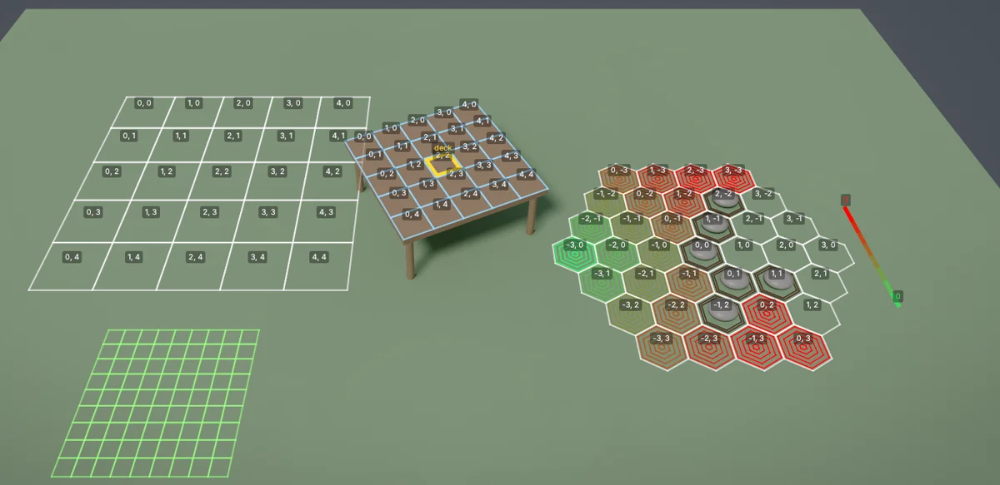
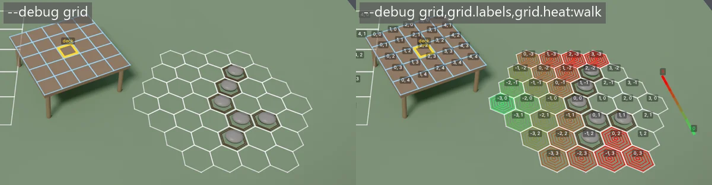

# Grids

Colony builders, city builders, dungeon crawlers and tactics games are built on grids.
Super has square and hex grids, with the maths every grid game needs. You can turn a
world position into a cell and pick a cell with the mouse. You can also find
neighbours, distances, lines, ranges and rings, and turn cells about each other. None
of it needs the renderer, so it runs the same in a headless test.

```csharp
var build = new SquareGrid(2f);                          // 2 m cells on level ground
var map = new HexGrid(1f, HexTop.Pointy);                // hexes 1 m from middle to corner

Cell under = build.CellAt(input.Mouse.Ray(camera)) ?? default;
Vector3 middle = build.Center(under);

foreach (Hex hex in Hex.Range(map.HexAt(player.Position), 2))
{
    // the 19 hexes within two steps of the player
}
```

A game can have as many grids as it needs. Each one has its own size and placement, so
a 2 m building grid can sit next to a 0.5 m farm grid, or each floor of a building can
have a grid at its own height. Going from one grid to another goes through the world:
take a cell's `Center` on one grid and find the cell at that point on the other.

## Cells and hexes

A `Cell` is a square on a `SquareGrid`. `X` is its column along the grid's X and `Z` is
its row along the grid's Z. Cell 0, 0 runs from the grid's origin to one cell size
along both, so its middle is half a cell in.

A `Hex` is a hexagon on a `HexGrid`, in axial coordinates, `Q` and `R`. The third cube
coordinate, `S`, is always `-Q - R`. These are the coordinates of the
[Red Blob Games hexagon guide](https://www.redblobgames.com/grids/hexagons/), which is
worth reading before writing hex code of your own. Hex 0, 0 has its middle at the
grid's origin.

Both are small structs that compare and hash by value, so they work as dictionary keys
and in sets. You can add and subtract them, so `cell + new Cell(1, 0)` is the cell
next along X.

`HexTop.Pointy`, the default, has a corner pointing along the grid's Z, so rows of
hexes run along X. `HexTop.Flat` has a side facing along Z, so columns of hexes run
along Z.

## From the world to a cell and back

| Square | Hex | What it gives |
| --- | --- | --- |
| `CellAt(position)` | `HexAt(position)` | The cell a world position lies over or under |
| `CellAt(ray)` | `HexAt(ray)` | The cell a ray meets the grid in, or null when it misses |
| `Center(cell)` | `Center(hex)` | The world position of a cell's middle, on the grid |
| `Corners(cell, span)` | `Corners(hex, span)` | The 4 or 6 corners in the world |

To pick with the mouse, pass `input.Mouse.Ray(camera)`. The answer is null when the ray
runs alongside the grid or points away from it. `Corners` writes into a span you give
it, so it doesn't allocate:

```csharp
Span<Vector3> corners = stackalloc Vector3[6];
map.Corners(hex, corners);
```

## Placing a grid

A grid lies flat on its own X and Z, on its `GridPlacement`: the point its origin is at
and how it is turned. Left out, the grid lies on level ground at the world's origin.

```csharp
var deck = new SquareGrid(1f, new GridPlacement(new Vector3(0f, 3f, 0f), shipRotation));
```

A grid can be raised, turned, tilted or stood up like a wall. `CellAt` and `HexAt` look
straight along the grid's own up, so a point above the grid finds the cell under it.
To make a grid follow something that moves, such as a ship's deck or a floating
island, set its `Placement` again each frame. The cells stay the same. Only where they
are in the world changes.

## Neighbours and distance

`Cell.Sides` holds the four steps to the cells that share a side, and `Cell.Around`
holds the eight that share a side or a corner. `Hex.Sides` holds a hex's six. Add one to
a cell to step there:

```csharp
foreach (Cell step in Cell.Sides)
{
    Cell next = here + step;
}
```

There are three ways to count the steps between two cells:

- `Cell.Manhattan(a, b)` counts the steps when you only move across sides, like a rook.
- `Cell.Chebyshev(a, b)` counts corners as steps too, like a king.
- `Hex.Distance(a, b)` counts the steps across hex sides.

## Lines, ranges, rings and spirals

`Line(from, to)` gives the cells a straight line from one middle to the other passes
nearest, from end to end. Each step is a neighbour, so a line has one more cell than
the distance. Use it for line of sight or to aim a shot along a row.

`Range(center, steps)` gives every cell within that many steps. For hexes it is a big
hexagon of 3n(n+1)+1 hexes. For squares it is a square, counting king's steps.
`Ring(center, steps)` gives only the cells exactly that far: 6n hexes or 8n squares,
going round in order. `Spiral(center, steps)` gives the same cells as `Range`, ring by
ring outwards from the centre. That is handy for finding the nearest free spot.

These return `IEnumerable`, so `foreach` over them, or call `.ToList()` to keep them.

## Turning

`Cell.Rotate(cell, around, quarterTurns)` turns a cell about another, and
`Hex.Rotate(hex, around, sixthTurns)` does the same in sixths of a turn. They turn the
same way as `Quaternion.CreateFromAxisAngle(Vector3.UnitY, angle)` with a positive
angle, so a building's cells and its model turn together. Negative turns go the other
way, and four quarter turns or six sixth turns come back to where they started.

## Mirroring

`Cell.Mirror(cell, around)` flips a cell across the column of another, so X runs the
other way, as a model scaled by −1 along X is. A hex's coordinates flip differently on
pointy and flat grids, so for hexes ask the grid: `map.Mirror(hex, around)`. Mirroring
twice gives the cell back.

## Offset coordinates

A hex map stored as a rectangle, such as one drawn in a tile editor or kept in a 2D
array, uses offset coordinates: a column and a row. `map.ToOffset(hex)` gives them, and
`map.FromOffset(column, row)` goes back. On a pointy grid every other row is pushed half
a hex along +X, and on a flat grid every other column is pushed half a hex along +Z.
`HexOffset.Odd`, the default, pushes rows or columns 1, 3, 5 and so on, and
`HexOffset.Even` pushes 0, 2, 4. These are the guide's odd-r, even-r, odd-q and even-q.
Do the maths in axial coordinates and only use offsets to store or show a hex.

## How far a unit can walk

`Reachable(start, budget, cost)` floods out from a cell and gives every cell a walk can
reach without spending more than the budget, with the least it costs to get there. It
suits a tactics unit's move range or how far a fire spreads. It isn't pathfinding, but
it finds the cost of the cheapest path to every cell it reaches.

```csharp
IReadOnlyDictionary<Hex, float> range = Hex.Reachable(unit, 5f, hex =>
    terrain.TryGet(hex, out var ground) ? ground.MoveCost : null);
```

The cost function says what stepping into a cell costs, or null where nothing can go,
such as a wall or water. The start costs nothing and is always in the answer. A cost
below 0 throws. `Cell.Reachable` steps across sides only. With `corners: true` it steps
across corners too, at the same cost, and can slip between two walls that meet at a
corner.

## Footprints

Something bigger than one cell, such as a 2 by 3 barn or a temple of three hexes, has a
`Footprint`: the cells it covers, measured from its own cell 0, 0. `Footprints.Rectangle(2, 3)`
makes a rectangle of squares, `Footprints.Hexagon(1)` makes a hex and its six
neighbours, and `Footprints.Of(...)` takes any cells.

```csharp
var barn = Footprints.Rectangle(2, 3);
bool fits = barn.Fits(under, turns, cell => !buildings.Contains(cell));
view.Model(key, barnModel, transform, new Ghost(fits ? Green : Red, 0.6f));
```

`Fits(at, turns, isFree)` turns the footprint round its cell 0, 0 the way `Rotate` does,
moves it to the cell, and asks `isFree` about each cell. `Placed(at, turns, span)`
writes the cells it covers into a span, so placing a ghost every frame allocates
nothing. `Mirrored(grid)` flips the footprint for a building drawn mirrored. Every turn
keeps the same number of cells.

## Keeping something in each cell

`GridMap<TCell, T>` keeps a value in each cell: a building's entity, a tile, a cost or
an owner. It has no edge, and cells below 0 work like any other.

```csharp
var buildings = new GridMap<Cell, Entity>();
buildings.Set(cell, barn);
if (buildings.TryGet(cell, out Entity there)) { ... }
buildings.Remove(cell);
```

Cells are kept in blocks of 16 by 16, called chunks. `Chunks` lists the ones that hold
anything, `InChunk(chunk)` walks one, and `ChunkVersion(chunk)` goes up whenever a cell
in it changes, so drawing code can rebuild only the chunks that changed. `Version` goes
up on any change. Walking the whole map with `foreach` gives each cell and its value,
in no promised order.

`GridMaps.ToJson(map)` saves a map, and `GridMaps.FromJson<Cell, T>(json)` loads it
back, for a save game or a level file. The file lists each cell, row by row, so it
reads well and changes little in a diff:

```json
{
  "cells": [
    { "at": [-3, 0], "value": { "name": "floor", "turns": 0 } },
    { "at": [4, 1], "value": { "name": "wall", "turns": 2 } }
  ]
}
```

Values are written with System.Text.Json, in camelCase unless you pass your own
options. A cell listed twice, or one whose `at` isn't two whole numbers, throws and
says which one. An entity's ID only means something while the game runs, so save what
the entity is, not the entity itself.

## Naming grids

The `Grids` service holds a game's grids by name, so any code can find one, and so the
mouse can find which grid it's over. Ask for it in a constructor:

```csharp
public sealed class MyGame(Grids grids, Input input, World world) : IGame
{
    public void Load()
    {
        grids.Add("build", new SquareGrid(2f));
        grids.Add("deck", deckGrid, cell => deck.Contains(cell));
    }

    public void Update(GameTime time)
    {
        if (world.ActiveCamera() is { } camera && grids.Under(input.Mouse.Ray(camera)) is { Name: "deck" } hit)
        {
            Cell cell = hit.Cell<Cell>();
        }
    }
}
```

`Under(ray)` gives the grid the ray meets first, where it met it and how far along the
ray. A grid's plane has no edge, so pass a third argument to `Add` saying which cells
the grid has, and `Under` looks past the rest. `Get<Cell>("build")` gives a grid back,
and throws when there's none by that name or its cells are hexes.

`SquareGrid` and `HexGrid` share `IGrid<TCell>`, so code that takes one works with
either. Through it a hex grid's `HexAt` is called `CellAt`.

## Floors

`LayeredGrid` repeats one grid at several heights, for the floors of a building or the
levels of a dungeon:

```csharp
var floors = new LayeredGrid<Cell>(new SquareGrid(1f), 0f, 3f, 6f);
var (floor, cell) = floors.CellAt(player.Position);
Vector3 stairsTop = floors[1].Center(stairs);
```

Each layer has the ground's cells and turn, raised along the ground's up, so setting
`Placement` moves every floor together. `LayerAt(position)` gives the highest floor at
or below a point. A point a centimetre under a floor still counts as on it, so feet
that sink a little don't drop a floor. To pick on one floor with the mouse, use that
layer's grid: `floors[current].CellAt(ray)`.

## Seeing a grid while you work

[Debug drawing](debugging.md) can draw a grid's cells, their coordinates and a number
for each cell, in channels you show and hide like any other debug shape:

```csharp
public void Draw(View view)
{
    view.Debug.Grid(buildGrid, new Cell(2, 2), 2);
    view.Debug.GridLabels(buildGrid, new Cell(2, 2), 2);
    view.Debug.GridHeat(field, default, 3, hex => cost.TryGetValue(hex, out float c) ? c : null,
        new HeatScale(0f, 5f), "grid.heat:walk");
    view.Debug.Cells(field, path, Color.Yellow, "path");
}
```

Each call draws the cells within some steps of a centre, a square of them on a square
grid and a big hexagon on a hex grid. `Grid` draws outlines in the `grid` channel,
`GridLabels` writes each cell's coordinates in `grid.labels`, and `GridHeat` colours
each cell by a number on a `HeatScale`, from `Cold` at its low end to `Hot` at its high
end, with a legend just past the area. Leave out the scale and it runs from the lowest
number in the area to the highest. Cells whose number is null or not a number are
left out. Name each heat map's channel, such as `grid.heat:walk`, so you can show one at
a time. `Cells` highlights any cells, such as a path, a footprint or the keys of a
`Reachable` answer, in the channel you give it.



Named channels start hidden. Show them with `DebugDraw.Show`, or from the command line
with `--debug grid,grid.labels,grid.heat:walk`. A hidden overlay costs only the check
of its channel, and a shown one allocates nothing once its labels have been seen.



The [Plots](../examples/Plots) example has a building grid, a farm grid, a raised and
turned deck and a hex field. The mouse picks a cell on whichever grid it's over, and G,
L and H show and hide the three channels.

Like the rest of debug drawing these are lines, so a heat map's colour is drawn as
rings inside each cell, not a solid fill.

## What's not here yet

- Overlays for players, such as a filled cell under the mouse or a build preview, which
  is issue #33.
- Tile maps of modular pieces on a grid, which is issue #32.
- `GridMap` has no dense form for small bounded maps. The chunked one does both.
- `Reachable` has no rule against cutting a corner past a wall when it steps across
  corners.
