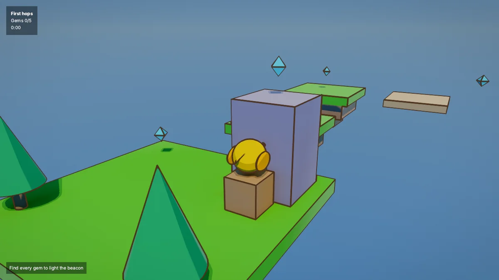
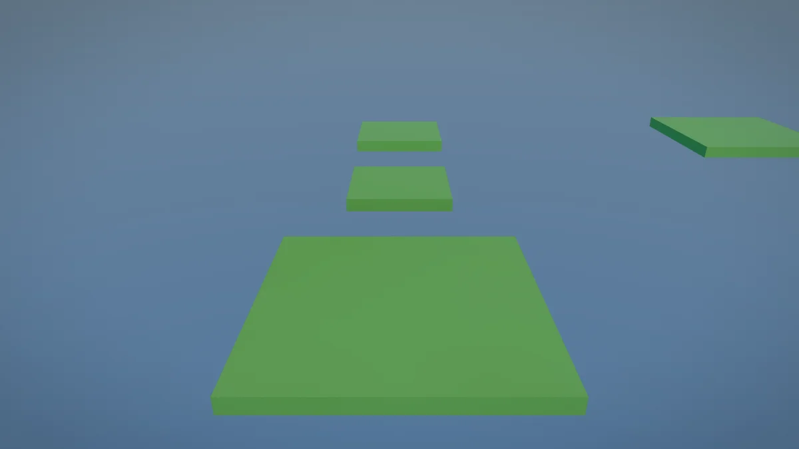
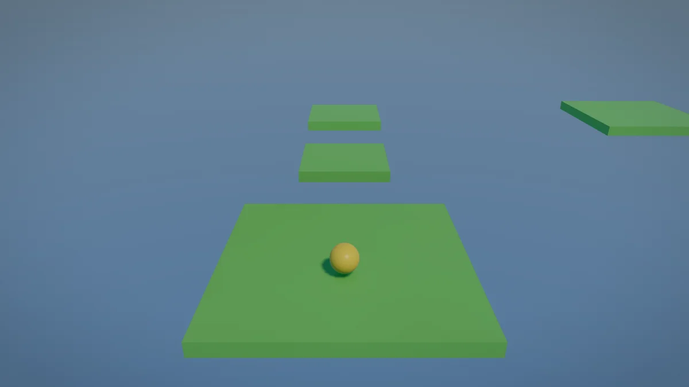
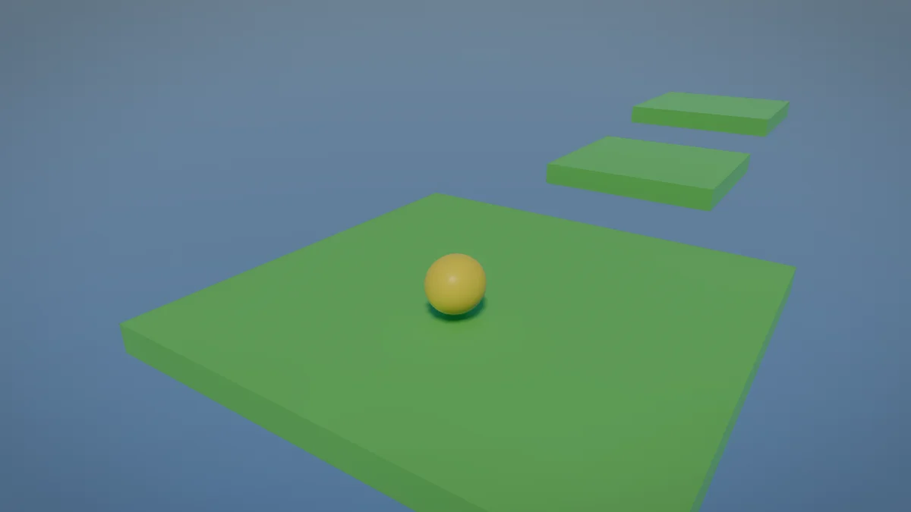
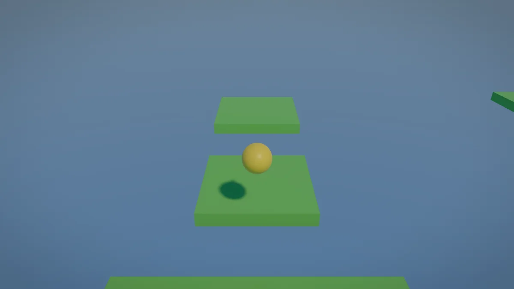
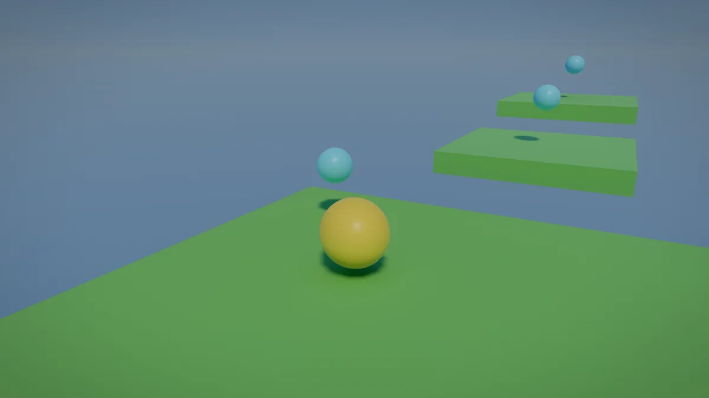
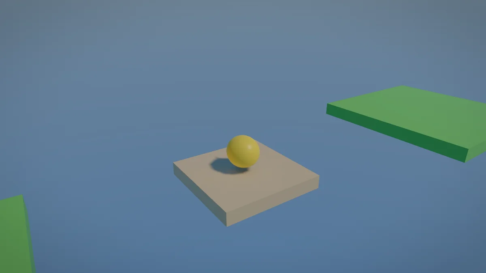
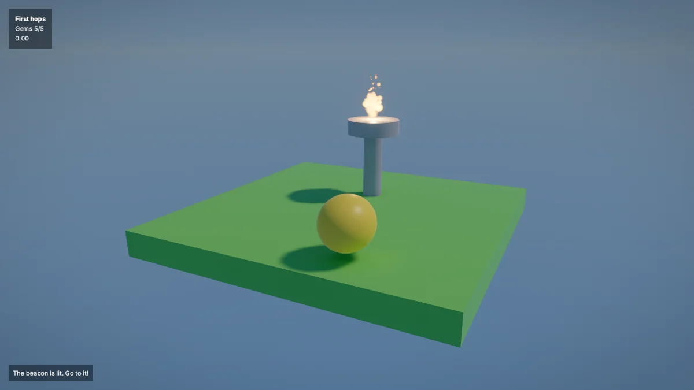
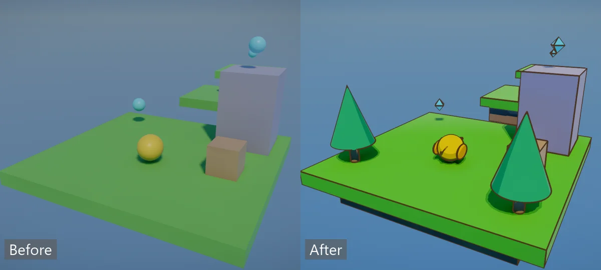

# Build a 3D platformer

In this guide we'll build Skylark, a small 3D platformer, from an empty folder to a game
with two levels, a title screen and a best time. You play a round yellow bird on a string
of islands in the sky. Hop between them, ride the lifts, push a crate to reach a high
ledge, and find every gem to light the beacon that takes you to the next level.

You'll need to know C#, but nothing about games or Super. Each chapter adds one piece and
ends with a game you can run, so you can stop at any point and still have something that
works. The whole thing takes an hour or two.

If you've done the [tower defense guide](tower-defense.md), the first chapter will feel
familiar. After that this one goes somewhere else: physics, a character you steer, a camera
that follows, and levels that follow each other. You don't need to have read it.

Everything is drawn with simple shapes that Super makes for you, so there's nothing to
download: no models, no textures, no sounds. The finished game is in
[examples/Skylark](../../examples/Skylark) if you'd like to peek ahead.



What you'll need:

- The .NET 10 SDK
- Windows with a GPU that supports Vulkan 1.3, or a Mac with Apple silicon

## 1. An island in the sky

Let's start with a new console app and add Super:

```
dotnet new console -n Skylark
cd Skylark
dotnet add package Super
```

Super is one NuGet package. It holds the engine, the renderer, the physics and the test
helpers, and it sets up the build for you, so there's nothing to add to the project file.

### The game

A Super game is a class that implements `IGame`. Its heart is `Update(GameTime time)`,
which runs a fixed number of times a second, 30 by default. Each run is called a tick. This
is where the game happens: the bird walks, lifts glide, gems get found.

What you see comes from the world. The world holds entities, and an entity is a handful of
small values called components: where it is, what model it is, what colour. Put an entity
with a `Transform` and a `Model` in the world and it's drawn, every frame, until you take
it out again. You never draw anything by hand.

That split matters more than anything else in Super. The game changes the world in
`Update`, and drawing only ever looks at it, so the game can run with no window at all,
which is how we'll test it later.

### A level is data

A platformer is mostly its levels, so let's write a level down as plain data, and have one
method that builds whatever level it's given. The data first. Make a file called
`Levels.cs`:

```csharp
using System.Numerics;

namespace SkylarkExample;

/// <summary>An island to stand on, given by the middle of its top.</summary>
public readonly record struct Island(Vector3 Top, float Width, float Depth, float Height = 0.5f);

/// <summary>Everything in one level.</summary>
public sealed record Level(string Name, Vector3 Start, Island[] Islands);

/// <summary>The levels, and which one is being played.</summary>
public sealed class Levels
{
    private static readonly Level FirstHops = new(
        "First hops",
        Start: new Vector3(0, 0, 1),
        Islands:
        [
            new Island(new Vector3(0, 0, 0), 8, 8),
            new Island(new Vector3(0, 0.6f, -8), 4, 4),
            new Island(new Vector3(0, 1.2f, -14), 4, 4),
            new Island(new Vector3(17, 1.2f, -14), 6, 6),
        ]);

    /// <summary>Every level, in the order they're played.</summary>
    public static IReadOnlyList<Level> All { get; } = [FirstHops];

    /// <summary>The level being played.</summary>
    public Level Current => All[0];
}
```

Super measures the world in metres, with y pointing up, so the ground is the x and z
plane. An `Island` is given by the middle of its top, because that's the part you stand on
and the number you'll care about when you decide how high a jump has to be. The first
island is 8 metres square at height 0. The next is 0.6 metres higher and its near edge is
2 metres away, and so on.

The colours get a file of their own, so they're easy to find and change. Colours in the 3D
world are `Vector3`s of red, green and blue. Make `Palette.cs`:

```csharp
using System.Numerics;

namespace SkylarkExample;

/// <summary>The colours Skylark is painted with, as red, green and blue.</summary>
public static class Palette
{
    public static readonly Vector3 Grass = new(0.3f, 0.62f, 0.18f);
}
```

### Building the scene

Now the method that turns a level into things you can see. Make `Scenery.cs`:

```csharp
using System.Numerics;
using Super;

namespace SkylarkExample;

/// <summary>Builds the level being played into a scene: the light, the islands and everything on them.</summary>
public sealed class Scenery(Levels levels)
{
    /// <summary>Spawns the level into a scene. Hand it to <c>scenes.Go</c>.</summary>
    public void Build(Scene scene)
    {
        var level = levels.Current;
        Light(scene);

        foreach (var island in level.Islands)
        {
            Island(scene, island);
        }

        scene.Spawn(new Camera(new Vector3(0, 8, 13), new Vector3(0, 0, -5)));
    }

    /// <summary>A warm sun with crisp shadows, and a blue sky all around.</summary>
    private static void Light(Scene scene)
    {
        scene.Spawn(
            new Sun(Direction: new Vector3(0.7f, 1.6f, 1.1f), Color: new Vector3(2.6f, 2.4f, 2.1f)),
            new Shadows(Radius: 40f, SunSize: 0.03f),
            new Sky(new SkySettings
            {
                Zenith = new Vector3(0.16f, 0.42f, 0.9f),
                Horizon = new Vector3(0.6f, 0.8f, 1f),
                Ground = new Vector3(0.3f, 0.55f, 0.95f),
                Brightness = 0.55f,
            }));
    }

    /// <summary>A slab of grass.</summary>
    private static void Island(Scene scene, Island island)
    {
        var slab = new Transform(
            island.Top - new Vector3(0f, island.Height / 2f, 0f),
            Quaternion.Identity,
            new Vector3(island.Width, island.Height, island.Depth));
        scene.Spawn(slab, new Model(ModelRef.Cube, Palette.Grass));
    }
}
```

There's a lot packed in here, so let's go through it.

`Scenery` asks for `Levels` in its constructor, so it can find the level being played.
We'll see how it gets one in a moment.

`Build` takes a `Scene`. A scene is a group of entities that come and go together: when
the game goes to another scene, or builds this one again, everything spawned into it is
taken away first. That's exactly what a level is, and we'll lean on it in chapter 7 to
move to the next level.

The sun gives the light, `Shadows` says how far around the camera shadows are drawn, and
the sky gives a soft blue light from all around. They share one entity, since a component
only says one thing. The sun's colour is light, not paint, so it can go past 1 to be
bright. The sky's `Ground` colour
is what you see when you look down. Ours is blue, because there's only more sky down there.

Each island is an entity with two components. Its `Transform` says where it is and how
it's stretched into a slab, and its `Model` says it's a `ModelRef.Cube`, coloured green.
`ModelRef.Cube` is one of Super's [built-in shapes](../rendering.md#built-in-shapes), a
1 metre cube, so a scale of 8 by 0.5 by 8 makes a slab that size. A `Transform` is the
middle of the thing, which is why the slab sits half its height below its top.

The camera is an entity too. It sits 8 metres up and 13 back, looking at a spot a little
past the first island. It'll do until chapter 3.

See [The world](../ecs.md) for more on entities and components.

Now the game itself. Make `SkylarkGame.cs`:

```csharp
using Super;

namespace SkylarkExample;

public sealed class SkylarkGame(Scenery scenery, Scenes scenes) : IGame
{
    public void Load()
    {
        scenes.Go(scenery.Build);
    }

    public void Update(GameTime time)
    {
    }
}
```

`Load` runs once, before the first tick. It asks `Scenes` to go to a scene built by
`scenery.Build`.

### Asking for what you need

`SkylarkGame` takes `Scenery` and `Scenes` in its constructor, and `Scenery` takes
`Levels`. Super makes the game for you, and gives each class whatever its constructor asks
for, using the same dependency injection as ASP.NET. `Scenes` is Super's own, but `Levels`
and `Scenery` are ours, so we tell it about our classes once. Make `SkylarkServices.cs`:

```csharp
using Microsoft.Extensions.DependencyInjection;

namespace SkylarkExample;

public static class SkylarkServices
{
    /// <summary>Everything the game asks for. Program.cs and the tests both call this.</summary>
    public static IServiceCollection AddSkylark(this IServiceCollection services) => services
        .AddSingleton<Levels>()
        .AddSingleton<Scenery>();
}
```

Keeping the list in one method means the tests in chapter 9 can use it too. Each new class
in this guide gets one more `AddSingleton` line here.

### Starting it

Last, replace everything in `Program.cs` with:

```csharp
using SkylarkExample;
using Super;

Game.StartWindowsGameLoop<SkylarkGame>(
    new GameOptions { Title = "Skylark", Id = "skylark", Width = 1280, Height = 720 },
    services => services.AddSkylark());
```

`StartWindowsGameLoop` opens a window and runs the game until you close it. Despite the
name, it works on a Mac too. The `Id` names the folder the game keeps its saved files in,
which we'll use in chapter 7. Run it:

```
dotnet run -c Release
```



Four islands in the sky, and nobody on them yet.

The game in the repository references the engine's projects instead of the NuGet package,
so it builds against the latest code. That's the only difference from yours.

## 2. A bird that walks

A platformer needs solid ground and something that can stand on it. Both come from
physics.

### Turning physics on

Physics is a set of services you add next to your own. In `SkylarkServices.cs`:

```csharp
using Microsoft.Extensions.DependencyInjection;
using Super.Physics;

namespace SkylarkExample;

public static class SkylarkServices
{
    public static IServiceCollection AddSkylark(this IServiceCollection services) => services
        .AddSuperPhysics()
        .AddSingleton<Levels>()
        .AddSingleton<Scenery>()
        .AddSingleton<Bird>();
}
```

We'll write `Bird` in a moment.

### Solid ground

So far an island is only a picture. To make it solid, give it a `Collider`, which is its
shape as far as physics cares, and a `Body`, which says how it moves. Add
`using Super.Physics;` to the top of `Scenery.cs` and change the last line of `Island`:

```csharp
scene.Spawn(slab, new Model(ModelRef.Cube, Palette.Grass), Collider.Box(Vector3.One), Body.Static);
```

`Body.Static` means it never moves. The box is 1 metre each way, and like the model it's
stretched by the transform's scale, so the solid part is the same slab you see.

### What the bird is

Game-specific facts about an entity go in components of your own. A component is a struct,
and a `record struct` keeps it short. Make `Components.cs`:

```csharp
using System.Numerics;

namespace SkylarkExample;

/// <summary>The bird the player hops around as.</summary>
/// <param name="Velocity">How fast it moves, kept from tick to tick so it can fall.</param>
public record struct Hero(Vector3 Velocity);
```

Now spawn the bird. In `Palette.cs`, add two colours under `Grass`:

```csharp
public static readonly Vector3 Feathers = new(1f, 0.72f, 0.15f);
public static readonly Vector3 Beak = new(0.95f, 0.5f, 0.2f);
```

Then add these two methods at the bottom of `Scenery`, and a call to
`Bird(scene, level.Start);` in `Build`, after the islands:

```csharp
/// <summary>The bird: a capsule that walks, with its body and beak riding along as children.</summary>
private static void Bird(Scene scene, Vector3 start)
{
    var bird = scene.Spawn(
        Transform.Facing(start, -Vector3.UnitZ),
        Collider.Capsule(height: 1.1f, radius: 0.4f),
        new Character(),
        new Hero(Vector3.Zero));

    // A cone points up, so tip it forward for the beak. The bird faces +z.
    var straight = Quaternion.Identity;
    var forward = Quaternion.CreateFromAxisAngle(Vector3.UnitX, MathF.PI / 2f);
    Part(scene, bird, new Transform(new Vector3(0, 0.55f, 0), straight, new Vector3(0.9f, 0.9f, 1f)), ModelRef.Sphere, Palette.Feathers);
    Part(scene, bird, new Transform(new Vector3(0, 0.6f, 0.55f), forward, new Vector3(0.25f, 0.3f, 0.25f)), ModelRef.Cone, Palette.Beak);
}

/// <summary>One piece of the bird. Its place is measured from the bird's feet.</summary>
private static void Part(Scene scene, Entity bird, Transform place, ModelRef shape, Vector3 color) =>
    scene.Spawn(new Parent(bird), place, new Model(shape, color));
```

The bird itself has no model at all. It's a capsule, a pill shape 1.1 metres tall, with a
`Character` component. A character is a body you move yourself: you say which way it wants
to go, and physics slides it along the ground and stops it at walls. Its `Transform` is at
its feet, so starting it at the island's top stands it on the island.

What you see are two more entities, a sphere and a cone, each with a `Parent`. A child's
`Transform` is measured from its parent, so the body sits 0.55 metres above the feet and
the beak sticks out in front, and both follow wherever the capsule goes. Keeping the look
in children means you can add a tail and wings later without touching how the bird moves.

`Transform.Facing(start, -Vector3.UnitZ)` puts the bird at the start, looking away from
the camera.

### What the player can do

Super doesn't want your game to ask "is W down?". Name the things a player can do, and
bind keys to them in one place. Make `Controls.cs`:

```csharp
namespace SkylarkExample;

/// <summary>Everything the player can do. Which key, button or stick does it is set in SkylarkGame.Load.</summary>
public enum Control
{
    Move,
}
```

### Walking

Something that runs every tick over a kind of entity is a system. Make `Bird.cs`:

```csharp
using System.Numerics;
using Super;
using Super.Physics;

namespace SkylarkExample;

/// <summary>Walks the bird.</summary>
public sealed class Bird(World world, Physics physics, Actions<Control> actions) : ISystem
{
    public const float Speed = 6f;
    public const float Gravity = 24f;

    public void Update(GameTime time)
    {
        float seconds = time.DeltaSeconds;

        foreach (var row in world.Query<Hero, Transform>())
        {
            ref var hero = ref row.First;
            var stick = actions.Vector(Control.Move);
            var walk = new Vector3(stick.X, 0f, -stick.Y) * Speed;
            var velocity = new Vector3(walk.X, hero.Velocity.Y - Gravity * seconds, walk.Z);

            var move = physics.Characters.Move(row.Entity, velocity, seconds);
            hero.Velocity = move.Velocity;
            if (move.Grounded)
            {
                hero.Velocity = hero.Velocity with { Y = 0f };
            }

            if (walk.LengthSquared() > 0.01f)
            {
                row.Second.Rotation = Transform.Facing(Vector3.Zero, walk).Rotation;
            }
        }
    }
}
```

`world.Query<Hero, Transform>()` gives every entity that has both components. There's only
one bird, but writing it as a loop costs nothing, and it'd work for two. `row.First` is the
`Hero` and `row.Second` the `Transform`, and both are the real thing, not copies, so
changing them changes the entity.

`actions.Vector(Control.Move)` is the move stick, from -1 to 1 each way. Up on the stick
is away from the camera, which for now means towards -z.

Then comes the one line that does the work. `physics.Characters.Move` takes the speed you'd
like and moves the character as far as it can go this tick. It gives back a `CharacterMove`
that says what speed it really ended up with and whether it's standing on something.

Nothing falls unless you say so. A character has no gravity of its own, so each tick we
take 24 metres a second off its upward speed, and when it lands we set that speed back to
zero. That's stronger than real gravity, which is 9.8. Platformers nearly always do this,
because real gravity makes a jump feel like floating.

Notice `hero.Velocity with { Y = 0f }`. A component is a struct, and C# won't let you set
one part of a struct that comes out of a property, so you make a changed copy with `with`
and put it back.

The last part turns the bird to face the way it walks.

### Wiring it up

Change `SkylarkGame.cs` to bind the keys and run the system:

```csharp
using Super;

namespace SkylarkExample;

public sealed class SkylarkGame(Scenery scenery, Scenes scenes, Systems systems, Actions<Control> actions) : IGame
{
    private readonly Systems _systems = systems.Add<Bird>();

    public void Load()
    {
        actions.Bind(Control.Move, Keys.WASD, Keys.Arrows, GamepadStick.Left);
        scenes.Go(scenery.Build);
    }

    public void Update(GameTime time)
    {
        _systems.Update(time);
    }
}
```

`Systems` runs your systems in the order you add them. One `Bind` line gives the player
WASD, the arrow keys and a gamepad's left stick. Run it and walk around:



Walk off the edge and the bird falls for ever. We'll catch it in chapter 4. First, the
camera. See [Physics](../physics.md) and [Input](../input.md) for more.

## 3. A camera that follows

The camera stays put while the bird walks away from it. A platformer wants a camera that
stays behind the player and that the player can turn. Super has one ready, the
`BoomCamera`: a camera on the end of an arm, with the other end fixed to what you follow.

### The camera rig

Make `Chase.cs`:

```csharp
using System.Numerics;
using Super;

namespace SkylarkExample;

/// <summary>The camera, on an arm behind the bird, turned with the mouse or the right stick.</summary>
public sealed class Chase(World world, Actions<Control> actions)
{
    private readonly BoomCamera _boom = new() { Length = 10f, Pitch = 0.45f, Pivot = new Vector3(0f, 1f, 0f) };
    private Entity _camera;

    /// <summary>Spawns the camera into a scene, behind <paramref name="target"/>.</summary>
    public void Build(Scene scene, Vector3 target)
    {
        _boom.Yaw = 0f;
        _boom.Pitch = 0.45f;
        _boom.Jump();
        _boom.Update(target, 0f);
        _camera = scene.Spawn(_boom.Current);
    }

    /// <summary>Turns the move stick into a direction on the ground, so up on the stick is away from the camera.</summary>
    public Vector3 Walk(Vector2 stick) => _boom.Walk(stick);

    /// <summary>Stops the camera sliding after the bird when it's put back home.</summary>
    public void Jump() => _boom.Jump();

    /// <summary>Turns the arm and follows the target. Call it once a tick, after the bird has moved.</summary>
    public void Update(Vector3 target, GameTime time)
    {
        _boom.Turn(actions.Vector(Control.Look));
        _boom.Update(target, time.TickSeconds);
        world.Get<Camera>(_camera) = _boom.Current;
    }
}
```

The arm is 10 metres long and tipped up by 0.45 radians, about 25 degrees, and it's fixed
1 metre above the bird's feet. `Yaw` is how far round the bird it has swung.

A `BoomCamera` isn't an entity. It works out where the camera should be, and `Current` is
the answer as a `Camera`. So `Build` spawns a camera entity and remembers it, and `Update`
writes the newest answer into it each tick. `world.Get<Camera>(entity)` hands back the
component itself, so you can assign straight to it.

The camera eases after the bird, which looks good while walking and wrong when the bird is
suddenly somewhere else. `Jump` tells it to go straight there next time.

`Walk` is the handy part. It turns the stick into a direction on the ground as the camera
sees it, so pushing up always walks away from the camera, however it's turned.

### Using it

Add the control to `Controls.cs`:

```csharp
public enum Control
{
    Move,
    Look,
}
```

`Scenery` needs the rig to put the camera in the scene, so ask for it in the constructor:

```csharp
public sealed class Scenery(Levels levels, Chase chase)
```

In `Build`, replace the line that spawned the camera:

```csharp
chase.Build(scene, level.Start);
```

`Bird` asks for it too, walks the way the camera says, and updates the camera once it has
moved:

```csharp
public sealed class Bird(World world, Physics physics, Actions<Control> actions, Chase chase) : ISystem
```

```csharp
var walk = chase.Walk(actions.Vector(Control.Move)) * Speed;
```

And at the end of the loop, after the bird has turned:

```csharp
chase.Update(world.Get<Transform>(row.Entity).Position, time);
```

In `SkylarkGame.cs`, ask for `Input input` in the constructor, and add two lines to `Load`:

```csharp
actions.Bind(Control.Look, Binding.MouseDelta.Scaled(0.005f), GamepadStick.Right);
input.Mouse.Locked = true;
```

`Binding.MouseDelta` is how far the mouse moved, in pixels, so we scale it down to a
gentle turn. Locking the mouse hides the pointer and keeps it in the window, the way
every third-person game does. Add `.AddSingleton<Chase>()` to `AddSkylark` and run it:



Move the mouse and the camera swings round the bird. Hold W and the bird walks wherever
the camera is looking. See [Cameras](../cameras.md) for the other rigs.

## 4. Jumping and falling

The second island is 2 metres away and a little higher. Time to jump.

### A jump

Add `Jump` to the `Control` enum, and bind it in `Load`:

```csharp
actions.Bind(Control.Jump, Key.Space, GamepadButton.South);
```

A jump is only an upward speed. Gravity is already pulling it back down each tick, so it
rises, slows, and falls on its own. In `Bird.cs`, add the speed next to the others:

```csharp
public const float JumpSpeed = 9.5f;
```

`Update` is getting long, so the jump gets a method of its own. Add it under `Update`:

```csharp
/// <summary>Starts a jump when the button is pressed, and cuts one short when it's let go.</summary>
private Vector3 Jump(ref Hero hero, Vector3 velocity)
{
    if (actions.Pressed(Control.Jump) && hero.AirTime <= Forgiveness)
    {
        hero.AirTime = Forgiveness + 1f;
        return velocity with { Y = JumpSpeed };
    }

    if (actions.Released(Control.Jump) && velocity.Y > 0f)
    {
        // Letting go early makes a short hop.
        return velocity with { Y = velocity.Y * 0.5f };
    }

    return velocity;
}
```

and pass the velocity through it in `Update`:

```csharp
var velocity = Jump(ref hero, new Vector3(walk.X, hero.Velocity.Y - Gravity * seconds, walk.Z));
```

`ref Hero hero` hands the method the bird's real component, not a copy, so what it changes
stays changed.

At 9.5 metres a second against a gravity of 24, the bird rises about 2 metres. That number
decides your whole level: a ledge 1.5 metres up is easy, and one 3 metres up can't be
reached.

There are two small kindnesses in there, and nearly every platformer you've enjoyed has
both.

The first is forgiveness. Players press jump a moment after they've run off the edge, all
the time, and a game that says "too late" feels broken. So we don't ask "is the bird on
the ground?". We ask "was it on the ground in the last 0.12 seconds?". Setting `AirTime`
past the limit when it jumps stops it jumping twice.

The second is the short hop. Letting go of the button early halves the upward speed, so a
tap is a small hop and a hold is a full jump.

`AirTime` is a new fact about the bird, so it goes in the component. While we're there,
let's also remember where to put it back after a fall. In `Components.cs`:

```csharp
/// <summary>The bird the player hops around as.</summary>
/// <param name="Velocity">How fast it moves, kept from tick to tick so it can fall and jump.</param>
/// <param name="AirTime">Seconds since it last stood on something.</param>
/// <param name="Home">Where it goes back to after a fall.</param>
public record struct Hero(Vector3 Velocity, float AirTime, Vector3 Home);
```

and where the bird is spawned in `Scenery.cs`:

```csharp
new Hero(Vector3.Zero, 0f, start));
```

Back in `Bird.cs`, add the limit:

```csharp
/// <summary>A jump still works this long after walking off an edge, so a late press isn't punished.</summary>
public const float Forgiveness = 0.12f;
```

Landing gets a method too, which keeps the time up to date:

```csharp
/// <summary>Keeps count of how long the bird has been in the air, and stops it falling once it lands.</summary>
private static void Land(ref Hero hero, bool grounded, float seconds)
{
    if (grounded)
    {
        hero.AirTime = 0f;
        hero.Velocity = hero.Velocity with { Y = 0f };
    }
    else
    {
        hero.AirTime += seconds;
    }
}
```

In `Update`, it replaces the `if (move.Grounded)` block:

```csharp
var move = physics.Characters.Move(row.Entity, velocity, seconds);
hero.Velocity = move.Velocity;
Land(ref hero, move.Grounded, seconds);
```

### Falling off

When the bird drops far enough below where the level starts, put it back. Let's count the
falls too, in a small class that will hold everything about how the player is doing. Make
`Journey.cs`:

```csharp
namespace SkylarkExample;

/// <summary>How the player is doing.</summary>
public sealed class Journey
{
    /// <summary>How many times the bird fell off.</summary>
    public int Falls { get; set; }
}
```

Add `.AddSingleton<Journey>()` to `AddSkylark`. In `Levels.cs`, say how far is too far:

```csharp
/// <summary>Fall this far below where a level starts and the bird goes back home.</summary>
public const float FallDepth = 8f;
```

`Bird` now asks for `Journey journey` and `Levels levels` as well. Work out the floor at
the top of `Update`:

```csharp
float floor = levels.Current.Start.Y - Levels.FallDepth;
```

and check it in the loop, before the camera update:

```csharp
if (row.Second.Position.Y < floor)
{
    world.Teleport(row.Entity, row.Second with { Position = hero.Home });
    hero.Velocity = Vector3.Zero;
    journey.Falls++;
    chase.Jump();
}
```

`world.Teleport` is how you move something that physics owns. Writing a new position into
a body's `Transform` would push whatever is in the way, as if it had flown there.
`Teleport` says "it's simply here now".

### A script for screenshots

It'd be good to see a jump without playing. A game can carry input scripts, small recorded
bits of play that you can run from the command line. Add this to `SkylarkGame`:

```csharp
public IReadOnlyDictionary<string, InputScript> Scripts => new Dictionary<string, InputScript>
{
    // Walks to the edge and hops to the next island: --script hop
    ["hop"] = new InputScript().Hold(Key.W).Wait(22).Hold(Key.Space).Wait(20).Release(Key.Space).Release(Key.W),
};
```

Then this plays 38 ticks of it and saves a picture, with no window:

```
dotnet run -c Release -- --screenshot hop.png --script hop --ticks 38 --size 1280x720
```



Now run the game properly and hop your way up the three islands. The fourth is 13 metres
off to the right, far too far to jump. We'll build a way across in chapter 6.

## 5. Gems

A level needs something to find. Let's hang gems over the islands and collect them by
walking into them.

### Areas that notice

A gem shouldn't be solid, or the bird would bump into it. What we want is an area that
notices when something enters it. In Super that's a collider with a `Trigger` component:
it blocks nothing, and physics tells you who walked in.

Add the component to `Components.cs`:

```csharp
/// <summary>A gem to collect, hovering around a height.</summary>
public record struct Gem(float Height);
```

Give `Level` a list of where the gems are, by the spot on the ground under each:

```csharp
public sealed record Level(string Name, Vector3 Start, Island[] Islands, Vector3[] Gems);
```

and add them to the level, after the islands:

```csharp
Gems: [new Vector3(-2.5f, 0, -2.5f), new Vector3(0, 0.6f, -8), new Vector3(0, 1.2f, -14)],
```

Give them a colour in `Palette.cs`:

```csharp
public static readonly Vector3 Jewel = new(0.35f, 0.85f, 0.95f);
```

Then a method in `Scenery` that spawns one:

```csharp
/// <summary>A gem hovering a metre over a spot on the ground.</summary>
private static void Gem(Scene scene, Vector3 spot)
{
    // Gems need a Trigger, and the game says so once with Require, so it isn't listed here.
    float height = spot.Y + 1f;
    scene.Spawn(Transform.At(spot with { Y = height }, 0.6f), new Model(ModelRef.Sphere, Palette.Jewel), Collider.Ball(1f), new Gem(height));
}
```

and a loop in `Build` that calls it, after the islands:

```csharp
foreach (var spot in level.Gems)
{
    Gem(scene, spot);
}
```

Each gem hovers a metre off the ground. `Transform.At(position, 0.6f)` is a place and a
scale, with no turn. The ball collider is bigger than the gem you see, so the player
doesn't have to be exact.

The comment mentions `Require`. `Spawn` takes up to four components, and a gem would need
a fifth, the `Trigger`. More to the point, a gem without a trigger is always a mistake. So
say it once, in `SkylarkGame.Load`, before the scene is built:

```csharp
// A gem is an area that notices who walks in, so every gem gets a Trigger without asking.
world.Require<Gem, Trigger>(new Trigger());
```

That needs `World world` in the constructor and `using Super.Physics;` at the top. From
now on, anything spawned with a `Gem` gets a `Trigger` too.

### Collecting them

Add a count to `Journey`:

```csharp
/// <summary>Gems found on this level.</summary>
public int Gems { get; set; }
```

Then a system for the gems. Make `Gems.cs`:

```csharp
using System.Numerics;
using Super;
using Super.Physics;

namespace SkylarkExample;

/// <summary>Spins the gems and collects the ones the bird touches.</summary>
public sealed class Gems(World world, Physics physics, Journey journey) : ISystem
{
    public void Update(GameTime time)
    {
        Spin(time);
        Collect();
    }

    /// <summary>Turns each gem and bobs it up and down.</summary>
    private void Spin(GameTime time)
    {
        float turn = (float)time.TotalSeconds;
        foreach (var row in world.Query<Gem, Transform>())
        {
            row.Second.Rotation = Quaternion.CreateFromAxisAngle(Vector3.UnitY, turn * 2f);
            row.Second.Position = row.Second.Position with { Y = row.First.Height + MathF.Sin(turn * 3f + row.Second.Position.X) * 0.12f };
        }
    }

    /// <summary>Takes the gems the bird walked into.</summary>
    private void Collect()
    {
        // Everything that walked into an area this tick. Keep the pairs that are a gem and the bird.
        foreach (var touch in physics.Triggers.Entered)
        {
            if (world.Has<Gem>(touch.Trigger) && world.Has<Hero>(touch.Other))
            {
                world.Destroy(touch.Trigger);
                journey.Gems++;
            }
        }
    }
}
```

`Spin` turns each gem and bobs it up and down. Adding the gem's x position inside
the sine puts them out of step with each other, which looks livelier than a row of gems
moving as one.

`physics.Triggers.Entered` lists every pair that met this tick: the area, and what walked
into it. It lists every trigger in the game, so we keep only the pairs we care about with
`world.Has`. Destroying the gem takes away its model and its area in one go.

Add `.AddSingleton<Gems>()` to `AddSkylark`, and run the system after the bird in
`SkylarkGame`:

```csharp
private readonly Systems _systems = systems.Add<Bird>().Add<Gems>();
```



Walk into a gem and it's gone. They're plain balls for now. They'll be cut gems in
chapter 8, and chapter 7 will put the count on screen.

## 6. Lifts and a crate

Two classic platformer toys: a platform that carries you over a gap, and a crate you push
to reach somewhere too high to jump to. They show the two other ways a body can move.

### A lift

A lift goes where it's told and can't be pushed. That's a kinematic body, and in Super you
get one by giving an entity a collider and no `Body` at all: it sits wherever its
`Transform` says, and things bump into it.

To glide it there and back we'll use a tween, a value that moves from one thing to another
over time. Add this to `Components.cs`, with `using Super;` at the top:

```csharp
/// <summary>A platform that glides between two places, there and back.</summary>
public struct Lift(TweenValue<Vector3> path)
{
    /// <summary>Where it is along its way. A field, so a query can update the tween itself and not a copy.</summary>
    public TweenValue<Vector3> Path = path;

    /// <summary>How fast it moved this tick, for whoever is standing on it.</summary>
    public Vector3 Velocity;
}
```

This one is a plain struct with fields, not a record. A tween keeps its own time inside
it, and updating it through a property would update a copy.

In `Levels.cs`, describe a lift's path, and give `Level` a list of them. We'll add the
crates now too:

```csharp
/// <summary>A platform's two ends, by the middle of its top, and the seconds it takes one way.</summary>
public readonly record struct LiftPath(Vector3 From, Vector3 To, float Seconds);

public sealed record Level(string Name, Vector3 Start, Island[] Islands, LiftPath[] Lifts, Vector3[] Gems, Vector3[] Crates);
```

One lift crosses the gap to the far island, and there's a gem in the air over its path:

```csharp
Lifts: [new LiftPath(new Vector3(4.5f, 1.2f, -14), new Vector3(11.5f, 1.2f, -14), 3f)],
Gems:
[
    new Vector3(-2.5f, 0, -2.5f), new Vector3(0, 0.6f, -8), new Vector3(0, 1.2f, -14),
    new Vector3(8, 1.4f, -14),
],
```

A colour for the planks goes in `Palette.cs`:

```csharp
public static readonly Vector3 Plank = new(0.8f, 0.62f, 0.4f);
```

and `Scenery` gets a method that spawns a lift:

```csharp
/// <summary>A wooden platform that glides between the two ends of its path.</summary>
private static void Lift(Scene scene, LiftPath path)
{
    // No Body makes it kinematic: it goes where its Transform says.
    var size = new Vector3(3f, 0.4f, 3f);
    var middle = new Vector3(0f, size.Y / 2f, 0f);
    var glide = Tween.Between(path.From - middle, path.To - middle, path.Seconds, Easing.SineInOut).Yoyo();
    scene.Spawn(new Transform(path.From - middle, Quaternion.Identity, size), new Model(ModelRef.Cube, Palette.Plank), Collider.Box(Vector3.One), new Lift(glide));
}
```

Call it from `Build`, the same way as the gems:

```csharp
foreach (var path in level.Lifts)
{
    Lift(scene, path);
}
```

`Tween.Between` goes from one place to the other in 3 seconds. `Easing.SineInOut` starts
and stops it gently, and `Yoyo` sends it back again, for ever.

The system that moves them is short. Make `Lifts.cs`:

```csharp
using System.Numerics;
using Super;

namespace SkylarkExample;

/// <summary>Glides every lift along its path, and notes how fast each went.</summary>
public sealed class Lifts(World world) : ISystem
{
    public void Update(GameTime time)
    {
        foreach (var row in world.Query<Lift, Transform>())
        {
            ref var lift = ref row.First;
            lift.Path.Update(time);

            var next = lift.Path.Value;
            lift.Velocity = time.DeltaSeconds > 0f ? (next - row.Second.Position) / time.DeltaSeconds : Vector3.Zero;
            row.Second.Position = next;
        }
    }
}
```

### Riding it

If you ran the game now and jumped on the lift, it would slide out from under the bird. A
character only goes where you move it, and nothing has told it to move with the floor.

`CharacterMove` says what the character is standing on, so we can fix that ourselves:
remember the ground, and next tick add that ground's speed to the walk. That's why the
lift keeps its `Velocity`. Add one more thing to remember to `Hero`:

```csharp
public record struct Hero(Vector3 Velocity, float AirTime, Vector3 Home, Entity? Ground = null);
```

In `Bird.cs`, add a method that finds the speed of the lift under the bird:

```csharp
/// <summary>How fast the lift under the bird is moving. A character isn't carried by what it stands on.</summary>
private Vector3 Ride(Hero hero) =>
    hero.Ground is { } ground && world.IsAlive(ground) && world.Has<Lift>(ground) ? world.Get<Lift>(ground).Velocity : Vector3.Zero;
```

and use it in `Update`, around `Characters.Move`:

```csharp
var ride = Ride(hero);

var move = physics.Characters.Move(row.Entity, velocity + ride, seconds);
hero.Velocity = move.Velocity - ride;
hero.Ground = move.Ground;
Land(ref hero, move.Grounded, seconds);
```

We take the lift's speed back off afterwards, so the bird's own speed stays its own. The
lifts have to move before the bird does, so they go first:

```csharp
private readonly Systems _systems = systems.Add<Lifts>().Add<Bird>().Add<Gems>();
```

Add `.AddSingleton<Lifts>()` to `AddSkylark`.

### A crate and a rock

Now the third kind of body. A crate should fall, slide and be pushed, so physics moves it:
that's `Body.Dynamic`. Let's also give it a reason to exist, a gem on a rock too tall to
jump onto.

The rock is only a tall island. Add it to the level's islands, with a gem on top, and a
crate standing nearby:

```csharp
new Island(new Vector3(2.5f, 2.9f, -2.5f), 2, 2, Height: 2.9f),
```

```csharp
Gems:
[
    new Vector3(-2.5f, 0, -2.5f), new Vector3(2.5f, 2.9f, -2.5f), new Vector3(0, 0.6f, -8),
    new Vector3(0, 1.2f, -14), new Vector3(8, 1.4f, -14),
],
Crates: [new Vector3(2.5f, 0, 0.5f)],
```

The rock's top is 2.9 metres up. The bird's jump is about 2 metres, and a character steps
up small ledges by itself, which adds a little. From the ground that isn't enough. From on
top of a 1 metre crate, it is.

Two more colours for `Palette.cs`, one for rock and one for the crate:

```csharp
public static readonly Vector3 Rock = new(0.5f, 0.47f, 0.55f);
public static readonly Vector3 Wood = new(0.62f, 0.44f, 0.28f);
```

Tall islands get the rock colour. In `Island`:

```csharp
bool rock = island.Height > 0.5f;
scene.Spawn(slab, new Model(ModelRef.Cube, rock ? Palette.Rock : Palette.Grass), Collider.Box(Vector3.One), Body.Static);
```

A crate remembers where it started, so we can put it back when it's pushed off the edge:

```csharp
/// <summary>A crate to push about, and where it goes back to after falling off.</summary>
public record struct Crate(Vector3 Home);
```

And in `Scenery`, with a loop over `level.Crates` in `Build` like the others:

```csharp
/// <summary>A crate to push, standing on a spot on the ground.</summary>
private static void Crate(Scene scene, Vector3 spot)
{
    var home = spot + new Vector3(0f, 0.5f, 0f);
    var crate = scene.Spawn(Transform.At(home), new Model(ModelRef.Cube, Palette.Wood), Collider.Box(Vector3.One), Body.Dynamic(mass: 15f, friction: 0.8f));
    scene.World.Add(crate, new Crate(home));
}
```

Here's the fifth component again. This time it isn't something every crate could be given
blindly, since each has its own home, so we spawn the first four and `Add` the last.

There's no code for pushing. The character walks into the crate, and physics shoves it. A
mass of 15 kilograms makes it move without flying off, and the friction stops it sliding
like ice.

One more small system brings a lost crate home. Make `Crates.cs`:

```csharp
using System.Numerics;
using Super;
using Super.Physics;

namespace SkylarkExample;

/// <summary>Puts a crate that fell off back where it started, standing still.</summary>
public sealed class Crates(World world, Physics physics, Levels levels) : ISystem
{
    public void Update(GameTime time)
    {
        float floor = levels.Current.Start.Y - Levels.FallDepth;
        foreach (var row in world.Query<Crate, Transform>())
        {
            if (row.Second.Position.Y < floor)
            {
                world.Teleport(row.Entity, Transform.At(row.First.Home));
                physics.Bodies.SetVelocity(row.Entity, Vector3.Zero);
                physics.Bodies.SetAngularVelocity(row.Entity, Vector3.Zero);
            }
        }
    }
}
```

A dynamic body keeps its speed and its spin when it's teleported, so we stop both, or the
crate would arrive home still tumbling. Add the system last, and to `AddSkylark`:

```csharp
private readonly Systems _systems = systems.Add<Lifts>().Add<Bird>().Add<Gems>().Add<Crates>();
```



Push the crate against the rock, hop on it, and jump to the gem on top. Then ride the lift
across and grab the gem in the air on the way.

## 7. The beacon and the next level

The game has everything except a point. Let's give each level a beacon that lights when
every gem is found, a second level to go to, and a title, a clock and a best time around
it all.

### The beacon

The beacon is a stone bowl on a post, with a fire that's there from the start but hidden.
Add its component:

```csharp
/// <summary>The beacon that ends a level, and the flame that lights once every gem is found.</summary>
public record struct Goal(Entity Flame);
```

Give `Level` a `Vector3 Goal` at the end, and the first level a place for it on the far
island:

```csharp
Goal: new Vector3(18, 1.2f, -14)),
```

In `Scenery.cs`, add `using Rendition;` at the top for the particles. Then the fire, and
the beacon itself, called from `Build` with `Beacon(scene, level.Goal);`:

```csharp
/// <summary>The beacon's fire: small flames that rise and fade.</summary>
private static readonly ParticleEmitter Fire = new ParticleEmitter(count: 60, lifetime: 0.6f)
    .Over(1f)
    .FromSphere(0.15f)
    .Velocity(new Vector3(0f, 1.2f, 0f))
    .Scatter(0.2f)
    .Size(0.35f, 0.05f)
    .Color(new Vector3(1f, 0.8f, 0.4f), new Vector3(0.95f, 0.3f, 0.08f))
    .Glow(4f)
    .Fade(0.1f, 0.5f);
```

```csharp
/// <summary>A stone bowl on a post, an area round it that notices the bird, and a flame hidden until the gems are found.</summary>
private static void Beacon(Scene scene, Vector3 foot)
{
    scene.Spawn(new Transform(foot + new Vector3(0, 0.7f, 0), Quaternion.Identity, new Vector3(0.4f, 1.4f, 0.4f)), new Model(ModelRef.Cylinder, Palette.Rock));
    scene.Spawn(new Transform(foot + new Vector3(0, 1.5f, 0), Quaternion.Identity, new Vector3(1.1f, 0.3f, 1.1f)), new Model(ModelRef.Cylinder, Palette.Rock));

    var flame = scene.Spawn(
        Transform.At(foot + new Vector3(0, 1.8f, 0)),
        new Emitter(Fire),
        new PointLight(default, new Vector3(6f, 3.5f, 1.2f), Range: 9f),
        default(Hidden));
    scene.Spawn(Transform.At(foot + new Vector3(0, 1f, 0)), Collider.Box(new Vector3(2.4f, 2f, 2.4f)), new Trigger(), new Goal(flame));
}
```

The flame is one entity that is two things: an `Emitter`, which keeps playing a particle
effect where it stands, and a `PointLight`, which lights the island around it orange. The
light's own position is left at `default`, because the entity's `Transform` places it.

`Hidden` is a component with nothing in it. An entity that has it isn't drawn, and that
goes for its particles and its light too. So lighting the beacon is one line: take
`Hidden` off.

The last entity is the area round the beacon, a trigger like a gem's, with a `Goal` that
remembers which flame is its own.

### Finishing a level

`Journey` grows into the whole story of a run. Here it is in full, with a second small
class for what's kept between runs:

```csharp
namespace SkylarkExample;

/// <summary>How the player is doing: which level they're on, the gems they've found there, and the whole run so far.</summary>
public sealed class Journey
{
    /// <summary>The level being played, counted from 0.</summary>
    public int Level { get; set; }

    /// <summary>Gems found on this level.</summary>
    public int Gems { get; set; }

    /// <summary>Seconds played since the run began.</summary>
    public float Seconds { get; set; }

    /// <summary>How many times the bird fell off.</summary>
    public int Falls { get; set; }

    /// <summary>The bird reached the lit beacon, so the game should move on.</summary>
    public bool ReachedBeacon { get; set; }

    /// <summary>Back to the start of a run.</summary>
    public void Reset()
    {
        Level = 0;
        Seconds = 0f;
        Falls = 0;
        StartLevel();
    }

    /// <summary>Clears what belongs to one level.</summary>
    public void StartLevel()
    {
        Gems = 0;
        ReachedBeacon = false;
    }
}

/// <summary>What's kept between runs, in the player's own folder.</summary>
public sealed class Records
{
    /// <summary>The fastest finished run in seconds, or 0 before the first.</summary>
    public float BestSeconds { get; set; }
}
```

The level being played is now whichever one the journey is on. In `Levels.cs`, ask for
the journey and change `Current`:

```csharp
public sealed class Levels(Journey journey)
```

```csharp
public Level Current => All[journey.Level];
```

`Scenery` clears the level's count when it builds one. Ask for the journey there too, and
add one line at the top of `Build`, after `var level`:

```csharp
public sealed class Scenery(Levels levels, Journey journey, Chase chase)
```

```csharp
journey.StartLevel();
```

`Gems` gets the beacon's rules. It asks for `Levels levels` too, and gains two properties
and a third method, called from `Update` after `Collect`:

```csharp
/// <summary>How many gems the level has.</summary>
public int Total => levels.Current.Gems.Length;

/// <summary>True once every gem is found and the beacon burns.</summary>
public bool AllFound => journey.Gems >= Total;
```

```csharp
/// <summary>Lights the beacon once every gem is found, and notices the bird reaching it.</summary>
private void Beacon()
{
    foreach (var row in world.Query<Goal, Transform>())
    {
        var flame = row.First.Flame;
        if (AllFound && world.Has<Hidden>(flame))
        {
            world.Remove<Hidden>(flame);
        }

        if (!AllFound)
        {
            continue;
        }

        foreach (var visitor in physics.Triggers.Inside(row.Entity))
        {
            if (world.Has<Hero>(visitor))
            {
                journey.ReachedBeacon = true;
            }
        }
    }
}
```

Gems used `Entered`, which fires once when something walks in. The beacon uses
`Triggers.Inside`, which is everything in the area right now. That matters: the player
might already be standing by the beacon when the last gem is found, and `Entered` would
have come and gone.

The system only raises a flag. Deciding what happens next is the game's job, which we'll
get to in a moment.

### A second level

Add a second level under `FirstHops`, and put it in `All`. It climbs: one lift goes
straight up, and another crosses to the beacon.

```csharp
private static readonly Level TheClimb = new(
    "The climb",
    Start: new Vector3(0, 0, 2),
    Islands:
    [
        new Island(new Vector3(0, 0, 0), 8, 8),
        new Island(new Vector3(0, 1, -9), 4, 4),
        new Island(new Vector3(0, 5, -19), 5, 5),
        new Island(new Vector3(-17, 5.6f, -19), 6, 6),
    ],
    Lifts:
    [
        new LiftPath(new Vector3(0, 1, -13.5f), new Vector3(0, 5, -13.5f), 3f),
        new LiftPath(new Vector3(-5, 5, -19), new Vector3(-12, 5, -19), 3f),
    ],
    Gems: [new Vector3(0, 0, -2), new Vector3(0, 1, -9), new Vector3(1.5f, 5, -20.5f), new Vector3(-8.5f, 5.2f, -19)],
    Crates: [],
    Goal: new Vector3(-18, 5.6f, -19));

/// <summary>Every level, in the order they're played.</summary>
public static IReadOnlyList<Level> All { get; } = [FirstHops, TheClimb];
```

Nothing else changes. The lift that goes up is the same lift with a different path, and
riding it works because the bird adds the lift's whole velocity, up as well as along.

### Naming the screens

The game is in one of three places: on the title, playing, or finished. Add them and two
more controls to `Controls.cs`:

```csharp
public enum Control
{
    Move,
    Look,
    Jump,
    Start,
    Restart,
}

/// <summary>Where the game is: on the title, playing, or finished.</summary>
public enum Screen
{
    Title,
    Playing,
    Won,
}
```

Ask for `States<Screen>` and Super keeps track of which one you're in. It starts in the
first, and it can run code when you enter or leave one.

### A HUD

The interface is made of small records that describe what to show. Make `Hud.cs`:

```csharp
using Super;
using Super.Ui;

namespace SkylarkExample;

/// <summary>The level, the gems and the clock in the top-left corner, and a hint along the bottom.</summary>
public sealed record Hud(string Level, int Gems, int Total, float Seconds) : UiView
{
    private static readonly Color Panel = Color.Hex("#10141C", 0.7f);

    public override UiView Body => new VStack(HorizontalAlignment.Leading)
    {
        new VStack(HorizontalAlignment.Leading, Spacing: 4f)
        {
            new Text(Level).Bold(),
            new Text($"Gems {Gems}/{Total}"),
            new Text(Clock.Show(Seconds)),
        }
        .Padding(12f)
        .Background(Panel)
        .FixedSize()
        .Id("hud"),
        new Spacer(),
        new Text(Gems < Total ? "Find every gem to light the beacon" : "The beacon is lit. Go to it!")
            .Padding(8f)
            .Background(Panel)
            .IgnoresPointer(),
    }
    .Padding(16f)
    .Frame(maxWidth: UiExtensions.Infinity, maxHeight: UiExtensions.Infinity, alignment: Alignment.TopLeading);
}

/// <summary>A big line and a small one in the middle of the screen, for the title and the end of a run.</summary>
public sealed record Banner(string Title, string Hint) : UiView
{
    public override UiView Body => new VStack(Spacing: 8f)
    {
        new Text(Title).Bold().FontSize(40f),
        new Text(Hint),
    }
    .Padding(24f)
    .Background(Color.Hex("#10141C", 0.7f))
    .FixedSize()
    .IgnoresPointer()
    .Frame(maxWidth: UiExtensions.Infinity, maxHeight: UiExtensions.Infinity);
}

/// <summary>Seconds as minutes and seconds, such as 1:07.</summary>
public static class Clock
{
    public static string Show(float seconds)
    {
        int whole = (int)seconds;
        return $"{whole / 60}:{whole % 60:00}";
    }
}
```

A `VStack` puts things one above the other, and each `.Padding` or `.Background` wraps
what came before it. You describe the whole interface from scratch every frame, from the
game's state, and Super works out what changed. See [Interfaces](../interfaces.md).

### Putting it together

Here's the whole of `SkylarkGame.cs` now:

```csharp
using Super;
using Super.Physics;
using Super.Ui;

namespace SkylarkExample;

public sealed class SkylarkGame(Levels levels, Scenery scenery, Journey journey, Gems gems, Scenes scenes, Systems systems, States<Screen> screen, Actions<Control> actions, Input input, UserData saved, World world) : IGame
{
    // Each tick the lifts glide, the bird walks, the gems are collected and fallen crates go home, in that order.
    private readonly Systems _systems = systems.Add<Lifts>().Add<Bird>().Add<Gems>().Add<Crates>();

    public UiView? Ui => screen.Current switch
    {
        Screen.Title => new Banner("Skylark", "Press Space to start"),
        Screen.Won => new Banner(
            $"You made it in {Clock.Show(journey.Seconds)}",
            $"Best {Clock.Show(saved.Get<Records>().BestSeconds)}. Press R to play again"),
        _ => new Hud(levels.Current.Name, journey.Gems, gems.Total, journey.Seconds),
    };

    public IReadOnlyDictionary<string, InputScript> Scripts => new Dictionary<string, InputScript>
    {
        // Starts the game, for screenshots: --script start
        ["start"] = new InputScript().Press(Key.Space),
        // Starts, walks to the edge and hops to the next island: --script hop
        ["hop"] = new InputScript().Press(Key.Space).Wait(2).Hold(Key.W).Wait(22).Hold(Key.Space).Wait(20).Release(Key.Space).Release(Key.W),
    };

    public void Load()
    {
        actions.Bind(Control.Move, Keys.WASD, Keys.Arrows, GamepadStick.Left);
        actions.Bind(Control.Look, Binding.MouseDelta.Scaled(0.005f), GamepadStick.Right);
        actions.Bind(Control.Jump, Key.Space, GamepadButton.South);
        actions.Bind(Control.Start, Key.Space, GamepadButton.South);
        actions.Bind(Control.Restart, Key.R, GamepadButton.North);

        // A gem is an area that notices who walks in, so every gem gets a Trigger without asking.
        world.Require<Gem, Trigger>(new Trigger());

        scenes.Go(scenery.Build);
        screen.OnEnter(Screen.Playing, NewRun);
        screen.OnExit(Screen.Playing, () => input.Mouse.Locked = false);
    }

    public void Update(GameTime time)
    {
        switch (screen.Current)
        {
            case Screen.Title when actions.Pressed(Control.Start):
            case Screen.Won when actions.Pressed(Control.Restart):
                screen.Set(Screen.Playing);
                break;
            case Screen.Playing when actions.Pressed(Control.Restart):
                screen.Reenter();
                break;
            case Screen.Playing when !scenes.IsChanging:
                Play(time);
                break;
        }
    }

    private void Play(GameTime time)
    {
        journey.Seconds += time.DeltaSeconds;
        _systems.Update(time);

        if (!journey.ReachedBeacon)
        {
            return;
        }

        journey.ReachedBeacon = false;
        if (journey.Level + 1 < Levels.All.Count)
        {
            // The next level is built behind a fade, and nothing moves until it's in.
            journey.Level++;
            scenes.Go(scenery.Build, Transition.Fade(0.6f));
            return;
        }

        var records = saved.Get<Records>();
        if (records.BestSeconds <= 0f || journey.Seconds < records.BestSeconds)
        {
            records.BestSeconds = journey.Seconds;
            saved.Save<Records>();
        }

        screen.Set(Screen.Won);
    }

    /// <summary>A fresh run from the first level. Runs each time the game enters Playing.</summary>
    private void NewRun()
    {
        journey.Reset();
        scenes.Rebuild();
        input.Mouse.Locked = true;
    }
}
```

Let's go through the new parts.

`Ui` is what's on screen this frame. On the title and at the end it's a banner, and while
playing it's the HUD.

`Update` only runs the systems while the game is on the `Playing` screen, so on the title
the level is there behind the banner with nothing moving. Starting a run is
`screen.Set(Screen.Playing)`. Everything a new run needs is in `NewRun`, hooked up with
`OnEnter`: reset the journey, build the scene again, lock the mouse. Pressing R in the
middle of a run calls `Reenter`, which leaves and enters the same screen, so the same code
runs. `OnExit` gives the mouse back whenever the game stops playing.

When the bird reaches the lit beacon, `Play` moves on. If there's another level it raises
the level number and goes to a scene built by the same `scenery.Build`, behind a fade of
0.6 seconds. Everything from the old level goes with the old scene. Nothing had to keep a
list of what to clean up.

While a fade is under way `scenes.IsChanging` is true, and `Update` leaves the systems
alone. Without that, the bird would walk about on a level that's fading out.

After the last level, the time is compared with the best. `UserData` keeps small classes
in the player's own folder, the one named by `Id` in `Program.cs`. `saved.Get<Records>()`
loads it the first time and hands back the same object after that, and `Save<Records>()`
writes it.

Both scripts press Space first now, to get past the title.



That's a whole game. Find the five gems, walk up to the beacon, and climb the second level.

## 8. Giving it some style

It plays well and looks like a diagram. Let's make it a cartoon: flat shading in two
tones, an ink line round everything, soil under the islands, trees, and a bird with a bit
more bird to it.



### Cartoon shapes

The built-in shapes all share one plain surface. To change how a shape is shaded, make
your own with a `Surface`. Make `Look.cs`:

```csharp
using System.Numerics;
using Super;

namespace SkylarkExample;

/// <summary>
/// The shapes Skylark draws with, toon shaded with an ink outline. Each is white, so each part tints it with its
/// own color.
/// </summary>
public sealed class Look(Content content)
{
    public ModelRef Cube { get; private set; }

    public ModelRef Sphere { get; private set; }

    public ModelRef Cone { get; private set; }

    public ModelRef Cylinder { get; private set; }

    /// <summary>Eight flat faces coming to a point at the top and bottom.</summary>
    public ModelRef Gem { get; private set; }

    /// <summary>Makes the shapes. Call it once, from the game's Load.</summary>
    public void Load()
    {
        var cartoon = new Surface
        {
            Color = Vector3.One,
            Roughness = 0.9f,
            Toon = new Toon(Steps: 2, Rim: new Vector3(0.15f)),
            Features = SurfaceFeatures.Outline,
        };

        Cube = content.Mesh(Shapes.Box(Vector3.One, surface: cartoon));
        Sphere = content.Mesh(Shapes.Sphere(surface: cartoon));
        Cone = content.Mesh(Shapes.Cone(surface: cartoon));
        Cylinder = content.Mesh(Shapes.Cylinder(surface: cartoon));

        // A sphere with four sides and two rings is a gem. Flat gives each face its own shade.
        Gem = content.Mesh(Shapes.Flat(Shapes.Sphere(segments: 4, rings: 2, surface: cartoon with { Roughness = 0.3f })));
    }
}
```

`Toon` with two steps shades each shape in just a light tone and a dark one, and
`SurfaceFeatures.Outline` marks it to get an ink line. The gem is a nice trick: a sphere
made with only four sides is a diamond shape, and `Shapes.Flat` gives every face its own
flat shade so it catches the light as it spins.

Add `.AddSingleton<Look>()` to `AddSkylark`. Ask for `Look look` in `SkylarkGame` and call
`look.Load();` as the first line of `Load`. Then ask for it in `Scenery`:

```csharp
public sealed class Scenery(Look look, Levels levels, Journey journey, Chase chase)
```

and replace every `ModelRef.Cube`, `ModelRef.Sphere`, `ModelRef.Cone` and
`ModelRef.Cylinder` in `Scenery.cs` with `look.Cube`, `look.Sphere`, `look.Cone` and
`look.Cylinder`. The gems get `look.Gem`. The methods that used them can't be static any
more, so take `static` off `Island`, `Lift`, `Gem`, `Crate`, `Beacon` and `Bird`.

The outline needs a colour and a width, and while we're in `Light`, a `Finish` gives the
whole picture a little more punch. Add the `Outlines` to the sun's entity and spawn the
finish after it:

```csharp
scene.Spawn(
    new Sun(Direction: new Vector3(0.7f, 1.6f, 1.1f), Color: new Vector3(2.6f, 2.4f, 2.1f)),
    new Shadows(Radius: 40f, SunSize: 0.03f),
    new Sky(new SkySettings
    {
        Zenith = new Vector3(0.16f, 0.42f, 0.9f),
        Horizon = new Vector3(0.6f, 0.8f, 1f),
        Ground = new Vector3(0.3f, 0.55f, 0.95f),
        Brightness = 0.55f,
    }),
    new Outlines(Color: new Vector3(0.12f, 0.09f, 0.07f), Thickness: 1.5f));
scene.Spawn(new Finish(new PostSettings { Contrast = 0.15f, Saturation = 0.25f, Vignette = 0.2f }));
```

### Soil, trees and a better bird

An island that's a thin green slab looks like a tile. Two smaller blocks of soil hanging
under it make it look like a piece of land. Add a colour to `Palette.cs`, and finish
`Island` like this:

```csharp
public static readonly Vector3 Soil = new(0.52f, 0.37f, 0.27f);
```

```csharp
if (rock)
{
    return;
}

var upper = new Transform(island.Top - new Vector3(0f, 0.95f, 0f), Quaternion.Identity, new Vector3(island.Width * 0.8f, 0.9f, island.Depth * 0.8f));
var lower = new Transform(island.Top - new Vector3(0f, 1.75f, 0f), Quaternion.Identity, new Vector3(island.Width * 0.5f, 0.7f, island.Depth * 0.5f));
scene.Spawn(upper, new Model(look.Cube, Palette.Soil));
scene.Spawn(lower, new Model(look.Cube, Palette.Soil));
```

The soil has no collider. It's only there to be looked at, and that's fine: not everything
in a scene has to be solid.

Trees are a cylinder with a cone on top. Give `Level` a `Vector3[] Trees`, add a few to
each level, and a colour for the leaves to `Palette.cs`:

```csharp
Trees: [new Vector3(3, 0, 2.8f), new Vector3(-3, 0, 2.5f), new Vector3(19.2f, 1.2f, -16.2f)],
```

```csharp
Trees: [new Vector3(3, 0, 3), new Vector3(-1.6f, 5, -20.6f), new Vector3(-19, 5.6f, -21)],
```

```csharp
public static readonly Vector3 Leaves = new(0.16f, 0.45f, 0.24f);
```

Then a method in `Scenery`, with a loop over `level.Trees` in `Build`:

```csharp
/// <summary>A trunk with a cone of leaves on top.</summary>
private void Tree(Scene scene, Vector3 spot)
{
    scene.Spawn(new Transform(spot + new Vector3(0, 0.4f, 0), Quaternion.Identity, new Vector3(0.3f, 0.8f, 0.3f)), new Model(look.Cylinder, Palette.Wood));
    scene.Spawn(new Transform(spot + new Vector3(0, 1.7f, 0), Quaternion.Identity, new Vector3(1.5f, 2f, 1.5f)), new Model(look.Cone, Palette.Leaves));
}
```

And the bird gets a tail, wings and eyes. Two more colours for `Palette.cs`:

```csharp
public static readonly Vector3 Wing = new(0.95f, 0.55f, 0.12f);
public static readonly Vector3 Ink = new(0.1f, 0.08f, 0.08f);
```

and five more children, added after the beak in `Bird`:

```csharp
var back = Quaternion.CreateFromAxisAngle(Vector3.UnitX, -MathF.PI * 0.7f);
Part(scene, bird, new Transform(new Vector3(0, 0.7f, -0.5f), back, new Vector3(0.3f, 0.5f, 0.12f)), look.Cone, Palette.Feathers);
Part(scene, bird, new Transform(new Vector3(0.45f, 0.5f, -0.05f), straight, new Vector3(0.15f, 0.5f, 0.7f)), look.Sphere, Palette.Wing);
Part(scene, bird, new Transform(new Vector3(-0.45f, 0.5f, -0.05f), straight, new Vector3(0.15f, 0.5f, 0.7f)), look.Sphere, Palette.Wing);
Part(scene, bird, new Transform(new Vector3(0.2f, 0.78f, 0.38f), straight, new Vector3(0.12f)), look.Sphere, Palette.Ink);
Part(scene, bird, new Transform(new Vector3(-0.2f, 0.78f, 0.38f), straight, new Vector3(0.12f)), look.Sphere, Palette.Ink);
```

This is where the children pay off. The bird's movement code didn't change by a line.

### A sparkle

Last, a little reward: a burst of sparkles where a gem was. The beacon's fire is an
`Emitter`, an entity that plays for as long as it's there. A burst that plays once and is
gone is easier to draw than to spawn, and this is the one place Skylark uses `Draw`.

In `Gems.cs`, add `using Rendition;`, the effect, and a list of where and when:

```csharp
/// <summary>The sparkle where a gem was: a quick ring of bright bits.</summary>
private static readonly ParticleEmitter Sparkle = new ParticleEmitter(count: 24, lifetime: 0.5f)
    .FromSphere(0.2f)
    .Outward(3f)
    .Gravity(new Vector3(0f, -4f, 0f))
    .Size(0.18f, 0.02f)
    .Color(new Vector3(0.7f, 1f, 1f), new Vector3(0.3f, 0.8f, 1f))
    .Glow(3f)
    .Fade(0f, 0.3f);

private readonly List<(Vector3 Position, long Tick)> _sparkles = [];
```

`Collect` needs to know what tick it is, so give it the time: `Collect(GameTime time)`,
called with `Collect(time);`. In it, note the place and the tick when a gem is collected,
just before destroying it:

```csharp
_sparkles.Add((world.Get<Transform>(touch.Trigger).Position, time.Tick));
```

forget old ones after that loop:

```csharp
_sparkles.RemoveAll(sparkle => time.Tick - sparkle.Tick > 30);
```

and add two methods:

```csharp
/// <summary>Forgets the sparkles, for a new level.</summary>
public void Clear() => _sparkles.Clear();

/// <summary>Draws the sparkles. A burst that plays once is drawn, not spawned.</summary>
public void Draw(View view)
{
    for (int index = 0; index < _sparkles.Count; index++)
    {
        var (position, tick) = _sparkles[index];
        view.Effects.Particles(HashCode.Combine(position, tick), Sparkle, position, view.SecondsSince(tick));
    }
}
```

A particle effect is worked out from how old it is, so `Draw` only says "this effect, here,
this many seconds in" each frame. `view.SecondsSince(tick)` is that age, and it's smooth
even between ticks. The first argument is a key that tells one burst from another.

In `SkylarkGame.cs`, draw them, and clear them wherever a level starts: add `gems.Clear();`
after `journey.Level++;` in `Play` and after `journey.Reset();` in `NewRun`.

```csharp
public void Draw(View view) => gems.Draw(view);
```

Run it, and there's your cartoon. See
[Toon shading and outlines](../rendering.md#toon-shading-and-outlines) for the look, and
[Particles](../views.md#particles) for effects.

## 9. Testing your game

You've been hopping around to check that things work. That's fine for a quick look, but it
gets old, and it misses things. Super can run your game with no window at all, as fast as
your machine goes, so a test can play Skylark in a blink and then check what happened.

### A test project

Make an ordinary xUnit project next to the game, not inside its folder, and point it at
the game. From inside the `Skylark` folder, step up one first:

```
cd ..
dotnet new xunit -o Skylark.Tests
dotnet add Skylark.Tests reference Skylark
```

The test helpers live in `Super.Testing`, which comes with the Super package, so the test
project gets them through the game and needs nothing else.

### Starting a game in a test

`HeadlessGame.Create` builds the game the same way the window does. It takes a seed and the
same `AddSkylark` that `Program.cs` uses, so the test plays exactly the game you ship:

```csharp
using System.Numerics;
using SkylarkExample;
using Super;
using Super.Testing;

public class SkylarkTests
{
    /// <summary>A game past the title screen, with the bird standing on the first island.</summary>
    private static HeadlessRun<SkylarkGame> Start()
    {
        var run = HeadlessGame.Create<SkylarkGame>(1, services => services.AddSkylark());
        run.States<Screen>().Set(Screen.Playing);
        run.Ticks(11);
        return run;
    }

    private static Entity Bird(HeadlessRun<SkylarkGame> run) => Only<Hero>(run.World);

    /// <summary>The one entity that has a component.</summary>
    private static Entity Only<T>(World world) where T : struct
    {
        var found = new List<Entity>();
        foreach (var row in world.Query<T>())
        {
            found.Add(row.Entity);
        }

        return Assert.Single(found);
    }

    private static Vector3 Position(HeadlessRun<SkylarkGame> run, Entity entity) => run.World.Get<Transform>(entity).Position;
}
```

`run.Ticks(n)` plays that many ticks. `Start` jumps straight past the title and plays a
third of a second, so the bird has settled on the ground. `run.World` is the game's world,
so a test can find the bird and ask where it is.

`run.Game` is your `SkylarkGame`, so a test can look at the game through its properties.
Add two to `SkylarkGame.cs` so tests can see the journey and the best time:

```csharp
public Journey Journey => journey;

/// <summary>The fastest finished run, kept between runs.</summary>
public Records Records => saved.Get<Records>();
```

### Pressing buttons

`run.Input` plays input the way a player would. You hold or press one of your own controls,
so the test keeps working if you change which key it's bound to. Here's a whole test:

```csharp
[Fact]
public void Holding_forward_walks_away_from_the_camera()
{
    using var run = Start();
    var before = Position(run, Bird(run));

    run.Input.Hold(Control.Move, new Vector2(0f, 1f));
    run.Ticks(15);

    // Half a second at 6 metres a second, away from a camera that looks down -z.
    var after = Position(run, Bird(run));
    Assert.InRange(before.Z - after.Z, 2.8f, 3.2f);
    Assert.InRange(after.X - before.X, -0.05f, 0.05f);
}
```

The expected number is worked out by hand, 6 metres a second for half a second, not copied
from the code. If someone changes `Speed` by accident, this test says so.

A jump is a good thing to pin down, because your levels depend on its height:

```csharp
[Fact]
public void A_jump_rises_nearly_two_metres_and_lands_again()
{
    using var run = Start();
    var bird = Bird(run);

    run.Input.Hold(Control.Jump);
    float highest = 0f;
    for (int tick = 0; tick < 40; tick++)
    {
        run.Ticks(1);
        highest = MathF.Max(highest, Position(run, bird).Y);
    }

    Assert.InRange(highest, 1.9f, 2.1f);
    Assert.InRange(Position(run, bird).Y, -0.05f, 0.05f);
}
```

### Moving things into place

A test doesn't have to play the whole level to check one thing. It can put the bird where
the interesting part is, with the same `Teleport` the game uses. This one stands the bird
on the lift, holds nothing, and checks that it's carried:

```csharp
[Fact]
public void A_lift_carries_the_bird_across()
{
    using var run = Start();
    var bird = Bird(run);
    var lift = Only<Lift>(run.World);

    run.World.Teleport(bird, Transform.At(Position(run, lift) + new Vector3(0f, 0.2f, 0f)));
    run.Ticks(5);
    float startX = Position(run, bird).X;
    run.Ticks(60);

    // Nothing is held, so only the lift moved the bird. In two seconds it's well on its way.
    var riding = Position(run, bird);
    Assert.True(riding.X - startX > 3f, $"the bird moved {riding.X - startX} m");
    Assert.InRange(riding.X - Position(run, lift).X, -0.3f, 0.3f);
    Assert.Equal(0, run.Game.Journey.Falls);
}
```

And this one walks into a gem and reads the HUD:

```csharp
[Fact]
public void Walking_into_a_gem_collects_it()
{
    using var run = Start();

    // The first gem is 2.5 m left and 3.5 m forward of the start.
    run.Input.Hold(Control.Move, Vector2.Normalize(new Vector2(-2.5f, 3.5f)));
    run.Ticks(26);

    Assert.Equal(1, run.Game.Journey.Gems);
    Assert.Contains(run.ShownText, shown => shown.Text == "Gems 1/5");
}
```

`run.ShownText` is every piece of text the interface is showing, so you can check the
screen the player sees without looking at a picture.

A good habit: when you write a test, break the code it checks on purpose and watch the test
fail. Take the `ride` out of `Bird.cs` and the lift test fails, with the bird left behind
and a fall counted. A test that passes either way isn't checking anything.

Run them all with:

```
dotnet test Skylark.Tests
```

The tests in the repository go further: the rock can't be climbed without the crate, the
beacon does nothing until every gem is found, a slower run keeps the old best. There's
much more in [Testing](../testing.md).

### Seeing it

Tests tell you the rules work. To see what it looks like, the game itself can save a
picture or a video without you touching the window. Every screenshot in this guide was made
this way:

```
dotnet run -c Release -- --screenshot start.png --script start --seed 1 --ticks 20 --size 1280x720
dotnet run -c Release -- --record hop.mp4 --seconds 3 --script hop --seed 1
```

`--ticks` plays that many ticks first, as fast as it can, and `--script` plays one of the
input scripts from `Scripts`. With the same options you get the same picture, which makes
it easy to compare before and after a change. [The command line](../command-line.md) lists
every option.

## 10. Where to go next

That's a whole platformer: a bird that walks and jumps, a camera that follows, gems, lifts,
a crate, two levels, a title and a best time, with tests that play it for you. Skylark is
yours now, so change it. Here are a few places to start, each with a page that explains the
part of Super it needs.

More levels are the obvious one, and they're only data. Add a `Level` to `Levels.All` and
the game plays it after the second. Try a lift you have to jump onto from another lift, or
two crates stacked.

[JSON content](../content.md) loads records from files in a `content` folder. Move the
levels into JSON and you can edit one while the game runs and see it reload.

[Audio](../audio.md) plays sounds from a file. A chime where a gem is collected, a soft
thud on landing and wind in the background would do a lot for very little code.

[Animation](../animation.md) plays skinned models. Swap the bird's parts for an animated
character and switch between idle, run and jump clips from `Hero`'s velocity and air time.

[Physics](../physics.md) has more than Skylark uses. Rays can tell you what's under the
bird to draw a blob shadow or to keep the camera's arm out of walls, and joints can hang a
platform from a rope.

[Hot reload](../hot-reload.md) lets you change code while the game runs. Run it with
`dotnet watch`, change `JumpSpeed` or `Gravity`, save, and feel the difference at once.
Tuning a jump is mostly this.

[The world](../ecs.md) has more than Skylark uses, such as reacting when a component is
added or removed, which would be a tidy way to play a sound whenever a gem goes.

The finished game is in [examples/Skylark](../../examples/Skylark), with its tests in
[tests/Skylark.Tests](../../tests/Skylark.Tests). Have fun with it.
