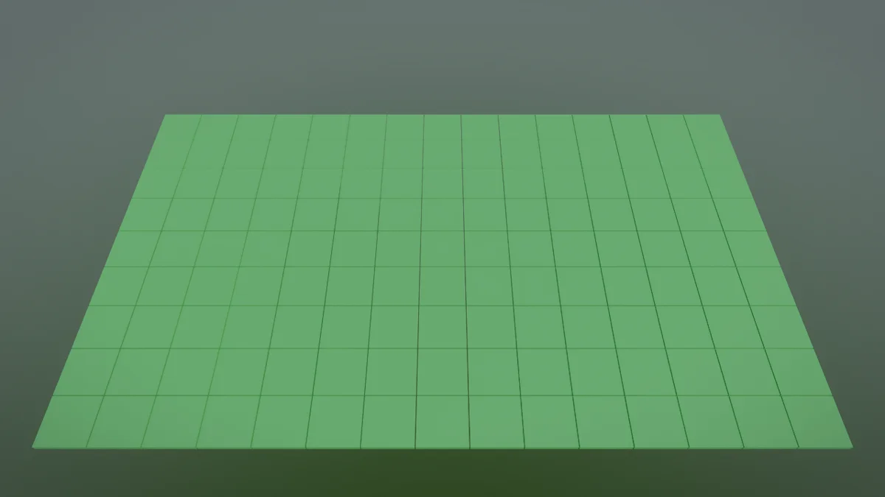

# Build a tower defense

In this guide we'll build Outpost, a small tower defense game, from an empty folder to a
game you can win or lose. Enemies walk a winding road towards your base. You spend gold on
towers beside the road, the towers shoot, and every enemy that gets through costs you a life.

You'll need to know C#, but nothing about games or Super. Each chapter adds one piece and
ends with a game you can run, so you can stop at any point and still have something that
works. The whole thing takes an hour or two.

Everything is drawn with Super's built-in shapes, so there's nothing to download: no
models, no textures, no sounds. The finished game is in
[examples/Outpost](../../examples/Outpost) if you'd like to peek ahead.

What you'll need:

- The .NET 10 SDK
- Windows with a GPU that supports Vulkan 1.3, or a Mac with Apple silicon

## 1. A field to stand on

Let's start with a new console app and add Super:

```
dotnet new console -n Outpost
cd Outpost
dotnet add package Super
```

Super is one NuGet package. It holds the engine, the renderer and the test helpers, and it
sets up the build for you, so there's nothing to add to the project file.

### The game

A Super game is a class that implements `IGame`. It has two methods that matter most:

- `Update(GameTime time)` runs a fixed number of times a second, 30 by default. Each run is
  called a tick. This is where the game happens: things move, towers shoot, gold changes.
- `Draw(View view)` runs once for every frame the screen shows. It describes what the
  world looks like right now. It only looks at the game, and never changes it.

Keeping these two apart is the most important idea in Super. Because `Draw` only looks,
the game can run with no window at all, which is how we'll test it later. And the screen
can draw faster or slower than the game ticks without changing how it plays.

Our game's world is a grid of square tiles. Let's give that its own class. Make a file
called `Field.cs`:

```csharp
using System.Numerics;

namespace OutpostExample;

/// <summary>The playing field: a grid of square tiles, with tile (0, 0) in one corner.</summary>
public sealed class Field
{
    public const int Width = 15;
    public const int Depth = 9;
    public const float TileSize = 2f;

    /// <summary>The middle of a tile, on the ground. The middle tile, (7, 4), is at the origin.</summary>
    public Vector3 Center(int x, int z) =>
        new((x - Width / 2) * TileSize, 0f, (z - Depth / 2) * TileSize);

    /// <summary>The tile a point on the ground is in, or null when it's off the field.</summary>
    public (int X, int Z)? TileAt(Vector3 point)
    {
        int x = (int)MathF.Floor(point.X / TileSize + 0.5f) + Width / 2;
        int z = (int)MathF.Floor(point.Z / TileSize + 0.5f) + Depth / 2;
        if (x < 0 || x >= Width || z < 0 || z >= Depth)
        {
            return null;
        }

        return (x, z);
    }
}
```

The field is 15 tiles wide and 9 deep, and each tile is 2 metres across. Super measures
the world in metres, with y pointing up, so the ground is the x and z plane. `Center`
turns a tile into a place in the world, and `TileAt` goes the other way. We'll need
`TileAt` when the player clicks on the ground.

Now the game itself. Make `OutpostGame.cs`:

```csharp
using System.Numerics;
using Super;

namespace OutpostExample;

public sealed class OutpostGame(Field field) : IGame
{
    private static readonly Vector3 Grass = new(0.25f, 0.55f, 0.18f);

    public Camera Camera { get; } = new(new Vector3(0, 22, 16), Vector3.Zero) { WideAs = 16f / 9f };

    public void Update(GameTime time)
    {
    }

    public void Draw(View view)
    {
        view.Camera(Camera);
        view.Lights.Sun(direction: new Vector3(1, 2, 1), color: new Vector3(3f));
        view.Surroundings.Sky(new SkySettings
        {
            Zenith = new Vector3(0.25f, 0.45f, 0.85f),
            Horizon = new Vector3(0.75f, 0.85f, 0.95f),
            Ground = new Vector3(0.08f, 0.12f, 0.06f),
        });

        for (int z = 0; z < Field.Depth; z++)
        {
            for (int x = 0; x < Field.Width; x++)
            {
                var tile = Matrix4x4.CreateScale(1.96f, 0.2f, 1.96f)
                    * Matrix4x4.CreateTranslation(field.Center(x, z) - new Vector3(0, 0.1f, 0));
                view.Model(10_000 + z * Field.Width + x, ModelRef.Cube, tile, Grass);
            }
        }
    }
}
```

There's a lot packed in here, so let's go through it.

The camera sits 22 metres up and 16 back, looking at the middle of the field. We keep it in
a property rather than making a new one in `Draw`, because in chapter 4 `Update` will need
it too, to work out what the mouse is pointing at. `WideAs` keeps the whole field in view
on a screen narrower than 16:9.

The sun gives the light, and the sky gives a soft blue light from all around. Colours in
the 3D world are `Vector3`s of red, green and blue. They're light, not paint, so the sun
can go past 1 to be bright.

Then each tile is a `ModelRef.Cube`, squashed into a flat slab with a matrix and coloured
green. `ModelRef.Cube` is one of Super's [built-in shapes](../rendering.md#built-in-shapes),
a 1 metre cube. Making each tile a little smaller than 2 metres leaves a thin gap, so you
can see the grid.

The first number given to `view.Model` is a key. Every model you draw needs its own key,
and it must stay the same from frame to frame, because that's how Super knows it's the same
tile as last time. We give the tiles keys from 10,000 up, so they won't clash with the
enemies and towers we'll add later.

Notice that `Draw` describes the whole world every frame. You don't create a tile and keep
it around. If you stop drawing it, it's gone. That makes `Draw` simple: it's a picture of
the game as it is right now. See [Drawing with views](../views.md) for more.

### Asking for what you need

`OutpostGame` takes a `Field` in its constructor. Super makes the game for you, and gives it
whatever its constructor asks for, using the same dependency injection as ASP.NET. So we
tell it about our classes once. Make `OutpostServices.cs`:

```csharp
using Microsoft.Extensions.DependencyInjection;

namespace OutpostExample;

public static class OutpostServices
{
    /// <summary>Everything the game asks for. Program.cs and the tests both call this.</summary>
    public static IServiceCollection AddOutpost(this IServiceCollection services) => services
        .AddSingleton<Field>();
}
```

Keeping the list in one method means the tests in chapter 8 can use it too. Each new class
in this guide gets one more `AddSingleton` line here.

Super has services of its own ready to ask for, such as `GameTime`, `Input` and
`GameRandom`. We'll meet them as we go.

### Starting it

Last, replace everything in `Program.cs` with:

```csharp
using OutpostExample;
using Super;

Game.StartWindowsGameLoop<OutpostGame>(
    new GameOptions { Title = "Outpost", Width = 1280, Height = 720 },
    services => services.AddOutpost());
```

`StartWindowsGameLoop` opens a window and runs the game until you close it. Despite the
name, it works on a Mac too. Run it:

```
dotnet run -c Release
```



A green field. It's not much of a game yet, but everything from here on is adding to it.

The game in the repository references the engine's project instead of the NuGet package,
so it builds against the latest code. That's the only difference from yours.
