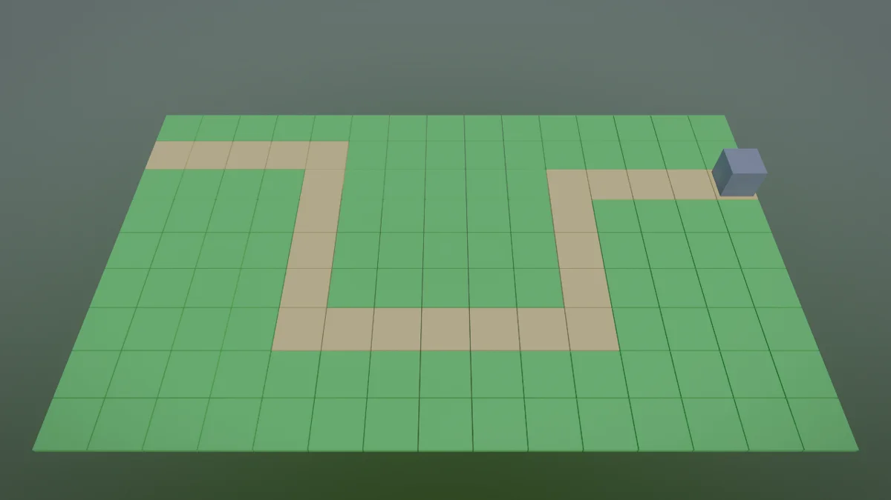
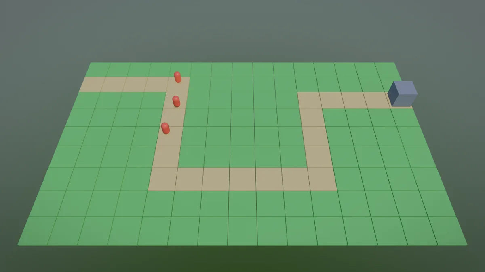
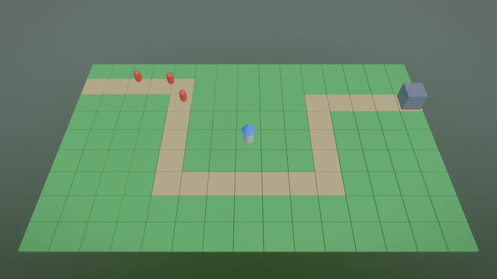
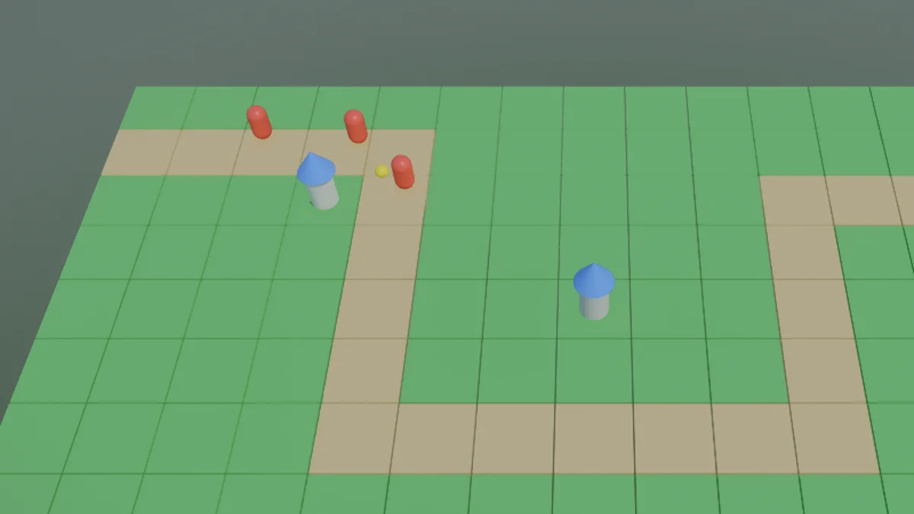
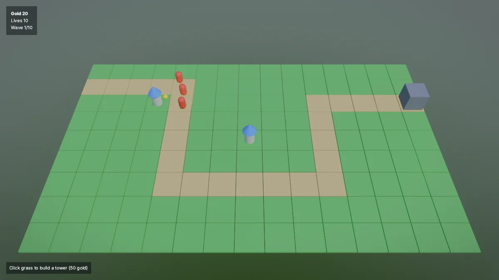
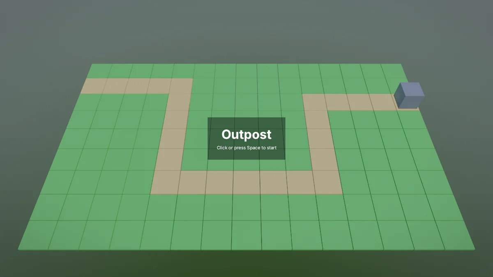
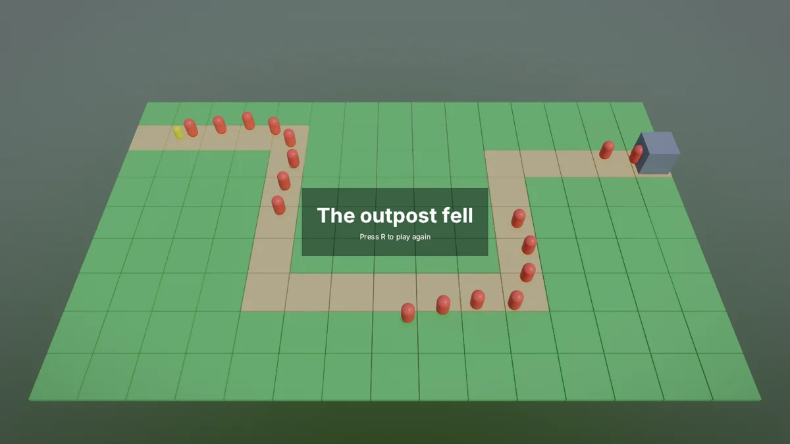
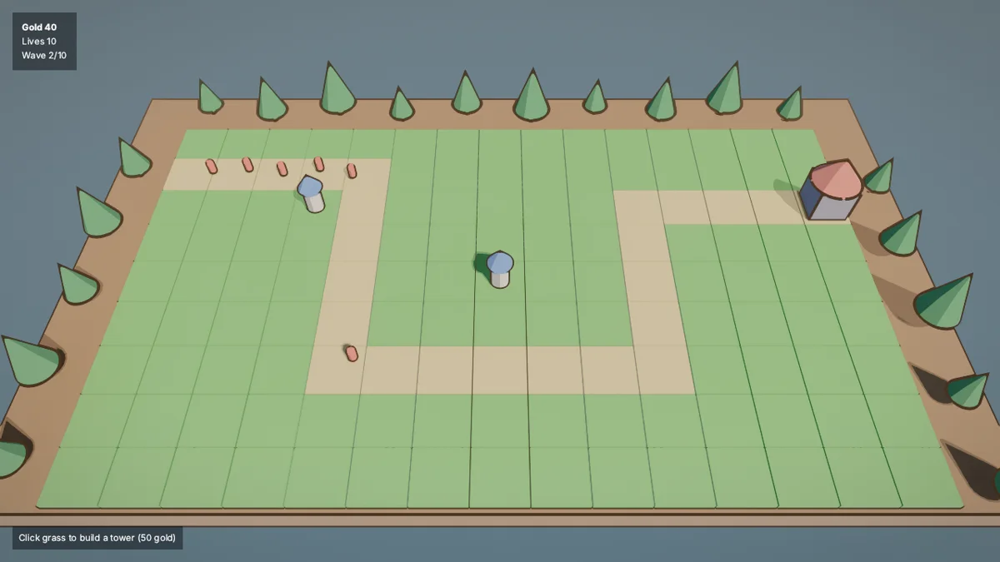

# Build a tower defense

In this guide we'll build Outpost, a small tower defense game, from an empty folder to a
game you can win or lose. Enemies walk a winding road towards your base. You spend gold on
towers beside the road, the towers shoot, and every enemy that gets through costs you a life.

You'll need to know C#, but nothing about games or Super. Each chapter adds one piece and
ends with a game you can run, so you can stop at any point and still have something that
works. The whole thing takes an hour or two.

Everything is drawn with simple shapes that Super makes for you, so there's nothing to
download: no models, no textures, no sounds. The finished game is in
[examples/Outpost](../../examples/Outpost) if you'd like to peek ahead.


What you'll need:

- The .NET 10 SDK
- Windows with a GPU that supports Vulkan 1.3, or a Mac with Apple silicon

## 1. A field to stand on

Let's start with a new console app and add Super:

```
dotnet new console -n Outpost
cd Outpost
dotnet add package Super
```

Super is one NuGet package. It holds the engine, the renderer and the test helpers, and it
sets up the build for you, so there's nothing to add to the project file.

### The game

A Super game is a class that implements `IGame`. It has two methods that matter most:

- `Update(GameTime time)` runs a fixed number of times a second, 30 by default. Each run is
  called a tick. This is where the game happens: things move, towers shoot, gold changes.
- `Draw(View view)` runs once for every frame the screen shows. It describes what the
  world looks like right now. It only looks at the game, and never changes it.

Keeping these two apart is the most important idea in Super. Because `Draw` only looks,
the game can run with no window at all, which is how we'll test it later. And the screen
can draw faster or slower than the game ticks without changing how it plays.

Our game's world is a grid of square tiles. Let's give that its own class. Make a file
called `Field.cs`:

```csharp
using System.Numerics;

namespace OutpostExample;

/// <summary>The playing field: a grid of square tiles, with tile (0, 0) in one corner.</summary>
public sealed class Field
{
    public const int Width = 15;
    public const int Depth = 9;
    public const float TileSize = 2f;

    /// <summary>The middle of a tile, on the ground. The middle tile, (7, 4), is at the origin.</summary>
    public Vector3 Center(int x, int z) =>
        new((x - Width / 2) * TileSize, 0f, (z - Depth / 2) * TileSize);

    /// <summary>The tile a point on the ground is in, or null when it's off the field.</summary>
    public (int X, int Z)? TileAt(Vector3 point)
    {
        int x = (int)MathF.Floor(point.X / TileSize + 0.5f) + Width / 2;
        int z = (int)MathF.Floor(point.Z / TileSize + 0.5f) + Depth / 2;
        if (x < 0 || x >= Width || z < 0 || z >= Depth)
        {
            return null;
        }

        return (x, z);
    }
}
```

The field is 15 tiles wide and 9 deep, and each tile is 2 metres across. Super measures
the world in metres, with y pointing up, so the ground is the x and z plane. `Center`
turns a tile into a place in the world, and `TileAt` goes the other way. We'll need
`TileAt` when the player clicks on the ground.

Now the game itself. Make `OutpostGame.cs`:

```csharp
using System.Numerics;
using Super;

namespace OutpostExample;

public sealed class OutpostGame(Field field) : IGame
{
    private static readonly Vector3 Grass = new(0.25f, 0.55f, 0.18f);

    public Camera Camera { get; } = new(new Vector3(0, 22, 16), Vector3.Zero) { WideAs = 16f / 9f };

    public void Update(GameTime time)
    {
    }

    public void Draw(View view)
    {
        view.Camera(Camera);
        view.Lights.Sun(direction: new Vector3(1, 2, 1), color: new Vector3(3f));
        view.Surroundings.Sky(new SkySettings
        {
            Zenith = new Vector3(0.25f, 0.45f, 0.85f),
            Horizon = new Vector3(0.75f, 0.85f, 0.95f),
            Ground = new Vector3(0.08f, 0.12f, 0.06f),
        });

        for (int z = 0; z < Field.Depth; z++)
        {
            for (int x = 0; x < Field.Width; x++)
            {
                var tile = Matrix4x4.CreateScale(1.96f, 0.2f, 1.96f)
                    * Matrix4x4.CreateTranslation(field.Center(x, z) - new Vector3(0, 0.1f, 0));
                view.Model(10_000 + z * Field.Width + x, ModelRef.Cube, tile, Grass);
            }
        }
    }
}
```

There's a lot packed in here, so let's go through it.

The camera sits 22 metres up and 16 back, looking at the middle of the field. We keep it in
a property rather than making a new one in `Draw`, because in chapter 4 `Update` will need
it too, to work out what the mouse is pointing at. `WideAs` keeps the whole field in view
on a screen narrower than 16:9.

The sun gives the light, and the sky gives a soft blue light from all around. Colours in
the 3D world are `Vector3`s of red, green and blue. They're light, not paint, so the sun
can go past 1 to be bright.

Then each tile is a `ModelRef.Cube`, squashed into a flat slab with a matrix and coloured
green. `ModelRef.Cube` is one of Super's [built-in shapes](../rendering.md#built-in-shapes),
a 1 metre cube. Making each tile a little smaller than 2 metres leaves a thin gap, so you
can see the grid.

The first number given to `view.Model` is a key. Every model you draw needs its own key,
and it must stay the same from frame to frame, because that's how Super knows it's the same
tile as last time. We give the tiles keys from 10,000 up, so they won't clash with the
enemies and towers we'll add later.

Notice that `Draw` describes the whole world every frame. You don't create a tile and keep
it around. If you stop drawing it, it's gone. That makes `Draw` simple: it's a picture of
the game as it is right now. See [Drawing with views](../views.md) for more.

### Asking for what you need

`OutpostGame` takes a `Field` in its constructor. Super makes the game for you, and gives it
whatever its constructor asks for, using the same dependency injection as ASP.NET. So we
tell it about our classes once. Make `OutpostServices.cs`:

```csharp
using Microsoft.Extensions.DependencyInjection;

namespace OutpostExample;

public static class OutpostServices
{
    /// <summary>Everything the game asks for. Program.cs and the tests both call this.</summary>
    public static IServiceCollection AddOutpost(this IServiceCollection services) => services
        .AddSingleton<Field>();
}
```

Keeping the list in one method means the tests in chapter 9 can use it too. Each new class
in this guide gets one more `AddSingleton` line here.

Super has services of its own ready to ask for, such as `GameTime`, `Input` and
`GameRandom`. We'll meet them as we go.

### Starting it

Last, replace everything in `Program.cs` with:

```csharp
using OutpostExample;
using Super;

Game.StartWindowsGameLoop<OutpostGame>(
    new GameOptions { Title = "Outpost", Width = 1280, Height = 720 },
    services => services.AddOutpost());
```

`StartWindowsGameLoop` opens a window and runs the game until you close it. Despite the
name, it works on a Mac too. Run it:

```
dotnet run -c Release
```


A green field. It's not much of a game yet, but everything from here on is adding to it.

The game in the repository references the engine's project instead of the NuGet package,
so it builds against the latest code. That's the only difference from yours.

## 2. A road to walk

Enemies need a road. It comes in on the left edge, winds across the field, and ends at your
base on the right.

The road has two jobs. When the player builds, we need to know which tiles are road, so
towers can't go on it. And when enemies walk, they need a smooth path to follow. So we
describe the road once, as the tiles where it turns, and make both from that.

Add this to `Field`, above `Center`:

```csharp
/// <summary>The tiles where the road turns, from where enemies come in to the base.</summary>
private static readonly (int X, int Z)[] Corners = [(0, 1), (4, 1), (4, 6), (10, 6), (10, 2), (14, 2)];

private readonly HashSet<(int X, int Z)> _road = [];

public Field()
{
    // Walk from each corner to the next, one tile at a time, marking every tile on the way.
    for (int i = 0; i < Corners.Length - 1; i++)
    {
        var (x, z) = Corners[i];
        var to = Corners[i + 1];
        _road.Add((x, z));
        while ((x, z) != to)
        {
            x += Math.Sign(to.X - x);
            z += Math.Sign(to.Z - z);
            _road.Add((x, z));
        }
    }

    Road = Spline.Bezier(Knots());
}

/// <summary>The path enemies walk, through the middle of the road tiles.</summary>
public Spline Road { get; }

/// <summary>Where the base stands: the last tile of the road.</summary>
public Vector3 BaseCenter => Center(Corners[^1].X, Corners[^1].Z);

/// <summary>Whether a tile is part of the road.</summary>
public bool IsRoad(int x, int z) => _road.Contains((x, z));

/// <summary>
/// The road's knots: straight lines between the corners, and a tight quarter circle at each
/// corner that stays inside the corner's tile. A smooth curve through the corners themselves
/// would swing wide of the road.
/// </summary>
private List<SplineKnot> Knots()
{
    const float Radius = 1f;
    // Handles this long make a Bézier curve close to a quarter circle.
    const float Handle = Radius * 0.55f;

    var points = Corners.Select(corner => Center(corner.X, corner.Z)).ToArray();
    var first = Vector3.Normalize(points[1] - points[0]);
    var knots = new List<SplineKnot> { new(points[0], Out: first * Handle) };
    for (int i = 1; i < points.Length - 1; i++)
    {
        var coming = Vector3.Normalize(points[i] - points[i - 1]);
        var going = Vector3.Normalize(points[i + 1] - points[i]);
        // Start turning half a tile before the corner and finish half a tile after it.
        knots.Add(new SplineKnot(points[i] - coming * Radius, In: -coming * Handle, Out: coming * Handle));
        knots.Add(new SplineKnot(points[i] + going * Radius, In: -going * Handle, Out: going * Handle));
    }

    var last = Vector3.Normalize(points[^1] - points[^2]);
    knots.Add(new SplineKnot(points[^1], In: -last * Handle));
    return knots;
}
```

`Field.cs` now needs `using Super;` at the top, for `Spline`.

The set of road tiles is what building will check. `Road` is a
[spline](../splines.md), a curve through the middle of the road tiles. A spline knows its
own length, and it can tell you the point any distance along it. That's exactly what an
enemy needs. An enemy only has to remember how far it has walked, and the spline says where
that is.

`Knots` takes a little explaining. The easy way to make a spline is `Spline.Through`, which
draws a smooth curve through the points you give it. Give it the corners, though, and it
swings wide round each one, so enemies cut across the grass. So instead we make a Bézier
spline, where each knot also has handles that pull the curve towards them. Each corner gets
two knots, half a tile before it and half a tile after, with short handles pointing along
the road. Between them the road bends in a tight quarter circle that stays inside the
corner tile, and everywhere else it runs dead straight.

Now draw it. In `OutpostGame`, add two more colours next to `Grass`:

```csharp
private static readonly Vector3 Sand = new(0.8f, 0.6f, 0.3f);
private static readonly Vector3 Stone = new(0.3f, 0.3f, 0.32f);
```

In the tile loop, pick the colour by asking the field:

```csharp
view.Model(10_000 + z * Field.Width + x, ModelRef.Cube, tile, field.IsRoad(x, z) ? Sand : Grass);
```

And after the loop, draw the base as a stone block at the end of the road:

```csharp
var baseBox = Matrix4x4.CreateScale(1.6f) * Matrix4x4.CreateTranslation(field.BaseCenter + new Vector3(0, 0.8f, 0));
view.Model(1, ModelRef.Cube, baseBox, Stone);
```

The cube is centred on its middle, so we lift it by half its height to stand it on the
ground. The base gets key 1, well away from the tiles.



## 3. Here they come

Time for some enemies. First, the player needs something to lose. Make `Player.cs`:

```csharp
namespace OutpostExample;

/// <summary>What the player has: gold to build with, and lives to lose.</summary>
public sealed class Player
{
    public const int StartingGold = 100;
    public const int StartingLives = 10;

    public int Gold { get; set; } = StartingGold;

    public int Lives { get; set; } = StartingLives;

    /// <summary>Back to how a new game starts.</summary>
    public void Reset()
    {
        Gold = StartingGold;
        Lives = StartingLives;
    }
}
```

There are three kinds of enemy. Walkers are the plain ones, runners are quick but weak, and
brutes are slow and take a lot of hitting:

| Kind | Health | Speed | Reward | Looks like |
| --- | --- | --- | --- | --- |
| Walker | 3 | 2 m/s | 10 gold | a red capsule |
| Runner | 2 | 4 m/s | 6 gold | a small yellow capsule |
| Brute | 10 | 1.2 m/s | 25 gold | a big purple capsule |

Make `Enemies.cs`. It's the longest file so far, so we'll go through it in pieces after:

```csharp
using System.Numerics;
using Super;

namespace OutpostExample;

public enum EnemyKind
{
    Walker,
    Runner,
    Brute,
}

/// <summary>How tough, fast and valuable a kind of enemy is, and how it looks.</summary>
public readonly record struct EnemyStats(int Health, float Speed, int Reward, float Size, Vector3 Color);

/// <summary>One enemy on the road.</summary>
public sealed class Enemy
{
    public required int Id { get; init; }

    public required EnemyKind Kind { get; init; }

    public required int Health { get; set; }

    /// <summary>How far along the road it has walked, in metres.</summary>
    public float Distance { get; set; }

    /// <summary>How far to the side of the road's middle it walks, so a line of enemies doesn't look like a train.</summary>
    public required float Offset { get; init; }

    public Vector3 Position { get; set; }

    /// <summary>Where it was last tick, so drawing can blend between the two.</summary>
    public Vector3 PreviousPosition { get; set; }
}

/// <summary>Every enemy on the road: spawning them, walking them to the base, and hitting them.</summary>
public sealed class Enemies(Field field, Player player, GameRandom random)
{
    private readonly List<Enemy> _all = [];
    private readonly RandomStream _offsets = random.Stream("enemies");
    private int _nextId;

    public IReadOnlyList<Enemy> All => _all;

    /// <summary>How many enemies towers have killed since the last <see cref="Clear"/>.</summary>
    public int Killed { get; private set; }

    public static EnemyStats Stats(EnemyKind kind) => kind switch
    {
        EnemyKind.Walker => new(Health: 3, Speed: 2f, Reward: 10, Size: 0.6f, Color: new Vector3(0.8f, 0.15f, 0.1f)),
        EnemyKind.Runner => new(Health: 2, Speed: 4f, Reward: 6, Size: 0.45f, Color: new Vector3(0.95f, 0.8f, 0.1f)),
        EnemyKind.Brute => new(Health: 10, Speed: 1.2f, Reward: 25, Size: 1f, Color: new Vector3(0.45f, 0.15f, 0.6f)),
        _ => throw new ArgumentOutOfRangeException(nameof(kind), kind, "There's no such enemy."),
    };

    /// <summary>Puts a new enemy at the start of the road.</summary>
    public Enemy Spawn(EnemyKind kind)
    {
        var enemy = new Enemy
        {
            Id = _nextId++,
            Kind = kind,
            Health = Stats(kind).Health,
            Offset = _offsets.Between(-0.3f, 0.3f),
        };
        enemy.Position = PositionAt(enemy);
        enemy.PreviousPosition = enemy.Position;
        _all.Add(enemy);
        return enemy;
    }

    /// <summary>Walks every enemy along the road. One that reaches the base costs a life and is gone.</summary>
    public void Update(GameTime time)
    {
        // Backwards, so removing one doesn't skip the next.
        for (int i = _all.Count - 1; i >= 0; i--)
        {
            var enemy = _all[i];
            enemy.PreviousPosition = enemy.Position;
            enemy.Distance += Stats(enemy.Kind).Speed * time.DeltaSeconds;
            if (enemy.Distance >= field.Road.Length)
            {
                player.Lives--;
                _all.RemoveAt(i);
                continue;
            }

            enemy.Position = PositionAt(enemy);
        }
    }

    /// <summary>Takes health off an enemy. At zero it dies, and the player gets its reward.</summary>
    public void Hit(Enemy enemy, int damage)
    {
        if (!_all.Contains(enemy))
        {
            return;
        }

        enemy.Health -= damage;
        if (enemy.Health <= 0)
        {
            _all.Remove(enemy);
            player.Gold += Stats(enemy.Kind).Reward;
            Killed++;
        }
    }

    /// <summary>Takes every enemy off the road, for a new game.</summary>
    public void Clear()
    {
        _all.Clear();
        Killed = 0;
    }

    private Vector3 PositionAt(Enemy enemy)
    {
        var pose = field.Road.FrameAtDistance(enemy.Distance);
        return pose.Position + pose.Right * enemy.Offset;
    }
}
```

`Enemies` asks for the `Field`, the `Player` and a `GameRandom` in its constructor, just
like the game did in chapter 1. Add the two new classes to `AddOutpost` so Super can make
them:

```csharp
public static IServiceCollection AddOutpost(this IServiceCollection services) => services
    .AddSingleton<Field>()
    .AddSingleton<Player>()
    .AddSingleton<Enemies>();
```

`GameRandom` you don't add. It's one of Super's own services, and it's set up with the
game's seed. Rather than one big random number generator, it gives out
[named streams](../random.md). Ours is called `"enemies"`. Each stream has its own
sequence, so if you later add some other randomness, the enemies still get the same
offsets as before. And running the game with the same seed always plays out the same,
which is great for tests and bug reports.

Walking is where the road's spline pays off. Each tick, an enemy's `Distance` grows by its
speed times `time.DeltaSeconds`, the length of a tick in seconds. Then `FrameAtDistance`
tells us where that is on the road, and which way is right, so we can step to the side by
the enemy's offset. When the distance reaches the end of the road, the enemy has made it
to your base. It costs you a life and leaves.

Always move things by `DeltaSeconds`. If you later slow the game down for a slow-motion
moment, everything moved by it slows down too.

`Hit` checks the enemy is still on the road before doing anything. Two towers might shoot
the same enemy in the same tick, and the second shot shouldn't pay out its reward again.

### Drawing them

Hand the game its `Player` and `Enemies`, make it walk the enemies each tick, and give
it three walkers to start with, so there's something to watch. We'll replace those with
proper waves in chapter 6.

```csharp
public sealed class OutpostGame(Field field, Player player, Enemies enemies) : IGame
{
    // ...the colours and camera from before...

    public Player Player => player;

    public Enemies Enemies => enemies;

    public void Load()
    {
        // Three walkers so there's something to watch. Waves replace these in chapter 6.
        for (int i = 0; i < 3; i++)
        {
            enemies.Spawn(EnemyKind.Walker).Distance = i * 3f;
        }
    }

    public void Update(GameTime time)
    {
        enemies.Update(time);
    }
```

`Load` runs once before the first tick. The `Player` and `Enemies` properties aren't needed
by the game itself, but the tests in chapter 9 will use them to look inside.

The enemies can draw themselves. Add this to `Enemies`, which draws each one as a capsule.
It takes the same `View` the game's `Draw` is given, so any class can add models to it:

```csharp
/// <summary>Draws each enemy as a capsule, blended between its last two ticks.</summary>
public void Draw(View view)
{
    foreach (var enemy in _all)
    {
        var stats = Stats(enemy.Kind);
        // The capsule is 2 metres tall, so lifting it by its size stands it on the road.
        var lift = new Vector3(0, stats.Size, 0);
        var scale = Matrix4x4.CreateScale(stats.Size);
        var previous = scale * Matrix4x4.CreateTranslation(enemy.PreviousPosition + lift);
        var current = scale * Matrix4x4.CreateTranslation(enemy.Position + lift);
        view.Model(100_000 + enemy.Id, ModelRef.Capsule, view.Smooth(previous, current), stats.Color);
    }
}
```

And call it at the end of the game's `Draw`:

```csharp
enemies.Draw(view);
```

Keeping each part's drawing next to the rest of that part stops the game's `Draw` from
growing into one long method as the game grows.

The game ticks 30 times a second, but your screen probably shows 60 frames or more. If we
drew each enemy right where it is, it would sit still for a frame or two and then jump.
`view.Smooth` blends between where it was last tick and where it is now, by how far the
frame is between the two ticks, so it glides instead. That's why each enemy remembers its
`PreviousPosition`. There's more on this in
[Smooth motion](../views.md#smooth-motion).

Each enemy's key is 100,000 plus its id. The id never changes, so the enemy keeps its key
for as long as it lives.



Run it, and three walkers wander down the road to your base. You lose three lives, but
nothing shows that yet. We'll get there.

## 4. Building towers

Now let's fight back. The player clicks a grass tile, pays 50 gold, and a tower goes up.

### What the player can do

In Super, you don't ask "is the left mouse button down?" in your game code. You name the
things the player can do with an enum, and bind keys and buttons to them in one place. Make
`Controls.cs`:

```csharp
namespace OutpostExample;

/// <summary>Everything the player can do. Which key or button does it is set in OutpostGame.Load.</summary>
public enum Control
{
    Build,
}
```

Then the rest of the game only ever asks about `Control.Build`. If you later want building
on a gamepad button too, that's one more binding, and nothing else changes. See
[Input](../input.md) for everything a binding can be.

### The towers

Make `Towers.cs`:

```csharp
using System.Numerics;
using Super;

namespace OutpostExample;

/// <summary>One tower, standing on a tile.</summary>
public sealed class Tower
{
    public required int X { get; init; }

    public required int Z { get; init; }
}

/// <summary>The towers the player has built.</summary>
public sealed class Towers(Field field, Player player)
{
    public const int Price = 50;

    private readonly List<Tower> _all = [];

    public IReadOnlyList<Tower> All => _all;

    /// <summary>Builds a tower on a tile, if it's grass, it's free, and the player can pay. Says whether it did.</summary>
    public bool TryBuild(int x, int z)
    {
        bool onField = x >= 0 && x < Field.Width && z >= 0 && z < Field.Depth;
        if (!onField || field.IsRoad(x, z) || _all.Any(tower => tower.X == x && tower.Z == z) || player.Gold < Price)
        {
            return false;
        }

        player.Gold -= Price;
        _all.Add(new Tower { X = x, Z = z });
        return true;
    }

    /// <summary>Takes every tower down, for a new game.</summary>
    public void Clear() => _all.Clear();
}
```

All the rules for building live in `TryBuild`: on the field, not on the road, not on
another tower, and only if you can pay. Keeping them in one method makes them easy to
test, which we'll do in chapter 9.

Add `.AddSingleton<Towers>()` to `AddOutpost`.

### Clicking on the ground

The game needs three more things in its constructor: the towers, the player's
`Actions<Control>`, and `Input` for the mouse. Both of those last two come from Super, so
there's nothing to register.

```csharp
public sealed class OutpostGame(Field field, Player player, Enemies enemies, Towers towers, Actions<Control> actions, Input input) : IGame
```

Bind the left mouse button at the top of `Load`:

```csharp
actions.Bind(Control.Build, MouseButton.Left);
```

And build in `Update`, before the enemies walk:

```csharp
if (actions.Pressed(Control.Build))
{
    // Follow the line from the camera through the cursor down to the ground, and build on that tile.
    if (input.Mouse.Ray(Camera).Ground() is { } spot && field.TileAt(spot) is { } tile)
    {
        towers.TryBuild(tile.X, tile.Z);
    }
}
```

`Pressed` is true only on the tick the button goes down, so holding it builds once.

The cursor is a point on the screen, but tiles are in the world. `Mouse.Ray(Camera)` is the
line from the camera through the cursor, out into the world. `Ground()` finds where that
line meets the ground, or gives null if it never does, such as when you point at the sky.
Then `TileAt` from chapter 1 turns that point into a tile. There's more on this in
[Clicking on things](../cameras.md#clicking-on-things).

Input is read in `Update`, never in `Draw`. Everything that changes the game happens in
ticks, which is what keeps it repeatable.

### Drawing the towers

Each tower is a cylinder with a cone for a roof. Like the enemies, the towers draw
themselves. Add the colours and a `Draw` to `Towers`:

```csharp
private static readonly Vector3 Wall = new(0.9f, 0.85f, 0.75f);
private static readonly Vector3 Roof = new(0.2f, 0.4f, 0.9f);

/// <summary>Draws each tower as a cylinder with a cone for a roof.</summary>
public void Draw(View view)
{
    for (int i = 0; i < _all.Count; i++)
    {
        var spot = field.Center(_all[i].X, _all[i].Z);
        var wall = Matrix4x4.CreateScale(0.8f, 1.2f, 0.8f) * Matrix4x4.CreateTranslation(spot + new Vector3(0, 0.6f, 0));
        var roof = Matrix4x4.CreateScale(1.1f, 0.8f, 1.1f) * Matrix4x4.CreateTranslation(spot + new Vector3(0, 1.6f, 0));
        view.Model(20_000 + i, ModelRef.Cylinder, wall, Wall);
        view.Model(30_000 + i, ModelRef.Cone, roof, Roof);
    }
}
```

And call it in the game's `Draw`, after the base and before the enemies:

```csharp
towers.Draw(view);
enemies.Draw(view);
```

Towers are never taken down during a game, so a tower's place in the list makes a fine key.

### A script for screenshots

You can try it by running the game and clicking, but it's handy to have the game do it
for you. A game can have named input scripts, which the `--script` option plays. Add this
to `OutpostGame`:

```csharp
public IReadOnlyDictionary<string, InputScript> Scripts => new Dictionary<string, InputScript>
{
    // Builds a tower on the middle tile, for screenshots: --script towers
    ["towers"] = new InputScript().Wait(1).Click(new Vector2(640, 360)).Wait(5),
};
```

Then this runs the game for two seconds with no window, clicking the middle of the screen,
and saves what it looks like:

```
dotnet run -c Release -- --screenshot towers.png --script towers --ticks 60 --size 1280x720
```



This is also how this guide's pictures were made. See [The command line](../command-line.md)
for more.

## 5. Shooting back

Towers that just stand there aren't much use. In this chapter each tower shoots at
enemies that come close, and a shot that lands takes a point of health.

### Shots in the air

A shot is a small ball that flies at one enemy and hits it when it gets there. Make
`Shots.cs`:

```csharp
using System.Numerics;
using Super;

namespace OutpostExample;

/// <summary>One shot in the air, chasing its target.</summary>
public sealed class Shot
{
    public required int Id { get; init; }

    public required Enemy Target { get; init; }

    public Vector3 Position { get; set; }

    /// <summary>Where it was last tick, so drawing can blend between the two.</summary>
    public Vector3 PreviousPosition { get; set; }
}

/// <summary>Every shot in the air. A shot flies at its target and hits it when it gets there.</summary>
public sealed class Shots(Enemies enemies)
{
    public const float Speed = 14f;
    public const int Damage = 1;

    private readonly List<Shot> _all = [];
    private int _nextId;

    public IReadOnlyList<Shot> All => _all;

    public void Fire(Vector3 from, Enemy target)
    {
        _all.Add(new Shot { Id = _nextId++, Target = target, Position = from, PreviousPosition = from });
    }

    public void Update(GameTime time)
    {
        for (int i = _all.Count - 1; i >= 0; i--)
        {
            var shot = _all[i];

            // Its target died or reached the base since it was fired, so there's nothing left to hit.
            if (!enemies.All.Contains(shot.Target))
            {
                _all.RemoveAt(i);
                continue;
            }

            // Aim for the middle of the enemy's body, not its feet.
            var aim = shot.Target.Position + new Vector3(0, Enemies.Stats(shot.Target.Kind).Size, 0);
            var toTarget = aim - shot.Position;
            float distance = toTarget.Length();
            float step = Speed * time.DeltaSeconds;

            shot.PreviousPosition = shot.Position;
            if (distance <= step)
            {
                enemies.Hit(shot.Target, Damage);
                _all.RemoveAt(i);
                continue;
            }

            shot.Position += toTarget / distance * step;
        }
    }

    /// <summary>Takes every shot out of the air, for a new game.</summary>
    public void Clear() => _all.Clear();
}
```

Each tick a shot moves 14 metres a second toward its target. When it's closer than one
step, it hits instead of moving.

Look at the check at the top of the loop. A shot takes a while to fly, and in that time
its enemy can die from another tower's shot, or walk into the base. Without the check,
the shot would keep chasing an enemy that's no longer in the game, and hit it. `Hit` in
chapter 3 already ignores enemies that are gone, so it wouldn't pay twice, but it's
better that a shot with nothing to hit simply disappears. Two small guards are cheap,
and each one keeps the game right on its own.

Add `.AddSingleton<Shots>()` to `AddOutpost`.

### Towers that shoot

A tower needs to know how long until it can shoot again. Give `Tower` one more property:

```csharp
/// <summary>Seconds until it can shoot again.</summary>
public float Reload { get; set; }
```

`Towers` now asks for the enemies and the shots too, and gets a range, a reload time, and
the spot shots start from:

```csharp
public sealed class Towers(Field field, Player player, Enemies enemies, Shots shots)
{
    public const int Price = 50;
    public const float Range = 5f;
    public const float ReloadSeconds = 0.75f;

    /// <summary>How high above its tile a tower's shots start, at the top of its wall.</summary>
    private static readonly Vector3 Muzzle = new(0, 1.2f, 0);
```

And an `Update` that does the shooting:

```csharp
/// <summary>Each tower that has reloaded shoots at the enemy in range that's nearest the base.</summary>
public void Update(GameTime time)
{
    foreach (var tower in _all)
    {
        tower.Reload = MathF.Max(0f, tower.Reload - time.DeltaSeconds);
        if (tower.Reload > 0f)
        {
            continue;
        }

        var spot = field.Center(tower.X, tower.Z);
        Enemy? target = null;
        foreach (var enemy in enemies.All)
        {
            bool inRange = Vector3.Distance(spot, enemy.Position) <= Range;
            if (inRange && (target is null || enemy.Distance > target.Distance))
            {
                target = enemy;
            }
        }

        if (target is not null)
        {
            shots.Fire(spot + Muzzle, target);
            tower.Reload = ReloadSeconds;
        }
    }
}
```

Which enemy should a tower pick? The one that's furthest along the road, because that's
the one about to cost you a life. `Distance` from chapter 3 tells us exactly that.

### Who goes first

The game needs the shots in its constructor:

```csharp
public sealed class OutpostGame(Field field, Player player, Enemies enemies, Towers towers, Shots shots, Actions<Control> actions, Input input) : IGame
```

Then the end of `Update` becomes:

```csharp
enemies.Update(time);
towers.Update(time);
shots.Update(time);
```

These are plain method calls, in an order you choose. Enemies move first, then towers
aim at where the enemies are now, then shots fly. There's no hidden system that runs
things for you in some order you have to look up. If you want something to happen
before something else, you put its line first.

### Drawing the shots

Shots are small yellow balls, smoothed between ticks just like the enemies. Add the colour
and a `Draw` to `Shots`:

```csharp
private static readonly Vector3 Glow = new(1f, 0.8f, 0.1f);

/// <summary>Draws each shot as a small yellow ball, blended between its last two ticks.</summary>
public void Draw(View view)
{
    foreach (var shot in _all)
    {
        var size = Matrix4x4.CreateScale(0.4f);
        var previous = size * Matrix4x4.CreateTranslation(shot.PreviousPosition);
        var current = size * Matrix4x4.CreateTranslation(shot.Position);
        view.Model(200_000 + shot.Id, ModelRef.Sphere, view.Smooth(previous, current), Glow);
    }
}
```

And call it last in the game's `Draw`, so `Draw` now ends like this:

```csharp
towers.Draw(view);
enemies.Draw(view);
shots.Draw(view);
```

Shots come and go all the time, so they use their `Id` for a key, not their place in the
list.

The middle tile is too far from the road to reach anything, so let's add a second tower
to the script, next to the road's first bend:

```csharp
// Builds a tower on the middle tile and one by the first bend, for screenshots: --script towers
["towers"] = new InputScript().Wait(1).Click(new Vector2(640, 360)).Wait(1).Click(new Vector2(411, 261)).Wait(5),
```

Run the game, and the tower by the bend picks off the walkers one by one.



## 6. Waves and a HUD

So far three walkers stroll in and that's it. A real tower defense sends wave after wave,
each a bit harder than the last. And the player needs to see their gold and lives without
guessing.

### The waves

There are 10 waves. Wave 1 is five walkers, and each wave after it has one more. Runners
join from wave 3, and brutes from wave 5. Make `Waves.cs`:

```csharp
using Super;

namespace OutpostExample;

/// <summary>Sends the enemies out, one wave after another.</summary>
public sealed class Waves
{
    public const int Count = 10;

    private readonly Enemies _enemies;
    private readonly Queue<EnemyKind> _left = new();
    private float _wait;

    public Waves(Enemies enemies)
    {
        _enemies = enemies;
        Reset();
    }

    /// <summary>Seconds before the first enemy of the first wave, so the player can look around.</summary>
    public float FirstDelay { get; set; } = 3f;

    /// <summary>Seconds between two enemies of the same wave.</summary>
    public float Gap { get; set; } = 0.8f;

    /// <summary>Seconds between the last enemy of a wave and the first of the next.</summary>
    public float Pause { get; set; } = 5f;

    /// <summary>The wave that's coming or walking now, counting from 1.</summary>
    public int Number { get; private set; }

    /// <summary>True once the last enemy of the last wave is on the road.</summary>
    public bool AllSpawned => Number == Count && _left.Count == 0;

    /// <summary>Who walks in a wave: more walkers each time, runners from wave 3, brutes from wave 5.</summary>
    public static IReadOnlyList<EnemyKind> Makeup(int wave)
    {
        int walkers = 4 + wave;
        int runners = Math.Max(0, wave - 2);
        int brutes = Math.Max(0, (wave - 3) / 2);

        return
        [
            .. Enumerable.Repeat(EnemyKind.Walker, walkers),
            .. Enumerable.Repeat(EnemyKind.Runner, runners),
            .. Enumerable.Repeat(EnemyKind.Brute, brutes),
        ];
    }

    public void Update(GameTime time)
    {
        if (AllSpawned)
        {
            return;
        }

        _wait -= time.DeltaSeconds;
        if (_wait > 0f)
        {
            return;
        }

        if (_left.Count == 0)
        {
            Number++;
            Queue(Number);
        }

        _enemies.Spawn(_left.Dequeue());
        _wait = _left.Count > 0 ? Gap : Pause;
    }

    /// <summary>Back to the start of wave 1, for a new game.</summary>
    public void Reset()
    {
        _left.Clear();
        Number = 1;
        Queue(1);
        _wait = FirstDelay;
    }

    private void Queue(int wave)
    {
        foreach (var kind in Makeup(wave))
        {
            _left.Enqueue(kind);
        }
    }
}
```

A wave is just a queue of enemy kinds. `Update` counts a timer down, and each time it runs
out, the next enemy steps onto the road. When a wave's queue is empty, the timer waits a
little longer before the next wave starts. The numbers are properties rather than
constants so a test can change them, to speed the waves up or hold them back.

`Makeup` is `static` and only does arithmetic, so it's easy to check on its own. If you'd
rather write the waves out by hand, it's the one place to change.

Add `.AddSingleton<Waves>()` to `AddOutpost`, add `Waves waves` to the game's constructor,
and call it first in `Update`, so a new enemy can be shot on the tick it appears:

```csharp
waves.Update(time);
enemies.Update(time);
towers.Update(time);
shots.Update(time);
```

Now the waves bring the enemies, so take out the loop in `Load` from chapter 3 that spawns
three walkers. `Load` is back to one line:

```csharp
public void Load()
{
    actions.Bind(Control.Build, MouseButton.Left);
}
```

### A HUD

The interface in Super works a lot like SwiftUI. You don't create labels and then update
them. Instead, your game has a `Ui` property that describes what the interface should look
like right now, and Super calls it every frame. Gold changed? The next frame simply shows
the new number.

A piece of interface is a `record` that inherits `UiView` and has a `Body`. Its fields are
the data it shows. Make `Hud.cs`:

```csharp
using Super;
using Super.Ui;

namespace OutpostExample;

/// <summary>Gold, lives and the wave in the top-left corner, and a hint along the bottom.</summary>
public sealed record Hud(int Gold, int Lives, int Wave, int Waves) : UiView
{
    private static readonly Color Panel = Color.Hex("#10141C", 0.7f);

    public override UiView Body => new VStack(HorizontalAlignment.Leading)
    {
        new VStack(HorizontalAlignment.Leading, Spacing: 4f)
        {
            new Text($"Gold {Gold}").Bold(),
            new Text($"Lives {Lives}"),
            new Text($"Wave {Wave}/{Waves}"),
        }
        .Padding(12f)
        .Background(Panel)
        .FixedSize()
        .Id("hud"),
        new Spacer(),
        new Text($"Click grass to build a tower ({Towers.Price} gold)")
            .Padding(8f)
            .Background(Panel)
            .IgnoresPointer(),
    }
    .Padding(16f)
    .Frame(maxWidth: UiExtensions.Infinity, maxHeight: UiExtensions.Infinity, alignment: Alignment.TopLeading);
}
```

From the outside in: the outer `VStack` fills the screen, with the stats panel at the top,
a `Spacer` that pushes everything after it down, and the hint at the bottom. The panel is
three lines of text on a see-through dark background. `.Id("hud")` gives it a name so a
test can find it.

Then give the game its `Ui`. It needs `using Super.Ui;` at the top:

```csharp
public UiView? Ui => new Hud(player.Gold, player.Lives, waves.Number, Waves.Count);
```

Because `Hud` is a record, two HUDs with the same numbers are equal, and Super uses that to
skip work when nothing changed. You can make a new one every frame without worrying.

The stats panel takes the mouse. A click that lands on the interface never reaches
`actions.Pressed`, so clicking the panel won't also build a tower on the grass behind it.
The hint uses `.IgnoresPointer()` to do the opposite: it's only words, so clicks go
straight through to the ground. [Interfaces](../interfaces.md) has every view and
modifier.



## 7. A start and an end

Right now the game starts the moment the window opens, and never ends. Let's add a title
screen, a way to win, a way to lose, and a key to play again.

### Naming the screens

Like the controls, the screens are an enum. Add it to `Controls.cs`, along with two more
controls:

```csharp
public enum Control
{
    Build,
    Start,
    Restart,
}

/// <summary>Where the game is: on the title, playing, or over.</summary>
public enum Screen
{
    Title,
    Playing,
    Won,
    Lost,
}
```

Ask for `States<Screen>` in the game's constructor. Like `Actions<Control>`, Super makes
it for you, so there's nothing to register:

```csharp
public sealed class OutpostGame(Field field, Player player, Enemies enemies, Towers towers, Shots shots, Waves waves, States<Screen> screen, Actions<Control> actions, Input input) : IGame
```

The game starts in the enum's first value, so it opens on `Title`.

### Starting a new game

`Load` binds the new controls and says what happens when a game begins:

```csharp
public void Load()
{
    actions.Bind(Control.Build, MouseButton.Left);
    actions.Bind(Control.Start, Key.Space, MouseButton.Left);
    actions.Bind(Control.Restart, Key.R);

    screen.OnEnter(Screen.Playing, NewGame);
}
```

`OnEnter` runs `NewGame` every time the game enters `Playing`, whether that's from the
title or from the end of the last game:

```csharp
/// <summary>Everything back to how a game starts. Runs each time the game enters Playing.</summary>
private void NewGame()
{
    player.Reset();
    waves.Reset();
    enemies.Clear();
    towers.Clear();
    shots.Clear();
}
```

This is why every class got a `Clear` or `Reset` along the way. Playing again is just
entering `Playing` again, and starting fresh is one method that puts each piece back.

### Only playing while playing

`Update` now looks at the screen first. The old body moves into a `Play` method, and
only runs while playing:

```csharp
public void Update(GameTime time)
{
    switch (screen.Current)
    {
        case Screen.Title when actions.Pressed(Control.Start):
        case Screen.Won or Screen.Lost when actions.Pressed(Control.Restart):
            screen.Set(Screen.Playing);
            break;
        case Screen.Playing:
            Play(time);
            break;
    }
}
```

`Play` is everything `Update` did before, with the end of the game added at the bottom:

```csharp
private void Play(GameTime time)
{
    if (actions.Pressed(Control.Build))
    {
        // Follow the line from the camera through the cursor down to the ground, and build on that tile.
        if (input.Mouse.Ray(Camera).Ground() is { } spot && field.TileAt(spot) is { } tile)
        {
            towers.TryBuild(tile.X, tile.Z);
        }
    }

    waves.Update(time);
    enemies.Update(time);
    towers.Update(time);
    shots.Update(time);

    if (player.Lives <= 0)
    {
        screen.Set(Screen.Lost);
    }
    else if (waves.AllSpawned && enemies.All.Count == 0)
    {
        screen.Set(Screen.Won);
    }
}
```

You win when every wave has come out and every enemy is gone. Checking only "no enemies
left" isn't enough, because that's also true in the gaps between waves, and right at the
start.

`Set` doesn't switch screens on the spot. It asks for the change, the rest of the tick
finishes on the old screen, and then the switch happens. That matters here: left click
is both `Start` and `Build`. The click that leaves the title happens in a tick that's
still on `Title`, so `Play` doesn't run and no tower appears under the cursor. On the next
tick you're playing, and clicks build as usual. [Game states](../states.md) has the
details.

### Showing the screens

Each screen gets its own interface. Add a `Banner` to `Hud.cs`, for a big line of text
and a small one in the middle of the screen:

```csharp
/// <summary>A big line and a small one in the middle of the screen, for the title and the end of a game.</summary>
public sealed record Banner(string Title, string Hint) : UiView
{
    public override UiView Body => new VStack(Spacing: 8f)
    {
        new Text(Title).Bold().FontSize(40f),
        new Text(Hint),
    }
    .Padding(24f)
    .Background(Color.Hex("#10141C", 0.7f))
    .FixedSize()
    .IgnoresPointer()
    .Frame(maxWidth: UiExtensions.Infinity, maxHeight: UiExtensions.Infinity);
}
```

It ignores the mouse so a click anywhere starts the game, even on the banner itself.
Then `Ui` picks one for each screen:

```csharp
public UiView? Ui => screen.Current switch
{
    Screen.Title => new Banner("Outpost", "Click or press Space to start"),
    Screen.Won => new Banner("You held the outpost!", "Press R to play again"),
    Screen.Lost => new Banner("The outpost fell", "Press R to play again"),
    _ => new Hud(player.Gold, player.Lives, waves.Number, Waves.Count),
};
```

`Draw` doesn't change. The field, towers and enemies are drawn on every screen, so the
title has the field behind it, and when you lose, you can see the enemies that got
through.



### Scripts that start the game

The `towers` script now has to get past the title first, so it presses Space before it
clicks. And a `start` script that only starts the game is handy for screenshots:

```csharp
public IReadOnlyDictionary<string, InputScript> Scripts => new Dictionary<string, InputScript>
{
    // Starts the game, for screenshots: --script start
    ["start"] = new InputScript().Press(Key.Space),
    // Starts, then builds a tower on the middle tile and one by the first bend: --script towers
    ["towers"] = new InputScript().Press(Key.Space).Wait(1).Click(new Vector2(640, 360)).Wait(1).Click(new Vector2(411, 261)).Wait(5),
};
```

Start a game, build nothing, and wait. With no towers, ten walkers reach the base in under
a minute:

```
dotnet run -c Release -- --screenshot lost.png --script start --ticks 1500 --size 1280x720
```



## 8. Giving it some style

The game works, but it looks like a test level: bright plain shapes floating in the sky.
Let's give it the soft, chunky look of a mobile game. We'll use calmer colours, shapes
shaded as a cartoon with an ink line round them, and an island of soil with trees for the
field to sit on.

### Cartoon shapes

The built-in shapes are drawn the physically based way, like real materials under real
light. A cartoon wants something simpler: light that falls in a couple of flat bands, and a
dark outline. That's a setting on a mesh's `Surface`, so we make our own copies of the
shapes with it. Make `Look.cs`:

```csharp
using System.Numerics;
using Super;

namespace OutpostExample;

/// <summary>
/// The shapes Outpost draws with, made toon shaded with an ink outline. Each is white and the same size as the
/// built-in shape it stands in for, so each part tints it with its own color and places it the same way.
/// </summary>
public sealed class Look(Content content)
{
    public ModelRef Cube { get; private set; }

    /// <summary>A cube with no outline, for the tiles.</summary>
    public ModelRef Tile { get; private set; }

    public ModelRef Sphere { get; private set; }

    public ModelRef Capsule { get; private set; }

    public ModelRef Cylinder { get; private set; }

    public ModelRef Cone { get; private set; }

    /// <summary>Makes the shapes. Call it once, from the game's Load.</summary>
    public void Load()
    {
        // Two flat bands of light, a soft rim where a shape turns away, and an ink line round it.
        var cartoon = new Surface
        {
            Color = Vector3.One,
            Roughness = 0.9f,
            Toon = new Toon(Steps: 2, Rim: new Vector3(0.15f)),
            Features = SurfaceFeatures.Outline,
        };

        Cube = content.Mesh(Shapes.Box(Vector3.One, surface: cartoon));
        // Tiles sit side by side, so an outline on each would draw a heavy grid. They go without.
        Tile = content.Mesh(Shapes.Box(Vector3.One, surface: cartoon with { Features = SurfaceFeatures.None }));
        Sphere = content.Mesh(Shapes.Sphere(surface: cartoon));
        Capsule = content.Mesh(Shapes.Capsule(surface: cartoon));
        Cylinder = content.Mesh(Shapes.Cylinder(surface: cartoon));
        Cone = content.Mesh(Shapes.Cone(surface: cartoon));
    }
}
```

`Content` is another of Super's own services. `content.Mesh` hands a mesh to the renderer
and gives back a `ModelRef`, the same kind of thing as `ModelRef.Cube`, so it drops in
wherever a built-in shape went. `Shapes` builds the meshes, and its sizes match the
built-in shapes, so nothing has to move.

Each shape is white. The colour you pass to `view.Model` tints the model's own colour, so
white takes on whatever colour each part asks for. `Toon` sets the bands, and a rim adds a
little light along the edge of each shape, which keeps the dark side from looking flat.
[Toon shading and outlines](../rendering.md#toon-shading-and-outlines) has the rest.

Add `Look` to `AddOutpost`, and ask for it in `OutpostGame`. Meshes are made once, so call
`look.Load()` at the top of the game's `Load`. Then swap the shapes: the tiles take
`look.Tile`, the base `look.Cube`, the enemies `look.Capsule`, the towers `look.Cylinder`
and `look.Cone`, and the shots `look.Sphere`. `Enemies`, `Towers` and `Shots` each ask for
a `Look` in their constructors, the same way they ask for the `Field`.

### The scene around the field

Next, the light and what's around the field. That's a part of its own, so make
`Scenery.cs`. It moves the sun and sky out of the game's `Draw` too:

```csharp
using System.Numerics;
using Rendition;
using Super;

namespace OutpostExample;

/// <summary>What's around the field: the island of soil it stands on, and trees along its back and sides.</summary>
public sealed class Scenery(Look look)
{
    /// <summary>How far the island reaches past the field at the back and sides, in metres.</summary>
    private const float Margin = 2.5f;

    private static readonly Vector3 Soil = new(0.52f, 0.37f, 0.27f);
    private static readonly Vector3 Bark = new(0.45f, 0.32f, 0.24f);
    private static readonly Vector3 Leaves = new(0.3f, 0.5f, 0.32f);

    private readonly List<(Vector3 Spot, float Size)> _trees = Trees();

    public void Draw(View view)
    {
        // A warm sun with crisp shadows, a dim sky so the sun does most of the lighting, and brown ink lines.
        view.Lights.Sun(direction: new Vector3(0.8f, 1.6f, 1.2f), color: new Vector3(3.4f, 3.1f, 2.7f));
        view.Lights.Shadows(radius: 30f, sunSize: 0.03f);
        view.Surroundings.Sky(new SkySettings
        {
            Zenith = new Vector3(0.45f, 0.6f, 0.8f),
            Horizon = new Vector3(0.85f, 0.88f, 0.9f),
            Ground = new Vector3(0.45f, 0.62f, 0.72f),
            Brightness = 0.5f,
        });
        view.Effects.Outlines(color: new Vector3(0.12f, 0.09f, 0.07f), thickness: 1.5f);
        // A little more contrast clears the haze, and darker corners draw the eye to the field.
        view.Effects.Finish(new PostSettings { Contrast = 0.15f, Vignette = 0.25f });

        // The island runs out past the back and sides of the field, but stops at the front, which is near the camera.
        float halfWidth = Field.Width * Field.TileSize / 2;
        float halfDepth = Field.Depth * Field.TileSize / 2;
        float back = -halfDepth - Margin;
        float front = halfDepth + 0.2f;
        var island = Matrix4x4.CreateScale(2 * (halfWidth + Margin), 1.4f, front - back)
            * Matrix4x4.CreateTranslation(0, -0.9f, (back + front) / 2);
        view.Model(2, look.Cube, island, Soil);

        for (int i = 0; i < _trees.Count; i++)
        {
            var (spot, size) = _trees[i];
            var trunk = Matrix4x4.CreateScale(0.3f * size, 0.6f * size, 0.3f * size) * Matrix4x4.CreateTranslation(spot + new Vector3(0, 0.3f * size, 0));
            var crown = Matrix4x4.CreateScale(1.4f * size, 2f * size, 1.4f * size) * Matrix4x4.CreateTranslation(spot + new Vector3(0, 1.5f * size, 0));
            view.Model(40_000 + i, look.Cylinder, trunk, Bark);
            view.Model(50_000 + i, look.Cone, crown, Leaves);
        }
    }

    /// <summary>A row of trees behind the field and down each side, not quite in line, so they look planted by hand.</summary>
    private static List<(Vector3 Spot, float Size)> Trees()
    {
        float edgeX = Field.Width * Field.TileSize / 2 + Margin / 2;
        float edgeZ = Field.Depth * Field.TileSize / 2 + Margin / 2;
        var trees = new List<(Vector3, float)>();
        for (int i = 0; i < 10; i++)
        {
            trees.Add((new Vector3(-14f + i * 3.1f, 0, -edgeZ + i % 2 * 0.5f), 0.8f + i % 3 * 0.2f));
        }

        for (int i = 0; i < 5; i++)
        {
            float z = -6f + i * 3.4f;
            trees.Add((new Vector3(-edgeX - i % 2 * 0.3f, 0, z), 0.9f + i % 2 * 0.2f));
            trees.Add((new Vector3(edgeX + (i + 1) % 2 * 0.3f, 0, z + 1f), 0.8f + i % 3 * 0.2f));
        }

        return trees;
    }
}
```

`PostSettings` lives in the renderer's own namespace, `Rendition`, which is why this file
has one more `using`.

A cartoon looks best with one strong light, so the sun is warm and bright and the sky is
dimmed to half. Super evens out how bright the picture is on its own, the way your eyes
do, so making everything darker wouldn't change much. What matters is how strong the sun
is next to the sky, because that sets how deep the shade is. A small `sunSize` gives the
shadows crisp edges, which suits the flat bands. The outlines are a dark brown rather than
black, which is softer on the eye. The finish adds a little contrast and darkens the
corners of the picture. [The look of the picture](../rendering.md#the-look-of-the-picture)
lists everything else it can do.

The island is one big cube of soil under the field, and each tree is a cylinder with a cone
on top. The trees never change, so we work out where they stand once, when `Scenery` is
made. They have keys from 40,000 and 50,000, out of the way of everything else.

Add `Scenery` to `AddOutpost` next to `Look`, ask for it in `OutpostGame`, and start the
game's `Draw` with it, in place of the sun and sky:

```csharp
public void Draw(View view)
{
    view.Camera(Camera);
    scenery.Draw(view);

    // ...the tiles, the base, towers, enemies and shots, as before...
}
```

### Calmer colours

Bright, pure colours look like plastic. Pull each one a little towards grey and warm it up.
Here are the colours in `OutpostGame`, with a red roof for the base:

```csharp
private static readonly Vector3 Grass = new(0.42f, 0.66f, 0.34f);
private static readonly Vector3 Sand = new(0.9f, 0.76f, 0.52f);
private static readonly Vector3 Stone = new(0.55f, 0.53f, 0.58f);
private static readonly Vector3 BaseRoof = new(0.85f, 0.42f, 0.36f);
```

Draw the roof as a cone on top of the base, after the base box:

```csharp
var baseRoof = Matrix4x4.CreateScale(2.1f, 1.2f, 2.1f) * Matrix4x4.CreateTranslation(field.BaseCenter + new Vector3(0, 2.2f, 0));
view.Model(3, look.Cone, baseRoof, BaseRoof);
```

The towers get a cream wall and a slate blue roof, and the shots a warm yellow:

```csharp
private static readonly Vector3 Wall = new(0.92f, 0.88f, 0.8f);
private static readonly Vector3 Roof = new(0.38f, 0.52f, 0.75f);
```

```csharp
private static readonly Vector3 Glow = new(1f, 0.88f, 0.5f);
```

The enemies looked a little big next to the towers, so they shrink too. Here are their
new stats in `Enemies`:

```csharp
EnemyKind.Walker => new(Health: 3, Speed: 2f, Reward: 10, Size: 0.4f, Color: new Vector3(0.88f, 0.38f, 0.32f)),
EnemyKind.Runner => new(Health: 2, Speed: 4f, Reward: 6, Size: 0.3f, Color: new Vector3(0.92f, 0.78f, 0.42f)),
EnemyKind.Brute => new(Health: 10, Speed: 1.2f, Reward: 25, Size: 0.65f, Color: new Vector3(0.58f, 0.46f, 0.7f)),
```

How far a tower reaches doesn't depend on size, and shots aim for the middle of whatever
size the enemy is, so the game plays the same.



## 9. Testing your game

You've been clicking around to check that things work. That's fine for a quick look, but
it gets old, and it misses things. Super can run your game with no window at all, as fast
as your machine goes, so a test can play a whole minute of Outpost in a blink and then
check what happened.

### A test project

Make an ordinary xUnit project next to the game, not inside its folder, and point it at
the game. From inside the `Outpost` folder, step up one first:

```
cd ..
dotnet new xunit -o Outpost.Tests
dotnet add Outpost.Tests reference Outpost
```

The test helpers live in `Super.Testing`, which comes with the Super package, so the test
project gets them through the game and needs nothing else.

### Starting a game in a test

`HeadlessGame.Create` builds the game the same way the window does. It takes a seed and the
same `AddOutpost` that `Program.cs` uses, so the test plays exactly the game you ship:

```csharp
using System.Numerics;
using OutpostExample;
using Super;
using Super.Testing;

public class OutpostTests
{
    /// <summary>A game on its title screen.</summary>
    private static HeadlessRun<OutpostGame> Open(int seed = 1) => HeadlessGame.Create<OutpostGame>(seed, services => services.AddOutpost());

    /// <summary>A game past the title screen, playing.</summary>
    private static HeadlessRun<OutpostGame> Start(int seed = 1)
    {
        var run = Open(seed);
        run.States<Screen>().Set(Screen.Playing);
        run.Ticks(1);
        return run;
    }
}
```

`run.Ticks(n)` plays that many ticks. At 30 ticks a second, `run.Ticks(30 * 40)` is forty
seconds of play. `run.Game` is your `OutpostGame`, so a test can look at the game through
its properties. You gave it `Player` and `Enemies` in chapter 3. Add the other parts next
to them in `OutpostGame.cs`, so tests can see those too:

```csharp
public Towers Towers => towers;

public Shots Shots => shots;

public Waves Waves => waves;
```

`Start` jumps straight past the title, because most tests don't care about it.

Here's a whole test. With one life left and no towers, the first walker to reach the base
should end the game:

```csharp
[Fact]
public void Losing_every_life_ends_the_game()
{
    using var run = Start();

    run.Game.Player.Lives = 1;
    run.Ticks(30 * 40);

    Assert.Equal(Screen.Lost, run.States<Screen>().Current);
    Assert.Contains(run.ShownText, text => text.Text == "The outpost fell");
}
```

`run.ShownText` is every piece of text the interface is showing, so you can check the
screen the player sees without looking at a picture.

### Pressing buttons

`run.Input` plays input the way a player would. You can click at a spot on the screen, or
press one of your own controls directly, so the test keeps working if you change which key
it's bound to later. This test
loses a game in the middle of a wave, presses Restart, and checks that nothing from the old
game is left:

```csharp
[Fact]
public void Restarting_mid_wave_starts_clean()
{
    using var run = Start();
    var game = run.Game;
    Assert.True(game.Towers.TryBuild(3, 2));
    run.Ticks(30 * 20);
    Assert.NotEmpty(game.Enemies.All);
    Assert.NotEmpty(game.Shots.All);

    game.Player.Lives = 0;
    run.Ticks(1);
    Assert.Equal(Screen.Lost, run.States<Screen>().Current);

    run.Input.Press(Control.Restart);
    run.Ticks(1);

    Assert.Equal(Screen.Playing, run.States<Screen>().Current);
    Assert.Equal(100, game.Player.Gold);
    Assert.Equal(10, game.Player.Lives);
    Assert.Empty(game.Towers.All);
    Assert.Empty(game.Enemies.All);
    Assert.Empty(game.Shots.All);
    Assert.Equal(1, game.Waves.Number);
}
```

The two `NotEmpty` checks near the top matter. Without them, the test would pass even if
the wave never got going, and then it wouldn't prove the restart cleared anything.

### Rules that always hold

Some things should be true on every single tick, like "gold never goes below zero". An
invariant checks a rule after every tick and fails the test on the tick it breaks, so you
find out when it went wrong, not just that it did:

```csharp
[Theory, Seeds(10)]
public void Gold_never_goes_negative(int seed)
{
    using var run = Start(seed);
    run.Invariant("gold never goes below zero", game => game.Player.Gold >= 0);

    // Click somewhere new on the field every second, far more often than the player can pay.
    for (int second = 0; second < 120; second++)
    {
        var spot = new Vector2(250 + second % 9 * 100, 250 + second / 9 % 4 * 100);
        run.Input.Click(MouseButton.Left, at: spot);
        run.Ticks(30);
    }

    Assert.NotEmpty(run.Game.Towers.All);
}
```

`Seeds(10)` runs the test with ten different seeds. The seed changes where each enemy
walks on the road, so each run plays a slightly different game. Two minutes of clicking all
over the field tries to build far more towers than the gold allows.

A good habit: when you write a test, break the code it checks on purpose and watch the test
fail. If `TryBuild` forgets to check the gold, this test fails on its first seed. A test
that passes either way isn't checking anything.

Run them all with:

```
dotnet test Outpost.Tests
```

There's much more in [Testing](../testing.md), such as moving the mouse, reading where a
view landed on screen and checking the camera.

### Seeing it

Tests tell you the rules work. To see what it looks like, the game itself can save a
picture or a video without you touching the window. Every screenshot in this guide was made
this way:

```
dotnet run -c Release -- --screenshot towers.png --script towers --seed 1 --ticks 300 --size 1280x720
dotnet run -c Release -- --record towers.mp4 --seconds 10 --script towers --seed 1 --ticks 300
```

`--ticks` plays that many ticks first, as fast as it can, and `--seed` makes it the same
game every time. `--script` plays one of the input scripts from `Scripts`, so the game gets
past the title and builds its towers. With the same options you get the same picture, which
makes it easy to compare before and after a change. [The command line](../command-line.md)
lists every option.

## 10. Where to go next

That's a whole game: a title, ten waves, towers, gold, lives, and a way to win or lose,
with tests that play it for you. Outpost is yours now, so change it. Here are a few
places to start, each with a page that explains the part of Super it needs.

[Audio](../audio.md) plays sounds from a file. Load a sound with
`content.Sounds.Sound("sounds/pop.wav")` and call `audio.Play(pop, at: spot)` where a tower
fires, so each shot pops from the tower that fired it, and play a low thud
when an enemy reaches the base.

[JSON content](../content.md) loads records from files in a `content` folder. Move the wave
table and the enemy stats into JSON, and you can balance the game without touching the code.
Edit a file while the game runs and it reloads on its own.

[Hot reload](../hot-reload.md) does the same for code. Run the game with `dotnet watch`,
make the shots bigger in `Shots.Draw` or change how a tower picks its target, save, and
see the change in the window without starting over. The towers you built stay where they are.

[Interfaces](../interfaces.md) has buttons, so the HUD could get one per kind of tower, or
an Upgrade button that shows when you click a tower and spends gold to make it shoot faster.

[Physics](../physics.md) gives you falling, bouncing bodies. Make a cannon tower whose
balls fly in an arc and roll along the road, or have a brute knocked flying when it dies.

[The ECS](../ecs.md) keeps thousands of things fast. Outpost's lists are fine for a few
dozen enemies, but if you want waves of hundreds, keeping them as entities is the way to go.

The finished game is in [examples/Outpost](../../examples/Outpost), with its tests in
[tests/Outpost.Tests](../../tests/Outpost.Tests). Have fun with it.
