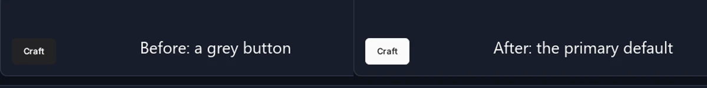

# Interfaces

Worlds are flat lists, redrawn every frame. Interfaces are the opposite: they're trees,
and most of a tree stays the same from one frame to the next. So `Super.Ui` works like
SwiftUI. You describe the interface with small records, and Super works out what changed.

```csharp
using Super;
using Super.Ui;

record StatRow(string Label, string Value) : UiView
{
    public override UiView Body => new HStack(Spacing: 24f)
    {
        new Text(Label).Foreground(Color.Hex("#9FD3E0")),
        new Spacer(),
        new Text(Value).MonospacedDigit(),
    };
}

record ColonyPanel(int Workers, int Wood) : UiView
{
    public override UiView Body => new VStack(HorizontalAlignment.Leading, Spacing: 4f)
    {
        new Text("Colony").Bold().FontSize(16f),
        new StatRow("Workers", $"{Workers}"),
        new StatRow("Wood", $"{Wood}"),
    }
    .Padding(12f)
    .Background(Color.Hex("#06202C", 0.72f))
    .FixedSize();
}

class MyColony(Colony colony) : IGame
{
    public UiView? Ui => new ColonyPanel(colony.Workers.Count, colony.Wood)
        .Padding(16f)
        .Frame(maxWidth: UiExtensions.Infinity, maxHeight: UiExtensions.Infinity, alignment: Alignment.TopLeading);

    // Update and Draw as usual.
}
```

A component is a record with a `Body`. `ColonyPanel` and `StatRow` are components, and
you use your own exactly like the built-in ones. Super reads `Ui` every frame, so always
describe the whole interface and let Super find the differences.

Interface code runs on the CPU only. Layout and text are real in headless runs, so
[a test can check](testing.md#checking-the-screen) what text is shown and where.

## Views

| View | What it does |
| --- | --- |
| `Text("Hello")` | Text. It wraps at spaces when it's offered too little width. See [Text that doesn't fit](#text-that-doesnt-fit) |
| `VStack`, `HStack` | Children top to bottom, or left to right |
| `ZStack` | Children on top of each other, the last one in front |
| `Spacer()` | Pushes its neighbors apart along the stack |
| `Image(content.UiImages.Image("icon.png"), ImageFit.Contain)` | An image, stretched, fitted (`Contain`) or filling (`Cover`), with an optional tint |
| `ScrollView()` | Scrolls what's inside it with the wheel or a draggable bar. Give it a height, or it grows to fit |
| `ListView<T>(items, row, selected, onSelect)` | A scrolling list of rows you can hover and pick |
| `Grid(columns, columnGap, rowGap)` | Children in equal columns, wrapping onto new rows |
| `Pressable(look => view, onClick)` | Anything clickable, drawn from whether it's hovered or pressed |
| `Button("Craft", onClick, Disabled: true)` | A ready-made `Pressable` with a label. See [Controls](#controls) |
| `Toggle("Music", on, set)` | A switch, or a checkbox with `Style = ToggleStyle.Checkbox` |
| `Slider(value, set, min, max)` | Picks a number by dragging, smoothly or in `Step`s |
| `Stepper("Players", count, set, min, max)` | A whole number with minus and plus buttons |
| `Picker<T>("Difficulty", picked, options, set)` | One of a few `PickerOption`s, segmented or as radio buttons |
| `ProgressView("Loading", done, total)` | How far along something is, as a bar or a ring |
| `Gauge("Health", value, min, max)` | A reading on a scale, as a ring open at the bottom or a bar |
| `Rectangle`, `RoundedRectangle(radius)`, `Capsule`, `Circle`, `Ellipse` | A shape that fills the space it's offered. See [Shapes](#shapes) |
| `Arc(start, sweep, thickness)` | Part of a ring, for progress rings, cooldowns and gauges |
| `new Icon(IconName.Search)` | A line icon, sized and coloured like the text around it |
| `Divider()` | A thin line across a stack, either way |
| `Badge("Rare", BadgeStyle.Secondary)` | A short tag for a count, a status or a rarity |
| `Label("Settings", new Icon(IconName.Menu))` | Text with an icon before it |
| `KeyHint("E")` | A keycap, for prompts such as "Press E to open" |

## Modifiers

Modifiers wrap a view, so their order usually matters.

| Modifier | What it does |
| --- | --- |
| `.Padding(all)`, `.Padding(horizontal, vertical)`, `.Padding(top, trailing, bottom, leading)` | Adds room around the view |
| `.Margin(...)` | The same, but outside the view's background |
| `.Frame(width, height, maxWidth, maxHeight, alignment, minWidth, minHeight)` | Fixes the size, or lets the view stretch |
| `.FixedSize()` | Uses the size the view would like, whatever it's offered |
| `.Background(color)`, `.Background(Paint.Linear(...))` | Fills the view's area with a colour or a [gradient](#gradients) |
| `.Border(width, color)` | Draws a line inside the view's edge, following its corners |
| `.CornerRadius(radius)`, `.CornerRadius(new CornerRadii(...))` | Rounds the background, border and image, and clips what's inside. `CornerRadii` rounds each corner on its own |
| `.Shadow(ShadowSize.Medium)`, `.Shadow(color, blur, x, y, spread)` | Casts a soft [shadow](#shadows) under the box |
| `.Opacity(value)` | Fades the view and everything inside it |
| `.Foreground(color)`, `.Foreground(Tone.Muted)`, `.FontSize(pixels)`, `.Font(font)` | Styles text here and everywhere inside. A `Tone` takes its colour from the theme |
| `.TextStyle(TextStyle.Headline)` | Sets the size and weight from the theme's [text styles](#text-styles) |
| `.Bold()`, `.Weight(FontWeight.Medium)`, `.Italic()` | Sets how heavy text is, or slants it |
| `.TextAlign(TextAlignment.Center)` | Lines up each line of text inside its frame |
| `.Theme(theme)` | Gives everything inside [a theme](#themes) |
| `.Disabled()` | Turns off every control inside: they fade and ignore clicks. `.Disabled(false)` further in can't turn them back on |
| `.ControlSize(ControlSize.Small)` | Makes the controls inside smaller or larger |
| `.MonospacedDigit()` | Gives digits one width, so changing numbers don't jiggle |
| `.LineLimit(lines)` | Keeps text here and everywhere inside to that many lines, ending cut text in "…" |
| `.Id(key)` | Names a view among its siblings, and lets a test or script [find it on screen](testing.md#finding-a-view) |
| `.OnClick(action)` | Runs on a left click |
| `.Tooltip(view)` | Shows a view near the cursor after a short hover |
| `.Draggable(payload, preview)`, `.DropTarget<T>(onDrop, canDrop)` | Lets the mouse carry a value from one view to another |
| `.Draggable(start => payload, payload => preview)` | Chooses what to carry at the press, from the button and the Shift, Control and Alt keys held (`DragStart`), or null not to drag. On a Mac, Cmd counts as Control, since Ctrl with a click means a right-click there |
| `.IgnoresPointer()` | Lets the mouse through, like CSS's `pointer-events: none` |
| `.OnSlide(fraction => ..., inset)` | Follows the left button held on the view, with how far across it the cursor is, for [controls of your own](#controls-of-your-own) |
| `.Semantics(role, label, value, isChecked)` | Says what a view of your own means, so tests [read it like a built-in control](testing.md#reading-controls) |

### The box

Five modifiers written next to each other make one box, in any order, as in CSS:

| Written | Result |
| --- | --- |
| `.Background(c).Margin(8f)` or `.Margin(8f).Background(c)` | Same thing: the margin is never filled |
| `.Border(1f, c).CornerRadius(6f)` or the reverse | Same thing: the border follows the corners |
| `.Margin(4f).Margin(4f)` | Margins in one box add up, to 8 |
| `.Padding(12f).Background(c)` | Padding comes first, so the background fills it |
| `.Background(c).Padding(12f)` | Padding comes after, so it stays outside the background |
| `.Background(c).Padding(1f).CornerRadius(8f)` | Padding ends the box, so that background stays square |

`Background`, `Border`, `CornerRadius`, `Opacity` and `Margin` are the five. `Padding` and
`Frame` go by order and end the box. Gaps are the `Spacing` on a stack and the gaps on a
`Grid`.

## Colors

`Color` takes whichever notation you like, and each one takes an optional alpha:

```csharp
Color.Hex("#06202C", 0.72f);        // also #RGB, #RGBA and #RRGGBBAA
Color.Rgb(6, 32, 44);               // 0 to 255
Color.Hsl(198f, 0.76f, 0.1f);       // hue in degrees, the rest 0 to 1
Color.Oklch(0.72f, 0.12f, 210f);    // lightness 0 to 1, chroma 0 to about 0.4, hue in degrees
Color.White with { A = 0.5f };      // change just the opacity
```

Oklch is the best one for building a palette, because colors with the same lightness
look equally bright. A color too vivid for a screen gets clipped.

`Color` is for interfaces. 3D colors and lights stay as `Vector3`, because they're
linear and a bright light can go well past 1.

## Themes

The built-in elements take their look from a `Theme`: its colours, corners, shadows, text
styles and control sizes. `Theme.Dark` is the default and `Theme.Light` is the other. Both
are neutral greys, so they fit most games. Change what you need with `with` and put it on
any view, and everything inside takes it:

```csharp
var theme = Theme.Dark with
{
    Colors = Theme.Dark.Colors with { Primary = Color.Hex("#3B82F6") },
    Radius = 2f,
};

new VStack(new Text("Paused"), new Button("Resume", Resume)).Theme(theme);
```

The colours are in `theme.Colors`, and the shadows in `theme.Shadows`:

| Colour | Used for |
| --- | --- |
| `Background`, `Foreground` | Behind everything, and the text on it |
| `Surface`, `Raised` | Panels and cards, and what floats above them, such as menus |
| `Muted`, `MutedForeground` | Quiet fills such as a slider's track, and text that matters less |
| `Hover` | A row or quiet button under the pointer |
| `Primary`, `Secondary`, `Destructive`, each with a `...Foreground` | Buttons and badges, and the text on them. `Primary` also fills a switch that's on, the filled part of a slider, and progress |
| `Success`, `Warning` | Statuses |
| `Border`, `Input`, `Ring` | Lines between things, the edge of a field, and the focus ring |
| `Scrim` | Laid over the game behind a dialog |

Your own views can use the same colours through a `Tone`, so they change with the theme:
`.Foreground(Tone.Muted)` is the theme's `Colors.MutedForeground`. Corners are `RadiusSmall` (4),
`Radius` (6) and `RadiusLarge` (10).

`.Disabled()` and `.ControlSize(...)` also reach everything inside them. A control turned off
fades and ignores the mouse, and `ControlSize.Small`, `Regular` and `Large` set how tall
controls are, their padding and their text size, from the theme's `Small`, `Regular` and
`Large` metrics.

### Text styles

`.TextStyle(...)` sets text's size and weight by what it is, as SwiftUI does, from the
theme's `Typography`:

| Style | Size | Weight |
| --- | --- | --- |
| `LargeTitle` | 30 | Bold |
| `Title` | 24 | SemiBold |
| `Title2` | 20 | SemiBold |
| `Title3` | 17 | SemiBold |
| `Headline` | 14 | SemiBold |
| `Body` | 14 | Regular |
| `Callout` | 13 | Regular |
| `Subheadline` | 13 | Medium |
| `Footnote` | 12 | Regular |
| `Caption` | 11 | Medium |

Change one with `Theme.Dark with { Typography = Typography.Default with { Title = new(28f, FontWeight.Bold) } }`.

### Gradients

`.Background(...)` and a shape's `.Fill(...)` take a `Paint`, which is a colour or a
gradient. A colour turns into a `Paint` by itself.

```csharp
Paint.Linear(top, bottom);                                       // top to bottom
Paint.Linear(from, to, angle: 90f);                              // left to right, as CSS's angles go
Paint.Linear(from, to, Alignment.TopLeading, Alignment.BottomTrailing);
Paint.Radial(center, edge, at: Alignment.Top, radius: 200f);     // the radius reaches the farthest corner unless given
```

Gradients mix in sRGB, as CSS does, and fade into a clear colour without turning grey.

### Shadows

`.Shadow(ShadowSize.Small)`, `Medium` and `Large` cast the theme's shadows. For one of your
own, give its colour, blur and offset: `.Shadow(Color.Black with { A = 0.4f }, blur: 16f, y: 6f)`.
A shadow follows the box's corners and isn't seen through a see-through background.

### Shapes

Shapes fill the space they're offered, so give one a size with `.Frame(...)` or let a stack
stretch it. A shape takes the text colour around it unless it's given `.Fill(paint)`, and
`.Stroke(color, width)` draws its outline inside the edge:

```csharp
new Circle().Fill(Color.Hex("#22C55E")).Frame(width: 10f, height: 10f);
new RoundedRectangle(8f).Stroke(Color.White, 2f).Frame(width: 120f, height: 40f);
new Arc(Start: 0f, Sweep: cooldown, Thickness: 3f).Frame(width: 32f, height: 32f);
```

An `Arc` runs clockwise from the top. Its start and sweep are fractions of a turn, so
`new Arc(0f, 0.25f)` is the top right quarter.

## Controls

The controls show the value they're given and tell you when the player changes it, as
React's controlled inputs do. Keep the value in your game, pass it in, and store what
`OnChange` hands back. The change runs on the next tick, just before `Update`, like a click:

```csharp
new VStack(HorizontalAlignment.Leading, 12f)
{
    new Toggle("Subtitles", settings.Subtitles, on => settings.Subtitles = on),
    new Slider(settings.Volume, volume => settings.Volume = volume) { Label = "Volume" },
    new Slider(settings.Fov, fov => settings.Fov = fov, 60f, 120f) { Step = 5f, Label = "Field of view" },
    new Stepper("Players", lobby.Players, players => lobby.Players = players, 1, 4),
    new Picker<Difficulty>("Difficulty", game.Difficulty, Difficulties, picked => game.Difficulty = picked),
}
```

A control without an `OnChange` only shows its value. Every control fades and ignores the
pointer when it's `Disabled` or inside `.Disabled()`, and follows the `.ControlSize(...)`
around it.

| Control | Choices |
| --- | --- |
| `Button` | `Style`: `Default` (filled with the primary colour, for the main action), `Secondary`, `Outline`, `Ghost`, `Destructive` and `Link`. `Icon` puts an icon before the label, and with an empty label it's a square icon button |
| `Toggle` | `Style`: `Switch`, which fills its row with the label at the start, or `Checkbox`, a box before the label. Clicking the label toggles it too |
| `Slider` | `Min`, `Max` and `Step`. A press on the track jumps there, and dragging follows the cursor even off the track. `Label` names it for tests |
| `Stepper` | `Min`, `Max` and `Step`. Each button turns off at its end of the range |
| `Picker<T>` | `Style`: `Segmented`, side by side with the picked one raised, or `Radio`, one under the other |
| `ProgressView` | `Style`: `Linear` or `Circular`. A bar with a label shows the percentage beside it, and a ring shows it inside |
| `Gauge` | `Style`: `Circular` or `Linear`, `Tint` for its own colour, and `ValueLabel` for the reading shown in place of the number |


A `Button` without a `Style` is the main action, filled with the theme's primary colour.
It used to be a quiet grey, so give the buttons beside the main one `ButtonStyle.Secondary`
or `Outline`:



### Controls of your own

`.OnSlide(...)` and `.Semantics(...)` are what the built-in controls are made with. A
volume knob or a colour wheel can use them too:

```csharp
new Knob(level)
    .OnSlide(across => SetLevel(across), inset: 8f)
    .Semantics(UiRole.Slider, "Level", UiSemantics.Number(level));
```

`OnSlide` hands over how far across the view the cursor is, from 0 to 1, once a tick for
as long as the left button stays down. `inset` keeps that much of each end out of the
range, for a thumb whose middle stops short of the edge.

## Focus, the keyboard and the gamepad

Every built-in control can take focus, so a menu works without a mouse. The focused control
has a ring round it:

| Input | What it does |
| --- | --- |
| Tab, Shift+Tab | The next or the previous control, in the order they're laid out, round to the start again |
| The arrows, the d-pad, the left stick | The nearest control that way. On a slider, stepper or picker, left and right change its value instead |
| Enter, Space, the gamepad's South button | Presses the focused control |
| Escape, the gamepad's East button | Leaves a text field |

Held, the d-pad and the stick move once, then after a short wait again and again. A control
that's turned off, hidden or gone is passed by, and when the focused one goes, focus lets go.
A click anywhere but a text field lets go too, and the ring stays hidden while the mouse is
in use: the first arrow after a click only shows it again.


Keys and buttons the interface uses are taken from the game. While a control has focus,
`input.Pressed(Key.Enter)` stays false for the press that pressed it, and the game sees no part of
it, not even the release. The same goes for the gamepad's buttons, and the left stick reads as
centred while it steers. With nothing focused, every key and button goes to the game, so a game
with no interface on screen sees all its input as before.

`.DefaultFocus()` gives focus to the first control inside it as soon as it appears, with the
ring hidden. A main menu wants that, so the gamepad's South button starts the game from the
start. With nothing focused, the arrows come back to it:

```csharp
new VStack(Spacing: 12f)
{
    new Button("Play", game.Start),
    new Button("Options", () => screen = Screen.Options) { Style = ButtonStyle.Secondary },
    new Button("Quit", game.Quit) { Style = ButtonStyle.Ghost },
}.DefaultFocus()
```

Without one, Tab still starts on the first control, and the arrows stay with the game until
something has focus.

`.Focusable(...)` makes a view of your own a stop. It takes what Enter does and, for a
control with a value, what left and right do, as -1 or 1. Leave the first out to press the
click inside the view. A focusable view holds whatever can take focus inside it, so a
stepper's two buttons are one stop:

```csharp
new Card(chest)
    .Focusable(() => chest.Open(), step => chest.Turn(step))
    .Semantics(UiRole.Button, "Old chest");
```

A focused control inside a `ScrollView` is scrolled into view.

## Text fields

`TextField` is one line of text to type. It's a control like the others: give it the text
and store what `OnChange` hands back. The prompt shows in a muted colour while it's empty.
`SecureField` shows a dot for each character and won't copy or cut:

```csharp
new TextField("Player name", profile.Name, name => profile.Name = name),
new SecureField("Password", login.Password, password => login.Password = password)
{
    OnSubmit = _ => login.SignIn(),
},
```

A click or Tab focuses a field, and a click places the caret. A focused field takes every key
except the modifiers and F1 to F25, so typing a W doesn't walk the player. Tab, Up, Down, Enter
and Escape leave it, and Enter calls `OnSubmit` first. Inside the field:

| Keys | What they do |
| --- | --- |
| Left, Right, Home, End | Move the caret. With Ctrl (Command on a Mac) Left and Right go a word at a time |
| Shift with any of those | Selects |
| Backspace, Delete | Delete a character, the selection, or with Ctrl (Command) a word |
| Ctrl+A, C, X, V (Command on a Mac) | Select all, copy, cut and paste. A paste becomes one line |

`OnChange` runs once a tick at most, with the text as it ends up, however many keys came in.
Characters below a space are dropped. A field that's `Disabled`, or inside `.Disabled()`,
fades and can't be focused.

## The storybook

The [Storybook example](../examples/Storybook) shows every element on its own and in its
variations, in both themes. Run it to see what's there, or with `--story badges --theme light`
to open one page. The `buttons`, `toggles`, `sliders`, `steppers`, `pickers`, `progress`
and `gauges` stories keep their values, so you can try each control, and `text-fields` and
`focus` show typing and moving with the keys. The `focus` and `typing` input scripts play
those for a shot, with `--story focus --script focus`.


## Layout

Layout works like SwiftUI's, and does what flexbox does:

1. A parent offers its child some space.
2. The child picks its own size. The parent has to accept the answer.
3. The parent places the child, using its alignment.

Stacks share their space out starting with the least flexible child, and spacers go
last. When there's room for every child at its ideal size, each gets at least that, so
nothing wraps in a row that fits it. To make something grow like `flex-grow`, give it
`.Frame(maxWidth: UiExtensions.Infinity)`. To pin something to a corner, wrap it in a
frame that fills the screen, as `MyColony` does above. The top of the tree is centered
otherwise.

### Text that doesn't fit

A stack offers each piece of text the width it would like when there's room. When
there isn't, text wraps at its spaces and gets taller, and a short label such as
"Thatch 8" can end up split from its number, spilling out of a card with a fixed height.
Wrapping is the default because paragraphs need it. For labels, choose what happens
instead:

| Write | What happens when it doesn't fit |
| --- | --- |
| nothing | Wraps onto more lines, and grows taller than it was offered |
| `.LineLimit(1)` | Stays on one line inside its frame, cut with "…" at the end |
| `.LineLimit(n)` | Wraps onto at most `n` lines, the last cut with "…" |
| `.FixedSize()` | Stays whole on one line and spills past its frame, overlapping its neighbours |

`.LineLimit` reaches every text inside it, so one on a row covers all its labels:

```csharp
new HStack { new Text("Wood 16"), new Text("Stone 6"), new Text("Thatch 8") }.LineLimit(1)
```

`run.ShownText` reports cut text as it shows, such as `"Thatc…"`, so a test sees the
cut too. Only cut text is reported differently; text that wraps is reported whole.

## State

Most interfaces only show game state. For anything the interface owns itself, such as
which tab is selected, use `UseState`. Super keeps the value for as long as that view
stays in the tree:

```csharp
record Tabs : UiView
{
    public override UiView Body
    {
        get
        {
            var selected = UseState(0);
            return new HStack(Spacing: 8f)
            {
                new Button("Items", () => selected.Value = 0),
                new Button("Recipes", () => selected.Value = 1),
                new Text($"Tab {selected.Value}"),
            };
        }
    }
}
```

Reading `Value` during `Body` signs that component up for changes, and setting it runs
only the components that read it. Call `UseState` the same number of times and in the
same order on each run. Hand a `State<T>` to a child to let the child use it too.

The rule is the same as for views: if gameplay cares, it's game state, and it belongs in
your own classes, not in `UseState`.

## The mouse

Clicks, drops and list picks run just before `Update`, on the tick they happened, so
they can change game state and replay with a seed. Hover, press and scrolling follow the
mouse every frame, however slowly the game ticks.

```csharp
new Button("Craft", () => bag.Craft(recipe), Disabled: !bag.Has(recipe));

new Pressable(look => Slot(stack).Background(look.Hovered ? hover : fill))
    .Draggable(slotNumber, new Image(icon).Frame(56f, 56f))
    .DropTarget<int>(from => bag.Move(from, slotNumber));
```

`.Draggable(payload)` drags with the left button. To let other buttons drag, or carry something
different for each, hand it a function instead. It's told how the drag began and returns what to
carry, or null when that press shouldn't drag. It runs at the press, so it only chooses; the drop
is where the game changes. The drag ends when that button is let go, and other buttons pressed
meanwhile do nothing. A left press that turns into a drag is no longer a click, but a left click
already held on something else still clicks when it's let go, even if another button dragged in
between:

```csharp
new Pressable(look => Cell(stack))
    .Draggable(start => start.Button switch
    {
        MouseButton.Middle => new Carry(cell, stack.Count / 2),
        MouseButton.Left => new Carry(cell, start.Shift ? 1 : stack.Count),
        _ => null,
    }, carry => Icon(carry))
    .DropTarget<Carry>(carry => bag.Move(carry, cell));
```

In a tick, the order is: clicks, then `Update`, then the next `Draw`. So `Update` already
sees what a click changed on the tick it happened, and the press the button took never
reaches `Input`, so `Pressed(MouseButton.Left)` stays false. When a button and a key do
the same thing, have both call one method that does all of it, such as putting the other
tool away, rather than comparing state against last tick in `Update` to find out what a
click did:

```csharp
new Button("Harvest", () => tools.TakeOut(harvest));      // the button

if (actions.Pressed(Control.Harvest))                     // the key, in Update
{
    tools.TakeOut(harvest);
}
```

A press that moves off a button and lets go there doesn't click. While the mouse is over
the interface, `input.Mouse.OverUi` is true, so a game can leave those clicks alone. To
have a panel let clicks through to the game, as a stats readout should, use
`.IgnoresPointer()`.

A `ListView` compares its list by reference, so hand it a new one when the items change.

[The crafting bench](../examples/Crafting/CraftingGame.cs) uses all of this.

## Scale

Sizes in an interface are pixels, until you scale it. At a scale of 2, one unit covers two
pixels, so text, padding, borders and corners are all twice as big. That's what an
interface made for a desktop window needs to be read in a video watched on a phone:

```
dotnet run -c Release --project MyColony -- --size 1080x1920 --ui-scale 2.5 --record clip.mp4 --seconds 15
```

`--ui-scale` overrides `GameOptions.UiScale`, which is 1 unless the game sets it. The
interface lays itself out in the screen's size divided by the scale, so a 1080 pixel wide
screen at 2.5 is 432 units wide. Text is drawn at its size in pixels, not stretched, so it
stays sharp. `FrameOf`, `ShownText` and everything else the interface reports are in
units. The mouse is turned into units for you, and an `InputScript` or a test that clicks
a view by its id aims at where it's drawn. `InputScript.MoveMouse(position)` and
`input.Mouse.Position` stay in pixels. A headless test sets the scale with `run.UiScale`.

On a Mac's Retina screen a window has two pixels for each point of its size, so a game in a
window multiplies the scale by that, and the interface looks the same size as on any other
screen. Screenshots and videos have the pixels `--size` asks for, so they keep the scale.

A scale that isn't a number above zero is refused. The characters all share one 1024 by
1024 image, so very large text at a large scale can run out of room, and characters that
don't fit aren't drawn.

## How it stays cheap

This is a virtual tree, like React's and SwiftUI's. The records are cheap descriptions
that live for moments. Behind them sits a tree of long-lived nodes, which hold state and
layout. Each frame, the reconciler walks the new description against those nodes:

- A record that equals the last one is skipped, with everything inside it.
- If nothing changed, there's no layout and no drawing work. The panel in Reef only
  redoes its work twice a second, when its numbers change.
- A view keeps its state while it stays in the same place with the same type. A
  different type in that place starts fresh.
- `show ? view : null` keeps its slot when it's null, so what follows doesn't move.
  In a list that changes, use `.Id(item.Id)`, like a `key` in React, so rows keep their
  state as they move.
- A lambda that captures a variable is a new object each run, so a record holding one
  never equals the last. That view and its parents are laid out again every frame. For a
  screen with a few hundred views that's fine. For something always on screen in a tight
  budget, keep the delegate in a field, so it stays equal.

## Fonts

The default font is [Inter](https://rsms.me/inter/), built into `Super.dll`, so text
works with no files around. A game's own font is cooked from a `.ttf` or `.otf` file and
named through [`content.Fonts`](content.md#fonts), and `.Font(font)` puts it on text here and
everywhere inside, as `.Bold()` does:

```csharp
GameFont heading = content.Fonts.Font("fonts/pirata-one.ttf");
GameFont body = content.Fonts.Font("fonts/figtree.ttf", bold: "fonts/figtree-bold.ttf");

new VStack(
    new Text("The Drowned Bell").Font(heading).FontSize(28f),
    new Text("+3 Armor").Bold(),
    new Text("Found on the third floor")
).Font(body);
```

The built-in Inter has Regular, Medium, SemiBold and Bold weights, and an italic. A font of your
own has a regular and a bold file: `.Bold()`, `SemiBold` and the text styles that use them
draw in the bold file, and `Medium` in the regular one. A font named without a bold file has
no bold, and bold text in it is drawn in the regular weight. Italic is only built in. Every font and size shares one 1024-pixel sheet of
characters; a character drawn once there's no room left takes its place in the line but isn't
seen, so keep to a few fonts and sizes.

## Showing how the game runs

Every game has a stats panel built in. Press F3 in the window to show or hide it (a game
can [pick another key or none](#the-stats-key)), or start
with it on with `--stats` from [the command line](command-line.md), which works with
`--screenshot` and `--record` too. It sits in the top right corner over the game's interface
and never takes the mouse.


From the top, the panel shows:

- The frame rate and how long a frame takes.
- CPU: how long a frame kept the game's thread busy, which is the frame less the time spent
  waiting for the GPU and the display.
- GPU: how long a frame kept the GPU busy, with the five slowest passes under it. A GPU that
  can't time its passes leaves these out.
- Draw calls: the models drawn in the newest frame, over every pass, shadows included.
- Triangles: what the camera drew after culling and detail, and under it what the shadows
  drew. A still light's kept shadow isn't drawn again, so it isn't counted.
- Shadow tiles: the point and spot light shadows drawn this frame and those kept from
  earlier ones, when the scene has any.
- GPU memory: what the renderer uses of what it has taken from the device. It takes memory
  in 64 MB blocks, so the second figure is the larger.
- Heap: the size of the garbage collected heap and the bytes allocated a frame on the
  game's thread.
- Collections: garbage collections since the game started.
- The frame's size and the GPU's name.

The times are averages over half a second, and the counts are the newest frame's. Timing
the GPU costs a little, so the renderer is only measured while the panel is shown.

### The stats key

The key is `GameStats.ToggleKey`, F3 unless the game picks another. The engine keeps that
key, so the game never sees it, and any other key, F3 included once it isn't the toggle,
reaches the game as usual. Set it to null to turn the key off, as a shipped game might;
`Shown` and `--stats` still work then. Either can change while the game runs, and a game
can show the panel from a menu of its own by setting `Shown`:

```csharp
class DebugMenu
{
    private readonly GameStats _stats;

    public DebugMenu(GameStats stats)
    {
        _stats = stats;
        _stats.ToggleKey = Key.F10;
    }

    public void ShowStats(bool on) => _stats.Shown = on;

    public void LockForRelease() => _stats.ToggleKey = null;
}
```

### Your own panel

To draw your own panel instead, ask for `GameStats` in your constructor and read `Latest`,
which updates twice a second. It holds the frame rate, frame time, bytes allocated per frame
on the game's thread, heap size and garbage collections, and in `Render` the renderer's
figures above, while `Shown` is on. Work done for the interface isn't counted, so a stats
panel doesn't report itself. Reef's panel is in
[StatsPanel.cs](../examples/Reef/StatsPanel.cs).

These numbers come from the real clock, so only show them. If they reach `Update`, a seed
stops repeating.

## Not yet

There's no touch yet, text fields are one line only, and menus, sheets and dialogs aren't
built in yet.
