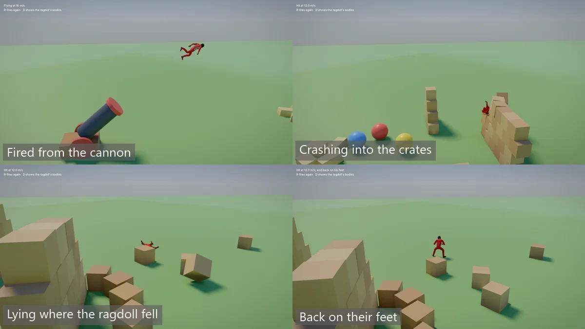
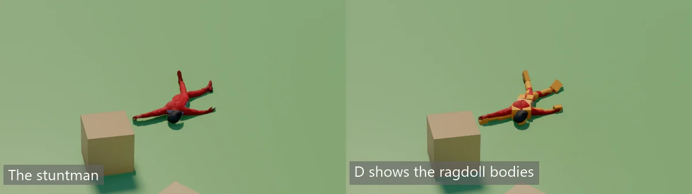

# Physics

`Super.Physics` gives entities solid shapes. Things fall, stack, bounce and get pushed;
characters walk into walls and up stairs; joints hold bodies together; animated characters
turn into ragdolls and back; trigger areas notice who comes and goes; contacts say what
hit what and how hard; and rays and shape casts find what's in the way. It's built on
[Jolt Physics](https://github.com/jrouwe/JoltPhysics), through JoltPhysicsSharp.

It comes with the Super package, along with its native library (`joltc.dll`, copied beside
the game by the build). A game that wants physics turns it on where it registers its own
services:

```csharp
using Super.Physics;

services.AddSuperPhysics();
```

From then on the world is stepped before each `Update`, and a game asks for `Physics` in a
constructor like any other service.

## Colliders

A `Collider` is an ECS component. It needs a `Transform`, and it moves, turns and scales
with it, following `Parent` too:

```csharp
var knight = world.Spawn(
    Transform.At(position),
    Collider.Capsule(height: 1.8f, radius: 0.4f, layers: Enemies));
```

| Shape | Made with | Where it sits |
| --- | --- | --- |
| Ball | `Collider.Ball(radius, offset)` | Centred on the offset |
| Box | `Collider.Box(size, offset)` | Its full size, centred on the offset, turned with the entity |
| Capsule | `Collider.Capsule(height, radius, offset)` | Upright, standing on the offset and reaching `height` up, end to end. It suits a character whose origin is at their feet |

The offset is in the entity's own space. A capsule's height must be at least twice its
radius; a collider that can't be built throws on the next step, naming its entity.

**Layers.** A collider is on one or more of 16 layers, as bits, `Collider.DefaultLayer`
(bit 0) unless you say otherwise. Queries name the layers they look at, so a click can
look at enemies only, or skip the walls, and bodies name the layers they bump into.
`collider.OnLayers(bits)` gives the same shape on other layers.

## Bodies

A collider on its own is **kinematic**: it goes where its Transform says, and pushes
anything dynamic out of the way, like a door or a moving platform. Add a `Body` to say
otherwise:

```csharp
world.Add(floor, Collider.Box(new Vector3(40f, 1f, 40f)));
world.Add(floor, Body.Static);

world.Add(crate, Collider.Box(Vector3.One));
world.Add(crate, Body.Dynamic(mass: 20f, friction: 0.6f));
```

| Body | What moves it | Use it for |
| --- | --- | --- |
| No `Body`, or `Body.Kinematic` | Your code, through its Transform. It sweeps to the new place, pushing dynamic bodies | Doors, lifts, platforms, a character's own body |
| `Body.Static` | Nothing. Moving it teleports it | Floors, walls and scenery; the cheapest kind |
| `Body.Dynamic(...)` | The simulation: gravity, collisions and your pushes. Physics writes its Transform | Crates, balls, rubble, things that are thrown |

`Body.Dynamic` takes:

| Setting | Default | What it does |
| --- | --- | --- |
| `mass` | 1 | Kilograms. Inertia follows from the shape |
| `friction` | 0.5 | How rough it is, from 0 (ice) up. Two bodies use the square root of their two multiplied |
| `bounciness` | 0 | How much speed a bounce keeps, from 0 to 1. Two bodies use the larger |
| `drag`, `angularDrag` | 0.05 | How much moving and turning fade each second |
| `gravityScale` | 1 | 0 floats, 2 falls twice as hard |
| `lockRotation` | false | Never turns, such as a box-shaped player that must stay upright |
| `continuous` | false | Sweeps along its path so a small, fast body can't pass through a thin wall. Costs more |
| `collidesWith` | every layer | The layers it bumps into. Both bodies must say yes to collide |

`body.CollidingWith(bits)` and `body.WithSurface(friction, bounciness)` change one part of
a body, static and kinematic ones too.

**Moving dynamic bodies.** Physics owns a dynamic body's Transform, so it can't have a
`Parent`. Setting its Transform yourself teleports it, keeping its speed. Otherwise, push
it through `physics.Bodies`:

| Call | What it does |
| --- | --- |
| `physics.Bodies.Push(entity, impulse)` | A sudden push in newton-seconds: the velocity changes by impulse over mass. Kicks, hits, explosions |
| `physics.Bodies.Push(entity, impulse, point)` | The same, at a point in the world, so it spins when the point is off centre |
| `physics.Bodies.AddForce(entity, force)` | A steady push in newtons through the next step. Call it every tick for thrusters or wind |
| `physics.Bodies.AddTorque(entity, torque)` | A twist through the next step |
| `physics.Bodies.SetVelocity(entity, velocity)` | Sets it outright, in metres per second |
| `physics.Bodies.SetAngularVelocity(entity, spin)` | Sets the spin, as an axis whose length is radians per second |
| `physics.Bodies.Velocity(entity)`, `physics.Bodies.AngularVelocity(entity)` | How fast any body moves and turns |

Only dynamic bodies can be pushed; pushing anything else throws, naming the entity.

**Gravity.** `physics.Gravity` pulls every dynamic body, `Physics.EarthGravity`
(9.81 m/s² down) to start.

## Characters

A `Character` walks with `physics.Characters.Move`. It slides along walls, climbs steps, keeps to the
ground going down slopes and stairs, can't walk up slopes that are too steep, and pushes
crates. Its shape is its collider, usually a capsule on its feet:

```csharp
world.Add(player, Transform.At(start));
world.Add(player, Collider.Capsule(height: 1.8f, radius: 0.4f));
world.Add(player, new Character(MaxSlope: 45f, StepHeight: 0.35f));
```

`Move` walks it at once, writes where it ends up to its Transform, and says how it went.
Gravity and jumping are yours, so they feel the way your game wants. Keep the vertical
speed from one tick to the next:

```csharp
Vector3 velocity;
bool grounded;

public void Update(GameTime time)
{
    var walk = actions.Vector(Control.Move) * 5f;
    velocity.Y = grounded ? 0f : velocity.Y - (20f * time.DeltaSeconds);
    if (grounded && actions.Pressed(Control.Jump))
    {
        velocity.Y = 6f;
    }

    var move = physics.Characters.Move(player, new Vector3(walk.X, velocity.Y, walk.Y), time.DeltaSeconds);
    velocity = move.Velocity;
    grounded = move.Grounded;
}
```

| `Character` setting | Default | What it does |
| --- | --- | --- |
| `MaxSlope` | 50 | The steepest ground it stands on and walks up, in degrees |
| `StepHeight` | 0.3 | The highest step it climbs, and how far down it stays on the ground, in metres |
| `CollidesWith` | every layer | The layers that block it |
| `Mass` | 70 | How hard it pushes dynamic bodies, in kilograms |

| `CharacterMove` | What it says |
| --- | --- |
| `Position` | Where it ended up, as written to its Transform |
| `Velocity` | How fast it really moved, after walls and slopes |
| `Footing` | `Ground`, `SteepGround` (it slides), `Unsupported` (on an edge) or `InAir` |
| `Grounded` | `Footing` is `Ground` |
| `GroundNormal`, `Ground` | Which way the ground faces, and its entity |
| `GroundVelocity` | How fast the ground under it is moving, such as a lift. Zero in the air and on still ground |

A character isn't carried by what it stands on. To ride a lift or a moving platform, add
the ground's velocity to the next move:

```csharp
var move = physics.Characters.Move(player, walk + carried, time.DeltaSeconds);
carried = move.GroundVelocity;
```

It works for any kinematic collider moved through its Transform, and for dynamic bodies.
It's zero from the tick the character leaves the ground, so keep the last one yourself if
a jump off a moving platform should keep its speed.

### Jumping

When a plain fall and a good jump are all you want, give the character a `Jumper` and
call `Walk` in place of `Move`. It does the falling, the jumping and the riding above
for you:

```csharp
world.Add(player, new Jumper(JumpSpeed: 9.5f, Gravity: 24f));

public void Update(GameTime time)
{
    var stick = actions.Vector(Control.Move) * 6f;
    var walk = new Vector3(stick.X, 0f, -stick.Y);
    var move = physics.Characters.Walk(player, walk, actions.Down(Control.Jump), time.DeltaSeconds);
}
```

Pass whether the jump button is down, not whether it was just pressed: `Walk` tells a
press from a hold itself, so holding the button doesn't jump again on landing. Letting
go on the way up makes a lower hop, and a jump still works a moment after walking off an
edge, which players expect without knowing it. A button that's already down the first
time a jumper walks doesn't count, so the press that started the game isn't also a jump.
The walking speed's Y is ignored.

| `Jumper` setting | Default | What it does |
| --- | --- | --- |
| `JumpSpeed` | 9.5 | How fast a jump leaves the ground, in metres per second |
| `Gravity` | 24 | How fast it speeds up falling, in metres per second each second |
| `Forgiveness` | 0.12 | A jump still works this many seconds after walking off an edge |
| `ShortHop` | 0.5 | How much of its rise is kept when the button is let go on the way up. 1 turns the short hop off |

A jump rises its speed squared over twice the gravity, about 1.9 metres with the
defaults, and the character climbs its `StepHeight` on top, so it reaches ledges a bit
higher than that. The jumper's `Rise` is how fast it's going up, and `AirTime` is the seconds since it stood
on something. Set `Rise` for a bounce pad, and set it to 0 after a teleport, or it keeps
falling at the speed it had. `Move` is still there underneath for anything else, such as
a double jump or a glide.

A character can't have a `Parent` or a dynamic `Body`. Setting its Transform teleports it.
Its collider is also a kinematic body, so rays and triggers find it and falling crates
land on it.

## Triggers

Add a `Trigger` to a collider to make it an area that notices what comes in and goes out,
rather than a solid shape. Nothing bumps into it, and queries pass through it:

```csharp
world.Add(goal, Collider.Box(new Vector3(4f, 3f, 4f)));
world.Add(goal, new Trigger(Detects: Players));

public void Update(GameTime time)
{
    foreach (var entered in physics.Triggers.Entered)
    {
        if (entered.Trigger == goal)
        {
            Win(entered.Other);
        }
    }
}
```

| Call | What it gives |
| --- | --- |
| `physics.Triggers.Entered` | Who came into a trigger in the last step, as `(Trigger, Other)` pairs |
| `physics.Triggers.Exited` | Who left one in the last step |
| `physics.Triggers.Inside(trigger)` | Who's in it now |
| `physics.Triggers.Entered<TTrigger, TOther>()` | The same pairs, kept when the area has a `TTrigger` and the visitor a `TOther` |
| `physics.Triggers.Entered<TTrigger>()` | Everyone who came into an area that has a `TTrigger` |
| `physics.Triggers.Exited<TTrigger, TOther>()`, `Exited<TTrigger>()` | The same for who left |
| `physics.Triggers.Inside<TTrigger, TOther>()` | Every pair that's inside now. `Anyone` as `TOther` takes every visitor |

With more than one kind of area, pick the events by component and skip the checks:

```csharp
foreach (var (gem, _) in physics.Triggers.Entered<Gem, Player>())
{
    score += world.Get<Gem>(gem).Worth;
    world.Destroy(gem);
}

if (physics.Triggers.Inside<Lava, Player>().Any())
{
    Burn();
}
```

These are walked with `foreach` and allocate nothing. The components are checked as the
loop goes, so an area destroyed in the loop drops out of the rest of it. An entity
destroyed while inside has no components left, so `Exited<TTrigger, TOther>` skips it, and
`Exited<TTrigger>` still lists it.

Each lists in trigger order, then entity order, so a seeded run repeats. Triggers notice
colliders on their `Detects` layers (every layer by default), but never other triggers.
An entity destroyed while inside leaves, so check `world.IsAlive` before using it; a
trigger that's removed reports no one leaving. Triggers are checked after each step, so a
character moved in Update is noticed on the next tick.

## Contacts

`physics.Contacts` lists what started touching in the last step: a crate landing, a ball
hitting a wall, a ragdoll's elbow hitting the floor. Each `Contact` gives the two
entities, the point, the normal from the first into the second, and `Speed`, how fast
they were closing in metres per second, which tells a tap from a crash:

```csharp
foreach (var contact in physics.Contacts)
{
    if (contact.Speed > 2f)
    {
        audio.Play(thud, at: contact.Point, volume: MathF.Min(1f, contact.Speed / 10f));
    }
}
```

There's one contact for each pair of entities, the hardest if several of their shapes
touched, with the lower entity first and the pairs in entity order. A pair is listed in
the step its shapes start touching, so a crate resting on the floor isn't listed again
until it lifts off and lands, but a ragdoll rolling over the floor is listed in most
steps, as one part after another touches down. Triggers don't make
contacts, and neither do a ragdoll's own parts touching each other. Read the list in
Update: the next step replaces it.

## Joints

A `Joint` holds an entity's body to another entity's, or to a point in the world, so
they move together. Both need a `Collider`, and at least one should be dynamic:

```csharp
world.Add(door, Joint.Hinge(anchor: new Vector3(-0.5f, 0f, 0f), axis: Vector3.UnitY, to: frame,
    minAngle: -100f, maxAngle: 100f));
world.Add(lamp, Joint.Rope(anchor: new Vector3(0f, 0.3f, 0f), to: null, otherAnchor: hook, length: 2f));
```

| Joint | Made with | What it does |
| --- | --- | --- |
| Fixed | `Joint.Fixed(to)` | Welds the two as they are now |
| Ball | `Joint.Ball(anchor, to)` | Holds them at one point, turning any way, like a chain link |
| Hinge | `Joint.Hinge(anchor, axis, to, minAngle, maxAngle)` | Turns about one axis only, between two angles in degrees from where it started, like a door or a wheel |
| Rope | `Joint.Rope(anchor, to, otherAnchor, length)` | Keeps two points no more than `length` metres apart; it goes slack |
| Rod | `Joint.Rod(anchor, to, otherAnchor, length)` | Keeps two points exactly `length` metres apart |

Anchors and axes are in each entity's own space. With no `to`, the other anchor is a
point in the world. A joint holds the bodies as they are when it's made, on the step
after it's added or changed. An entity has one joint at most, so for a chain, give each
link a joint back to the one before. When the other entity is destroyed or loses its
collider, the joint lets go; take the `Joint` away to let go yourself.

## Ragdolls

A `Ragdoll` makes an animated character fall, tumble and get pushed like a body. It
goes on an entity with a `Transform` and an `Animated`, and it needs a `RagdollBody`,
the parts and the joints between them. Make that once per rig and share it:

```csharp
var rig = content.Rig("cannonball/stuntman.fbx");
var body = RagdollBody.Humanoid(rig);

world.Add(stuntman, Transform.At(position));
world.Add(stuntman, new Animated(controller.Start(Stance.Idle)));
world.Add(stuntman, new Ragdoll(body));
```



`RagdollBody.Humanoid` suits a rig with the usual human joint names, such as Mixamo's,
with or without a prefix like `mixamorig:`. It has 16 parts: the pelvis, two spine
parts, the head, and the upper arm, forearm, hand, thigh, shin and foot on each side.
Each part is a box, ball or capsule fitted to the vertices its joints move, so the model
must be cooked with its mesh. The joints bend as a body does: elbows and knees one way
only, hips further forward than back. For another rig, list the parts yourself as
`RagdollPart`s, each naming its joint and its share of the mass, with its shape, how far
its joint swings and twists, and which way it bends. `Friction`, `Bounciness`, `Layers`,
`CollidesWith` and `Continuous` on the `RagdollBody` apply to every part. `Continuous` is
on by default, so a body fired at a wall doesn't pass through it. To give a humanoid
other settings, start from its parts:

```csharp
var body = new RagdollBody(rig, RagdollBody.HumanoidParts()) { Bounciness = 0.6f };
```

`Bounciness` is 0.1 by default, so a body mostly thuds. Cannonball uses 0.6, so the
stuntman bounces off the ground before rolling to a stop.

### Turning it on and off

Set `Mode` to switch the ragdoll:

| Mode | What happens |
| --- | --- |
| `Off` | No bodies; the animator moves the character. The default |
| `Kinematic` | Bodies follow the animation, so the character pushes crates and rays hit its limbs |
| `Simulated` | The simulation moves the bodies, and the character takes their pose |

```csharp
world.Get<Ragdoll>(stuntman) = world.Get<Ragdoll>(stuntman) with { Mode = RagdollMode.Simulated };
physics.Bodies.SetVelocity(stuntman, aim * 18f);
```

A ragdoll switched to `Simulated` starts where the animation has the limbs, moving as
fast as they were moving, so a running character falls forward. While it's simulated,
the entity's Transform follows the pelvis. `physics.Bodies`' `Push`, `SetVelocity`, `SetAngularVelocity`,
`AddForce` and `Velocity` work on the whole body, spread over its mass; `Push` with a
point pushes the part nearest it, and `AddTorque` twists the pelvis while the mask leaves
it simulated (the animation holds a pelvis outside the mask, so a twist does nothing). They work straight
after the switch, in the same Update. `physics.Ragdolls.PushPart(entity, "Head", impulse, point)`
pushes a part by name, such as the head a ball hits.

`Strength` sets how hard the muscles pull each part towards the pose the animation
gives, from 0, limp, to 1, which holds the pose against gravity but still gives under a
blow. Between them, a character braces and stumbles. A flailing clip played at 0.3 makes
a body that waves its arms in the air and crumples when it lands. `Mask` simulates only
some joints, such as `rig.Mask("Spine")` for a body that flops above the waist while the
legs keep walking; the other parts follow the animation.

### Getting up

Switching back to `Off` takes the bodies away and blends the ragdoll's pose back into
the clips over `BlendSeconds`, 0.4 by default. `physics.Ragdolls.IsFaceUp(entity)` says which
get-up clip to pick before the switch:

```csharp
bool faceUp = physics.Ragdolls.IsFaceUp(stuntman);
world.Get<Ragdoll>(stuntman) = world.Get<Ragdoll>(stuntman) with { Mode = RagdollMode.Off };
animator.Moves.Play(faceUp ? Move.StandUp : Move.StandUpFromFront);
```

Play the get-up in the same Update as the switch, as an action with `fadeSeconds: 0`,
such as `.Action(Move.StandUp, rig.Clip("StandUp"), fadeSeconds: 0f)`. The ragdoll then
lays the clip over the body: it turns the character so the clip's first frame lies the
same way as the body, and moves them so the clip's pelvis is where the body's is, on the
ground below. The blend only has to bend the limbs, and the character stands up from
where they fell. With no lying-down clip playing, the character stands under the pelvis,
facing the way a body lying there would get up.

### Seeing the bodies

`physics.Ragdolls.Shapes(entity, shapes)` lists each part's shape where it is now, as a
`RagdollShapeView` with its joint, shape, transform, size and whether it's simulated.
Draw them over the character while tuning a `RagdollBody`; the
[Cannonball](../examples/Cannonball) example does this on D.



## Queries

```csharp
public void Update(GameTime time)
{
    var ray = input.Mouse.Ray(camera);
    if (physics.Queries.Raycast(ray, layers: Enemies) is { } hit)
    {
        Target = hit.Entity;     // hit.Distance and hit.Point say where.
    }
}
```

| Call | What it does |
| --- | --- |
| `Queries.Raycast(ray, reach, layers)` | The nearest hit within `reach` metres (1000 by default) on those layers, or `null` |
| `Queries.RaycastAll(ray, hits, reach, layers)` | Every collider the ray meets, nearest first and once each, into a list you keep |
| `Queries.ShapeCast(shape, from, direction, reach, rotation, layers)` | Sweeps a collider shape, a thick ray, and gives the first hit with its point and surface normal, or `null` |
| `Queries.ShapeCastAll(shape, from, direction, hits, reach, rotation, layers)` | Every collider the sweep meets, nearest first |
| `Queries.Overlap(shape, position, hits, rotation, layers)` | Every entity whose collider touches the shape there, in entity order |
| `Sync()` | Moves the colliders to where their entities are now |
| `Count` | How many colliders there are, as of the last sync |

`Physics` hands its work to five parts: `physics.Bodies` pushes and reads bodies,
`physics.Characters` walks characters, `physics.Queries` asks what is where,
`physics.Triggers` says who is in each trigger and `physics.Ragdolls` reads and pushes
ragdolls. `Step`, `Sync`, `Gravity`, `Count` and `Contacts` stay on `Physics` itself.

A shape cast answers questions a ray can't: will a ball fit down this corridor, where
does a falling crate land, how far can the [camera boom](cameras.md#third-person) reach.
An overlap finds what an explosion reaches, or whether there's room to stand up. The
shape's offset counts from `from` or `position`, as on an entity, and `rotation` turns
it. A ray or shape that starts inside a collider hits it at distance 0. Hits at the same
distance come in entity order. Queries pass through triggers.

**When things move.** Before each `Update` the game loop steps the world by
`time.DeltaSeconds`: colliders move to where their entities are, dynamic bodies move on
and their Transforms are written, then triggers are checked. So `Update` sees the world as
it was last drawn. Entities moved during `Update` keep their old place for queries until
the next tick, unless you call `physics.Sync()`, which makes them jump there rather than
push. An entity destroyed, or a `Collider` taken away, is skipped by queries at once and
dropped at the next step. When `time.Scale` is 0 nothing moves.

A step longer than 1/60 s is split, so a game at 30 ticks a second simulates two steps
per tick. With a `Physics` you make yourself, such as in a test, call
`physics.Step(seconds)` to move it on.

**Repeating.** Jolt gives the same answers for the same calls with the same build on the
same machine, and Super keeps to that by sorting hits and events rather than trusting
Jolt's order. A pile of 60 dropped boxes lands the same way every run of a seed.

## Limits

- No mesh, convex-hull or height-field colliders; build a shape from balls, boxes and
  capsules.
- No vehicles, motors on joints, or springs.
- A ragdoll's muscles only pull towards the animation's pose. They don't balance, so a
  ragdoll can't stay on its feet or walk by itself.
- A ragdoll's parts don't collide with their parent part, nor with parts their shape
  overlaps at rest. Every other pair collides, so one leg can't pass through the other.
- An entity has one `Joint` at most.
- A collider's transform can't be sheared; a parent scaled unevenly under a turned child
  throws.
- Results repeat on one machine and build, not across machines.
- Up to 65,536 colliders.
- Games running in parallel, such as tests, take turns to step, because Jolt's native
  library shares one scratch allocator between physics worlds.
