# Rendering

Super draws with [Rendition](../src/Rendition/README.md), a deferred, physically based
Vulkan renderer. You don't call it directly: `Draw` describes the world on a `View`, and
Super hands that to Rendition each frame.

What it does for every game, with no setup:

- Cook-Torrance GGX shading with up to eight directional lights, and up to 1,024 point
  and spot lights with soft shadows. Rough surfaces keep the light that bounces between
  their tiny facets, so worn iron and brushed steel stay as bright as real metal does
- Soft, contact-hardening shadows, in up to four cascades, with screen-space [contact shadows](#shadows) where things meet the ground
- A generated environment that gives surfaces reflections and soft fill light
- Screen-space reflections and box-corrected [reflection probes](#reflections), which glass reflects too
- Ground-truth [ambient occlusion](#ambient-occlusion) (GTAO), with a bent normal that turns the soft light towards the opening and specular occlusion that dims reflections in corners, and light bounced back from the surface's colour
- Temporal anti-aliasing that follows moving, animated and swaying things with [motion vectors](#motion-vectors), and bloom
- [Glass](#glass) that bends and frosts what's behind it, car paint clearcoat and surfaces that glow
- [Height maps](#height-and-detail-maps) that sink mortar and grooves into a flat surface, and detail maps for fine grain
- [Occlusion maps](#occlusion-maps) that darken the soft light in cracks, read through either UV set
- [Toon shading](#toon-shading-and-outlines) in flat bands with ink outlines, for any surface beside physically based ones
- Skin, wax and jade that [let light spread under the surface](#skin-and-wax)
- Cut-out leaves, grass and cobwebs that [keep their shape in the distance](#models), since the cook keeps their alpha coverage in every mip
- Soft, lit [particles](views.md#particles) for dust and smoke
- Culling and simpler versions of distant models, for the camera and for shadows
- [AgX](#tone-mapping), ACES or PBR Neutral tonemapping, white balance, colour grading with split toning, tones, a channel mixer and a hue shift, [artists' colour tables](#a-colour-table), sharpening, vignette, grain and dithering

And when a scene asks for it:

- [Bounced light](#bounced-light) from light probes kept round the camera, lit by the sun and every lamp, which doesn't leak through walls
- A [clear sky](#the-sky) worked out from the sun and the haze in the air, with the sun's disc in it
- [Height fog](#fog) that glows towards the sun, and [volumetric fog](#volumetric-fog) near the camera, with shafts of sunlight and halos round lamps
- [Auto exposure](#auto-exposure) that meters the frame and adapts like a camera
- [Depth of field](#focus) from a lens with a focus distance, an aperture and a focal length
- [Decals](#decals) that lay grime, rust, moss and boot prints onto what is under them
- [Puddles](#puddles) of standing water, with a damp band, wherever the ground lies below a level
- [Planar reflections](#planar-reflections) in a flat floor or pool that mirror what's off screen too, sharp where things touch it
- [Wind](#wind) that sways grass, leaves and their shadows
- [Wear and dirt](#wear-and-dirt) on edges and in hollows, from masks the cook bakes from the mesh
- A [render scale](#graphics-settings) that draws the scene smaller or larger than the window, and [AMD FSR](#upscaling) to rebuild the full picture from a smaller one

The [Courtyard example](../examples/Courtyard) uses most of them. On the left is the
Courtyard on the evening it was first built, on 6 November 2026; on the right is how it
looks now, at the same seed and frame:


## Graphics settings

Everything above is on by default. Vsync is off, so frames come as fast as the machine draws
them; set `Screen.Vsync` to hold the frame rate at the display's, often 60, or `Screen.MaxFramesPerSecond`
to cap it. The settings come in groups: `Screen`, `Shadowing`, `Lighting`, `Atmosphere`, `Surfaces`,
`Picture`, `Baking` and `Drawing`. A game that must run fast on modest hardware turns off what it doesn't need:

```csharp
Game.Run<MyGame>(new GameOptions
{
    Title = "My game",
    Graphics = new Graphics
    {
        Lighting = { AmbientOcclusion = false, Reflections = false },
        Screen = { MaxFramesPerSecond = 144 },
    },
});
```

`Graphics.Fastest()` turns every effect that costs GPU time off, except point and spot lights and particles, and sets `Drawing.MeshDetail` to 0.5, a start to turn back on only what
the game needs. It keeps what costs nothing or saves time: the materials, the baked lighting, `Specular`,
`EnvironmentLight`, `Emissive`, `ColorGrading`, `ColorLut`, `Retro`, `Culling`, `SimplerModels`, `DepthFirst` and `Fades`, whose small cost buys a picture without pops. For settings a player picks from, see [quality presets and profiles](#quality-presets-and-profiles). Ask for `Graphics` in a constructor to change it while the game runs; the
next frame follows, so it can back an options menu.

| Setting | Off, or set |
|---|---|
| `Screen.Vsync` | Off is the default: frames come as fast as the machine draws them, and fast movement may tear. On, each frame waits for the display. `--vsync` turns it on too |
| `Screen.MaxFramesPerSecond` | The most frames drawn a second. 0, the default, is no limit. It saves power, and with vsync off it holds a steady rate |
| `Screen.UploadBudget` | Milliseconds a frame for sending models and textures to the GPU as they [stream in](states.md#loading-screens), from 0.25 to 33. 2, the default, lands hundreds of small meshes made in code in a few frames. More loads faster for a slower frame while it does. One item goes each frame however long it takes. Only play in a window streams |
| `Screen.UnfocusedMaxFramesPerSecond` | The most frames drawn a second while the player is in another window. 0, the default, keeps to `MaxFramesPerSecond`. A low limit such as 10 saves power while the game waits in the background, and it never draws faster than `MaxFramesPerSecond`. The game still ticks; read [`input.Window.HasFocus`](input.md#pausing-in-the-background) to pause it |
| `Shadowing.SunShadows` | Nothing is drawn into the sun's shadow maps, often the biggest saving. Ambient occlusion still darkens nooks |
| `Shadowing.ShadowResolution` | How many texels across each of the sun's shadow maps is: 1024, 2048 (the default) or 4096. Each step up sharpens shadow edges for four times the memory. A change rebuilds the maps before the next frame, which waits for the GPU once |
| `Shadowing.ShadowCascades` | How many of the sun's shadow maps are drawn, from 1 to 4, the default. Each map covers three times the ground of the one before, and each draws the scene again, so fewer save GPU time. The sun casts no shadow past the last map drawn, so with 2 its shadows reach about a ninth as far as with 4. A frame that asks for fewer in [`Shadows`](#shadows) keeps its number |
| `Drawing.MeshDetail` | How soon models switch to their simpler versions with distance, from 0.5 to 2. 1, the default, switches where the change is under a pixel. At 0.5 they switch twice as soon, which draws fewer triangles for a little blockiness far away, and at 2 half as soon. The sun's shadow maps follow it too |
| `Drawing.GrassDetail` | How far [grass](#grass) reaches, from 0.25 to 2. At 1, the default, every blade grows within 16 metres and the sparsest reach 120. Every ring scales with it, so the blades drawn go as its square: 0.5 draws about a quarter as many. Anything else is refused |
| `Screen.RenderScale` | How large the scene is drawn against the window, from 0.5 to 2 each way. 1, the default, draws it at the window's size with nothing resized. At 2 the scene has four times the pixels and is shrunk to fit, which smooths grass blades, railings and other thin things, for about four times the lighting and effects work. At 0.5 it has a quarter of the pixels and is stretched, which is much faster and softer. Below 1, meshes also switch to their simpler versions sooner, since they cover fewer scene pixels. A scene larger than the GPU can draw is shrunk to fit, keeping its shape. The interface, screenshots and recordings stay at the window's size. Anything else is refused. `--render-scale` sets it too. A change rebuilds the scene's targets before the next frame, which waits for the GPU once and restarts anti-aliasing |
| `Screen.Upscaler` | What smooths edges when `AntiAliasing` is on: `Upscaler.Taa`, the default, or `Upscaler.Fsr`, which hands the frame to AMD FSR to rebuild at the window's size. See [upscaling](#upscaling). `--upscaler fsr` sets it too, and `Graphics.Fastest()` uses TAA |
| `Shadowing.ContactShadows` | No thin dark line where things meet the ground in sunlight, only what the shadow maps show. [`Shadows`](#shadows)' `Contact` only changes [how far they look](#shadows) |
| `Shadowing.LightShadows` | Point and spot lights shine through walls |
| `Lighting.LocalLights` | Point and spot lights give no light: none is clustered, shadowed or lit onto the [light probes](#bounced-light), so the sun and the sky light the scene alone. Light a bake already holds stays, and no bake is redone. `BakedLighting` drops it too |
| `Lighting.AmbientOcclusion` | Corners and creases are as bright as open ground, and shiny things in them reflect the sky as brightly. A material's [occlusion map](#occlusion-maps) still darkens its own cracks. [`AmbientOcclusion`](#ambient-occlusion) only changes [how far and how dark](#ambient-occlusion). The [screen bounce](#light-bounced-across-the-screen) goes with it |
| `Lighting.ScreenBounce` | Surfaces on screen no longer [light their neighbours](#light-bounced-across-the-screen): the floor under a red ball stays its own colour, and a glowing panel lights nothing round it unless the light probes see it. The light probes still bounce light. It saves about 0.6 ms of GPU time a frame at 1920 by 1080 on an RTX 4060 Ti. A `ScreenBounce` entity only changes how far and how much. `GraphicsQuality.Low` and `Graphics.Fastest()` turn it off |
| `Lighting.OcclusionHistory` | The [ambient occlusion](#ambient-occlusion) and the [screen bounce](#light-bounced-across-the-screen) are no longer averaged over the last frames. Each frame's grain is blurred away over a wider patch instead, so creases and the shade under things turn softer and small detail, such as the gap round a chest's lid, washes out. It saves about 0.1 ms of GPU time a frame at `OcclusionResolution.Half` and about 0.9 ms at `Full`, at 1600 by 900 on an RTX 4060 Ti, and four small images. `Graphics.Fastest()` turns it off |
| `Lighting.MultiscatterSpecular` | Rough surfaces lose the light that bounces between their tiny facets, so rough metals such as worn iron come out darker than they should, by up to half at full roughness. It costs almost nothing, so leave it on unless you're comparing |
| `Lighting.LightProbes` | No [bounced light](#bounced-light): shade takes its soft light from the sky alone, even inside a `LightProbes` box. No probes are drawn, and their memory, about 170 MB at `ProbeQuality.High`, is freed until it is switched back on, when every probe starts again. `Graphics.Fastest()` turns it off |
| `Lighting.ProbeQuality` | How many [light probes](#bounced-light) follow the camera and how many are redrawn a frame. `High`, the default and the best look, keeps 32 × 16 × 32 probes in each of the four boxes and redraws 32 a frame, for about 170 MB. `Medium` keeps 24 × 12 × 24 and redraws 16, for about 73 MB. `Low` keeps 16 × 8 × 16 and redraws 8, for about 43 MB, so the boxes reach half as far, the bounce fills in more slowly at the start and is slower to follow lights that move. Anything else is refused. A change starts every probe again on the next frame, which waits for the GPU once. `Graphics.Fastest()` sets `Low`, so turning the probes back on stays cheap |
| `Lighting.Reflections` | Shiny surfaces, water and glass reflect only the sky: not what's on screen, and no [reflection probes](#reflections) are photographed |
| `Lighting.PlanarReflections` | A [mirror plane](#planar-reflections) or the puddles' level no longer mirrors the scene: a wet floor reflects only what's on screen and the probes, so what stands above the top of the picture is missing from it. It saves drawing the scene a second time at half size, about 1 ms of GPU time a frame on the Courtyard at 1600 by 900 on an RTX 4060 Ti. `GraphicsQuality.Low` and `Graphics.Fastest()` turn it off |
| `Lighting.ReflectionResolution` | Not a switch: how many pixels look for what the screen shows in them each frame. At `Half`, the default, one pixel in four does, a different one each frame, and the pixels between take theirs from the ones round them on the same surface. Anti-aliasing blends the frames, so a still reflection looks the same as at `Full`, where every pixel looks every frame for up to four times the cost. `Full` keeps a reflection sharper while it moves fast, and is the one to pick with `AntiAliasing` off. Anything else is refused. A change rebuilds the scene's targets before the next frame, which waits for the GPU once. `GraphicsQuality.Ultra` sets `Full` |
| `Lighting.OcclusionResolution` | Not a switch: how many pixels work out their [ambient occlusion](#ambient-occlusion) each frame. At `Half`, the default, one pixel in four does, a different one each frame, and the pixels between take theirs from the ones round them at the same depth. Occlusion is soft, so the picture is hard to tell from `Full`, where every pixel works out its own for about two and a half times the cost of the effect. At `Full` each pixel looks in one direction a frame and the average over the last frames gathers them, so with `OcclusionHistory` off it looks in two and costs more. With `AntiAliasing` off nothing blends the frames, so pick `Full` there too. Anything else is refused. A change rebuilds the scene's targets before the next frame, which waits for the GPU once. `GraphicsQuality.Ultra` sets `Full` |
| `Screen.AntiAliasing` | Edges show their pixels, and moving things stay sharp |
| `Picture.Bloom` | No glow round bright things. `PostSettings.Bloom` only changes how much there is |
| `Atmosphere.Fog` | Clear air, whatever `SkySettings.Fog` asks for. [Haze](#the-sky) stays, since it isn't fog. `SkySettings.Fog` only changes [how thick it is](#fog) |
| `Atmosphere.Haze` | Distant things keep their colours instead of fading into the sky between `SkySettings.HazeStart` and `HazeEnd`. The sky's own colour stays |
| `Atmosphere.AerialPerspective` | Under a [physical sky](#the-sky), far surfaces keep their colours instead of fading into the air with distance. A view with its own haze gets that either way. It costs almost nothing |
| `Atmosphere.Stars` | A [physical sky](#night) at night has no stars. The moon stays. They cost a little per sky pixel, so they stay on even in `Graphics.Fastest()` |
| `Atmosphere.Clouds` | A [physical sky](#clouds) is clear, whatever `SkySettings.Clouds` asks for: no clouds in the sky, in its reflections or in its light, and no cloud shadows. None of the cloud passes run. `Graphics.Fastest()` turns it off |
| `Atmosphere.VolumetricClouds` | The [clouds](#clouds) are a flat layer painted on the sky instead of heaped volumes lit from inside: no bright edges, dark bellies or towers, but the same clouds in the same places, and they still cast their shadows. It saves most of what the clouds cost. `GraphicsQuality.Low` and `Medium` turn it off |
| `Atmosphere.CloudShadows` | The sun shines everywhere as if the sky were clear: no [cloud shadows](#clouds) drifting over the ground, the water or through the volumetric fog. The clouds still dim the sky light. It saves one small compute pass |
| `Atmosphere.Underwater` | An `Underwater` entity is ignored: the view is drawn as if the camera were not under water, with no absorption, caustics or light shafts, and the sky and the surrounding colours come back. See [water](#water) |
| `Atmosphere.VolumetricFog` | The fog is the plain height fog all the way, exactly as if `FogSettings.VolumetricDistance` were 0: no shafts of sunlight and no halos round lamps, and under water no shafts of light. It saves two compute passes over a small grid and about 35 MB of memory at 1600 by 900, which is freed when it is switched off and made again, without its history, when it is switched back on. See [volumetric fog](#volumetric-fog) |
| `Atmosphere.FogVolumes` | The [fog volumes](#fog-volumes) a frame places are left out, and only the scene's own fog fills the volumetric fog. They show only while `VolumetricFog` is on too. `Graphics.Fastest()` turns it off |
| `Atmosphere.VolumetricFogCellSize` | Not a switch: how many scene pixels across, each way, one cell of the [volumetric fog's](#volumetric-fog) grid covers, from 4 to 32. 8 is the default. Smaller cells show finer shafts and sharper edges on fog volumes; each halving costs about four times the memory and work. The size is after `RenderScale`. Anything else is refused. A change remakes the grid before the next frame, which waits for the GPU once and starts its history again. See [the grid's cost](#the-grids-cost) |
| `Atmosphere.VolumetricFogSlices` | Not a switch: how many slices deep the volumetric fog's grid is, from 16 to 128, out to `FogSettings.VolumetricDistance`. 64 is the default. More slices keep shafts and fog volumes sharp further out, for memory and work that grow with the count. Anything else is refused. A change remakes the grid like `VolumetricFogCellSize`. `GraphicsQuality.Ultra` sets 128 |
| `Picture.AutoExposure` | Views that ask for [auto exposure](#auto-exposure) keep the fixed `PostSettings.Exposure` instead, as if they hadn't asked. It saves a compute pass over the frame |
| `Picture.DepthOfField` | Everything is sharp, even in views that open the lens with `PostSettings.Lens.Aperture`. It saves three passes, two of them at half size. See [focus](#focus) |
| `Surfaces.Particles` | No [particles](views.md#particles) are drawn, and none is uploaded. The game can still emit them |
| `Surfaces.Decals` | No [decals](#decals): surfaces show as they are, without the grime and stains `Decal` entities lay on them. It saves a copy of the normal target and a pass over the decals' pixels |
| `Surfaces.Puddles` | Every surface is dry, whatever level a `Puddles` entity sets: no water and no damp band. It saves a few noise lookups on each wet pixel. See [puddles](#puddles) |
| `Surfaces.Wind` | Grass, leaves and anything else flagged for the [wind](#wind) stand still, whatever a `Wind` entity sets, and so do their shadows |
| `Surfaces.Grass` | No [grass](#grass) grows over models with a `Grass` component: the ground shows bare, and the scatter pass and the blades' drawing in the picture and the two nearest shadow cascades don't run. It saves about 1.2 ms of GPU time a frame in the Terrain example at 1920 by 1080 on an RTX 4060 Ti. `Graphics.Fastest()` turns it off |
| `Baking.BakedLighting` | Every bake is ignored, so each [baked area](#baked-lighting) is lit live, as if it had never been baked: lights its bake holds are drawn again. It shows what a bake changes. A bake costs less than the live light it stands in for, so `Graphics.Fastest()` leaves it on |
| `Baking.BakeOnArrival` | Areas with no bake, or a stale one, stay lit live instead of [baking as the game runs](#baking-without-a-build-step), and a running bake stops |
| `Baking.BakeBudget` | Not a switch: the GPU milliseconds a [background bake](#baking-without-a-build-step) may take a frame, from 0.5 to 33. Null, the default, gives 4 from source and 2 in a published game |
| `Surfaces.Materials` | Every surface is the same light grey, matte clay, shaped only by its mesh, with no occlusion map, so you can judge the lighting and the models without textures in the way. Glows still glow, cut-outs still cut, glass stays see-through and puddles still wet the clay. `--no-materials` turns it off too |
| `Surfaces.WearAndDirt` | Models' materials show only their own colour and shine, without the pale worn edges and dark hollows their [baked masks](#wear-and-dirt) lay on, and the masks aren't read |
| `Surfaces.HeightMaps` | Surfaces with a height map are flat, shaded only by their normal maps: bricks no longer stand out from the mortar as the view moves. It saves up to 32 lookups on each near pixel of those surfaces. Puddles still sink into the grooves. `GraphicsQuality.Low` and `Graphics.Fastest()` turn it off |
| `Lighting.Specular` | No shine: every surface is lit as plain matte, with no highlights, no reflections and no clear coat, metals in their base colour, and glass lets light through without reflecting. It's for judging the diffuse light, not for speed |
| `Lighting.EnvironmentLight` | The sky gives the same flat colour from every side, its average, instead of brighter light from above and the sky's colours in reflections. Light probes still see the real sky. It shows what the direct light and the probes do alone |
| `Surfaces.Subsurface` | Skin and wax are lit as plain matte, and light no longer shines through their thin parts. It saves two blurs across the picture. `Graphics.Fastest()` turns it off. See [skin and wax](#skin-and-wax) |
| `Lighting.Emissive` | No glows: lamps, screens and embers show only the light that falls on them, and no longer light the light probes. [Bakes](#baked-lighting) keep the glow they were made with. Ghosts still glow |
| `Picture.Vignette` | The corners are as bright as the middle, whatever `PostSettings.Vignette` asks for |
| `Picture.Grain` | No film grain, whatever `PostSettings.Grain` asks for |
| `Picture.Sharpening` | No sharpening, whatever `PostSettings.Sharpen` asks for, and the finish pass skips that work |
| `Picture.ColorGrading` | `PostSettings`' contrast, saturation, lift, gain, temperature, tint, hue shift, channel mixer, tones and split toning are all neutral. The exposure, the bloom, the tonemapper with its look and the colour table stay |
| `Picture.ColorLut` | No [colour table](#a-colour-table), whatever `PostSettings.Grade.Lut` asks for. It costs nothing either way, since the table is baked into the grade |
| `Picture.ChromaticAberration` | No colour fringes, whatever `ScreenEffects.ChromaticAberration` asks for. The picture is read once a pixel instead of three times while they'd show. `Graphics.Fastest()` turns it off. See [screen effects](#screen-effects) |
| `Picture.SpeedBlur` | No blur at speed, whatever `ScreenEffects.SpeedBlur` asks for. The picture is read once a pixel instead of 16 times while it'd show. `Graphics.Fastest()` turns it off |
| `Picture.Flashes` | No flashes, whatever `ScreenEffects.Flash` asks for, for a player who is sensitive to flashing light. The fade stays. It costs nothing |
| `Picture.ScreenEffects` | None of the [screen effects](#screen-effects) a game sets, but the fade: no fringes, blur, flash, edge tints, loss of colour or paper. The fade stays, since a game uses it to say something, such as that the player fell |
| `Picture.LensFlare` | No [lens flare](#lens-flare) from the sun or the lights a game names, and its passes don't run. `Graphics.Fastest()` turns it off |
| `Picture.Paint` | No [oil-paint look](#paint), whatever `PaintSettings` a game sets, and its passes don't run. It costs nothing while a game doesn't paint. `GraphicsQuality.Low` and `Graphics.Fastest()` turn it off |
| `Picture.Retro` | No [retro pixels](#retro-pixels): the picture keeps every pixel and every shade, whatever a [look](#looks) asks for. They cost next to nothing, so `Graphics.Fastest()` leaves them on |
| `Drawing.Culling` | Every model is drawn into the picture, each of the sun's cascades and each light's shadow tile, seen or not. It only costs time: it's there to check that culling hides nothing it shouldn't |
| `Drawing.SimplerModels` | Every model is drawn at full detail at any distance, whatever `MeshDetail` says, in the picture and the shadows. It only costs time: it's there to see what the simpler versions change |
| `Drawing.DepthFirst` | Large solid surfaces are no longer drawn twice, depth first and then shaded, so a surface drawn before the one that hides it is shaded for nothing. It only costs time: it's there to measure what drawing depth first saves. The picture is the same, but where two surfaces lie in the very same plane, where the other of the two may show |
| `Drawing.Fades` | Nothing [fades with distance](#fading-with-distance): a fade becomes a hard cut halfway through it, models swap to their simpler versions at once, so the swap can pop, and glass shows fully up to whatever is behind it, with no soft edge. It saves drawing a model twice while it swaps |

Tonemapping and glass have no switch. Without tonemapping, bright light clips to flat white, and
without glass, windows would vanish rather than turn opaque, so neither shows anything useful.

With `Specular` off, the Courtyard's puddle and window lose their reflections and only the
diffuse light is left:

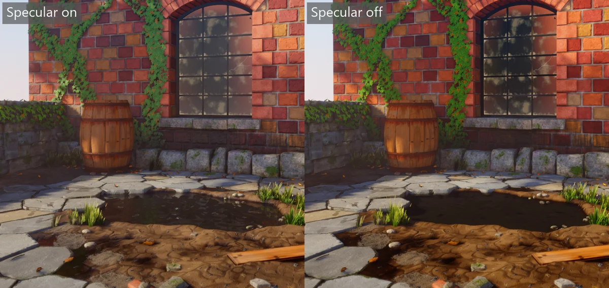

The finishing touches change the whole picture. With them off, the colours are flatter and the
corners no darker than the middle:

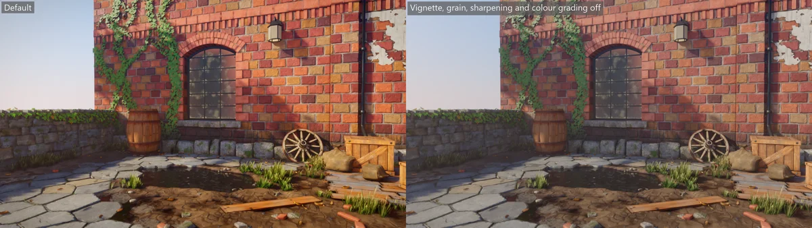

With `Emissive` off, the Crypt's lantern goes dark. The torch and candle flames are particles,
not emissive surfaces, so they still burn:

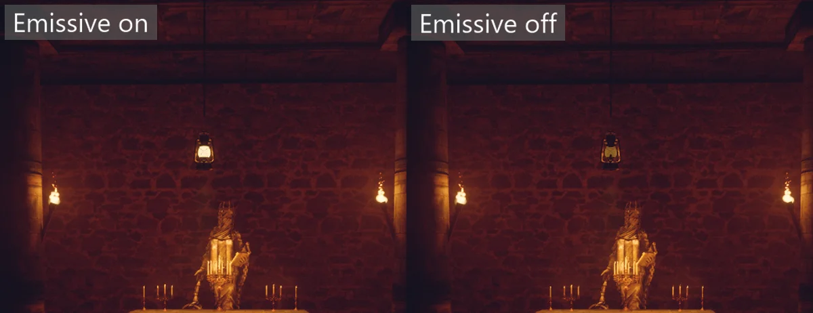

`Graphics.Fastest()` leaves `RenderScale` at 1 too, since a smaller picture is a change the
player can see, not only a saving. A game for slow GPUs on big screens sets it to 0.75 or 0.5
itself, or offers it in an options menu.

### Quality presets and profiles

`Graphics.For` gives a ready-made set of settings for `GraphicsQuality.Low`, `Medium`, `High` or
`Ultra`. `High` is the same as `new Graphics()`, every effect at its best. The others change:

| Quality | What changes from `High` |
|---|---|
| `Low` | Render scale 0.75, 1024 shadow maps, 2 cascades, `MeshDetail` 0.5, `GrassDetail` 0.5, `ProbeQuality.Low` and a 1 ms bake budget. Off: contact shadows, light shadows, light probes, ambient occlusion, the screen bounce, reflections, planar reflections, auto exposure, depth of field, paint, decals, volumetric fog, the marched clouds and height maps. Puddles, wind and the flat clouds with their shadows stay on, as they cost little |
| `Medium` | Render scale 0.85, 3 cascades, `MeshDetail` 0.75, `GrassDetail` 0.75, `ProbeQuality.Medium` and a 2 ms bake budget. Off: depth of field, volumetric fog and the marched clouds, so the [clouds](#clouds) are a flat layer |
| `Ultra` | 4096 shadow maps, `MeshDetail` 1.5, `GrassDetail` 1.25, `ReflectionResolution.Full`, `OcclusionResolution.Full` and 128 volumetric fog slices |

In the Courtyard at 1600 by 900 on an RTX 4060 Ti, a frame takes 8.5 ms of GPU at `High`, 6.5 at
`Medium` and 4.3 at `Low`. `Ultra` costs about the same as `High` there. `Medium` loses a little
sharpness; `Low` also loses the bounced light, the darkening in corners and what the puddle
reflects from the screen, though the puddle stays and still mirrors the sky:

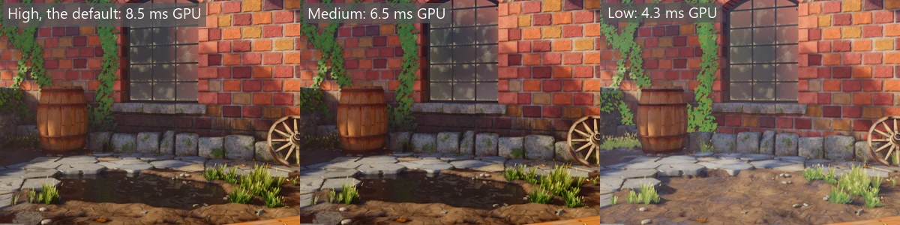

Every preset keeps vsync off and no frame limit, since those are the player's choice rather than a
quality. `graphics.Apply(profile)` switches a running game to another set of settings: it copies
every setting but `DebugView`, and the next frame follows. An options menu can do this:

```csharp
internal sealed class Options(Graphics graphics, Gpu gpu, UserData userData)
{
    public void Pick(GraphicsQuality quality)
    {
        graphics.Apply(Graphics.For(quality));
        graphics.Save(Path.Combine(userData.Folder, "graphics.json"));
    }

    public GraphicsQuality FirstChoice => gpu.RecommendedQuality;
}
```

`Gpu` is a service that says which GPU the game draws with: its `Name`, `Kind` (`Discrete`,
`Integrated`, `Virtual` or `Unknown`), `MemoryBytes` and `CanTrace`. The window fills it in once it
has made its device, so it is known from the first `Update`, not in `Load`, and stays `Unknown` in
tests without a window. `Graphics.Recommend(gpu.Info)`, or `gpu.RecommendedQuality`, guesses a
quality from it: `Low` for a GPU built into the processor or a virtual one, and for a card of its
own `Low` under 3 GB, `Medium` under 6 GB, `High` under 12 GB and `Ultra` from there. An unknown GPU
gets `High`. It is a first guess for a player who hasn't chosen, not a measurement.

`graphics.Save(path)` writes every setting but `DebugView` to a JSON profile, and
`Graphics.Load(path)` reads one back. Each group of settings is an object of its own, and choices
are written by name, such as `"Screen": { "Upscaler": "Fsr" }`. A profile written by hand can hold
only what it changes, and the rest keep their defaults:

```json
{
  "Atmosphere": { "VolumetricFog": false },
  "Shadowing": { "ShadowCascades": 2 },
  "Baking": { "BakeOnArrival": false }
}
```

A profile makes a custom preset of its own when `"Extends"` names one to start from instead of the
defaults: `Low`, `Medium`, `High`, `Ultra` or `Fastest`, in any case. The rest of the profile is
written over it, setting by setting, so a group the profile names keeps the preset's other settings.
This is `Low` with reflections back on and three cascades, and the rest of `Low`'s lighting, such as
ambient occlusion off:

```json
{ "Extends": "Low", "Lighting": { "Reflections": true }, "Shadowing": { "ShadowCascades": 3 } }
```

A setting outside its group, such as `{ "Bloom": false }`, is a name the profile doesn't know.

`Save` writes every setting and no `Extends`, so a saved profile keeps what it held even when a
later version changes the presets. A profile that extends anything else is refused with a message naming the file.

A name the profile doesn't know, or a value a setting refuses, stops the load with an
`InvalidDataException` naming the file. `--graphics` picks a preset or profile from the
[command line](command-line.md): `low`, `medium`, `high`, `ultra`, `fastest`, `auto` for the
recommended quality, or a path ending in `.json`.

A background bake costs up to `Baking.BakeBudget` milliseconds a frame while it runs, 4 from source by
default, which shows on a slow GPU right after arriving somewhere new. `Low` and `Medium` give it
less, and `Baking.BakeOnArrival = false` stops it.

### The debug view from a game

`Graphics.DebugView` sets what the frame shows from game code, so a key can toggle
`DebugView.Probes` (the [Hamlet](../examples/Hamlet/README.md) does, with P). It is not an effect:
it is `DebugView.None` by default and costs nothing then. `--debug-view` on the command line wins:
while it names a view, `Graphics.DebugView` is ignored, and when it doesn't, the game's value is
shown. `DebugView.Trace` needs a GPU that can trace rays. A `--debug-view trace` that can't run
exits at once with an error, but a game's `Graphics.DebugView = Trace` on such a GPU is ignored and
the lit scene is shown, because a game can't know what a player's GPU has.

### Upscaling

A render scale below 1 stretches the scene to the window, which softens it. With
`Upscaler.Fsr`, AMD FSR 3.1 rebuilds the full picture instead: it gathers detail from the
last frames as well as this one, so a scene drawn at 0.67 of the window's size comes back
close to one drawn at full size. It takes the place of TAA, so it also smooths edges at a
render scale of 1.

```csharp
Graphics = new Graphics { Screen = { Upscaler = Upscaler.Fsr, RenderScale = 0.67f } },
```

`--upscaler fsr` or `--upscaler taa` picks it from the command line. FSR is used only while
`AntiAliasing` is on and the render scale is 1 or less; above 1 the scene is already larger
than the window, so TAA and the plain shrink do the job. It needs `amd_fidelityfx_vk.dll`
next to the game, which the build copies there. Without it the renderer says so once and
uses TAA. A change while the game runs rebuilds the scene's targets before the next frame,
which waits for the GPU once and starts FSR's history again.

In the Courtyard at 1600 by 900 on an RTX 4060 Ti, FSR costs about 1.5 ms a frame at a render
scale of 1, against 0.2 ms for TAA, and about 0.6 ms at 0.67, where the whole frame drops from
about 13 ms to 7. At a scale of 1, FSR keeps grass blades and ivy a little sharper than TAA,
and window bars look the same, so TAA stays the default. Below 1, FSR is the better choice.

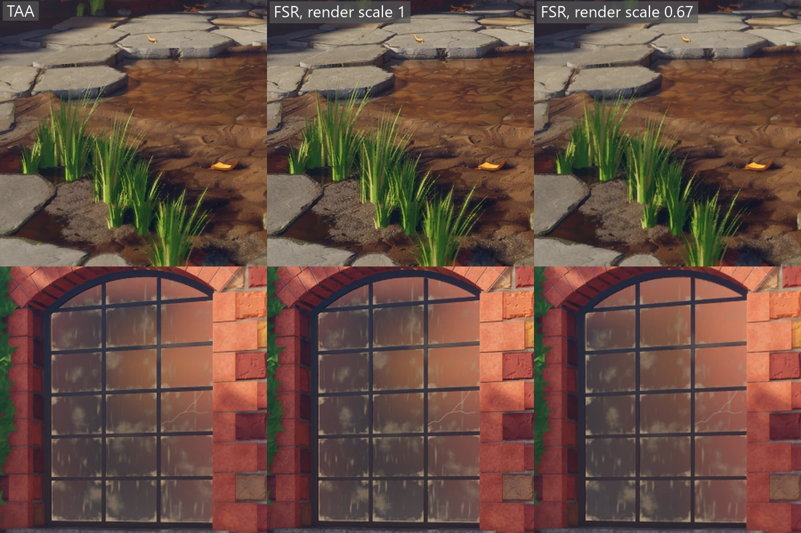

Only FSR is supported. NVIDIA's DLSS is not, see the [roadmap](roadmap.md).

`Materials` is for looking, not for speed, so `Graphics.Fastest()` leaves it on. A key that
flips it while the game runs makes a handy lighting check:

```csharp
internal sealed class MyGame(Graphics graphics, Input input) : IGame
{
    public void Update(GameTime time)
    {
        if (input.Pressed(Key.M))
        {
            graphics.Surfaces.Materials = !graphics.Surfaces.Materials;
        }
    }
}
```

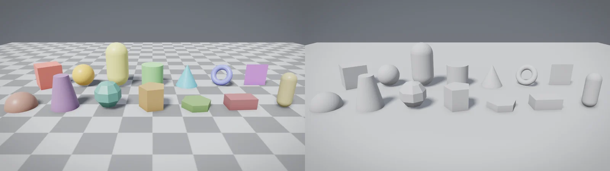

An effect turned off skips its work on the GPU, not only its look. In the Crypt, the
GPU time of a frame halves:

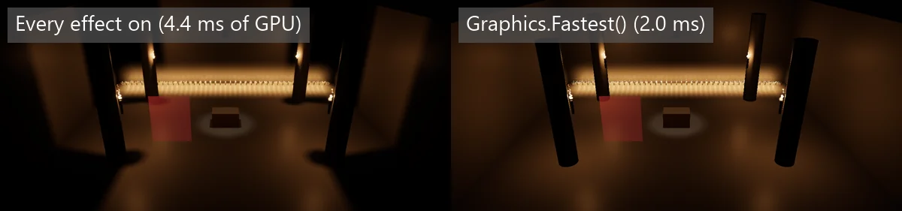

Recordings and profiles keep vsync and ignore the frame limit, so they come out the same on
every machine, but they do follow the effect switches. A screenshot follows them too, and
doesn't wait for the display: nobody sees its frames, and the shot comes out the same. Turning
`AntiAliasing` on or off waits for the GPU to finish once, so do it from a menu rather than
every frame.

### Ray tracing

On a GPU that supports ray queries (`VK_KHR_ray_query` with `VK_KHR_acceleration_structure`,
`VK_KHR_deferred_host_operations` and `bufferDeviceAddress`) the renderer turns them on when it
makes the device, and `Renderer.CanTrace` is true. Some players have a GPU that
can't, so nothing requires it: those players get the same game without tracing. So far rays
update the [light probes](#bounced-light), many more a frame than drawing them can, and draw the
debug view below; nothing else uses them.

`--no-trace` makes the device without ray queries even on a GPU that has them, so you can see
what a player without them gets. It works in the window and with `--screenshot`, `--record`
and `--profile`.

`--debug-view trace` shows what rays can see instead of the lit scene: each surface's base colour,
unlit, and sky blue where a ray hits nothing. Use it to check that the ray tracing layer holds the
scene you expect. Leaves in cut-out materials show holes, wind-swayed parts sit at rest, and skinned
characters, swimming draws and ghosts are missing, because rays don't see them yet. From code, set
`FrameView.Picture.DebugView` to `DebugView.Trace`; `Renderer.Render` throws on a GPU that can't trace, and
`Renderer.NoTraceReason` says why. See [the command line](command-line.md).

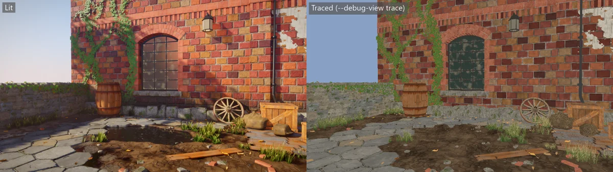

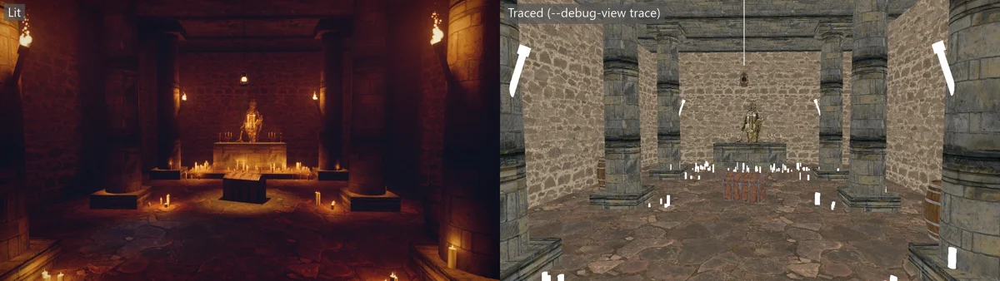

## Lights

A light is a component, and the [world](ecs.md) adds every light to each frame:

```csharp
world.Spawn(new Sun(Direction: new Vector3(1f, 2f, 1f), Color: new Vector3(3f)));
world.Spawn(new Sun(Direction: new Vector3(-1f, 0.5f, -1f), Color: new Vector3(0.4f, 0.5f, 0.8f)));
```

`Direction` points towards the light, and stays in the world whatever entity the sun is
on. Colours are linear, so a bright light goes well past 1. One sun casts the shadows:
the first, unless you pick another with `CastsShadows: true`:

```csharp
world.Spawn(new Sun(new Vector3(-1f, 0.5f, -1f), new Vector3(0.4f, 0.5f, 0.8f)));
world.Spawn(new Sun(new Vector3(1f, 2f, 1f), new Vector3(3f), CastsShadows: true));
```

Marking two suns in one frame throws.

This section's lights, shadows, ambient occlusion, sky, finish and outlines all work this
way. [Drawing by hand](views.md), `view.Lights.Sun(direction, color, shadows)` and the
other calls in `Draw` add to the frame or win over the world's setting for that frame.

### Point and spot lights

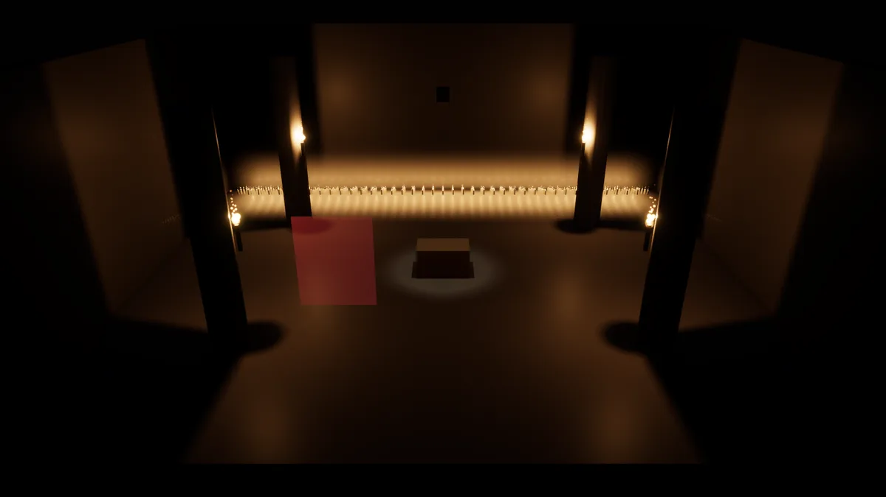

```csharp
world.Spawn(Transform.At(torch.Flame), new PointLight(default, new Vector3(3.2f, 1.5f, 0.5f), 9f) { Radius = 0.5f });
world.Spawn(Transform.At(candle.Wick), new PointLight(default, new Vector3(0.12f, 0.06f, 0.02f), 1.4f) { Shadows = false });
world.Spawn(Transform.At(new Vector3(0.3f, 1.2f, 0.4f)), new Parent(guard),   // shines where the guard faces
    new SpotLight(default, default, new Vector3(6f, 5.5f, 4.5f), 7f) { InnerAngle = 0.25f, OuterAngle = 0.4f });
```

A light's position and direction count from its entity's `Transform` and `Parent`. So
`default` puts the light at the entity, a spot light with no direction points along the
entity's +z, and a lantern carried by a character goes where the character goes. Each
light is keyed by its entity's ID, which keeps its shadow steady as the camera moves.

Drawing by hand, `view.Lights.Point(id, light)` and `view.Lights.Spot(id, light)` add a
light for one frame, at a place in the world, keyed by an ID you choose:

```csharp
view.Lights.Spot(lantern.Id, new SpotLight(lantern.Position, -Vector3.UnitY, new Vector3(6f, 5.5f, 4.5f), 7f)
    { InnerAngle = 0.25f, OuterAngle = 0.4f });
```

A point light shines every way from a spot, like a candle or a torch, and a spot light
shines in a cone, like a lantern's beam. The colour is how bright the light is a metre
away. It dims with the square of the distance and fades smoothly to nothing at the
range, so a small range is cheaper and keeps a candle's light on its own table. A spot
is full inside its inner angle and fades out by its outer one. Both angles are measured
from the direction, in radians, and the outer one must be under a right angle. `Graphics.Lighting.LocalLights` turns them all off, see [graphics settings](#graphics-settings).

A light also has a radius, the size of its glowing part, 0.1 m unless you set
`Radius`. No surface gets much brighter than it would be that far from the light. On
its own, the square of the distance makes a torch a hand from a wall blow the stone out
white while the room stays dim. A bigger radius calms the wall but leaves the light
just as bright a metre away and beyond, so raise it for lights in brackets, sconces and
lamps against walls. The Crypt's torches use 0.5. A bigger light also casts softer
shadows. The radius must be less than the range.

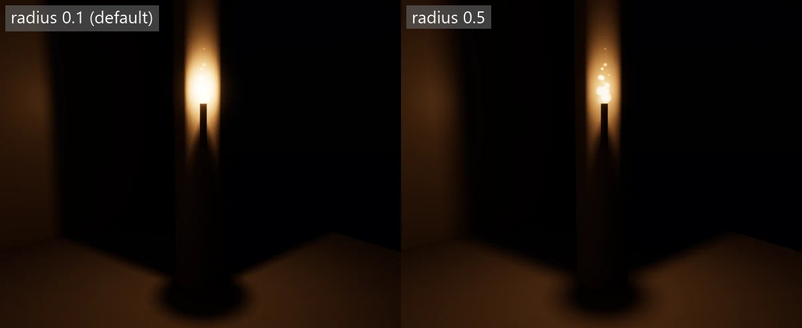

To make a torch flicker, change its colour in `Update` with `world.Get<PointLight>(torch)`.
Drawing by hand, the key names the light from frame to frame, the same as a model's key,
so use the ID of the thing holding it.

Lights cast soft shadows unless `Shadows = false` is set. Shadows are sharp where an
object touches the ground and blur further away, as the sun's do. All the lights share
one shadow atlas, and a light that is bigger on screen gets a sharper shadow. A point
light costs six times as much shadow as a spot. When the atlas is full, the lights that
are smallest on screen lose their shadows. Shadows are what cost the most, so leave
them off on small lights, such as rows of candles. A light's shadow is only drawn again
when the light, or something in its reach, moves or changes shape, so a flickering torch
in a still room costs little after its first frame. Animated characters and plants in the
wind redraw the shadows of the lights that reach them every frame.

A frame can have up to 1,024 lights, and one more throws. Lights are culled to what the
camera sees, and each part of the screen only works through the lights that reach it, so
a frame can have hundreds of small lights. 256 can reach any one spot on the screen,
and more than that are dropped there. The `Crypt` example has four torches, five
candelabras, a lantern, a beam from a grate and 126 candles, about 150 lights. The
`Hamlet` example has about 200 at night: lamps and forge fires with shadows, and lit
windows without.

Point and spot lights light models, glass and [particles](views.md#particles). Glass and
particles get no shadows from them. Reflection probes see what they light. In
[fog](#fog) they glow with a halo; `Volumetric` sets how strongly, and 0 leaves a light
out of the fog (see [volumetric fog](#volumetric-fog)).

### Light modes

Every sun takes a `mode:`, and every point and spot light a `Mode`, of `LightMode.Mixed`,
`Realtime` or `Baked`. `Mixed` is the default and changes nothing about how a light looks. The mode only
says how a bake will treat the light: `Realtime` is never part of a bake, `Baked` is only
part of one, and `Mixed` is both. Until a [bake](#baked-lighting) exists, every light is lit
live whatever its mode, so every frame looks the same. A mode that isn't one of the three
throws.

A baked space keeps the shadows of its Mixed lights in a shadow mask with four channels. The
sun takes one when it is Mixed, and Mixed point and spot lights whose ranges overlap need
different channels, so a space has at most four Mixed lights reaching the same place. A light
that finds none left keeps its real-time shadows only.

A frame shares four mask slots between all the bakes it draws: the space's and every placed
baked chunk's. The space's lights keep their channels, with the sun first. Each chunk's
Mixed lights then take the slots left, so lights from different bakes whose ranges overlap,
or two copies of one chunk standing side by side, get different slots and each surface reads
its own bake's shadow. Lights of one placed chunk always get different slots. Lights far apart
in different chunks share a slot, but the space's hold theirs everywhere.
A chunk light that finds every slot held, by the space or by lights its range overlaps, keeps
only its real-time shadow that frame, and its key is in `Renderer.Baking.LastFrame.UnslottedLights`.
A surface whose bake has nothing in a slot,
such as a neighbouring chunk's floor lit by a lamp from next door, is shadowed in that slot by
the real-time shadow alone.

While the bake is drawn, a Mixed light on a lightmapped surface is shadowed by its channel. A
light with a real-time shadow takes the darker of the two, so something that moves still casts
its shadow, and the baked one covers what the shadow map doesn't: past the sun's last
[cascade](#shadows) the mask takes over, so a sun lights a baked space with shadows however far
it reaches. A light with no shadow map, or one that didn't get a [tile](#point-and-spot-lights),
takes the mask alone, so a light with `Shadows = false` is still shadowed by the walls the
bake saw. A light without a channel, a surface without a lightmap, and every light while
[`BakedLighting`](#graphics-settings) is off or the bake is stale are lit as before.

## Shadows

```csharp
world.Spawn(new Shadows(40f, Cascades: 3));
```

Put `Shadows` on any entity, such as one made for the level. When several entities have
one, the newest wins, and taking it away gives the one before back. Ambient occlusion, the
sky, the finish and outlines work the same way. Drawing by hand,
`view.Lights.Shadows(40f, cascades: 3)` sets them for one frame.

The first number is the radius of the sharpest shadow map, in metres. Each extra cascade
covers three times the radius of the one before. The cascades are laid along what the
camera sees: the sharpest one starts at the camera, and each next one picks up where the
last ends, so no part of a map is spent behind the camera. A cascade keeps its size as the
camera turns and moves in whole shadow texels, so shadow edges don't shimmer or crawl.

Where two cascades meet, points hand over to the coarser one gradually, so there's no line
where the sharpness changes. Shadows fade out over the last part of the furthest cascade
instead of stopping at an edge.

An orthographic camera centres every cascade on its target instead, and widens its
shadows to cover the screen.

Things out of frame still cast into it. A tree behind the camera or off to the side, up-sun
of what you see, throws its shade into the picture, up to six cascade radii away.

```csharp
world.Spawn(new Shadows(7f, Cascades: 3, SunSize: 0.02f));
```

`SunSize` is how wide the sun looks, in radians, from 0 to 0.5. It sets how fast a shadow
blurs with distance from what casts it. The default of 0.12 is a soft, hazy sun that keeps
shadows gentle. The real sun is about 0.01, and something near that lets a canopy several
metres up throw crisp dappled light, where the default blurs it into one soft patch.
0 gives hard edges everywhere.

Each map is 2048 texels across unless `Graphics.Shadowing.ShadowResolution` asks for 1024 or 4096, so
a 7 m radius gives texels about 7 mm wide. That's too coarse for the last centimetre where
a barrel stands on the floor, so the sun also has contact shadows. Each pixel looks towards
the sun through what the camera sees, and darkens where something is in the way, which
draws a thin dark line where things touch the ground:

```csharp
world.Spawn(new Shadows(7f, Cascades: 3, SunSize: 0.02f, Contact: 0.3f));
```

`Contact` is how far each pixel looks, in metres. The default of 0.25 suits barrels, crates
and people; a longer one reaches under bigger things and costs no more. 0 turns them off, as
`Graphics.Shadowing.ContactShadows` does. They're drawn only inside the first cascade's radius, fading
out over its last tenth, since further away a centimetre is less than a pixel. They can only
see what's on screen, so something just out of frame or hidden behind another object casts
none. Something more than 15 cm in front of a surface never counts, so a near object puts no
dark outline on the wall behind it. Materials marked `foliage` get none, because the camera
only sees the front leaf.

## Ambient occlusion

```csharp
world.Spawn(new AmbientOcclusion(Radius: 1.2f, Strength: 0.7f));
```

Drawing by hand, `view.Indirect.AmbientOcclusion(radius, strength)` sets it for one frame.

Corners, creases and the ground under things get less of the soft light from the sky,
because the surfaces around them hide part of it. `radius` is how far, in metres, a point
looks for those surfaces, and must be above 0. `strength`, from 0 to 1, is how dark they
make it: 0 turns the darkening off and 1 is all of it. The defaults, a radius of 0.6 and a
strength of 0.9, suit rooms and streets seen from head height. A wider radius darkens
whole alcoves and the space under a cart, at the cost of losing fine creases.

A point in a corner also sees the sky only through the opening, so the soft light it gets
comes from that way rather than straight off the surface. Reflections of the sky fade in
the same corners, most on rough surfaces, so a gap behind a barrel doesn't shine.
It only knows what the camera sees, plus what stands over a point in the sun's shadow map.

Each frame looks in only a few directions from every point, which leaves grain. The grain
is averaged away over the last eight frames, following each surface as it and the camera
move, and only a narrow blur that stays on the surface it started on comes after. That
keeps the shade crisp: it stops at the edge of a step instead of spreading onto the next
one, and a small model keeps its creases. It works the same with anti-aliasing off. The
cost is that the shade takes about eight frames to catch up when something moves, so the
floor a figure just left stays dark for a moment, and a surface that has just come into
view is softer for its first few frames. Turn `Graphics.Lighting.OcclusionHistory` off to blur each
frame by itself instead, which is softer everywhere.

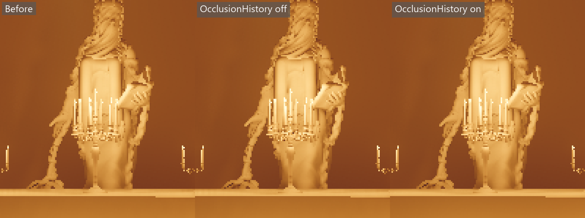

The statue in the Crypt, in plain clay with anti-aliasing off and enlarged. On the left is
the older blur, which followed depth alone and washed the folds of the robe out. The other
two keep them, with and without the average over frames.

## Light bounced across the screen

```csharp
world.Spawn(new ScreenBounce(Strength: 1.5f, Radius: 3f));
```

Drawing by hand, `view.Indirect.ScreenBounce(strength, radius)` sets it for one frame.

Light that lands on a surface the camera sees also lights the surfaces next to it: a red
ball tints the floor under it red, a sunlit floor lights the underside of a table, and a
glowing panel or a candle lights the wall beside it. The same pass as the
[ambient occlusion](#ambient-occlusion) finds the surfaces round each point and takes the
light they had in the last frame, so it follows lights, glows and moving things at once,
with nothing to bake. `radius` is how far, in metres, a point looks for surfaces that
light it, more than 0 and at most 8. `strength`, from 0 to 2, scales the light they give:
1, the default, is what they really pass on, and 0 turns it off. The default radius of 2
suits rooms and furniture. A wider one carries light across a hall, but finds fewer of the
small surfaces near a point.

It adds to the [light probes](#bounced-light), which carry light round corners and from
off screen, while this finds the close, coloured light the probes are too coarse for.
It only knows what the camera sees, so a wall that turns out of view stops lighting its
neighbours. Surfaces whose light is [baked](#baked-lighting) keep the bounce the bake
gave them, toon surfaces keep their flat shading, and with `AmbientOcclusion` off there
is no screen bounce either, since the two are found together.

The light probes already give most of the bounce, so the difference is gentle. In the
Shapes example the floor lights the shapes' lower sides, and the ground round each shape
takes a little of its colour:

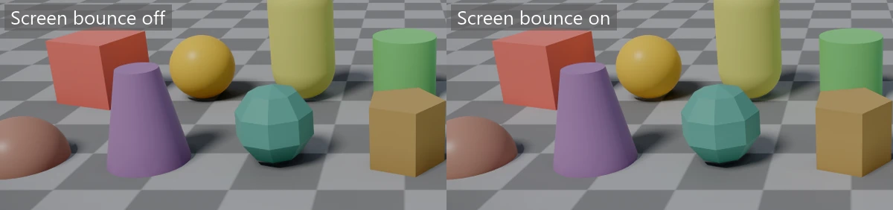

In the Crypt, the lit floor and the candles brighten the front of the chest:

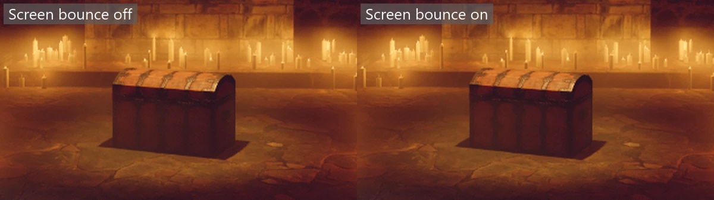

## Bounced light

Sunlight that lands on a brick wall doesn't stop there: some of it bounces off and lights
the ground and everything near it, tinted the colour of the brick. A lamp in a white room
lights the whole room, not only what faces it. Without bounced light, shade gets its soft light
from the sky alone, so a yard in shadow looks blue and flat and a room lit by a lamp is black
wherever the lamp doesn't reach.

The renderer keeps light probes round the camera for you, with no setup. Each probe records the
light reaching it from every direction, and surfaces take their soft light from the probes
round them instead of from the sky, so the shade under a sunlit wall takes on its warmth, a red
wall tints the floor beside it, and the inside of a closed room stays dark however bright the
sky is. The probes see the sun, the sky, point and spot lights (inside their cones), glowing
surfaces and the light already bounced, so light bounces again with every update.

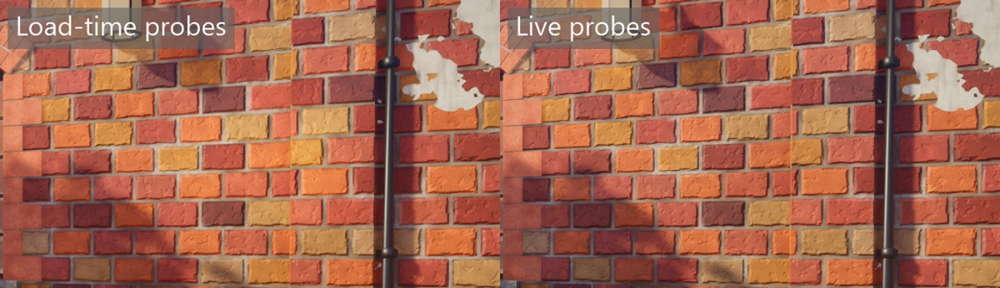

Where a probe sees nothing it sees the same sky that lights the scene without probes, so in a
scene with no [`Sky`](#the-sky) it sees the soft studio light rather than the plain
background colour drawn behind the scene. Out in the open, a probe gives the light the
scene would have had without it.

The probes sit in four nested boxes centred on the camera, 0.5, 1, 2 and 4 metres apart, so
detail is finest close by and the far boxes still reach a long way. On a GPU that can
[trace rays](#ray-tracing), each update sends 128 rays out from the probe, and 256, 512 or 1,024
probes are updated a frame by [`Graphics.Lighting.ProbeQuality`](#graphics-settings): `Low`, `Medium` or
`High`, the default. Nothing turns this on; it is used whenever the GPU can. Each traced update
moves a probe a quarter of the way to what its rays saw, so a little noise averages away, but a
big change, well above the probe's own noise, comes in whole, so a lamp turned on near the
probe fills in within a few updates. A small change, or one at a probe lit mostly by a small,
noisy light, still moves a quarter of the way an update. At `High` the near probes are all
traced within the first few dozen frames, and each is then redone about every second at 60 fps
for 12 more updates, as each update adds one more bounce of light between walls: in a white
room the bounce is about 80% there after 12 seconds. After that only a quarter as many are
redone a frame, to save GPU time, so every probe is redone about every four seconds and the
last of the bounce takes a minute or two to come in. A changed light or a new probe starts the
full count again.

Without tracing, each update draws the scene round the probe six times instead, so far fewer
fit in a frame: 8, 16 or 32 by `ProbeQuality`, and fewer in a dense scene, since a frame draws
at most 8 million triangles round its probes, which is about 9 probes in Courtyard. Either
way there is no pause while loading: the scene starts lit by the sky and fills in over the
first frames, nearest probes first. Drawn this way at `High`, the near probes have all been
drawn after about a thousand frames in a light scene (nearer four thousand in Courtyard).
Without a `LightProbes` box of your own, the first seconds after a load can look blotchy,
as neighbouring probes have been drawn different numbers of times, until each has been redone
a few times and they even out.
After that the oldest probes are redone in turn, so objects that move or appear show up in the
bounce within about 2,000 frames at `High`. A point or spot light that moves, turns, changes
colour or is switched off marks the probes in its range for an update. A colour change only counts
once the light has drifted by more than a third from the colour its probes were last marked for,
so a flame that flickers by a tenth or so each frame leaves them alone, while a lamp dimmed to half
or turned from red to blue marks them at once. A slow fade marks them each time it passes another
third. A change to the sun,
the sky or the `Materials`, `SunShadows` or `LightShadows` switches marks them all (probes
don't draw wear and dirt, so `WearAndDirt` leaves them be); until it is redone, a probe keeps its old light, so a change fades in rather than flashing.
As the camera moves, the boxes slide with it a row at a time: probes it keeps stay as they were,
and the new row starts dark and is drawn next.


```csharp
world.Spawn(new LightProbes(Min: new(-1f, 0f, -4f), Max: new(1f, 2.5f, 4f), Spacing: 0.25f));
```

A `LightProbes` entity adds a box of probes of your own on top, for a place that needs finer
detail than the camera's probes give, such as a narrow corridor at 0.25 metres. Inside it,
and up to a spacing round it, its probes win over the camera's. The box may hold at most 4,096
probes, so 1 metre spacing covers about 15 by 15 by 15 metres; a bigger box throws when it is
set. `Spacing` must be more than zero, and `Max` above `Min` on every axis. A new box starts
its probes again. A frame has one box, and when several entities have one, the newest wins.
Gallery keeps one over the whole building: in its rooms the camera's probes
alone left the walls and floors blotchy in a screenshot, and the box's probes, 1.65 metres
apart, light them smoothly. Drawing by hand, `view.Indirect.LightProbes(min, max, spacing)`
sets the box for one frame.

Each probe also notes how far away the surfaces it sees are, so a point behind a wall from a
probe gets nothing from it, and light doesn't leak into a room from the probes outside. Traced
probes also send a shadow ray towards every point or spot light that casts shadows, so a lamp
behind a wall doesn't light them. Without tracing, the probes take a lamp's shadow from its
shadow map, which only lamps that light the view have, so a lamp out of view lights the probes
through walls as if it cast no shadow. A probe that ends up inside a wall or under the ground sees mostly the backs of surfaces, and
is left out. Where no probe can see a point yet, the soft light comes from the sky as before.
Reflections don't change; probes give only the soft, diffuse light. See-through, skinned and
swimming things don't show in the probes or shade them from the sun, as they would spoil them or
move on their own. Without tracing, glass still shades the probes from a lamp that lights the view.

A surface in a [baked space](#with-a-fresh-bake) whose bake is fresh takes its soft light from its
lightmap instead, which is finer than any probe grid. Anything else inside the space, such as a
character walking through it, reads the bake's own probes first. Where none of them can see it, it
falls back to the box of probes, then to the probes round the camera, and last to the sky.

`Graphics.Lighting.LightProbes` turns all of this off and frees the probes' memory, about 170 MB at
`High`. Switching it back on starts every probe again. `Graphics.Lighting.ProbeQuality` trades the
probes' reach and speed for memory and GPU time; see [graphics settings](#graphics-settings).
A [screenshot](command-line.md#screenshots) waits for the probes near the camera to be drawn,
up to 2,048 frames, so it shows the bounce as it will be rather than still filling in.

`--debug-view probes` shows the probes themselves, over the lit scene. Every probe of the finest
box and of your `LightProbes` box is a small sphere; the three coarser boxes aren't shown.
Each point of a sphere shows the
light that probe gives a white surface facing the same way, so a probe beside a red wall is red
on the wall's side. The spheres are 0.15 of their probes' spacing in radius, 7.5 cm in the
finest box, so they read clearly from a few metres away while neighbours stay well apart and
leave the scene visible between them. A probe not drawn yet is a grey wireframe, and a probe
left out for being inside a wall isn't shown. Where your box covers the finest box, only your
box's probes are shown, as only they light that space. It works with or without tracing, and
shows no spheres while `Graphics.Lighting.LightProbes` is off. From code, set `FrameView.Picture.DebugView` to
`DebugView.Probes`. A game can switch it on while it runs, as the Hamlet does with P, by setting
`Graphics.DebugView`; see [the debug view from a game](#the-debug-view-from-a-game). See [the
command line](command-line.md).

## Baked lighting

```csharp
world.Spawn(new BakedLighting("crypt", Min: new(-8f, -1f, -12f), Max: new(8f, 6f, 12f), ProbeSpacing: 1f));

foreach (var house in village.Houses)
{
    world.Spawn(house.Transform,
        new BakedPiece("house-garden", Min: new(-6f, 0f, -8f), Max: new(6f, 7f, 8f), EdgeBlend: 0.5f));
}
```

A frame can name the parts of the world whose lighting is baked. [`Renderer.Baking.Bake`](#making-a-bake)
bakes a space, and the game finds the bake in its content and checks it against the frame. Once
the bake is fresh, its surfaces are lit from their lightmap; until a space is baked, naming it
changes nothing on screen.

The [Gallery](../examples/Gallery/README.md#baked-lighting) is the example to look at: it ships
with a bake, keys 1, 2 and 3 switch between live lighting, the bake and direct light only, and
its README says which light has which [mode](#light-modes) and why, and how to bake it again.
The [Crypt](../examples/Crypt/README.md#baked-lighting) (fire lights that stay `Mixed`) and the
[Courtyard](../examples/Courtyard/README.md#baked-lighting) (a sun and a lamp through glass) are
baked spaces too.
For chunks, look at the [Hamlet](../examples/Hamlet/README.md#baked-lighting): every building is
a chunk named for its kind, so with seed 1 its 40 buildings share seven bakes, and the same keys
switch its lighting.

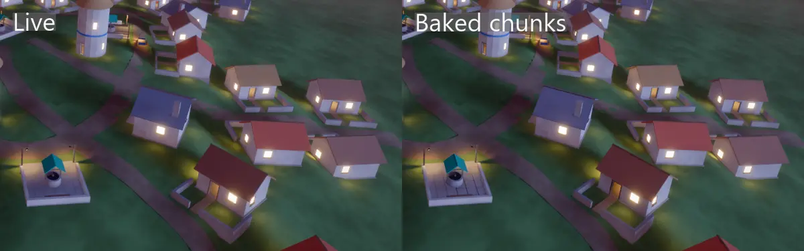

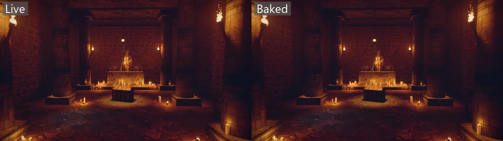

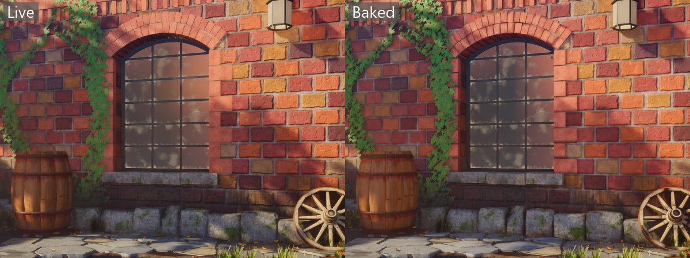

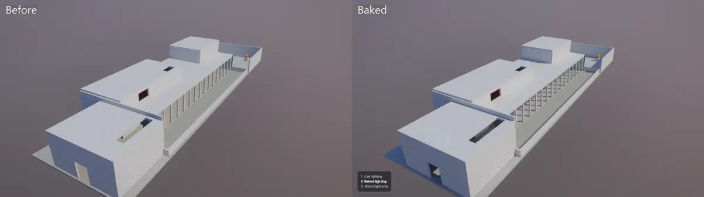

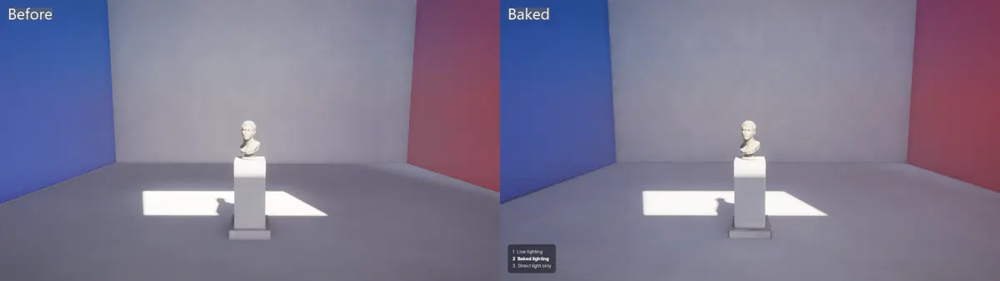

A `BakedLighting` entity names a space: one fixed place, baked as it stands, sun included. Its box also
holds baked probes `ProbeSpacing` metres apart, at most 4,096 of them, counted the same way as
[light probes](#bounced-light), so 1 metre spacing covers about 15 by 15 by 15 metres. A frame
has at most one space: when several entities have one the newest wins, and drawing by hand,
`view.Indirect.BakedLighting(name, min, max, probeSpacing)` names it for one frame. A call from `Draw`
replaces the world's space for that frame, and a second call by hand throws with both names. Its bake is
`lighting/<name>.lightbake`. `TexelsPerMetre`, 20 by default (5 cm texels), sets how fine its
lightmap is, from 1 to 200; anything else throws with the value. A `BakedPiece` takes the same
`TexelsPerMetre` for a chunk.

A `BakedPiece` entity places a chunk: a piece of the world, such as a house, baked once in its own
space and placed by the entity's `Transform`, following its `Parent` if it has one. `Min` and `Max`
are its box in its own space, before the transform. Drawing by hand,
`view.Indirect.BakedChunk(name, transform, min, max, texelsPerMetre, edgeBlend)` places one for a
frame, with the transform as a matrix. One chunk can be placed many times in a frame, so its name may repeat, and every
copy with the same contents will share one bake, kept in `lighting/<name>/<hash>.lightbake`
with the 16 hex digits of a hash of its contents. A frame places at most 256 chunks. The
transform may only turn and move the chunk: its first three rows must be unit length and
square to each other within 0.0001, without a mirror, and its last column (0, 0, 0, 1). One
that scales, shears or mirrors throws, since one bake serves every copy.

A chunk's bake knows only the chunk, so where its floor meets the world beside it the two
would be lit differently, and a seam would show along the chunk's side. `EdgeBlend`, half a
metre by default, blends them: over that many metres in from each of the chunk's four sides
(its x and z faces, not the top or bottom), its lightmap fades into the live light the world
beyond it gets, with its ambient occlusion and shadow mask. At the side itself the chunk is lit
like the world next to it, and from `EdgeBlend` in it is lit by its bake alone. `EdgeBlend: 0`
gives a hard edge. It may be at most half the box's smaller side across x and z, so the bands of
opposite sides never overlap; more than that, a negative value or NaN throws with the value. A
chunk narrower than a metre is too small for the default, so give it `EdgeBlend: 0` or a smaller
blend.
The band is drawn each frame, not baked, so changing it needs no new bake.

A name is one or more letters, digits, `-` or `_`, since it names a file; a slash, a dot or a
space throws. Each box must reach further than it starts on every axis, and `ProbeSpacing`
must be more than zero. Everything else throws when it's named, with the value and the limit.
For Rendition alone, `FrameView.Baked.Space` and `FrameView.Baked.Chunks` carry the same, and
`Renderer.Render` throws for more than 256 chunks or a chunk transform that isn't only a turn
and a move. `BakeFiles` has the limits, the file names and the checks.

### Without a bake

Every frame that names a space or a chunk, the renderer works out what each area's bake would
be made from and asks whether a bake of exactly that exists. A light that a fresh bake holds is
then left to the bake: a `Baked` light is no longer drawn live, and a `Mixed` one is. A light
in no baked area, a `Realtime` light, and a light that is [moving](#moving-lights) are always
drawn live.

An area's texel density is part of what its bake is made from, so changing the
`texelsPerMetre` an area is named with makes its bake stale. The bake's quality (`Preview` or
`Final`) does not: it only decides how long a bake takes, so a Preview bake is as fresh as a
Final one.

A Super game looks for each bake in its cooked content, where [`--bake`](command-line.md#baking-lighting)
puts it, reading only the header of each file once and keeping it, so asking every frame reads
and allocates nothing. A missing bake is quietly lit live, since most areas start unbaked. A
stale one is lit live too, and the game writes one line to the error output the first time it
meets it, naming what changed. It waits a second after the game starts before it says so, since
a light that moves is only known to be moving once it has been seen to move, and until then
it still counts in the bake's lights (see [Moving lights](#moving-lights)). The bake is still lit
live on those frames while it doesn't match:

```
The bake lighting/crypt.lightbake is stale, since its draws and lights changed, so its area is lit live until it is baked again.
```

A file that can't be read, because it is damaged or because opening it fails, as it can while a
cook is replacing it, is reported once the same way, with the reason, and lit live. When the
content reloads, every bake is read again and each stale one is reported again.

A frame with no bake, or only stale ones, looks exactly as it would without its baked areas, to
the byte, and a frame that names none does no bake work at all.
[`Graphics.Baking.BakedLighting`](#graphics-settings) off treats every bake as missing.

### With a fresh bake

When the space's bake is fresh, the renderer reads the whole file once, puts its pages on the
GPU and keeps them until another bake is loaded or the content reloads, even through frames
that don't name the space. Every draw the bake holds then takes its soft light from its lightmap: the light that
reached it from the sky, the sun and the bake's lights, bounced around the space, with no leaks
through walls. That replaces the sky and the [light probes](#bounced-light) for those surfaces.
The lightmap also notes where most of that light came from, so a normal map still shows its
bumps under baked light. Live lights, `Mixed` ones included, and reflections are drawn over
it as usual. Ambient occlusion still darkens
the corners, at half strength, since the bake already holds most of the shade there.

A draw the bake doesn't hold, such as something moved in after the bake or a moving
character, takes its soft light from the bake's probes while it is inside the space's box. They
hold the same light as the lightmap, `Baked` lights included, so a character walking through a
room lit only by `Baked` lamps is lit by them too, though they are no longer drawn live. Outside
the box, or where none of the bake's probes sees the point, it is lit as before, from the
[light probes](#bounced-light) or the sky. Over one `probeSpacing` in from each of the box's six
faces, the bake's probes blend into that live light, so something crossing the box's edge fades
from one light to the other over that distance rather than changing at once. The band falls off
at the box's floor and top as well as its sides, so a box whose floor sits at the ground's level
lights things standing on that ground partly live; set the box's floor a spacing or more below
the ground to keep them in the bake's light. The space's own
lightmap has no such band, since the space's static surfaces end inside its box.
Transparent surfaces and particles never read light
probes, so they are lit from the sky in a baked space as anywhere else. A file whose header is
fresh but whose pages can't be read or are larger than any bake makes, or that is gone by the
time they're read, is reported once to the error output and its area lit live, as if it had
no bake.

A fresh chunk's bake is read and checked off the render thread, then goes up to the GPU at most
8 MB a frame (`ChunkBakePool.ChunkUploadBudget`), so a big page can take a few frames. Until all
its pages are there the chunk is pending: it is drawn live, its `Baked` lights included, so it
never shows half a bake. A chunk bake that finds the renderer's 1024 texture slots all taken is
reported once to the error output and its chunk lit live until the content reloads. The pool
counts frames by `Render` calls, which is right while each frame draws one view, as Super does. Copies of a chunk that share a file share its bake. A bake that no
chunk in the frame names is let go at the end of that frame and read again when one comes back,
and a content reload drops every chunk bake and reads them again.

A bake that arrives while its area is on screen fades in rather than popping. That happens when
the area was drawn live last frame, its bake missing or stale, and its file is fresh now, as when
a [background bake](#baking-in-the-background) saves it or a stale bake is replaced. Its lightmaps and probes then blend in over
`Renderer.Baking.FadeSeconds` of game time (`FrameView.Time`), half a second by default, along a
smoothstep. While they do, the area's `Baked` lights stay in the frame, dimmed by as much as the
bake has come in, so the area never goes darker than either end, and `BakeFrame.ModeOf` already
says `Baked` for them. `BakeFrame.SpaceFade` and `BakeFrame.ChunkFade` say how far each area has
come. A bake that is fresh on the first frame that names its area shows at once, so loading a
level, a screenshot and a reload of an unchanged bake never fade, and nor does a chunk whose bake
was already saved but is still on its way to the GPU. An area left out of a frame is forgotten,
so the next frame that names it counts as its first, and a frame that names no area at all
forgets every area. So a game that draws an extra view with no baked areas every frame, such as
a minimap, between the frames that name them never sees a bake fade. Reflection probes are
captured again once a fade ends, so they hold the whole bake. Game time that goes back ends a fade at
once. Turning [`Graphics.Baking.BakedLighting`](#graphics-settings) back on counts as every bake on screen
arriving, so they fade in too. `FadeSeconds` of 0 shows every bake at once; it must be from 0 to 10, or it throws
`ArgumentOutOfRangeException` with the value.

A chunk's bake holds how the sky and the sun reach each of its surfaces, not the light itself,
so every copy is lit by the frame's sky and suns as it stands. The same house can face north in
one place and south in another, at noon or at dusk, and each copy gets the light from its own
open side and the bounce from its own sunlit walls, with no bake per copy and none again when the
sky changes. The frame after the sky or a sun changes, every copy shows it. Its own `Baked` and
`Mixed` lights are added on top. The sun's direct light and shadows stay live, while its bounce
follows every `Mixed` and `Baked` sun, moving ones included. The sky's light is kept to its
broad shape, so a sky much brighter at the horizon than overhead lights an open floor
too brightly, about 19 steps in 255 under a clear sky at turbidity 3, against a space baked under that sky. Each copy draws only its
own bake, so a pending copy is lit live even while another copy of the same chunk with another
bake is resident. Reflection captures don't draw chunk bakes: they light a chunk's surfaces live,
but without the chunk's `Baked` lights, which a fresh chunk takes out of the frame, so a chunk
with `Baked` lamps shows them missing in reflections. A chunk's own `Mixed` lights are shadowed through its
bake's shadow mask, in the frame's shared [mask slots](#light-modes), as a space's are.

For Rendition alone, `Renderer.Baking.Bakes` is where the renderer asks. It starts as
`NoBakes.Instance`, which has no bakes. A `LightBakeStore` reads bakes through a function that
gives a file's bytes, or null when there is none, and reports stale and damaged ones to a
`TextWriter`; any other `IBakeStore` can stand in for it. `LightBakeStore.Forget` drops what it
has read, for after the files change, and `LightBakeStore.Load` reads a whole bake.

### Making a bake

```csharp
byte[] bake = renderer.Baking.Bake(view, draws, new BakeSettings(quality: BakeQuality.Preview));
File.WriteAllBytes("lighting/crypt.lightbake", bake);
```

`Renderer.Baking.Bake` path traces the frame's space into a lightmap and its light probes, and returns
the `.lightbake` file's bytes. It takes the same view and draws as `Render`, waits for the GPU,
and draws nothing. A view without a space throws "Bake needs a baked space in the frame; call
view.Indirect.BakedLighting first." A space with more than 4,096 probes, which only a hand-made
`FrameView.Baked.Space` can have, throws with its name and count. The settings' `TexelsPerMetre`
must be the space's, since no frame would find a bake at another density fresh; one that differs
throws with both.
A game doesn't need to call it itself: [`--bake`](command-line.md#baking-lighting) bakes the
frame's space and each chunk it draws and saves them, and `--bake-check` says whether each saved bake is fresh.

```csharp
byte[] bake = renderer.Baking.BakeChunk(view, draws, chunk: 0, new BakeSettings(texelsPerMetre: 20));
```

`Renderer.Baking.BakeChunk` bakes one of the frame's `Baked.Chunks` in its own space, so one bake
serves every copy of the chunk wherever it stands and however it is turned. Only the static
draws the chunk owns are in it, so the rest of the world neither shades nor lights it. Its
lightmap is one square page, from 64 to 2048 texels a side, as small as holds its draws. It
holds:

- The sky's light, as how much of the sky each texel sees from each direction (its transfer),
  so a placed copy is lit by whatever sky it stands under, through openings and after
  bouncing.
- The sun's bounced light, the same way, for a sun from any direction. The sun's direct light
  stays live.
- A plain lightmap of the chunk's own `Baked` and `Mixed` lights and glowing surfaces, by the
  same rules as a space but with no sky and no sun. A chunk with none of these has no plain
  lightmap. Its `Mixed` lights get shadow mask channels of their own.

The edge-aware filter below smooths a chunk's plain lightmap but not its sky and sun transfer,
which is only grown at chart edges. A room lit only by light bounced in through its windows can
look blotchy at `Final`'s 1024 paths: the Hamlet's cottage walls do at 10 texels a metre, and
they come out smooth at 8192, which `BakeSettings` can't ask for yet.

A chunk has no probes. `BakeChunk` throws `ArgumentOutOfRangeException` for a chunk the frame
doesn't have, `ArgumentException` when the settings' `TexelsPerMetre` isn't the chunk's, and
`InvalidOperationException` when the chunk owns no static draws. `--bake` bakes each chunk file the frame draws once.

The lightmap covers the static draws the space owns, apart from ones that sway in the wind or
are see-through, at the space's texel density. Each texel holds the light reaching it from every
direction, the direction most of it comes from, and a shadow mask. What a light gives depends
on its mode:

- A `Baked` light is in the lightmap in full, both its direct light and the light it bounces.
- A `Mixed` light gives only its bounced light, since it stays drawn live. Its direct shadow
  goes in a shadow mask channel instead, so the live light is shadowed by what the bake saw
  (see [light modes](#light-modes)). There are four channels: a `Mixed` sun takes the first, and local lights whose ranges
  overlap get different ones.
- A `Realtime` light, a light that is [moving](#moving-lights), and a local light in no
  baked area are left out, as is the sun when it is `Realtime` or moving.
- Emissive surfaces light their surroundings, and the sky lights them at
  `view.Environment.Intensity`. Glass and other see-through surfaces let light through, dimmed
  by their opacity but not tinted.

The bake also holds the space's probes, one every `probeSpacing` metres in its box, laid out
as [light probes](#bounced-light) are, so the bake's probes can stand in for live ones there.
Each records the light from every direction and how far away the surfaces it sees are, by the
same rules as the lightmap: a `Mixed` light gives a probe only its bounced light, and `Baked`
lights, emissive surfaces and the sky count in full. A probe inside a closed room with no light
in it reads black.

A `Preview` bake sends 64 paths from each texel and a `Final` one 1024, so Preview is about
16 times quicker and noisier. Probes take a sixteenth of that per direction, 4 and 64, since
each probe direction already averages many. The file's report gives the time taken, the share
of texels found inside walls, and the lights that didn't get a mask channel.

Before the lightmap is written, an edge-aware filter smooths out the path tracer's noise. It
follows the surfaces, so it doesn't blur light across a crease or a step, and it never mixes
two charts, so light from one wall doesn't leak onto the floor beside it in the lightmap. It
also stops where the light changes by more than the noise explains, so a `Baked` light's
shadow edge stays sharp to within a texel or two, and the sky seen past the rim of a wall isn't
carried in under it. Where the light is noisy it spreads it over up to about 8 texels either
way (40 cm at 20 texels a metre). A penumbra that is itself noisy, as at `Preview`, can soften
a little, and blotches larger than about 8 texels stay. The shadow mask isn't smoothed, so the
shadows of `Mixed` lights stay sharp. Then the edges of each chart are grown
by up to 8 texels, which fills texels inside walls from their neighbours and gives bilinear
filtering and mips something right to read at a chart's edge. A path that came out as not a
number or past a half float's range is cleared first, so one bad sample can't spoil a patch,
and light the filter adds past that range is held at its largest value, 65,504, when written.
`new BakeSettings(filter: false)` turns the smoothing off to show the raw trace; the edges are
still grown and bad values still cleared. Like the quality, it doesn't make a bake stale.
Probes aren't filtered.

From code, `Renderer.Baking.LastFrame` shows what the last frame decided. It is null after a
frame that named no baked area. Otherwise its `Space` and `Chunks` hold the inputs of each
area, `SpaceFresh` and `ChunkFresh` say which bakes were found (a chunk's only once all its
pages are on the GPU), `ChunkPending(i)` says a chunk's fresh bake is still on its way, `ModeOf(key)` gives the mode
each light was drawn with: the light's own mode, or `Realtime` when it is moving or no fresh
bake holds it, `DroppedLocalLights`
and `DroppedSuns` list the lights left to a bake that has faded all the way in, by their place in the frame's lists,
`SpaceFade` and `ChunkFade(i)` say how far each bake has faded in, and
`UnslottedLights` lists the keys of Mixed lights that found no shadow mask slot.

### Baking in the background

```csharp
// Done runs inside Render, so each write goes to another thread instead of holding up the frame. The writes are
// chained, one after another in the order the bakes finished, so a Final is never overwritten by an earlier Preview.
Task writes = Task.CompletedTask;
renderer.Baking.AutoBake = new AutoBake(
    BudgetMilliseconds: 4f, Spaces: true, Qualities: [BakeQuality.Preview, BakeQuality.Final],
    Done: done => writes = writes.ContinueWith(_ =>
    {
        string path = Path.Combine("content", done.File);
        Directory.CreateDirectory(Path.GetDirectoryName(path)!);
        File.WriteAllBytes(path, done.Bytes);
    }, TaskScheduler.Default));
```

With `Renderer.Baking.AutoBake` set, the renderer bakes by itself each space and chunk a frame names whose bake is missing or
stale, a slice a frame, so the game keeps running while it bakes. It starts once the lights have held still for a
second (see [moving lights](#moving-lights)), bakes one area at a time, nearest the camera first, and gives every area
its first quality before any gets its next. Each slice takes about `BudgetMilliseconds` of GPU time: the trace is
sized to it, but a step that isn't split, such as one page's filter, can go over on a very large page. Reading the
GPU's results back into arrays runs on the thread pool, so a slice costs the render thread a millisecond or two even on
a large page. `Spaces: false`
bakes only chunks.

The renderer doesn't save anything. It hands each finished file to `Done`, on the render thread, inside a later
`Render`, with where it goes (`done.File`, the same path `--bake` writes), the area's name, the inputs it was made from
and its quality. Writing a file there would hold up the frame, so hand the bytes to another thread, as above, and keep the writes in
order: two writes started side by side can land in either order. A Super game does this for you (below). `Done`
must not throw, since an exception passes out of `Render`. Once the store reads the file the area is fresh and drawn
from its bake, which [fades in](#with-a-fresh-bake) over `Renderer.Baking.FadeSeconds` if the area is on screen. A bake whose area changes while it runs is started over, and one finished from the same inputs and
quality is never baked again, so a file the store hasn't read yet doesn't loop. An area whose saved bake is fresh but
at a quality before the last one asked for, such as a Preview saved before the game restarted, still gets the
qualities after it. `LightBakeStore` reads the quality from the file's header; a store of your own tells it with
`IBakeStore.SavedQuality`, and one that doesn't counts a fresh area as done.

`Renderer.Baking.Progress` is null when nothing is baking and no area waits. Otherwise it gives the area's name (empty
while areas wait and none has started), how much of it is done from 0 to 1, how many other areas wait, and the GPU
time of the last slice. Set `AutoBake` outside a frame, since the first
one prepares baking, which waits for the GPU. On a GPU that can't trace rays it does nothing, and a GPU that traces but
can't bake says so once and bakes nothing. A whole `Bake` or `BakeChunk` stops the running background bake, which
starts again on a later frame, and so does destroying a mesh, material or texture it uses. Null, the default, bakes nothing.

### Baking without a build step

A Super game sets `AutoBake` itself while it is played, so a baked space or chunk with no bake, or a stale one, is
baked as the game runs and nobody has to run `--bake` first. Where each bake goes depends on how the game runs:

- From source (`dotnet run`, with `content.dev.json` naming the content roots), spaces and chunks are both baked, first
  at `Preview` and then at `Final`. A space's bake is written into the first content root as
  `lighting/<name>.lightbake`, the file `--bake` writes, so the watch cook picks it up, the game reloads it, and it is
  there to commit. A chunk's goes to the bake cache below.
- Published, only chunks are baked, at `Preview` only, into the bake cache. A published game can't write its content,
  so a space whose bake is missing or stale stays lit live. That is what [`--bake-check`](command-line.md#baking-lighting)
  is for: run it before shipping.

Each bake kept prints one line, such as
`Baked gallery (Preview) in 29.5 s: C:\Code\MyGame\content\lighting\gallery.lightbake`. A bake that can't be written
prints one line saying why, once for each area and quality, and that area stays lit live and isn't baked again until
the game runs again. While an area bakes, a line in the bottom-left corner over the game's
interface says `Baking cottage, 42%`, with `(3 more)` when other areas wait, or `Waiting to bake 2 areas` before one
starts. It goes when nothing is left. The game's own interface keeps its state as the line comes and goes.

`Graphics.Baking.BakeOnArrival`, on by default, switches this off; turning it off stops a running bake. `Graphics.Baking.BakeBudget`
is the GPU time a slice may take a frame, in milliseconds: null, the default, gives 4 from source and 2 published,
and anything from 0.5 to 33 sets it. Anything else is refused, saying the range. A change shows from the next frame, and starts a running bake over.

The chunk bakes made on the player's machine go in a cache in the game's local app data, not the roaming folder:
`%LOCALAPPDATA%\<id>\Bakes` on Windows, `~/Library/Caches/<id>/Bakes` on macOS and `$XDG_CACHE_HOME/<id>/bakes` or
`~/.cache/<id>/bakes` on Linux, where `<id>` is `GameOptions.Id` or the one made from the title. With
[`--user-data`](command-line.md) it is the `Bakes` folder inside that folder instead, so nothing goes to the player's
profile. Where the environment names no such folder, the game says so in one line and plays without a cache. It is capped at
512 MB, deleting the bakes used longest ago first, and a cooked bake of the same name always wins. Deleting the folder
is safe: those chunks are baked again. So a chunk layout seen once is baked once, and loads lit the next time the game
runs.

A new bake [fades in](#with-a-fresh-bake) over half a second in play. Screenshots, recordings, profiles, `--bake` and
`--bake-check` never bake by themselves, don't read the cache and show each bake whole, so they draw only cooked
bakes, the same on every machine.

On a GPU that can't trace rays nothing bakes. A game run from source then says once why, the first time a frame has an
area left unbaked, such as `Not baking gallery: no VK_KHR_ray_query`. A published game says nothing.

## Reflections

```csharp
world.Spawn(Transform.At(new Vector3(3.5f, 1.6f, -1.5f)),
    new ReflectionCapture(BoxMin: new(-6.5f, -2.6f, -8.5f), BoxMax: new(6.5f, 4.4f, 8.5f)));
```

Shiny surfaces first mirror what's on screen. What they'd see off the edge of the screen, and
everything glass sees, comes from the sky unless a reflection probe covers it. A reflection
probe is a photograph of the scene in every direction from one spot, so a window in a yard
reflects the walls and the house opposite rather than a sky it can't see. Put it at about head
height in the middle of the space, and make the box match the space's walls, ground and
roof: a reflected ray runs on to the box before it looks the probe up, so what it shows lands
where it would really be and doesn't slide as the camera moves. Towards the sides of its box a
probe fades out over `Blend` metres, 0.5 by default, into the sky or the next probe.

A `ReflectionCapture` entity is photographed from where it stands, following its `Parent` if it
has one. Its box runs from `BoxMin` to `BoxMax` measured from there along the world's axes, so
the entity's turn and scale don't change it, and the box must hold the entity's place: one that
doesn't throws when the frame meets it. Drawing by hand,
`view.Indirect.ReflectionProbe(key, position, boxMin, boxMax, blend, priority, update, version)`
places one for a frame, with its box in the world.

Where boxes overlap, the probe with the higher `Priority` (0 by default) goes first, and the
next fills in only what the first leaves as it fades out towards its sides. Between equal
priorities the smaller box goes first, so a room's probe wins inside the room and the yard's
round it takes over at the door, with no priorities to set:

```csharp
world.Spawn(Transform.At(new Vector3(0f, 2f, 0f)), new ReflectionCapture(new(-40f, -3f, -40f), new(40f, 18f, 40f))); // the yard
world.Spawn(Transform.At(new Vector3(3f, 1.6f, 5f)), new ReflectionCapture(new(-3f, -1.6f, -3f), new(3f, 1.4f, 3f), Blend: 0.3f)); // a house in it
```

A pixel blends at most four probes, the first four that reach it in that order.

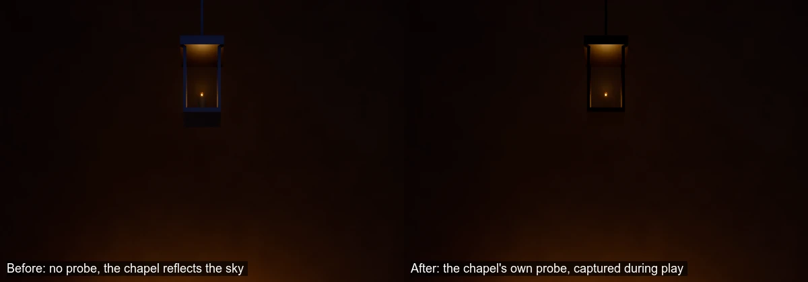

The entity names the probe across frames; drawing by hand, the key does, so place it every
frame like a light. Probes are
photographed during play, inside the frame and without stopping the game: one a frame, in the
order they asked, so a new probe shows a frame or a few after it's first placed, and surfaces
reflect the sky behind it until then. A probe left out of a frame is dropped, and the rest keep
their photographs.

A probe is photographed again whenever it moves or its box changes, and otherwise as `Update`
says:

| `Update` | Photographed again |
| --- | --- |
| `ProbeUpdate.OnChange`, the default | When the light on it changes: the sun's direction or colour, the sky and its brightness, the bake, the `SunShadows`, `Materials`, `Emissive`, `EnvironmentLight`, `LocalLights` or `LightShadows` switches, or a point or spot light that reaches its box appearing, going out, or changing its range, cone or shadow. Once the [light probes](#bounced-light) round the camera have first settled, every probe is photographed once more |
| `ProbeUpdate.OnRequest` | Only when `Version` changes, so the game says when |
| `ProbeUpdate.Always` | Over and over, taking turns with the others: with three such probes each is photographed every third frame |

Moving the camera never counts, because the photograph frames the sun's shadow on the probe's
own box, and nor does moving or adding objects. A light's colour and where it is aren't watched
either, so a flickering candle or a swinging lantern doesn't keep a probe busy. For a probe that
should follow something that moves, use `Always`; for one that should follow a lamp the game
dims, use `OnRequest` and change `Version` with it:

```csharp
var chapel = world.Spawn(Transform.At(new Vector3(0f, 1.5f, 0f)),
    new ReflectionCapture(new(-4f, -1.5f, -4f), new(4f, 1.5f, 4f), Update: ProbeUpdate.OnRequest));

// When the lamp dims:
ref var probe = ref world.Get<ReflectionCapture>(chapel);
probe = probe with { Version = probe.Version + 1 };
```

The [Gallery](../examples/Gallery) shows it: L puts the chapel's lantern out, and C dims the sky,
and the probes catch up over the next few frames. Below, the frame times as C dims the sky, on
main, where each probe's photograph stopped the game, and with photographs taken in the frame:

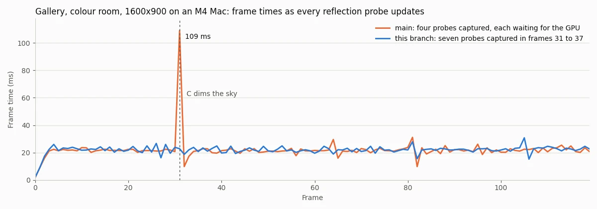

A photograph lights each surface as the screen does, without its shine: the suns with their
shadows, every point and spot light in range with its shadows, and the soft light from the
bake's probes, the [light probes](#bounced-light) or the sky. A metal shows its own colour in the
soft light round it. It sees things up to 100 m away, from both sides only where a material is
two-sided, so a probe inside a closed object sees out through it. It runs no surface shader, so
a glow made by one, like the Gallery's lamp discs, doesn't show; a material's own `Emissive` does.
Decals, glass, particles, outlines, fog and anything skinned, swimming or a ghost aren't in it.
On an M4 Mac a photograph takes about 0.7 ms of the GPU's time.

At most 64 probes fit in a frame, and a sixty-fifth throws. Each probe takes about 1 MB of
GPU memory. Room for 8 is made at the start and doubles when it runs out, up to 64, which
waits for the GPU once. The position must be inside the box, `BoxMax` above `BoxMin` on
every axis, `Blend` 0 or more, `Priority` a finite number, `Update` one of the three, and each
key used once a frame. A `ReflectionCapture` entity's key is its entity's id, so a probe drawn by hand next to
them needs a key no entity has, such as a negative one. With `Graphics.Lighting.Reflections` off, no probes are photographed and shiny
surfaces and glass reflect only the sky.

### Planar reflections

A flat, level floor that shines, such as a wet yard, a polished hall or a still pool, can mirror
the scene exactly, off screen and behind things too. A `MirrorPlane` entity names the plane's
height in metres:

```csharp
world.Spawn(new MirrorPlane(0f));   // the floor at 0 mirrors the scene
```

When several entities have one, the newest wins. Drawing by hand,
`view.Surroundings.ReflectionPlane(height)` sets it for one frame, and a height that isn't a
finite number is refused. [Puddles](#puddles) set the plane at their level by themselves, so a
scene with puddles needs nothing more; a `MirrorPlane` takes over from them.

Each frame the scene is drawn a second time, at half the picture's size each way, from a camera
mirrored under the plane, and the surfaces that lie in it read their reflection from that
picture. It shows what the screen's own reflections can't: the top of a wall above the edge of
the picture, the far side of a post, the sky behind the camera. A surface takes it when it lies
within 1 cm of the plane, fading out by 5 cm, faces up, and is smooth: it fades out as the
roughness goes from 0.5 to 0.8. Elsewhere, and near the picture's edges, the screen's reflections
and the probes show as before. A bumpy normal, such as the puddles' ripples, bends where the
reflection is read.

A rough surface blurs its reflection, and the blur grows with how far the reflected ray goes past
the plane before it meets something. So a post standing in a wet floor reflects sharp at its
foot and softer up its height, and a wall's reflection is crisp where the wall meets the floor.
The mirror's picture keeps how high above the plane each thing it saw stands, and its smaller
copies, each half the size of the last, give the blur.

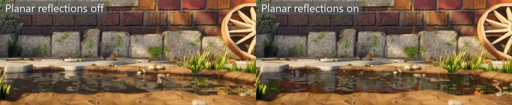

The mirror draws the scene's solid surfaces with their materials, lit by the suns, the lamps
and the soft light round them, but leaves out grass, the marched clouds, glass, particles,
decals and fog, and runs none of the effects on the picture, such as ambient occlusion, bloom,
depth of field or paint. Only one plane is mirrored in a frame. A surface that isn't level, such
as a ramp or a wall-mounted mirror, doesn't take it. Like every reflection it is scaled by the
environment's intensity, so with `EnvironmentSettings.Intensity` at 0 it shows black, as the
screen's own reflections do. The camera must stand at least 1 cm above the plane; below it
nothing is mirrored. Orthographic cameras, set with `Camera.Size`, are mirrored too.

It costs about 1 ms of GPU time a frame on the Courtyard at 1600 by 900 on an RTX 4060 Ti,
since the whole scene is drawn again. The mirror's pictures are made the first frame that has a
plane and shrunk to a single pixel the first frame without one, and each change waits for the
GPU once. [`Graphics.Lighting.PlanarReflections`](#graphics-settings) turns it off, and
`GraphicsQuality.Low` and `Graphics.Fastest()` turn it off.

## The look of the picture

```csharp
world.Spawn(new Finish(new PostSettings
{
    Exposure = 0.2f,     // stops: +1 is twice as bright
    Contrast = 0.1f,
    Saturation = 0.1f,   // -1 is black and white
    Vignette = 0.3f,
    Sharpen = 0.4f,
    Grain = 0.01f,
    Bloom = 0.1f,                              // more glow round bright things
    Lift = new Vector3(0.03f, 0.02f, 0.05f),   // lilac in the shade
    Gain = new Vector3(0.05f, 0.02f, -0.04f),  // cream in the highlights
}));
```

Drawing by hand, `view.Effects.Finish(settings)` sets it for one frame. Leaving a value at zero leaves that part unchanged. `Lift` adds colour to the dark parts
and fades out towards white, so shade takes a tint and white stays white. `Gain` makes
each channel that much brighter, by its share, so it shows most in the highlights.

| Setting | What it does |
| --- | --- |
| `Tonemapper` | The curve that fits the scene's light into what a screen shows. `Tonemapper.Agx`, the default, `Tonemapper.Aces` for the older, punchier look, or `Tonemapper.Neutral` to keep base colours true. See [tone mapping](#tone-mapping) |
| `AgxLook` | The look on top of AgX. `AgxLook.Punchy`, the default, deepens the mid-tones and strengthens colour; `AgxLook.Base` is the plain, softer curve. ACES ignores it |
| `Temperature` | White balance, from -1 to 1. Above 0 warms the picture, as if the camera were balanced for light bluer than daylight: 1 balances for 12000 K. Below 0 cools it, down to 4000 K at -1. 0.1 is a gentle afternoon warmth |
| `Tint` | White balance the other way, from -1 to 1. Above 0 pulls the picture towards magenta, below 0 towards green |
| `Grade` | The finer colour grade, a `ColorGrade` with the settings in the next table |
| `Lens` | The camera's lens, for depth of field, a `LensSettings` with the three settings below. See [focus](#focus) |
| `Lens.FocusDistance` | Where the lens is focused, in metres from the camera |
| `Lens.Aperture` | The lens's f-number, such as 2.8 or 8. Smaller opens the lens wider and blurs more. 0, the default, is no depth of field |
| `Lens.FocalLength` | The lens's focal length in millimetres, for the blur only. 0, the default, means 35. It doesn't change the field of view, which the camera sets |

The finer grade goes in `Grade`, so a look that only wants contrast and a vignette never sees it:

```csharp
world.Spawn(new Finish(new PostSettings
{
    Contrast = 0.2f,
    Grade = new ColorGrade
    {
        HueShift = 5f,
        SplitShadows = new Vector3(0f, 0.04f, 0.08f),   // teal shade
        Highlights = new Vector3(0.06f, 0.03f, 0f),     // warm highlights
    },
}));
```

| `ColorGrade` setting | What it does |
| --- | --- |
| `HueShift` | Turns every colour round the colour wheel by this many degrees, with grey left grey. 20 moves reds towards orange and greens towards teal |
| `RedFrom`, `GreenFrom`, `BlueFrom` | The channel mixer: how much of the red, green and blue light is added to each channel on top of its own. `RedFrom = (0, 0.1, 0)` mixes a tenth of the green into the red |
| `Shadows`, `Midtones`, `Highlights` | Extra brightness in each of red, green and blue in that part of the picture only, such as `Shadows = (0, 0, 0.1)` for blue shade. Black stays black |
| `SplitShadows`, `SplitHighlights` | Split toning: the darker half of the picture leans towards one colour and the brighter half towards the other, with the brightness kept. (0, 0.04, 0.08) and (0.08, 0.04, 0) give teal shade and an orange glow |
| `SplitBalance` | Where split toning turns from shade to light, from -1 to 1. Towards 1 more of the picture counts as shade |
| `Lut`, `LutBlend` | An artist's [colour table](#a-colour-table) and how much of it shows, from 0 to 1 |

A view refuses a `Temperature` or `Tint` outside -1 to 1, a `SplitBalance` outside -1 to 1, a `LutBlend` outside 0 to 1, or a `HueShift` that isn't a number.
Rendition used on its own holds them at the nearest end instead, and counts a value that
isn't a number as 0. White balance works on the light, after exposure and before contrast and the
curve, the way a camera's does, so white surfaces in the sun take the warmth and the
highlights still fade to white. The channel mixer and the hue shift work there too, in that
order after the white balance. The tones and split toning come after the curve, on the
colours the screen shows, so they split the picture where the eye does.

The Courtyard leans its shade towards teal with `SplitShadows = (0, 0.03, 0.06)` and warms its
sunlit bricks with `Highlights = (0.04, 0.015, 0)` and `Midtones = (0.02, 0.01, 0)`:

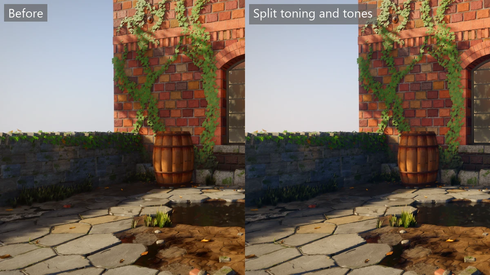

Everything from the white balance to the colour table is the same for every pixel, so it is
baked into one table of 64 cells a side whenever a setting changes, and each pixel reads it
once. A grade costs the same however many of these settings it uses, and changing one costs a
bake of its quarter of a million cells on the frame that changes it. Exposure and auto exposure
are worked out a pixel at a time, so they never bake.

`PostSettings.Lerp(from, to, t)` gives the look part of the way from one to the other, for
easing between grades, such as day into dusk or a room into a cave. Numbers and colours move
evenly. Choices that can't be halfway, such as the tonemapper, auto exposure or a lens that
opens from none, change at the halfway point, and two different colour tables cross through
none: the first fades out over the first half and the second in over the second.

```csharp
var settings = PostSettings.Lerp(day, dusk, view.SecondsSince(sunsetTick) / 30f);
```

### Tone mapping

The scene's light runs far brighter than a screen can show, so a curve squeezes it in.
AgX, the default, is the curve Blender 4 uses. It moves bright, strongly coloured light
gradually towards white, so a sunlit brick wall keeps the difference between its bricks.
ACES, the older look, is punchier in the mid-tones but takes saturated highlights to one
flat colour. Khronos PBR Neutral keeps colours up to near white as they are, so a product's or a
material's base colour shows true, and rolls only the brightest light off towards white.

On its own AgX reads soft and pale, so it comes with Blender's Punchy look by default,
which deepens the mid-tones and strengthens colour. Punchy also puts middle grey about
0.8 of a stop darker on screen than ACES or the plain curve, so a scene moving over from
ACES wants more `Exposure`: the Courtyard uses 1.05 with auto exposure, with `Contrast`
0.25 and `Saturation` 0.15. `AgxLook.Base` is the plain curve, which keeps middle grey where
ACES puts it and leaves the most room in the highlights.

```csharp
world.Spawn(new Finish(new PostSettings { Tonemapper = Tonemapper.Aces }));   // the older look
world.Spawn(new Finish(new PostSettings { AgxLook = AgxLook.Base }));         // AgX without the Punchy look
world.Spawn(new Finish(new PostSettings { Tonemapper = Tonemapper.Neutral }));  // base colours kept true
```

Every curve and look is baked into the grade's table, so they cost the same and `Graphics.Fastest()` leaves the choice alone.

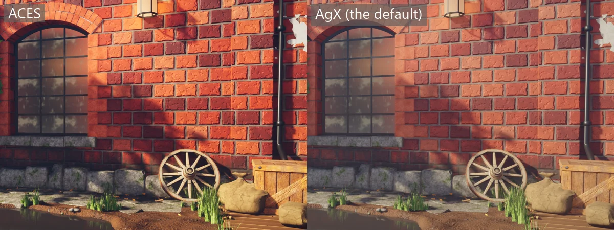

`Sharpen` gives back the crispness anti-aliasing blends away, from 0 to 1. It sharpens fine,
faint detail such as a texture's grain the most and edges that already stand out hardly at
all, so they get no bright halos. While anti-aliasing is on, textures are also read a little
sharper than their size on screen asks for. One frame alone would shimmer, but anti-aliasing
blends the frames and they settle. Reflection probes are captured without it, since nothing
blends their frames.

### A colour table

A colour table, or LUT, is a look made in a grading tool or a paint program: a cube that says
what each colour on screen turns into. It is laid over the picture after the curve and the
tones, on the sRGB colours the screen shows, so it grades the picture as the tool saw it.
`Grade.LutBlend` says how much of it shows, from 0, none, to 1, the table's own colours.

```csharp
ColorLut dusk = content.Lut("looks/dusk.cube");   // or "looks/dusk.lut.png"
world.Spawn(new Finish(new PostSettings { Grade = new ColorGrade { Lut = dusk, LutBlend = 0.8f } }));
```

A table comes from one of two files in the content folder:

- A `.cube` file, as DaVinci Resolve, Photoshop and most grading tools export. Only 3D tables
  over 0 to 1 are read, from 2 to 128 cells a side.
- A `.lut.png` strip, made from the game's own picture. Take a screenshot with
  `--neutral-lut`, which stamps a table that changes nothing in its top left corner, 1024 by 32
  pixels, grade the whole picture in a paint program, then cut the strip back out at 1024 by 32
  and save it as `.lut.png`. Whatever the grade did to the picture it did to the strip, so the
  table gives the game the same look.

```
dotnet run -c Release --project Hamlet -- --seed 1 --ticks 120 --size 1280x720 --screenshot grade-me.png --neutral-lut
```

The table is baked into the grade's table, so it costs nothing a frame, and changing it or
its blend costs one bake. `--neutral-lut` turns the game's own colour table off for the shot, so
the strip starts from the picture without it. Colours past white, before the screen clips
them, pass by the table unchanged. The vignette, the grain and the sharpening come after it.

`Graphics.Picture.ColorLut` turns the table off. With Rendition alone, upload one with
`renderer.Luts.Create(data)`, from `ColorLutData.Read` of a cooked table or
`ColorLutData.From(size, colour => ...)`, and pass the handle in `PostSettings.Grade.Lut`.

A table stays until it is let go: `content.Unload(lut)` in a game, or `renderer.Luts.Destroy(lut)`
with Rendition alone. Its image is freed once the frames that read it are done, the next table
made takes its slot, and a picture that still names it afterwards throws.

### Screen effects

Screen effects are the finish a game drives from play: a red edge while the player is hurt, a
white flash on a hit, a blur at speed, a fade to black on a fall. Put a `ScreenEffects`
component on any entity and change it every frame:

```csharp
var hurt = world.Spawn(new ScreenEffects());

// In a system, each frame:
ref var screen = ref world.Get<ScreenEffects>(hurt);
screen.Flash = MathF.Max(0f, screen.Flash - 4f * dt);              // a hit's flash, gone in a quarter second
screen.EdgeTint = new EdgeTint(new Vector3(0.8f, 0f, 0f), 1f - health);
screen.SpeedBlur = Math.Clamp((speed - 10f) / 30f, 0f, 0.5f);
```

| `ScreenEffects` setting | What it does |
| --- | --- |
| `ChromaticAberration` | Red and blue fringes that grow towards the edges, as through a cheap lens, from 0 to 1, about 16 pixels at the corners of a 1080p picture at 1. 0.2 is a hint; a short burst near 1 sells a heavy hit |
| `SpeedBlur` | A blur streaking out from `SpeedBlurCenter`, from 0 to 1, where the corners smear a quarter of the way to it. 0.2 is a fast run, 0.6 a dive |
| `SpeedBlurCenter` | Where the blur streaks out from, as a fraction of the screen, (0, 0) at the top left. Null, the default, is the middle. Put it where the camera is heading |
| `Flash`, `FlashColor` | Lights the picture with the colour, from 0 to 1, as a burst of light does: it brightens and never covers, so the picture shows through. The colour zero is white |
| `Fade`, `FadeColor` | Covers the picture with the colour, from 0 to 1. The colour zero is black |
| `EdgeTint`, `SecondEdgeTint` | A colour creeping in from the edges and corners, with a strength from 0 to 1. The second goes over the first, so a green heal can show over a red hurt. At 1 the edges are all the colour |
| `Desaturate` | How much colour the picture loses, from 0 to 1, grey. It comes after the grade, so it's on top of `PostSettings.Saturation` and a grade's colour table |
| `Blur` | Softens the whole picture, from 0 to 1, as behind a pause menu. The interface drawn over it stays sharp. A [`Backdrop`](interfaces.md#a-pause-backdrop) sets it for you |
| `Canvas`, `CanvasStrength`, `CanvasTileSize` | A texture laid over the picture, such as paper or canvas, multiplied, so white leaves it as it is. The strength runs from 0 to 1, and the tile size is how many pixels of the window one tile covers; 0 is the texture's own size. The paper stays put on the screen while the world moves under it |

Every amount is off at 0 and costs nothing there, and changing them never bakes the
[grade's table](#a-colour-table) again, so set them every frame with no cost but the effects
themselves. The colours are linear light, like a sun's. Amounts outside 0 to 1, a negative tile
size, and colours or a centre that aren't numbers are refused with a message saying which.

The finish can hold screen effects of its own, in `PostSettings.Screen`, for a look that
belongs to the level, such as a paper texture. The component, or `view.Effects.Screen(effects)`
when drawing by hand, lays over it: each effect set there, anything not zero, wins, and the
rest keep the finish's. So a hit's flash keeps the level's paper. When more than one entity
has the component, the one added or changed last wins. `PostSettings.Lerp` blends the screen
effects with the rest of the finish, so a blend between two looks fades a red edge in red rather
than through black, and two different canvases cross through none at the halfway point.

The fringes, the speed blur and the soft blur are worked out on the scene's light, before the grade, so a
bright lamp streaks bright. The flash, the fade, the tints, the loss of colour and the paper come
last, on the colours the screen shows, after the vignette and before the grain. A
[debug view](#ray-tracing) shows none of them.

The fringes read the picture three times a pixel and the blur 16 times, so those two cost GPU
time while they show, more the larger the window; the rest is a few sums a pixel. At 0 they're
skipped and the pass costs what it did without them. `Blur` reads bloom's blurred copy of the
picture nine times a pixel rather than blurring it again, so it costs little, and bloom's chain
runs while it shows even with `Picture.Bloom` off.

Four [graphics switches](#graphics-settings) turn them off. `Picture.ChromaticAberration` and
`Picture.SpeedBlur` turn off the two that cost time, and `Graphics.Fastest()` turns both off.
`Picture.Flashes` is for a player who is sensitive to flashing light. `Picture.ScreenEffects`
turns off all of them but the fade, since a game uses the fade to say something, such as that the
player fell.

With Rendition alone, set `PostSettings.Screen`, and give `Canvas` a texture handle from
`renderer.Assets.CreateTexture`. A Super game gives it a texture from `content.Texture("paper.png")`.

The [Cannonball](../examples/Cannonball) example blurs the screen with the stuntman's speed and
flashes it red on the hit. Each effect on its own, and Cannonball's:

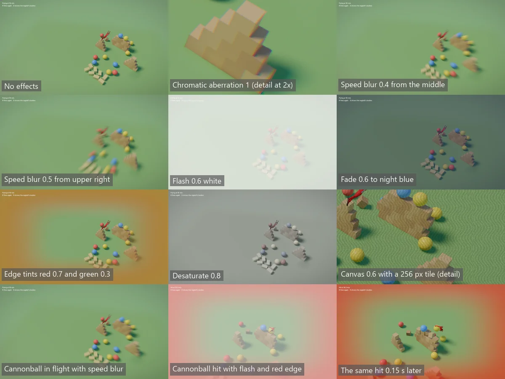

### Lens flare

When the sun is on screen, light bouncing between the camera's lenses leaves glints across the
picture: a thin streak and a faint halo round the sun, a few soft ghosts and hexagons towards and
past the middle of the screen, and a ring on the far side. It needs no setup and is subtle by
default.

The flare fades as something covers the light, so it dims behind a tree and goes out behind a
hill. It also dims in fog and fades out as the light nears the edge of the screen. The moon doesn't
flare.

Change it for one frame with `view.Lights.LensFlare`, or keep it on an entity as a
`LensFlareSettings` component, where the newest one wins:

```csharp
view.Lights.LensFlare(new LensFlareSettings
{
    Intensity = 0.5f,
    Elements = new[]
    {
        new LensFlareElement(LensFlareShape.Ghost, 0.6f, 0.1f, new Vector3(0.04f, 0.03f, 0.02f)),
        new LensFlareElement(LensFlareShape.Polygon, 1.5f, 0.12f, new Vector3(0.01f, 0.02f, 0.03f)) { Sides = 5 },
        new LensFlareElement(LensFlareShape.Ring, 2.1f, 0.25f, new Vector3(0.01f, 0.01f, 0.02f)),
    },
});
```

`Intensity` scales the whole flare. It is 1 when left out, and 0 turns the flare off. `Elements`
replaces the default set, which `LensFlareSettings.DefaultElements` holds, so you can start from
it. A flare has at most 16 elements.

Each `LensFlareElement` has a shape, a position, a size and a colour:

- The shape is `Ghost` (a soft disc with a brighter rim), `Ring`, `Polygon` (the aperture's shape,
  with `Sides` sides from 3, or 0 for six), `Streak` (a thin line across the screen, as from an
  anamorphic lens) or `Halo` (a wide faint rainbow ring round the light).
- The position places it on the line from the light through the middle of the screen: 0 is on the
  light, 1 is the middle and 2 is the light's mirror across the middle.
- The size is its width in screen heights.
- The colour is linear and is multiplied by the light's colour, so small values such as 0.02 suit
  the sun.

Besides the sun, up to three bright lights can flare, such as a lighthouse lamp or a car's
headlight. Name them each frame with `view.Lights.FlareLight`, or in the settings' `Lights`:

```csharp
view.Lights.FlareLight(lampPosition, new Vector3(40f, 32f, 20f), radius: 0.3f);
```

The colour is the light's brightness, like a light's radiance. The radius is how far round the light,
in metres, something must cover to hide it. Anything nearer the camera than the light by less than
the radius doesn't hide it, so the lamp's own glass doesn't. A fourth light is refused, as is a
setting that can't be drawn, and the message says why.

Under temporal anti-aliasing, the flare keeps the most of the light seen over the last four frames,
so a sun shining through leaves doesn't flicker as the camera jitters. A cut starts afresh.

The `Picture.LensFlare` switch turns it off, and `Graphics.Fastest()` does too. With Rendition
alone, set `PictureSettings.LensFlare` on the frame's `Picture`, and turn it off with
`RenderEffects.LensFlare`.

Clouds that cover the sun dim the flare with it, and a thick one hides it. The default streak is
hard to see against a bright sky. Hamlet under a low sun, without and with it:

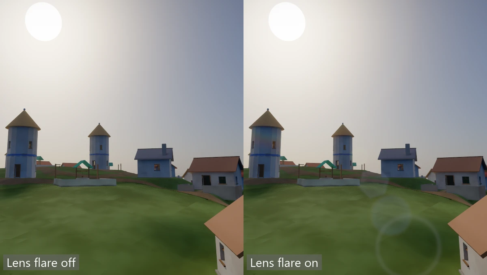

### Paint

Paint turns the picture into an oil painting. Flat parts such as grass, rock and leaves become
brush strokes that follow the shapes in them, and the edges between things stay hard where a blur
would soften them. It can paint the whole picture or only what is far away, so the far hills look
painted while the player and what's near stay sharp.

Set it for one frame with `view.Effects.Paint`, or keep it on an entity as a `PaintSettings`
component, where the newest one wins:

```csharp
world.Spawn(new PaintSettings { Amount = 1f, Near = 40f, Far = 150f });
```

The default paints nothing. The settings are:

- `Amount` says how much of the painted picture shows, from 0 for none to 1 for all of it.
- `BrushSize` is the brush's radius in pixels of a picture 1080 pixels tall, up to 16, so it covers
  the same share of the screen at any size. 0, the default, gives 10. Strokes along an edge are up
  to twice as long.
- `Sharpness` is how hard the edges between strokes are, from 0, soft and blended, to 1, crisp.
  Null gives 0.5.
- `Near` and `Far` paint only the distance: nothing nearer than `Near` metres, fading in to the
  full amount at `Far`. A `Far` of 0, the default, paints the whole picture alike. The sky always
  counts as far.

A setting that can't be drawn, such as an amount above 1 or a far distance short of the near one,
is refused, and the message says why.

Paint works on the lit picture before the colour grade and the tonemap, so the grade, the vignette
and the grain lie over the strokes rather than being smeared by them. Bloom reads the picture
unpainted. Below a tiny amount a pixel is left exactly as it was, so the near part of a picture
painted by distance is untouched.

The `Picture.Paint` switch turns it off, and `GraphicsQuality.Low` and `Graphics.Fastest()` do too.
With Rendition alone, set `PictureSettings.Paint` on the frame's `Picture`, and turn it off with
`RenderEffects.Paint`.

The strokes are worked out at half size, so a thin dark line against the sky, such as a far
skyline, can show small steps along it. Nothing carries the strokes from one frame to the next, so
where the picture is busy and moving they can shimmer. The
[Terrain](../examples/Terrain) example paints its far hills, from 40 to 150 metres. Courtyard's
ivy, bricks and barrel without and with the whole picture painted at an amount of 1 and the
default brush:

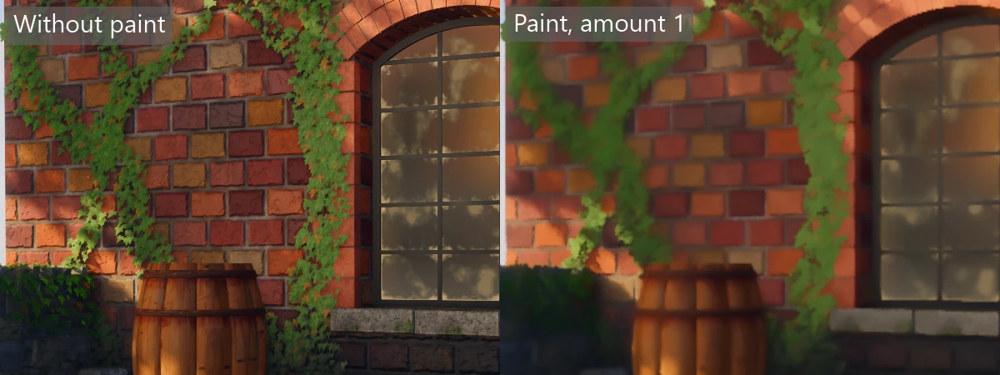

### Looks

A look sets the mood of the whole picture with one choice: a colour grade, screen effects, paint,
retro pixels and nudges to the sun, the sky, the fog and the clouds. Ask for `ArtStyle` in your game's
constructor and pick one of `Looks`:

```csharp
public sealed class MyGame(ArtStyle style) : IGame
{
    public void Load() => style.Use(Looks.GoldenHour);

    public void Update(GameTime time)
    {
    }
}
```

`style.Use(Looks.Noir, seconds: 1f)` eases from the look on screen into the new one over a second,
and starting another blend partway through carries on from what is on screen. The blend runs on
real ticks, so slow motion doesn't stretch it. `style.Current` is the look being shown or blended to,
for a menu. [`--look`](command-line.md) picks the look a game starts with, over the one it picks
itself. The [Hamlet example](../examples/Hamlet) steps through them with L. Here is each on the same
frame of Hamlet:


| Look | What it does |
| --- | --- |
| `Looks.Natural` | Nothing: the game's own picture |
| `Looks.Painterly` | An oil painting in warm light, with broad, crisp brush strokes and rich colour |
| `Looks.Candy` | Bright, soft and pastel: lifted exposure, rich colour, pink light, mint shade and a glow |
| `Looks.GoldenHour` | A low orange sun under a dimmer sky, teal shade, a brighter flare and darker corners |
| `Looks.Noir` | Black and white with hard contrast, a brighter sun, deep corners and grain |
| `Looks.Horror` | Dark and sickly green but readable: the sun and sky dimmed under heavy cloud and a low fog, grain and no flare |
| `Looks.Vhs` | A worn home video: faded, warm colour, grey blacks, colour bleeding at the edges, noise, soft big pixels and fewer shades |
| `Looks.Psx` | A 1990s console: big square pixels, few shades with a dither between them and no sharpening |

A look is a plain value, so make your own or change one with `with`:

```csharp
var moody = Looks.Noir with { Finish = Looks.Noir.Finish with { Grain = 0f } };
var dusk = new ArtLook
{
    Name = "Dusk",
    Finish = new PostSettings { Temperature = 0.15f, Vignette = 0.2f },
    Light = new LookLight { SunWarmth = 0.7f, Sky = -0.5f, Fog = 0.005f },
};
```

Every number in a look is a change to what the game set, so the default look, `Looks.Natural`,
leaves the picture as the game made it, and a game that grades its own picture keeps that grade
under any look. The parts are:

- `Finish` is a `PostSettings` [finish](#the-look-of-the-picture) added to the game's: a contrast
  of 0.2 adds 0.2 to the game's own, and the result is held to its range. A colour table in it
  replaces the game's, and a screen effect set in it wins over the game's. The exposure meter, the
  tonemapper and the lens stay the game's.
- `Paint` is [paint](#paint) that takes over from the game's as its amount rises to 1. Below 1 the
  brush and amount lie between the game's paint and the look's, so a look easing in grows out of the
  game's paint instead of replacing it at once. A game that paints nothing gets the look's as it is.
- `Retro` is [retro pixels](#retro-pixels).
- `Light` is a `LookLight`. `Sun` and `Sky` make the suns and the sky that many stops brighter.
  `SunWarmth`, from -1 to 1, turns the suns' colour from a cold blue to a low orange sun and keeps
  their brightness. `Fog` adds fog density, where 0.01 is a light haze. `Clouds` adds cloud cover,
  and a [physical sky](#clouds) without clouds gets fair-weather ones that grow from nothing, their
  cirrus thickening with the cover. `Flare` makes the
  [lens flare](#lens-flare) that many stops brighter, so -10 all but hides it.

`ArtLook.Lerp(from, to, t)` gives the look part of the way between two, as a blend does. Numbers move
evenly. The name and a colour table change halfway, and paint or retro pixels that only one side
has grow in from none. A look out of range, such as a dither above 1, is refused with a message
saying which part.

Graphics switches still win. `Picture.Paint` turns off a look's paint, `Picture.Retro` its retro
pixels, and `Atmosphere.Clouds` or `Atmosphere.Fog` the clouds and fog it adds.

A look that changes the sun's colour or brightness makes the sun move as far as the baked lighting
is concerned, so while it blends, a scene with a bake is lit live, and it goes back to its bake
a second after the blend ends. A look that holds the sun steady is drawn from the bake as before,
but the bake was made with the game's own sun, so the bounced light keeps the game's colour.

### Retro pixels

Retro pixels draw the picture in big square pixels, with fewer shades and a pattern of dots between
them, as a 1990s console did. They come with a [look](#looks) as a `RetroSettings`:

```csharp
style.Use(Looks.Natural with { Retro = new RetroSettings { PixelSize = 4f, Levels = 32, Dither = 1f } });
```

- `PixelSize` is how big each pixel is, in pixels of a picture 1080 pixels tall, up to 32, so it
  covers the same share of the screen at any size. 1 or less keeps every pixel.
- `Levels` is how many shades each of red, green and blue keeps, from 2 to 256. 0, the default,
  keeps them all.
- `Dither`, from 0 to 1, mixes the two shades either side of a colour in a fixed pattern, so a
  smooth slope shows as dots rather than bands.

They are drawn in the last pass, after the grain and before the interface, so the interface stays
sharp. They cost a few instructions a pixel and no pass of their own, and the `Picture.Retro`
switch turns them off. With Rendition alone, set `PictureSettings.Retro` on the frame's `Picture`,
and turn it off with `RenderEffects.Retro`.

### Auto exposure

```csharp
world.Spawn(new Finish(new PostSettings
{
    AutoExposure = true,
    Exposure = -0.3f,        // now compensation: a third of a stop darker than metered
    AdaptationSpeed = 2f,    // stops a second into the light; 0 means the default of 2
    Metering = new MeteringSettings
    {
        DarkSpeed = 1f,      // stops a second into the dark; 0 means the default of 1
        Darkest = -3f,       // don't brighten a scene darker than 1/8 any further
        Brightest = 2f,      // don't darken a scene brighter than 4 any further
        Centre = 0.5f,       // the middle of the screen counts more than the edges
    },
}));
```

With `AutoExposure` on, the camera meters the picture and sets the brightness itself, so a
scene lit much brighter or dimmer comes out about the same. It sorts the lit picture's pixels
by brightness, before bloom, leaves out the darkest 40 per cent and the brightest 5 per
cent, and puts the average of the rest at middle grey. Deep shade and the sun's disc so don't
pull the picture one way or the other. `Exposure` then shifts that, in stops, for a
brighter or darker picture than the meter picks.

When the scene gets brighter the exposure follows at `AdaptationSpeed` stops a second, the
way eyes adjust walking out of a cellar. When it gets darker it follows at
`Metering.DarkSpeed`, which is slower by default, 1 stop a second against 2, since eyes take
longer to get used to the dark. The first frame starts at the metered brightness,
not from black, and so does the first after `AutoExposure` or [`Graphics.Picture.AutoExposure`](#graphics-settings)
is turned back on, or after time goes backwards, as when the game restarts. A speed must be above 0, or 0 for the
default. A view refuses anything else; Rendition used on its own takes the default instead. The meter sees from about 1/256 to 65000 times a white of 1. Anything darker or
brighter counts as the darkest or brightest it sees.

Left alone, the meter makes a cave as bright as a field. `Metering.Darkest` and
`Metering.Brightest` stop that. They are the metered brightness in stops from 1, the same
scale the meter uses, and the camera adapts only as far as a scene at the limit. With
`Darkest = -3`, a cave whose middle tones are darker than 1/8 comes out darker than the field,
the way it would to a player standing in it. Either can be left null for no limit, and the
darkest can't be past the brightest.

`Metering.Centre`, from 0 to 1, makes the middle of the screen count for more, so what the
player looks at sets the brightness rather than a dark wall at the edge. At 1 the very middle
counts 16 times as much as the corners, falling off smoothly towards them. At 0, the default,
every pixel counts the same. A view refuses a centre weight outside 0 to 1 and a limit that
isn't a number; Rendition used alone holds the weight to 0 to 1 and ignores such a limit.

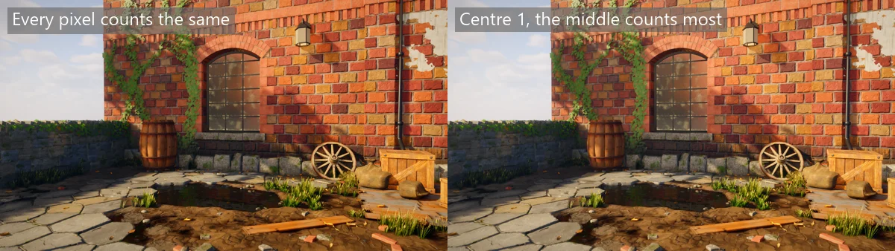

Screenshots and recordings step time a tick at a fixed rate, so the same `--seed` and `--ticks`
give the same exposure and the same picture every run. Reflection and light probes don't
use it: they hold light, and exposure is applied after lighting.

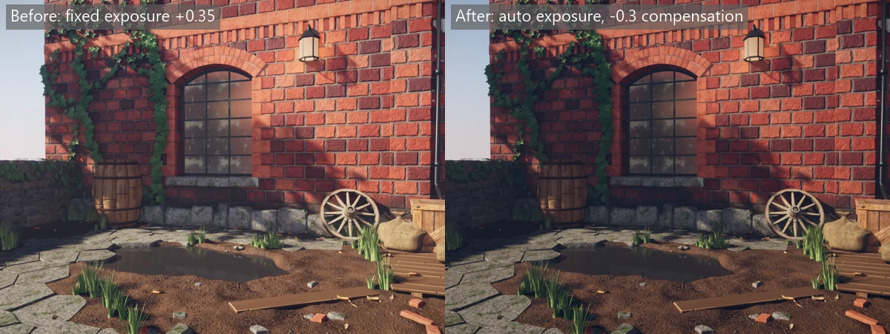

### Focus

```csharp
world.Spawn(new Finish(new PostSettings
{
    Lens = new LensSettings
    {
        FocusDistance = 11f,   // metres to what should be sharp
        Aperture = 8f,         // the f-number; 0, the default, keeps everything sharp
        FocalLength = 35f,     // millimetres; 0 means 35
    },
}));
```

With an aperture set, the picture blurs nearer and further than the focus distance, as a
camera lens does. The blur is worked out from a thin lens on a 36 mm full-frame sensor: a
point d metres away spreads into a circle (f / N) * |d - S1| / d * f / (S1 - f) across,
where f is the focal length, N the aperture and S1 the focus distance. A smaller f-number, a
longer lens or a nearer focus blurs more. A 50 mm lens at f/2.8 focused at 10 m spreads a
point at 5 m, or at the horizon, over 0.09 mm, about 4 pixels of a 1600 pixel picture.
The blur is measured in the scene's own pixels, so it looks the same at any
[render scale](#graphics-settings). No circle grows past 16 pixels in radius (32 across).

`Lens.FocalLength` only sizes the blur. The field of view still comes from the camera, so set
them to match if it matters. The sensor is 36 mm across the picture's width, so in a 16:9
picture 35 mm sees about 0.56 radians top to bottom, the camera's `fieldOfView`, and 50 mm
about 0.40.

Small apertures blur gently. The Courtyard is focused on its window at f/8, so the window and
the wall stay sharp, and the flagstones and grass at the camera's feet soften a little, by
about a pixel. A portrait look wants f/1.4 to f/2.8 and a longer lens; cutscenes can change
the focus each shot to pull attention.

What's out of focus behind blurs only with other things behind, so a sharp thing never
smears into the background. A blurred thing in front spreads over what's behind it, past its
own edge, as a branch close to the lens veils the scene. The blur is gathered at half size
and drawn back at full size, so edges in focus stay crisp.

The blur goes by the depth of solid surfaces, so glass and particles take the blur of what's
behind them: a window pane is as sharp or as soft as the room through it, and smoke in front
of a blurred wall blurs with the wall. Where a sharp edge in front sits on a blurred
background, the background can pick up a pixel-wide fringe of the edge's colour, since each
half-size pixel mixes the four pixels under it.

A view refuses a negative or broken `Lens.FocusDistance`, `Lens.Aperture` or `Lens.FocalLength`, and a focus
distance no further than the focal length while the aperture is open. Rendition used on its
own draws no depth of field for those instead. [`Graphics.Picture.DepthOfField`](#graphics-settings)
turns it off for every view, and `Graphics.Fastest()` turns it off. Probes never see it, so
changing the focus never captures them again.

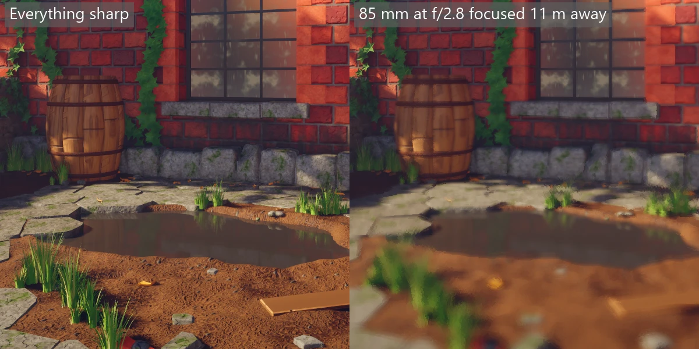

The picture above uses a stronger lens than the Courtyard's own f/8 and 35 mm, so the blur shows.

## The sky

Without a sky the world sits in a plain grey studio. A `Sky` on any entity gives it a gradient
from the ground up through the horizon to straight up, which shows behind everything, lights
the scene from all around and shows in reflections. Drawing by hand,
`view.Surroundings.Sky(settings)` sets it for one frame.

```csharp
world.Spawn(new Sky(new SkySettings
{
    Zenith = new Vector3(0.18f, 0.36f, 0.85f),   // straight up
    Horizon = new Vector3(1f, 0.62f, 0.32f),
    Ground = new Vector3(0.22f, 0.2f, 0.13f),    // below the horizon
    Brightness = 0.9f,                           // 0 counts as 1
    HazeStart = 25f,                             // metres
    HazeEnd = 110f,
}));
```

Haze fades things into the sky behind them, from nothing at `HazeStart` to all sky at
`HazeEnd`, so the far edge of a world melts away instead of stopping. Leave both at
zero for no haze. A negative brightness, or haze that ends nearer than it starts, throws. `Graphics.Atmosphere.Haze` turns the fade off for every view, see [graphics settings](#graphics-settings).

`HazeFromFocus` measures the haze across the ground from the point the camera looks at
instead of from the camera. Use it with a far-off camera, such as an isometric one: from there everything on
screen is about the same distance away, so haze from the camera fades everything evenly.
Haze from the focus leaves the middle clear and fades the edges of the view. `HazeColor`
sets what things fade into; zero fades them into the sky behind them, which for a camera
looking down is the dark ground below the horizon.

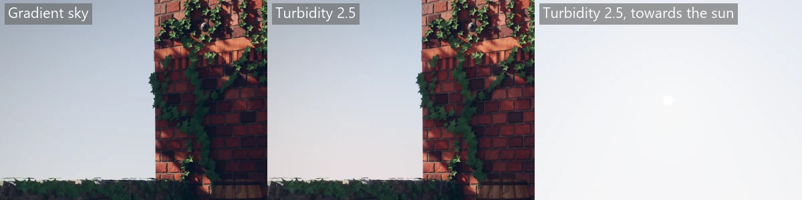

`Turbidity` swaps the gradient for a physical sky: the light of the sun scattered by the
air of a planet like Earth, after Hillaire (2020). It is a deeper blue straight up and
paler at the horizon, it glows round the sun, it turns orange and pink as the sun sets,
and the sun itself shows as a disc:

```csharp
world.Spawn(new Sun(Direction: new Vector3(-0.75f, 0.5f, 0.42f), Color: new Vector3(7.2f, 6.7f, 5.8f)));
world.Spawn(new Sky(new SkySettings
{
    Ground = new Vector3(0.2f, 0.17f, 0.14f),
    Brightness = 1f,
    Turbidity = 2.5f,   // 1.7 is a very clear day, 10 a hazy one
}));
```

Turbidity is how hazy the air is, from 1.7 to 10; 2 to 3 is a clear day, and a hazier
sky is whiter and its sunsets redder. Zero, the default, keeps the gradient, and is the
way to turn the physical sky off: there is no switch for it in `Graphics`. Any other
value throws. The sky follows the sun that casts the shadows, or the first sun when none
does. Its disc is as wide as `SunSize` in [`Shadows`](#shadows) and as bright as the sun's
colour spread over it, so a smaller sun is a brighter disc, held under what the screen
can store. `Zenith` and `Horizon` are not used; `Ground` still colours what is below the
horizon, lit by the sun and the sky, so it darkens at dusk, and `Brightness` still
scales the whole sky, disc included.

A scene that already set a turbidity gets the physical sky with no change. The
[Forest example](../examples/Forest)'s sunrise mist now takes the warm glow round the
low sun, and the hard white glare the old sky put on the grass is softer:

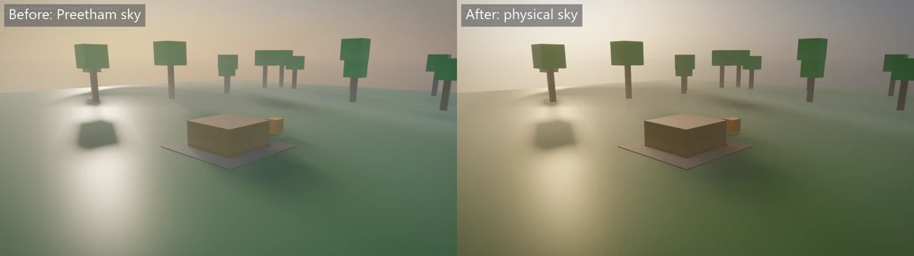

The sun's light comes through the air too. Set its colour as it looks with the sun 60°
up: higher, it is a little brighter; lower, it is warmer and dimmer, orange near the
horizon, and once it has set it gives no light at all. Only the sun the sky follows is
tinted; other lights keep their colour. After sunset the sky fades to a faint deep blue
glow, eight stops or so under noon, and never to black.

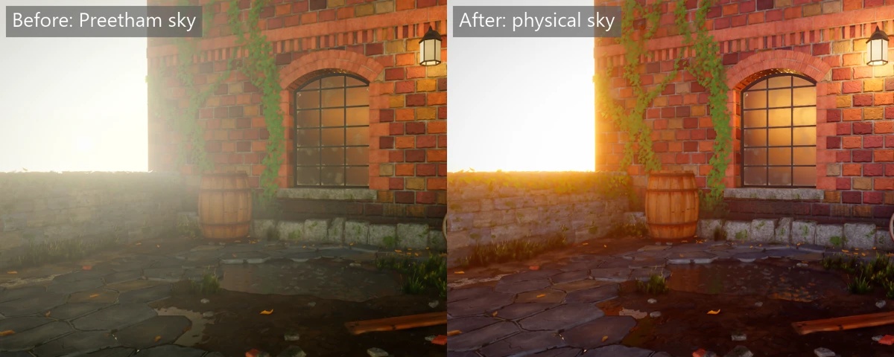

Far surfaces fade into the air, bluer and paler with distance, as they would on a clear
day: about a sixth of the way by a kilometre at turbidity 3. A view with its own haze,
`HazeStart` and `HazeEnd`, gets that instead, and with `Graphics.Atmosphere.Haze` off it gets neither.
Reflections leave the fade out, as they leave out haze. `Graphics.Atmosphere.AerialPerspective` turns the fade
off for every view; it costs almost nothing, so it stays on even in `Graphics.Fastest()`.

The disc shows in the background and in sharp reflections from the sky, but not in the
soft light, in rough reflections or in what [probes](#bounced-light) capture: the sun's
own light already gives those their highlight and their warmth. Moving the sun or
changing the turbidity rebuilds the sky's lighting, the same as changing its colours.

The sky's lighting is rebuilt on the GPU within the frame, in about half a millisecond, so the
colours, the turbidity and the sun can change every frame, for a sunset or a turning day.
Nothing waits for it. The roughest reflections catch up over the next two frames, too blurred
for the lag to show. Hamlet's day used to change its sky every half second; now it follows the
sun every frame. The plot shows the brightness of the top of the screen over eight seconds
of its sunset:

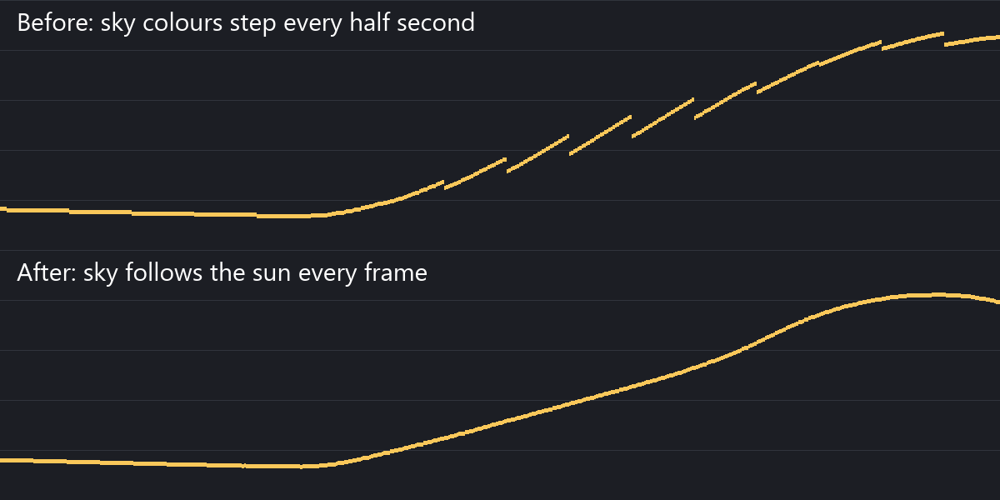

[Water](#water), when set, takes over the
sky. The [Archer example](../examples/Archer) has its sun 14 degrees up for golden hour,
with a white sun the air turns gold, and the [Courtyard example](../examples/Courtyard)
a clear one. Moving Archer from its gradient sky kept its brightness and lost
the blue cast the gradient's zenith gave the shade:

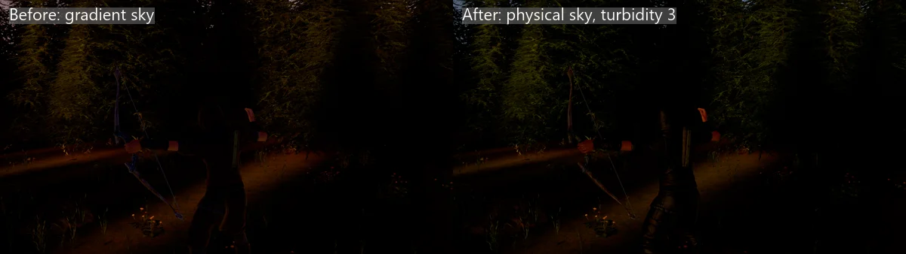

### Night

Once the sun is down, a physical sky shows stars. They fade in as the sun goes from 2° to
12° below the horizon and thin out low down, where the light comes through more air.
`StarRotation` turns them about the straight-up point, in radians, so a day cycle can turn
them once a day. `HideStars` leaves them out, and `Graphics.Atmosphere.Stars` turns them off for every view.
[Clouds](#clouds) hide the stars behind them on their own.

`Moon` puts the moon in the sky, as a direction from the ground towards it. It is lit by
the sun, so it is full opposite the sun and a crescent beside it, and like the sun it turns
warmer and dimmer low down and is gone below the horizon. It is drawn twice the real moon's
size so it reads on screen. The sky draws the moon but gives no light for it: add a dim,
bluish `Sun` aimed the same way for moonlight and shadows. The sky still follows the
real sun, whichever light casts the shadows, and skips a light aimed at the moon; with only
the moon's light, it follows that.

```csharp
// In Update, as the day turns. daylight, moonlight and sky are entities made in Load.
var moon = -sun;   // opposite the sun, so always full
bool night = sun.Y <= 0f;
world.Get<Sun>(daylight) = new Sun(sun, new Vector3(5.2f, 4.9f, 4.4f), CastsShadows: !night);
world.Get<Sun>(moonlight) = new Sun(moon, night ? new Vector3(0.16f, 0.21f, 0.36f) : Vector3.Zero, CastsShadows: night);
world.Get<Sky>(sky) = new Sky(new SkySettings
{
    Turbidity = 2.5f,
    Moon = moon,
    StarRotation = MathF.Tau * timeOfDay,   // 0 to 1 over a day
});
```

A moon or rotation that is not a number throws. The moon and the stars show only in the
background, not in reflections or in what [probes](#bounced-light) capture, and not under a
gradient sky. The night sky itself is near black, so open the exposure up a few stops at
night. The [Hamlet example](../examples/Hamlet) does that, and has moved from its gradient
to the physical sky. At twilight the old gradient was a flat blue; the physical sky glows
pink above the sunset:

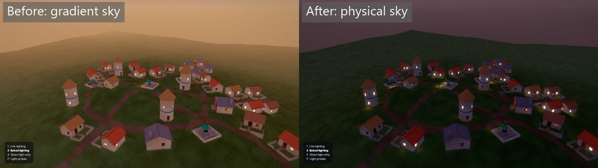

Looking up from Hamlet at night, at the moon and the stars:

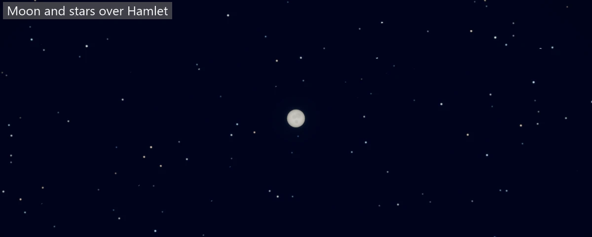

### Clouds

A physical sky has clouds: a layer of heaped cumulus, lit bright on the side facing the sun and
grey underneath, with thin streaks of cirrus high above. They drift with the wind, cast shadows
that move over the ground, and change with the time of day, white at noon and gold and pink at
sunset. A sky with a turbidity and no `Clouds` gets `CloudSettings.Fair`, scattered cumulus over
about a third of the sky, so a scene with a physical sky has them with no change. Set `Clouds` to
choose the weather:

```csharp
world.Spawn(new Sky(new SkySettings
{
    Turbidity = 2.5f,
    Clouds = CloudSettings.Cloudy with { Wind = new Vector2(20f, 5f) },
}));
```

There are four ready-made kinds of weather to start from:

| Weather | What it looks like |
|---|---|
| `CloudSettings.Clear` | No clouds at all |
| `CloudSettings.Fair` | Scattered cumulus over about a third of the sky and a little cirrus, drifting slowly. The default |
| `CloudSettings.Cloudy` | Broken cloud over more than half the sky, so the sun comes and goes |
| `CloudSettings.Overcast` | A low, thick deck that hides the sun. The sky's light turns grey and soft, from everywhere at once |

Each is a `CloudSettings` you can change with `with`:

| Setting | What it does |
|---|---|
| `Coverage` | How much of the sky the cumulus covers, from 0 to 1. Past about 0.85 they merge into a deck |
| `Density` | How thick they are inside, from 0 to 4. 1, and 0, is fair-weather cumulus; more is darker and greyer underneath, less thin and wispy |
| `Altitude` | How high their base is above y 0, in metres, up to 8000. 0 is 1500 |
| `Thickness` | How deep the layer is from base to the tallest tops, in metres, from 200 to 4000. 0 is 1600 |
| `Wind` | How fast and which way they drift, in metres a second across the ground, x and z. The cirrus drifts twice as fast. Without wind they stay put, though their edges still churn slowly |
| `Cirrus` | The high streaks above, from 0 for none to 1 for a sky full of them |

A value out of its range, or a wind that is not a number, throws. Only a physical sky has clouds:
a gradient sky or a [photographed one](#a-photographed-sky) ignores them. With Rendition alone,
set `Clouds` on the frame's `Weather`; `FrameView.Time` moves them with the wind.

The clouds light and shade the world as well as the sky. Their shadows drift over the ground,
the water and through the [volumetric fog](#volumetric-fog), so a lit field can fall into shade
as a cloud passes over it. The sky's soft light and its reflections hold them too, so an overcast
sky turns the light under it grey. They sit over far hills and haze into the air with distance,
and a cloud over the sun dims its [lens flare](#lens-flare).

Hamlet at noon and at sunset, without and with `Fair` at `High`:

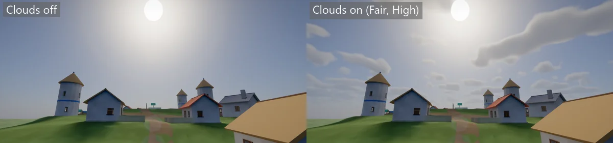

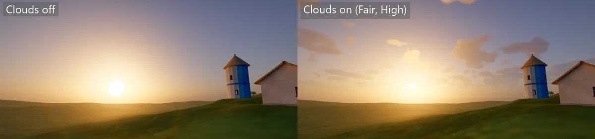

At night the moon lights the clouds, when a light is aimed at it as [above](#night), and they
hide the stars behind them:

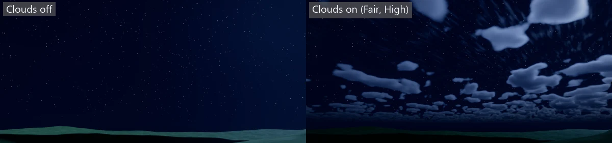

`High` and `Ultra` march the clouds as volumes, lit from inside, with bright edges and dark
bellies. `Low` and `Medium` turn `Graphics.Atmosphere.VolumetricClouds` off and draw them as a
flat layer painted on the sky instead: the same clouds in the same places, with their shadows,
but with no depth to them. In Hamlet at 1920 by 1080 the marched clouds take about a tenth of a
`High` frame's GPU time, and the flat layer about a twentieth of a `Medium` frame's.
`Graphics.Atmosphere.Clouds` turns them off, and `Graphics.Atmosphere.CloudShadows` their shadows;
`Graphics.Fastest()` turns them off. See [graphics settings](#graphics-settings).

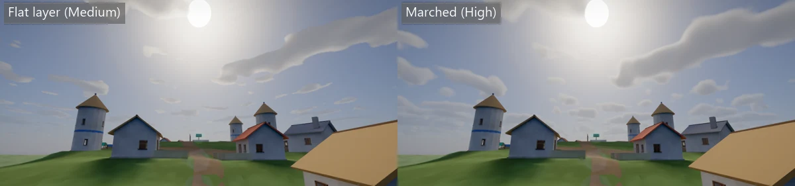

The clouds are drawn at a quarter of the screen's size and filled out over four frames, so a
fast turn of the camera can soften their edges for a moment. The sky's soft light and its
sharpest reflections hold them, drawn as a single flat layer that moves on in steps of 250
metres of wind, so the light changes a little as a step passes, not every frame. Rough
reflections show the sky without them. The march can start inside or above the layer, but the
clouds have only been looked at from under them so far.

### A photographed sky

A photographed sky, an HDRI, puts a real place round the scene. Put an equirectangular
Radiance `.hdr` in the content folder, load it once with `content.Sky`, and set it as the
sky's `Image`. It shows behind the scene and lights it like any other sky: its soft light
fills the shadows, the reflections show it, and the probes and bakes see it.

```csharp
SkyImage meadow = content.Sky("skies/meadow.hdr");   // in Load

world.Spawn(new Sun(meadow.SunDirectionAt(0.6f), new Vector3(4f)));
world.Spawn(new Sky(new SkySettings { Image = meadow, Rotation = 0.6f, Exposure = -0.5f }));
```

`Rotation` turns the picture about the straight-up point, in radians, counterclockwise seen
from above. The middle of the picture faces -Z before it is turned. `Exposure` brightens or
darkens it in stops, from -20 to 20, on top of `Brightness`; a rotation that is not a
number, or an exposure outside that range, throws.

The cooker finds the sun in the picture: the brightest spot, if it is much brighter than the
rest of the sky. It takes the sun out of the picture and keeps its light as a small disc of
the same brightness, which shows behind the scene and in the sharpest reflections. The sky
gives no light for it, just as for the physical sky's sun: aim a `Sun` at
`SunDirection`, or at `SunDirectionAt(rotation)` once the picture is turned, so its shadows
fall the way the picture's do. `HasSun` is false for an overcast picture with no sun in it.

The picture takes the place of the gradient and of the physical sky: with an `Image` set,
`Turbidity`, the moon and the stars are not used. Each face of the cooked cube is 256 pixels
across, so a 2k picture is plenty. Changing to another picture waits for the GPU to finish,
so load and set them up front rather than every frame; changing `Rotation` or `Exposure` is
as cheap as changing the sun.

The lineup in the [Courtyard example](../examples/Courtyard#the-lineup) stands under Poly
Haven's Meadow 2, turned so its sun comes from the right. The metal now shows the blue sky
above and the green meadow below:

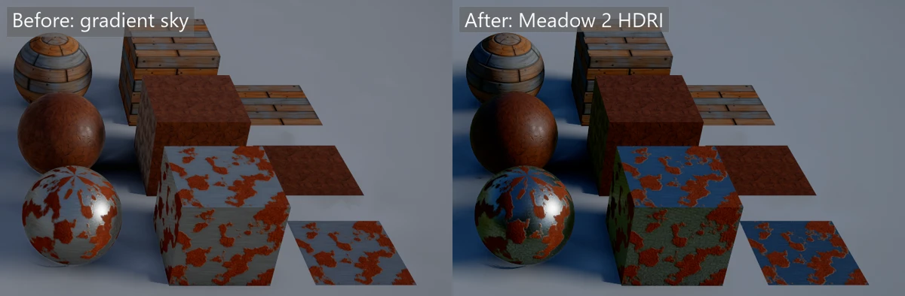

### Fog

Fog is air you can see: it thickens towards the ground, so the far side of a yard sits
back in it while the near ground stays crisp. Set it on the sky:

```csharp
world.Spawn(new Sky(new SkySettings
{
    Turbidity = 2.5f,
    Fog = new FogSettings(Density: 0.004f, Height: 0f, Falloff: 0.15f, SunScatter: 0.6f),
}));
```

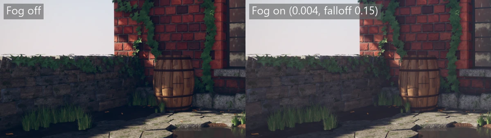

`Density` is how much light the air takes per metre at `Height`, so 0.004 hides about 4%
of what is 10 m away and a third of what is 100 m away. Above `Height` the fog thins by e
every 1 / `Falloff` metres, 6.7 m at 0.15, and below it thickens the same way, so a
valley fills and a tower's top stands clearer than its foot. A `Falloff` of 0 is fog of
one density at every height. The default, a density of 0, is clear air.

Fog takes its colour from the sky behind what it hides, without the sun's disc. Looking
down, it takes the sky's colour at the horizon that way, since fog is lit by the sky all
round it, not by the ground. Looking towards a sun it glows, by `SunScatter` times the
sun's colour, in a lobe that narrows to nothing a right angle away; 0 gives no glow.
Lit surfaces, glass and particles all sit in the same fog. The sky itself is drawn
clear, apart from the light of the [volumetric fog](#volumetric-fog) in front of it, as is
everything under [water](#water).

Haze and fog work side by side. Haze fades things into the sky between two distances,
which hides the edge of a world; fog is worked out along each line of sight and gives
depth inside it. A negative density, falloff or sun scatter throws, as does a height that
isn't a number. Fog is drawn for the camera only: [light probes](#bounced-light) and
[reflection probes](#reflections) capture clear air, so changing the fog captures nothing
again and costs nothing but its pixels. `Graphics.Atmosphere.Fog` turns it off.

#### Volumetric fog

Near the camera the fog is lit by the light that really reaches it. Sunlight falls
through it in shafts beside the shadows of walls and leaves, and point and spot lights
glow in it with soft halos. It is on by default and needs nothing but a fog with some
density, or a [fog volume](#fog-volumes); two more settings tune it:

```csharp
Fog = new FogSettings(Density: 0.004f, Height: 0f, Falloff: 0.15f, SunScatter: 0.6f)
{
    VolumetricDistance = 48f,
    Anisotropy = 0.6f,
},
```

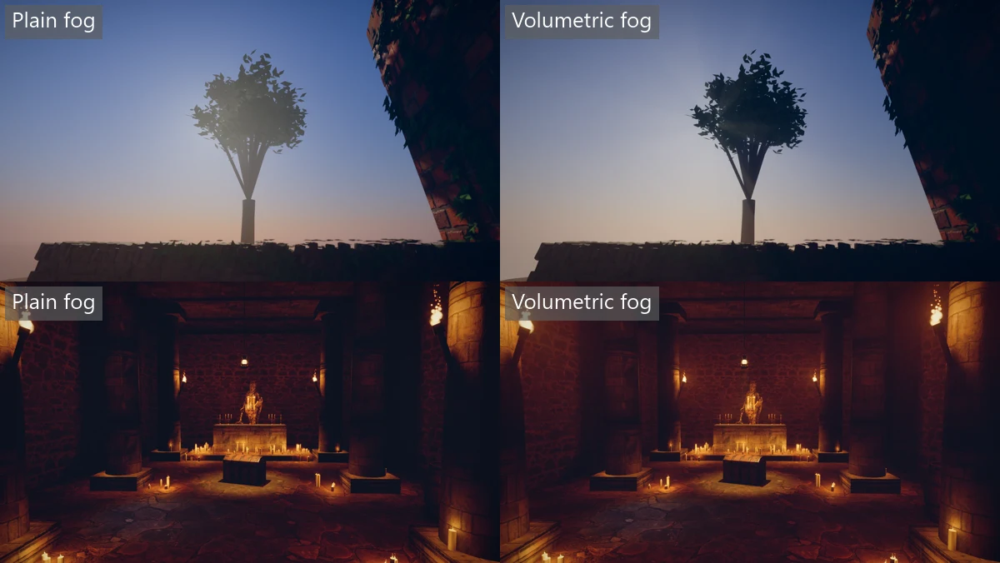

Above, looking past the Courtyard's tree towards the sun: the plain fog washes the
leaves with the sun's glow, while the volumetric fog leaves them dark and lets the light
through between them in shafts. Below, the Crypt's faint, dusty air, with a density of
0.008: the torches glow in the air round them, where the plain fog only darkens. The
torches set `Volumetric = 2f`, so their halos read without thicker air hazing the far
end of the room.

`VolumetricDistance` is how far from the camera, in metres, the fog is worked out this
way, 48 by default. Past it the plain fog carries on, seen through the volumetric part,
so the far distance looks as it did. 0 is the plain fog only, and a negative or endless
distance throws. `Anisotropy` is which way the air scatters light, from -0.9 to 0.9, 0.6
by default: 0 sends it every way alike, more sends it onwards, so the air glows most
looking towards a light, as real haze does, and less sends it back. Anything outside
that range throws. In the volumetric part the anisotropy shapes the sun's glow, and
`SunScatter` only shapes it past `VolumetricDistance`.

Each light lights the fog at full strength unless asked otherwise.
`PointLight` and `SpotLight` take a `Volumetric` strength: 1 is as much as the
air really scatters, 0 leaves the light out of the fog, and more makes its halo
stronger. A negative strength throws. A light's halo is cut by its own shadow where it
casts one, so a lantern's beam shows as a cone.

The soft light round the fog comes from the [light probes](#bounced-light) where they
cover it, so mist in a closed room or a shaded corner stays dark instead of glowing with
the sky. Where no probe reaches, as outside the probes' volume or with light probes off,
the fog is lit by the sky as the plain fog is.

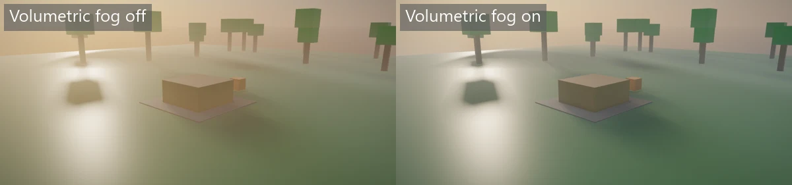

The Forest example lies under low morning mist with the sun just over the trees, and its V
key switches the volumetric fog, so you can see the shafts come and go.

The fog near the camera is kept in a grid of cells, one for every 8 by 8 pixels of the
scene and 64 deep unless [`Graphics.Atmosphere.VolumetricFogCellSize` and `VolumetricFogSlices`](#the-grids-cost)
say otherwise: one cell for the first metre, then thin cells that get deeper further out. Each frame lights
every cell at a different point of its depth and keeps 90% of what the cell held last
frame, so a light that moves or switches on takes a few frames to settle in the fog.
Screenshots and recordings that fix the frame come out the same every time. The grid
follows [`RenderScale`](#graphics-settings), not the window. Like the plain fog, it is
drawn for the camera only. Under water the scene's fog is clear and the grid holds the
water instead, with its [shafts of light](#water). `Graphics.Atmosphere.VolumetricFog` turns it
off, which gives the plain fog exactly, and `Graphics.Fastest()` turns it off.

#### Fog volumes

A `FogVolume` entity fills a shape with fog of its own: mist pooled in a cellar, steam over a
pool, or the haze a lamp's beam lights up. It is drawn into the
[volumetric fog](#volumetric-fog)'s grid, so the sun and the lights shine through it
and cast shadows in it, the same as the scene's fog. The shape is one of four unit shapes,
moved, turned and sized by the entity's `Transform`, following its `Parent` if it has one:

| `FogShape` | Before the transform |
| --- | --- |
| `Box` | From −0.5 to 0.5 on each axis |
| `Ellipsoid` | A sphere of radius 0.5 |
| `Cylinder` | Along Y, radius 0.5, from y −0.5 to 0.5 |
| `Cone` | Its tip at y 0.5 and a base of radius 0.5 at y −0.5 |

```csharp
// Mist a metre deep over a cellar floor ten metres by eight.
var mist = new FogVolumeSettings(0.4f) { Noise = 0.5f, Wind = new Vector3(0.2f, 0f, 0f) };
world.Spawn(
    new Transform(new Vector3(0f, 0.5f, 0f), Quaternion.Identity, new Vector3(10f, 1f, 8f)),
    new FogVolume(FogShape.Box, mist));
```

`FogVolumeSettings` says what the fog is like. Only the density has to be given:

| Field | Default | What it does |
| --- | --- | --- |
| `Density` | | How much of the light the fog stops per metre, 0 or more, the same measure as `FogSettings.Density`. 0.05 is a thin haze; at 0.5 you can barely see across a room |
| `Color` | white | The colour the fog scatters light in, each channel from 0 to 1 |
| `EdgeFade` | 0.25 | The share of the way in from the surface over which the fog thickens from nothing to full, from 0 for a hard edge to 1 for fog thickest only at the centre |
| `Noise` | 0 | How much noise breaks the fog up, from 0 for even fog to 1 for patches with gaps between |
| `NoiseSize` | 2 | How big the patches are, in metres, more than 0 |
| `Wind` | 0 | How fast the patches drift, in metres per second |

Where volumes overlap, and where they overlap the scene's fog, the fog adds up. Drawing by
hand, `view.Effects.FogVolume(key, shape, transform, settings)` places one for a frame, with
the transform as a matrix and a key that names the volume, the same as a decal's.

The frame that meets a bad fog volume throws, with a message naming what's wrong:

- more than 64 fog volumes in a frame;
- a key used twice in a frame. A `FogVolume` entity's key is its entity's id, so a volume drawn by hand
  next to them needs a key no entity has, such as a negative one;
- a shape that isn't one of the four;
- a transform squashed flat on any axis, or holding a number that isn't finite;
- a density below 0 or not finite, a colour channel or `EdgeFade` or `Noise` outside 0 to 1,
  a `NoiseSize` of 0 or less, or a `Wind` that isn't finite.

Fog volumes show only where the volumetric fog reaches, out to
`FogSettings.VolumetricDistance`, and only while
[`Graphics.Atmosphere.VolumetricFog`](#graphics-settings) is on.
`Graphics.Atmosphere.FogVolumes` turns them off on their own, and `Graphics.Fastest()` turns both off.
The grid's [cell size and slices](#the-grids-cost) set how sharp their edges are.


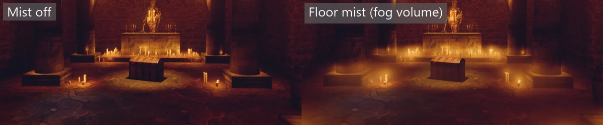

The Crypt example lays a cold mist over its floor with one box volume, 0.8 m deep with a
soft edge and drifting noise, and its V key switches the mist off.

They need no scene fog. A scene with a density of 0, or with `Graphics.Atmosphere.Fog` off, still
makes the grid for its volumes. That also means they share the grid's limits:

- They show only out to `FogSettings.VolumetricDistance`; past it a volume is cut off.
- Their edges are as sharp as the grid's cells. A volume much thinner than a cell, or than
  a slice at its distance, blurs into the air round it and thins out, so give mist some depth.
- They are left out of light probes, as the volumetric fog is. Under water they show in the
  water, out to its `ShaftDistance`.
- A frame holds at most 64.

`Graphics.Atmosphere.FogVolumes` turns them off on their own, and `Graphics.Atmosphere.VolumetricFog` turns
them off with the rest of the volumetric fog. Each volume costs the grid's every cell a
distance check against a sphere round it, and the cells inside it the shape test and,
with `Noise`, three octaves of noise.

### The grid's cost

The grid's memory and work grow with its cells. Halving `Graphics.Atmosphere.VolumetricFogCellSize`
gives four times the cells, and doubling `VolumetricFogSlices` gives twice as many. The grid
is three volumes of 8 bytes a cell. At 1600 by 900, with `RenderScale` 1:

| Cell size | Slices | Cells | Memory | Used by |
|---|---|---|---|---|
| 16 | 32 | 100 × 57 × 32 | 4.4 MB | A slow GPU that still wants shafts: an eighth of the default's cells |
| 8 | 64 | 200 × 113 × 64 | 35 MB | The default and `High` |
| 8 | 128 | 200 × 113 × 128 | 69 MB | `Ultra` |
| 4 | 64 | 400 × 225 × 64 | 138 MB | Close-ups where thin shafts matter more than the cost |

The far slices are deep, so `FogSettings.VolumetricDistance` is the other lever: a shorter
reach puts the same slices into less depth, sharpening the fog near the camera for nothing.

With the defaults, the fog takes about 0.16 ms of GPU time a frame in the Courtyard at 1600
by 900, and about 1.3 ms in the Crypt at 1920 by 1080, with its many torches, its floor mist
and its light probes. `--profile` from [the command line](command-line.md) lists it as
"Volumetric fog".

## Water

An `Underwater` entity puts the camera underwater, with light absorbed by depth, moving caustics on
sunlit surfaces and shafts of light:

```csharp
world.Spawn(new Underwater(new UnderwaterSettings
{
    Absorption = new Vector3(0.045f, 0.024f, 0.018f),   // per metre; red should be largest
    ShallowColor = new Vector3(0.11f, 0.42f, 0.55f),
    DeepColor = new Vector3(0.01f, 0.09f, 0.17f),
    SurfaceHeight = 30f,
    CausticStrength = 2.2f,
    CausticScale = 0.11f,
    ShaftStrength = 0.11f,
    ShaftDistance = 55f,
}));
```

When several entities have one, the newest wins. Drawing by hand,
`view.Surroundings.Water(settings)` puts one frame underwater.

Leaving `Absorption` at zero means there's no water. The [Reef example](../examples/Reef)
uses this. Red goes first, so colours fade towards blue and green with distance: at a red
absorption of 0.075 an orange coral turns brown a few metres off. The Reef lowers it to 0.045
so its coral keeps some warmth across the view. `Graphics.Atmosphere.Underwater` turns the water off for every view, see [graphics settings](#graphics-settings).

The shafts are the sun's caustics coming down through the water, brightest looking towards
the sun. They are drawn in the [volumetric fog's](#volumetric-fog) grid, out to
`ShaftDistance`, so the sun's shadow cuts them: a ledge or a hull overhead leaves dark
water under it. The grid also holds the water's own colour out to that distance, and any
[fog volumes](#fog-volumes), such as silt over the floor; past it the water's colour
fills in as before. A wide `ShaftDistance` spreads the grid's slices over more water, so
shafts close by blur, the way a wide [`VolumetricDistance`](#the-grids-cost) does on land.

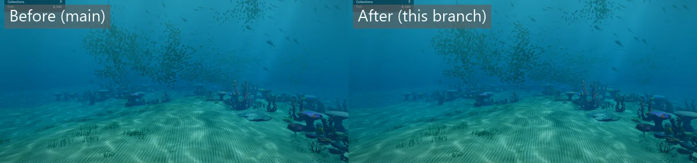

The shafts need [`Graphics.Atmosphere.VolumetricFog`](#graphics-settings). With it off, as in the
`Low` and `Medium` presets, the water has its colour and caustics but no shafts.

## Puddles

A `Puddles` entity lets water stand in the low places of the ground, with no mesh for the water.
It takes the water's height in metres and, optionally, how far above it the ground is damp,
8 cm unless given:

```csharp
world.Spawn(new Puddles(-0.045f));              // water at 4.5 cm below 0, damp for 8 cm above it
world.Spawn(new Puddles(0.2f, Band: 0.03f));    // higher water and a narrower damp band
```

When several entities have one, the newest wins. Drawing by hand,
`view.Surroundings.Puddles(level, band)` sets the level for one frame.

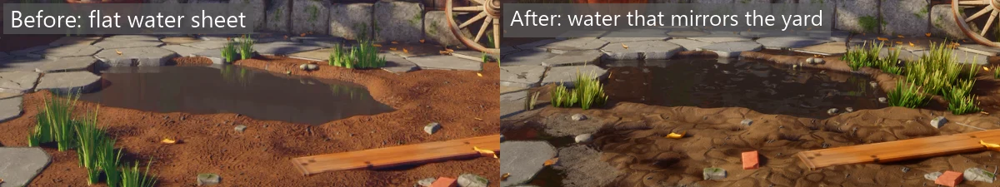

Only materials that ask for it get wet: a model sidecar's rule with `"puddles": true`, or a
`Surface` with `Features = SurfaceFeatures.Puddles`. Each pixel's height is where it is in the world, less how
deep its height map sinks it (the material's `heightDepth` times how far below white the
height is), so the mortar between flagstones and the hollows in mud fill before the tops.
A pixel below the level is water. It mirrors the sky and what's on screen with roughness
0.03 and no metalness, and the level is a [mirror plane](#planar-reflections) too, so it also
shows what stands above the top of the picture; its normal points straight up but for two layers of ripples 1 mm
high that drift and change, at 0.4 and 0.9 cycles a second, so the wind breaks the reflection
up a little. It reflects as water does: 2% of the light looking straight down, about a quarter
from a standing eye a few metres off, and nearly all of it at grazing. Its colour is the
ground's, turning to the near-black brown of turbid water as the water deepens to 4 cm, and it
shows only through the light the reflection leaves, so the ground under shallow water shows
most near your feet, deep water hides it, and the sky and what stands round the puddle read in
it as reflections on a dark sheet, not as wet mud. Above the level, the surface is
damp: at the waterline its colour is squared, which darkens it the way water darkens soil,
and its roughness halved, fading in a straight line to dry at the band's top. A band of 0
leaves only the water.

The water is drawn on the ground, but it is lit as if at the level: its reflections start
from the water's surface, so the sides of the hollow don't get in their way, and the sky
reflects in it wherever nothing on screen stands in the way. Anything in the puddle
with the rule, such as a plank or a wheel's rim, is wet and mirror-smooth below the level
too. Puddles still apply with [`Graphics.Surfaces.Materials`](#graphics-settings) off: the plain clay
gets wet at the height of its mesh, as there is no height map to sink it.

The damp band is measured up from the water, so it is only a fringe where the ground rises
well above the level. Where the ground sits only centimetres above the water, as round a
shallow hollow, a band wider than that gap darkens all of it. Give a narrower band there, a
little less than the ground's height above the water, so the ground round the puddle stays dry
and only the slope down into it darkens.

Without a level, the rule does nothing. [`Graphics.Surfaces.Puddles`](#graphics-settings) turns
it off, and `Graphics.Fastest()` turns it off. The Courtyard uses it for its puddle, on the
mud, the flagstones, the plank, the deck, the barrel's hoops and the wheel, with water 4.5 cm
below the yard and a band of 3.5 cm.

## Wind

A `Wind` entity sets a breeze that bends grass and leaves. It takes the way the wind blows, how
strong it is and, optionally, how gusty, from 0 for steady to 1 for gusty, 0.5 unless given:

```csharp
world.Spawn(new Wind(new Vector3(0.6f, 0f, -0.3f), 0.35f));      // a fresh breeze, gusty by half
world.Spawn(new Wind(Vector3.UnitX, 0.1f, Gustiness: 0f));      // a light, steady air from the west
```

The strength is how far, in metres, it leans the tip of a blade of grass 1 m tall. Only the
way along the ground counts, so a wind's direction needs some x or z, and a strength of 0 is
a calm with no direction needed. When several entities have one, the newest wins, and with
none the air is calm. A bad wind throws when the frame that meets it is drawn. Drawing by
hand, `view.Surroundings.Wind(direction, strength, gustiness)` sets it for one frame, and each
frame starts calm.

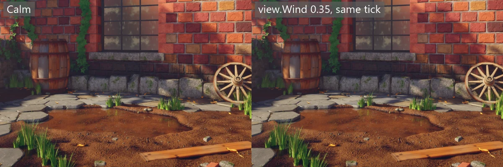

Only materials that ask for it move: a model sidecar's rule with `"wind": true`, or a
`Surface` with `Wind = 1`. A rule can give a share of the lean instead, as
`"wind": { "sway": 0.08 }`, for something stiffer than grass, such as ivy on a wall or a
tree's crown, which would otherwise lean as far as a blade of grass of its height. A vertex
moves downwind by the strength times its share times the square of its height above the
lowest point of its part of the model, so the foot stays put and the tip bends most. The
height counts up to 1 m, so a tall plant leans no further than a blade 1 m tall. Gusts swing
the lean: noise 3 m across drifts downwind at 15 cm/s, and at the default gustiness a lull
leans the grass 60% as far as a gust. On top, leaves flutter 2 cm either way at their tips,
once every two and a half seconds, out of step from one place to the next. The flutter is the same at any
share of the lean, and comes in fully from a strength of 0.25.

The sway happens as the mesh is drawn, so its shadows sway with it, and a part that sways
must be a separate part in the model, standing on its own foot: the lowest point of the whole
part is what stays still. A copy can be moved, scaled or turned about the vertical and still
sway from its own foot, but one tipped over sways from the wrong height, because the height
is measured straight up. Culling knows how far a swaying part can reach, so grass at the
edge of the screen or of a shadow doesn't pop in or out as it leans.

Wind works underwater too. The [Reef](../examples/Reef) rocks its seagrass and sea fans with
the swell by changing its wind each tick so its strength follows a slow sine and its direction
flips as the sine crosses zero, so the lean swings smoothly from one side to the other:

```csharp
float surge = MathF.Sin(seconds * MathF.Tau / 7f);
world.Get<Wind>(wind) = new Wind(surgeDirection * MathF.Sign(surge), 0.45f * MathF.Abs(surge), Gustiness: 0.3f);
```
[`Graphics.Surfaces.Wind`](#graphics-settings) turns it off, and
`Graphics.Fastest()` turns it off. The Courtyard blows a breeze of 0.35 across its grass, with
a share of 0.08 for the ivy and 0.4 for the tree's crown.

## Grass

A `Grass` component next to a `Model` grows a field of grass blades over the model's top
surface. It suits ground such as terrain chunks, where modelling every blade would be far too
many triangles. The blades are made on the GPU each frame, so they cost no memory per blade and
nothing on the CPU:

```csharp
world.Spawn(Transform.Identity, new Model(ground), new Grass());          // the default meadow, all over
world.Spawn(Transform.Identity, new Model(ground), new Grass(new GrassSettings
{
    BaseColor = new Vector3(0.08f, 0.1f, 0.03f),
    TipColor = new Vector3(0.45f, 0.4f, 0.12f),                           // dry, late-summer tips
    Height = 0.7f,
    Bend = 0.5f,
}));
```

`GrassSettings` holds the look: the colour at the root and at the tip, the height and how much
it varies, the width at the root, how thick the blades stand (`Density`, from 0 to 1, where 1 is
about 64 blades a square metre near the camera), how far the tips droop (`Bend`), how much
sunlight shines through a blade from behind (`Translucency`), how far the wind sways them
(`Sway`) and how wide a clump is (`ClumpSize`). Blades grow in clumps that lean the same way and
stand about as tall, so a field reads as tufts rather than an even carpet. Where the grass is
thin, the blades near a clump's middle stand first, so sparse ground grows separate tufts with
bare earth between rather than single blades sprinkled evenly, and thin grass is shorter and
drier. Each clump, and each patch a few clumps across, has its own shade and a little yellowing,
so a field isn't one flat colour. Each blade is a curved strip that tapers to its tip, darker at
its root where its neighbours shade it, the more so where the grass stands thick, with a
brighter tip. It is lit from both sides, and the sun behind it shines through, strongest when
you look straight toward it, so with the sun low ahead the grass glows. A look out of range, such
as a height over 2 metres, is refused when the model is drawn, with a message that names it.

A `GrassMap` says where the grass grows. It is a texture laid flat over the model from above,
from `Min` to `Max` in x and z in the model's own space, and its `Channel` says how thick the
grass stands, from 0 for bare to 1 for the full density. Outside the map nothing grows. The
[Terrain example](../examples/Terrain) passes each chunk's splat map, whose red channel says how
grassy the ground is, so blades grow in the damp lowlands and stop where the ground turns to
sand. The map is blended between its texels, so the grass's edge frays over a slope rather than
in steps, and patches a few clumps across stand a little thicker or thinner, so the edge wanders.
The splat's edge texels sit on the chunk's edges, so its area reaches half a texel past
them:

```csharp
float texel = ChunkSize / (SplatSize - 1f);
var origin = new Vector2(chunkX, chunkZ) * ChunkSize;
var grass = new Grass { Density = new GrassMap(splat, origin - new Vector2(texel / 2f), origin + new Vector2(ChunkSize + texel / 2f)) };
world.Spawn(Transform.Identity, new Model(chunkMesh), grass);
```

The blades stand on a lattice fixed to the world, so they never crawl as the camera moves. It
has four rings round the camera: every blade grows within 16 metres, a quarter of them out to
36, a sixteenth out to 80 and one in 64 out to 160, and blades shrink away over the last part
of each ring rather than pop. The blades left widen smoothly with distance, so the far ground
doesn't look bare, but never past half their height, so a far blade never lies as a flat flake.
Near blades are drawn in full, out to 12 metres; past that they have fewer rows, and past the
second ring each is a single triangle. Only the squares of the lattice in view are grown. The
blades sway in the [wind](#wind), give motion vectors, so anti-aliasing keeps them steady as
they move, and cast shadows in the sun's two nearest cascades from within the second ring;
further blades are too small for their shadows to show.


`Graphics.Surfaces.Grass` turns it off, and so does `Graphics.Fastest()`: the ground shows bare
and nothing is grown. `Graphics.Drawing.GrassDetail`, from 0.25 to 2, scales how far each ring
reaches, so the blades drawn go as its square. `GraphicsQuality.Low` sets 0.5, `Medium` 0.75 and
`Ultra` 1.25. In the Terrain example at 1920 by 1080 on an RTX 4060 Ti at `High`, from low over
the valley, growing the blades takes about 0.11 ms, drawing them 0.18 ms and their shadows
0.04 ms; lighting the grassy pixels shows under "Lighting". The stats panel and the
[profiler](profiling.md) list each of these on its own line. Drawing by hand, `ModelOptions.Grass` does the same as the component, and with
Rendition alone `FrameExtras.Grass` takes a `GrassDraw` for each ground draw.

Grass can't yet:

- Be pushed aside by things standing in it, unless the density map leaves a gap there.
- Grow under overhangs or on walls: the blades follow the ground as seen from straight above.
- Show in reflections, light probes or bakes, which see the bare ground.
- Cast shadows past the sun's second cascade or the second ring, or from blades out of view.
- Be hidden behind hills before it is grown: blades behind a hill are grown and drawn, and only
  the depth test hides them.
- Have more than eight looks in a frame, or more than 32,768 blades drawn in full, 131,072 with
  fewer rows and 131,072 as single triangles; past that, blades of that detail go missing.

## Decals

A `Decal` entity lays a material onto whatever is already drawn inside a box: damp rising up a
wall, a puddle stain on a floor, rust run down from a bolt. The box is the cube from −0.5 to
0.5 that the entity's `Transform` places, turns and sizes, following its `Parent` if it has
one, and the material is projected along the box's own −Y, so its +Y should look
out of the surface. The material's U runs along the box's X and its V runs against its Z,
each across the whole box, from −0.5 to 0.5 in the box's own units. Its normal map reads
as it does on a mesh, with green pointing the way V falls, towards the box's +Z, and a
mirrored box reads it the same way. A material graph is the usual material, loaded on its
own with `content.Surface`:

```csharp
Surface damp = content.Surface("materials/grime.material.cs");

// A metre wide, half a metre high, on a wall that faces +Z. Its +Y looks out of the wall,
// and its +Z points down, so V is 0 at the bottom edge.
var box = new Transform(
    new Vector3(2f, 0.6f, -3.98f),
    Quaternion.CreateFromAxisAngle(Vector3.UnitX, MathF.PI / 2f),
    new Vector3(1f, 0.2f, 0.5f));

world.Spawn(box, new Decal(damp));
```

Drawing by hand, `view.Effects.Decal(key, box.Matrix, damp)` lays it for one frame, with a
key of your own.

The material's opacity fades the decal: a graph's `Opacity`, or the alpha of a colour
texture. Where it shows, the decal blends its colour over the surface, makes it as rough
as its own roughness, and lays its bumps over the surface's own, so a brick wall's edges
and mortar still show through the damp. Lighting, shadows, ambient occlusion and
reflections all see the result. It also fades where the surface turns away from the box's
+Y, so a box over a corner stains the wall and not the floor below it, and over the last
fifth of the box's depth at either end.

`DecalBlend` sets how much of each part goes on, each from 0 to 1:

| Field | Default | What it does |
| --- | --- | --- |
| `Color` | 1 | How much of the decal's colour covers the surface's |
| `Normal` | 1 | How much of its bumps are laid on. 0 keeps the surface's bumps alone |
| `Roughness` | 1 | How far the surface's roughness moves to the decal's. A wet stain is smoother, a dusty one rougher |
| `AngleFade` | 0.5 | How far the surface can turn from the box's +Y before the decal fades. It's gone where the cosine of the angle is below this, and whole halfway from there to facing +Y. At 0.5 it fades from about 41° and is gone at 60°. At 0 it fades from 60° and is gone only where the surface is side-on |

```csharp
// Darkens the bricks but keeps them their own roughness.
world.Spawn(box, new Decal(soot, new DecalBlend { Roughness = 0f }));
```

A surface's `Color` tints the decal's colour, so `damp with { Color = new Vector3(0.6f) }`
lays the same stain darker. Each different surface gets a material of its own the first
time a decal uses it. Make them once in `Load` rather than a new one each frame: past 512,
the ones the frame didn't use are let go and made again when next used.

The frame that meets a bad decal throws, with a message naming what's wrong:

- more than 256 decals in a frame;
- a key used twice in a frame. A `Decal` entity's key is its entity's id, so a decal drawn by hand next to
  them needs a key no entity has, such as a negative one;
- a box squashed flat on any axis, or holding a number that isn't finite, since it can't be
  inverted;
- a `DecalBlend` field outside 0 to 1;
- a surface with a [surface shader](#surface-shaders), since a decal draws only
  textures;
- a surface naming a texture its content doesn't have.

A character walking through a puddle stain or standing over a scorch mark shouldn't wear it,
so animated characters never take decals: a rigged model drawn with a pose is drawn after the
decals are laid, over them. Any surface can opt out the same way with `Features = SurfaceFeatures.NoDecals`, such
as a crate set down in a stain, whose lid the stain would otherwise reach; a cooked model's
material takes `"noDecals": true` in its rule. What doesn't take decals still covers them where
it stands in front, and the decals still land on the ground round it.


[`Graphics.Surfaces.Decals`](#graphics-settings) turns them all off, and
`Graphics.Fastest()` does too. The Courtyard lays its damp, the dirty water under its sill
and the rust under its anchor plates as decals, and the gravel kicked off its path into the
mud along both arms and round the barrel. D turns them off and on there.


Decals have some limits:

- Where two decals overlap, both colours show, but the later one's bumps and roughness
  replace the earlier one's.
- A decal can't change how metallic a surface is or make it glow.
- A decal's material uses its colour, normal and surface textures, and its colour,
  roughness and opacity. Its detail textures, height map and world variation are ignored.
- On strongly bumped surfaces, the fade by angle follows the bumps, so near the limit it
  fades in specks.
- Reflection probes and light probes don't see decals, so a decal shows in no reflection probe and doesn't tint bounced light.


## Fading with distance

Grass, flowers and small stones can fade out with distance, so a field thins out instead of
ending in a line. Give a `Surface` a `FadeDistance`, from where the fade starts to where
nothing is left, in metres from the camera:

```csharp
var grass = new Surface { Color = new Vector3(0.4f, 0.6f, 0.2f), Foliage = new Foliage(), FadeDistance = new DistanceFade(50f, 60f) };
```

A draw can have a fade of its own, which wins over its surfaces' fades, so one model can be
kept further away than another:

```csharp
world.Add(entity, new Model(tuft, Fade: new DistanceFade(50f, 60f)));
view.Model(key, tuft, transform, new ModelOptions { Fade = new DistanceFade(50f, 60f) });  // the same drawn by hand
```

A fade starts at 0 or more and ends no sooner than it starts, or the material or the draw is
refused with a message saying why. A fade that starts and ends at the same distance is a hard
cut there. The distance is measured to the middle of the draw's bounds, or to its origin for
a `DrawItem` made by hand without them. A model fades as a whole, each of its parts by its own
middle. In between, the model drops more and more of its pixels in a fine noise that changes
each frame, and anti-aliasing blends that into a smooth fade. Past the end it isn't drawn at
all, which saves its time in the picture and in the shadows. Its shadow fades with it, by the
distance from the camera, not from the sun. Glass fades its opacity instead. A cooked model's
materials have no fade yet, so give its draw one.

Models switch to [simpler versions](#graphics-settings) with distance, and the switch fades
too. As a model nears the distance where its next finer version takes over, both versions are
drawn, each into the pixels the other leaves, so the coarser one gives way to the finer bit by
bit instead of popping. That costs drawing the model twice while it swaps.

Glass can also fade where it meets what's behind it. `SoftEdge` is how far behind the glass,
in metres, the scene must be for the glass to show fully, so water fades out softly where it
meets the shore or a stone instead of ending in a hard line. It suits water and fog cards;
leave it at 0, the default, for a window in its frame:

```csharp
var water = new Surface { Color = new Vector3(0.35f, 0.55f, 0.6f), Roughness = 0.05f, Opacity = 0.3f, Ior = 1.33f, SoftEdge = 0.2f };
```


[`Graphics.Drawing.Fades`](#graphics-settings) turns all three off.

## Motion vectors

Anti-aliasing blends each pixel with where its surface was last frame. Every model draw
also records how far it moved on screen since then: its own movement, its animation, the
swim of a fish and the sway of grass in the wind, as well as the camera's. So a swinging
lantern, a running character or a blade of grass keeps its edge instead of leaving a faint
trail. There's nothing to turn on, and no setting.

Super finds where a model stood last frame by its [key](views.md#keys). A model drawn for
the first time, one whose key drew another model last frame, or one whose key is shared by
models in different places, moves with the camera alone, which softens it a little while it moves. Still scenes look exactly as they did
before. Glass and particles don't record their motion.


Using Rendition alone, set `DrawItem.Key` to a number that names the thing drawn, the same
every frame, on every part of it. The motion is kept in the G-buffer, in scene pixels, for
anything that reads it later; [design.md](design.md#motion-vectors) has the encoding.

## Models

Models are cooked from FBX, glTF or OBJ into Rendition's `.rmodel` format by the model
cooker in `Super.Cook.Models`, through the asset pipeline. Its settings are the ones
below, read from the model's `<file>.cook.json` sidecar, and a `parts` entry cooks named
pieces of one file, each as `file#part`. [`super-cook`](command-line.md#cooking-content)
runs it, and so does a build that imports `Super.targets`. The game reads only the
cooked content.

A game names a model by its source's [name](content.md#names), the path from the
content root:

```csharp
readonly ModelRef coral = content.Model("reef/coral/coral.glb");
```

A name that wasn't cooked, or that isn't a model, stops with a `ContentException` when
it's named.

Naming a model starts loading it. A model drawn before it's ready is waited for, so
nothing pops in; to show a loading screen instead, see
[Game states](states.md#loading-screens). `ModelRef.Cube` and the other
[built-in shapes](#built-in-shapes) need no file.

The sidecar sets the model's size and fixes materials by name. Each rule
applies to every material whose name contains `match`:

```json
// models/fir.glb.cook.json
{
  "targetLength": 6.0,
  "materials": [
    { "match": "bark", "roughness": 0.9 },
    { "match": "leaves", "alphaCutoff": 0.5, "foliage": true }
  ]
}
```

`alphaCutoff` cuts out pixels whose opacity is below it. Opacity is the colour texture's
alpha times the surface texture's alpha, so leaves with alpha in their colour texture
need nothing else, and a glTF file's own `MASK` cutoff is read without a rule. The
import fails if the cutoff would cut out nothing, or everything, instead of quietly
giving you solid cards. With a `graph`, the graph's `Opacity` is what gets cut.

A cut-out keeps its shape in the distance. Plain mips average a thin opaque thread with the
clear pixels round it, so its alpha falls under the cutoff a few levels down and it
vanishes. The cook instead scales each smaller level's alpha so as large a share of its
pixels passes the cutoff as on the full-size texture. When the colour and surface textures
both carry opacity, it's the share where their product passes that is kept, by scaling the
colour's alpha alone. Compression keeps that share too: a cut-out's smaller levels are
checked once compressed, and encoded again with their alpha pushed away from the cutoff when
more than 1% of their pixels moved across it. When both textures carry opacity, the colour
is checked against the product, pixel by pixel, and the surface is compressed as it is. This
is only done for materials with a cutoff: blended, dithered and opaque textures keep their
mips as before. Changing the cutoff cooks the textures again. When two cut-out materials
share a texture but want different coverage from it, such as two different cutoffs, the
first material's wins and the cook warns.


`foliage` is for a tree's leaves. It points their normals out of the crown so it's lit
as one rounded shape instead of speckled cards, lets sunlight through the back of the
leaves, and draws both sides. Every material the rule matches counts as one crown, so
give the trunk its own material. How much sunlight comes through is the leaves' own: 0.6
with `"foliage": true`, or set as `"foliage": { "translucency": 0.85 }` for thin, bright
leaves, down to 0 for leaves no light gets through. Anything outside 0 to 1 stops the cook.
Leaves that aren't one rounded shape, such as ivy on a wall or grass across a yard, take
`"foliage": { "crown": false }`. That keeps the normals the model gives, so bend them out of
the surface the leaves grow on in your modelling tool. As one crown, ivy whose rule also
covers ivy spilling into the yard would have its wall leaves facing into the wall, and
lit dark.
A `Surface` sets the same with `Foliage = new Foliage(Translucency: 0.5f)`, and is drawn from both
sides too. A Rendition `Material` takes `MaterialFlags.Foliage` and `Translucency`, and needs
`MaterialFlags.TwoSided` as well to show its back. Both start at a translucency of 0.6. To make the leaves move,
add a [`wind`](#wind) rule.

Textures are looked for beside the source file, then in any folder under it, as
Poly Haven's downloads keep them in `textures`. Some plants ship their leaf cut-outs
as a separate grey image beside a colour JPEG with no alpha; name it with `alpha`, and
its red becomes the colour texture's opacity. A mesh without UVs whose material uses a
texture warns, since every read lands on one texel; an untextured mesh needs no UVs. A
mesh with triangles of no area, such as a lathed cone whose tip ring has a radius of 0, warns
too, naming the mesh and how many of its vertices had no tangent. The cook gives each of them
one along the surface, so the model still draws, but taking those triangles out in the
modelling tool is the real fix. A texture a rule names that can't be found stops the cook; one the model file links to only
warns.

Every cooked model has a second UV set for lighting and for [wear and dirt](#wear-and-dirt),
which an [occlusion map](#occlusion-maps) can be read through too,
checked and made for each material on its own. Each material's set is in its own 0 to 1, in
which no two places on that material's meshes share a texel, and two materials may overlap
each other there. The cook keeps the file's own `TEXCOORD_1` for a material when every mesh
of it has one and it fits a lightmap: inside 0 to 1, no overlaps, two empty texels at 512
between islands, and texel density within four times from island to island. Otherwise it
makes one for that material only and says why in a note. A note isn't a warning, since
nothing needs fixing: it doesn't fail a build that treats warnings as errors, and MSBuild
shows it as a plain message, such as
`C:\game\content\props\crate.glb: note: made a second UV set for lighting: the file has none`.
These are the forms it takes:

```text
made a second UV set for lighting: the file has none
made a second UV set for lighting: Triangles 0 and 2 are in different charts with only 1 empty texel between them at texel (230, 51), less than the 2-texel gutter.
made a second UV set for lighting: materials bark and moss have none
material leaf: made a second UV set for lighting: 2 of its 5 meshes have none
```

The first two are for a model of one material, or one where no material had a set. Meshes
are counted after the cook joins a material's meshes that share the same attributes, unless
`keepMeshes` is on, so the count can be lower than the one in Blender. A
material with so many separate pieces that their islands don't fit a 512 page is laid on
1024, then 2048, and stops the cook if they don't fit that either. The made set is kept in
the cook cache, so it's made again, and noted, only when the material's shape changes. A
cook that takes the model from the cache prints no note.

A texture path must match the file's name exactly, case included, even on Windows,
so a model that cooks there cooks on every OS:

```json
// props/fern_02/fern_02.gltf.cook.json
{
  "node": "fern_02_a",
  "materials": [
    { "match": "fern_02", "alpha": "fern_02_alpha_1k.png", "alphaCutoff": 0.5, "foliage": true }
  ]
}
```

`node` keeps only what's under the nodes whose name contains it, for files that hold
several variants side by side, as Poly Haven's plant sets do. The cook fails if no
node with meshes matches. It's not for rigged models.

`keepMeshes` keeps each mesh of a static model as its own part, named by the node that holds
it, instead of merging the meshes that share a material. It's `false` by default, so a static
model has one part per material and no mesh names. Set it to `true` to
[show some of its meshes](#showing-some-meshes-of-a-model). Each kept mesh is its own draw
call, so a model of hundreds of small meshes costs more to draw with it. Rigged models always
keep their meshes.

`keepOrigin` keeps the file's own origin. The model is still turned by `rotateY` and scaled by
`targetLength`, but about that origin: it isn't centred or stood on the ground, so it stays where
the file put it. Use it when the origin means something, such as a character whose file also holds
a few hundred alternative weapons, heads and shields spread around. Those would move the bounds,
and the character would end up shifted by an amount you can't predict. A rigged model's skeleton
stays in the same place as its mesh. It's `false` by default.

`compressTextures` block-compresses the model's textures, which is on by default. Normal maps
become BC5, height and occlusion maps BC4 and the rest BC7, so a texture takes a quarter of the memory or less.
Compressing is quick: BC7 takes about a tenth of a second for a 2048-pixel texture, and the
whole Courtyard cooks from nothing in about 2 minutes, most of it running material graphs.
Each compressed texture is kept in the cook cache by its pixels, so editing one graph
compresses only the textures that graph changed. Set it to `false` to keep every pixel
exactly. The cook checks textures before it compresses them, so its warnings are the same
either way. Plain textures and material graphs take the same setting in their own `texture`
and `material` rules, also on by default; see [Rules and sidecars](content.md#rules-and-sidecars).

To use several pieces of one file, list them as `parts`. Each part is cooked as its own
model, named `file#part`, and takes every setting written beside `parts` unless it sets
that one itself. A file with parts cooks only its parts:

```json
// props/dandelion_01/dandelion_01_1k.gltf.cook.json
{
  "materials": [
    { "match": "dandelion_01", "alpha": "dandelion_01_alpha_1k.png", "alphaCutoff": 0.5, "foliage": true }
  ],
  "parts": {
    "a": { "node": "dandelion_01_a" },
    "b": { "node": "dandelion_01_b" }
  }
}
```

```csharp
var flowers = new[] { content.Model("props/dandelion_01/dandelion_01_1k.gltf#a"), content.Model("props/dandelion_01/dandelion_01_1k.gltf#b") };
```

### Showing some meshes of a model

One file can hold many looks: several bodies, heads and weapons for one character, of which
each draw shows one of each. A rigged model keeps every mesh in its source file, named by the
node that holds it, the name an artist sees in the outliner. A static model keeps them too,
but only with `"keepMeshes": true` in its sidecar, since by default its meshes that share a
material merge into one part with no name. Cook the model again after adding it. Pick the
meshes by name with `content.Models.Meshes` once, and keep the mask. Each draw then shows only
those meshes. This is different from the `#part` files above, which are separate models cut
at cook time:

```csharp
MeshMask mask = content.Models.Meshes(model, "Body_03a", "Head_05b");
world.Add(entity, new Model(model, Meshes: mask));
```

A mask fits only the model it was made for, so make it from the model you draw. See
[Mesh names](content.md#mesh-names) for the rules and the error when a name isn't there,
and [Showing some meshes](views.md#showing-some-meshes) for how a draw uses it.

The textures a model uses are read while it cooks, so they don't need to be assets of
their own. Turn cooking off for them with a rule in a [`cook.json`](content.md#rules-and-sidecars),
as the shared `assets` folder does for Poly Haven's `textures` folders:

```json
// assets/cook.json
{
  "rules": [
    { "match": "**/textures/**", "cook": false },
    { "match": "reef/**/*.png", "cook": false }
  ]
}
```

Other options are the `baseColor`, `normal`, `surface`, `emissive` and [`occlusion`](#occlusion-maps)
textures, `occlusionUv`, `noOcclusionMap`, [`toon` and `outline`](#toon-shading-and-outlines),
`color`, `emissiveColor`, `metallic`, `roughness`, `clearcoat`, `subsurface`, `heightDepth`,
`detailScale`, `detailMask`, `twoSided`, `transparent`, `opacity`, `ior`, `noNormalMap`,
`worldVariation`, `dithered`, `puddles`, [`noDecals`](#decals), `wind` and `rotateY`, and `graph`, `graphSize`, `detailGraph` and
`detailGraphSize`, and `shader`, `shaderParameters` and `shaderTextures`, below; see
`src/Super.Cook.Models/ImportSettings.cs`.

`worldVariation` darkens and lightens the colour in broad patches a few metres across, laid by
where the surface is in the world rather than by its UVs, with a little more roughness in the
dark patches. A texture repeated across a big wall or floor then doesn't show its repeats. It's
on the Courtyard's bricks, stone, flagstones and mud.

`dithered` fades a material out softly by its opacity instead of cutting it at `alphaCutoff`.
Each frame a share of its pixels as large as its opacity is drawn, a different share each
time, and anti-aliasing blends them into a smooth fade. Its shadow fades the same way. With
`AntiAliasing` off the pattern shows as grain. Like any opaque surface, a dithered one
replaces the normal and roughness of what's behind it. For grime, damp or a stain on a
wall, use a [decal](#decals) instead of a dithered quad in front of it: a decal
blends its colour and roughness into the wall and lays its bumps over the wall's own, so
the bricks still show through, and it never floats off the surface or flickers against it.
Keep `dithered` for things that should fade as a whole, such as a leaf or a cobweb.

`puddles` lets water stand on the material wherever it lies below the level the game sets
with a `Puddles` entity, and makes it damp for a band above. See [Puddles](#puddles).

`wind` sways the material in the breeze the game sets with a `Wind` entity: `true` for grass, or
`{ "sway": 0.08 }` for a share of the lean, for something stiffer. A share below 0 stops the
cook. See [Wind](#wind).

### A material graph on a model

A rule's `graph` gives the materials it matches a [material graph](materials.md), so a
model exported from Blender can wear procedural bricks, dirt or wood. The path is from the
model's folder and names a `.material.cs` graph or a `.material.json` variant:

```json
// models/courtyard.glb.cook.json
{
  "materials": [
    { "match": "graph_bricks", "graph": "../materials/bricks.material.cs" },
    { "match": "graph_dirt", "graph": "../materials/dirt.material.cs", "graphSize": 512 }
  ]
}
```

The graph runs while the model cooks, at `graphSize` pixels across, 1024 unless you give
one. Like a graph's own [size](materials.md#size), it must be a power of two from 16 to
4096, and anything else stops the cook:

```text
material graph_dirt: graphSize must be a power of two from 16 to 4096, not 500.
```

The graph's colour, normal and surface textures go into the model like any other textures.
The material's colour is white and its `metallic` and `roughness` are 1, because they
multiply the textures. Set `color`, `metallic` or `roughness` in the rule to tint or scale
them. The model file's own colour and factors are ignored, since they were meant for its
own textures. Since the graph makes the textures, a rule that also sets `baseColor`,
`normal`, `surface` or `alpha` stops the cook. `emissive`, `noNormalMap`, `alphaCutoff` and
the other switches work as usual. A graph's `Opacity` goes into the surface texture's alpha.
With `alphaCutoff` it goes into the colour texture's alpha instead, and the surface alpha is
left whole, so a graph can cut out leaves, lace or a torn edge. Otherwise it stays in the surface alpha,
so for glass whose grime clouds it, add `"transparent": true` and the graph's opacity
scales the tint, as the Courtyard's window does. With `"dithered": true` the opacity fades the
material out instead. A stain such as the Courtyard's `grime.material.cs` looks better as a
[decal](#decals): `content.Surface` loads the graph on its own, and its opacity
fades the decal.

A graph that sets a `Height` also gives the material a height map, so its grooves sink in
with [parallax](#height-and-detail-maps) up close. The depth is the graph's `Depth`. A rule's
`heightDepth` sets another, and `"heightDepth": 0` turns the parallax off. A rule's own
`height` texture wins over the graph's.

A rule's `detailGraph` names a second, small graph to lay over the first as its detail
textures, for grain that still holds up when the camera is a step away and the main graph's
pixels run out. Its normal map becomes the detail normal. Its colour becomes the detail
colour, divided by its average brightness so it brightens and darkens without changing the
main graph's colour on the whole. It tiles at its own `Width`, so a 0.25 m grit graph over
a 2 m brick graph repeats 8 times across each repeat of the bricks; a rule's `detailScale`
sets another. It runs at `detailGraphSize`, 1024 by default:

```json
{
  "match": "graph_bricks",
  "graph": "../materials/bricks.material.cs",
  "detailGraph": "../materials/grit.material.cs",
  "worldVariation": true
}
```

A detail graph needs a main graph, and it makes the detail textures, so a rule can't also
give `detailColor` or `detailNormal`:

```text
material bark: detailGraph tiles at a size the main graph's width sets, so it needs a graph.
material bark: detailGraph makes the detail textures, so it can't be used with detailColor or detailNormal.
```


A graph material reads its UVs in metres. The cook divides the UVs of every mesh that uses
it by the graph's `Width`, so a 2 m brick graph repeats once every 2 units of UV. In
Blender, unwrap the surfaces at real-world scale, one UV unit to a metre, and a tile starts
at the UV origin, so a wall unwrapped from its foot starts a row of bricks there. The
division happens before `targetLength` is applied. A model cooked with `targetLength`
changes size but keeps its UVs, so its bricks grow or shrink with it.

Errors in the graph stop the model's cook and name the material, and the graph and its
line where there is one:

```text
material graph_bricks: ../materials/bricks.material.cs line 12: scale must be at least 1, not 0. (Parameter 'scale')
material graph_dirt: materials/dirt.material.cs isn't in the source root.
```

Editing the graph, its variant or an image it reads cooks the model again. A graph that
several materials or parts use runs once per model cook at each size. The graph is a
source of its own too, so it also cooks to its own textures. If only models use it, turn
that off with a `"cook": false` rule in `cook.json`, as you would for a model's textures.

### Wear and dirt

A rule with `"bakeMasks": true` has the cook bake masks from the material's own meshes, and
its `wear` and `dirt` are laid over the surface by them. Wear pales and polishes a band about
two centimetres wide along the convex edges, where hands and knocks rub a barrel's staves,
in patches, so some of an edge is rubbed and some not. Dirt darkens the hollows the sky
can't reach and the foot of each mesh, its lowest 0.3 m or, on a mesh shorter than that,
its lower part, where mud splashes, but not over wear:

```json
{
  "match": "graph_wood",
  "graph": "../materials/wood.material.cs",
  "bakeMasks": true,
  "wear": { "color": [0.86, 0.85, 0.82], "roughness": 0.45, "amount": 0.6 },
  "dirt": { "color": [0.6, 0.55, 0.5], "roughness": 0.95, "amount": 0.65 }
}
```

A layer tints the surface rather than covering it, so the grain and the stone's pattern show
through. Each layer's `color` is red, green and blue from 0 to 1 as a colour picker shows it
(sRGB), and the surface's own colour is multiplied by twice its linear value: 0.735 leaves
the colour as it is, more pales it and less darkens it. This differs from the rule's own
`color`, which is a plain linear multiplier on the graph or texture, so 0.5 there halves it.
`amount`, from 0 to 1, is how far the layer goes where its mask is full. `roughness` is the
layer's own, from 0 to 1. Leave it out and the surface keeps its roughness under the layer.
A rule may give only one of the two. It works with or without a graph, so a downloaded
model's textures can wear too. A transparent material doesn't show wear and dirt, so the
cook warns and ignores `bakeMasks` on one. [`Graphics.Surfaces.WearAndDirt`](#graphics-settings)
turns them off everywhere.

The masks are baked into the material's second UV set, the one lighting uses, where every
texel stands for one place on the mesh. Each material has its own 0 to 1 there. The first set
stays free to tile, as a graph's metric UVs do. The cooker keeps the file's own `TEXCOORD_1`
for a material when it's fit for a lightmap and makes one otherwise (see [Models](#models)),
so a model needs no second UV map for its masks. To lay out the masks yourself, add a second
UV map in Blender, unwrap it with Smart UV Project with an island margin of 0.004 or more,
and keep the first map active for rendering; the glTF exporter writes both. A rule that's
wrong stops the cook:

```text
material graph_wood: wear and dirt need bakeMasks, since they're laid by the masks it bakes.
material graph_wood: dirt amount must be from 0 to 1, not 1.5.
```

The masks are 1024 pixels across for each material, whatever its size, so a material that
spreads over many meshes gets fewer pixels for each. The Courtyard's stone, on the sill, the
plinth and all the loose stones, is the coarsest. Every mesh of the material is baked
together, and the rest of the model within half a metre shades it, so the deck darkens where
the crates stand on it. Off its islands the mask reads as clean, so a mip that reaches past
an island's edge adds neither wear nor dirt. See [Mask bakes](design.md#mask-bakes) for how they're made.

### A surface shader on a model

A rule's `shader` gives the materials it matches a [surface shader](#surface-shaders), named
by its file name as with `content.Shader`. `shaderParameters` are its parameters, up to 8 of
up to 4 numbers each, with missing numbers read as 0. `shaderTextures` are up to 4 cooked
textures for its texture slots, by their path from the model's folder:

```json
// models/courtyard.glb.cook.json
{
  "materials": [
    {
      "match": "graph_flagstones",
      "graph": "../materials/flagstones.material.cs",
      "shader": "puddles",
      "shaderParameters": [[0.6], [0.2, 0.3, 0.35, 1]],
      "shaderTextures": ["../textures/ripples.png"]
    }
  ]
}
```

The cook writes the names and numbers into the model. When the model loads, the shader is
read from the game's `shaders` folder and the textures from the cooked content, and the
model's material gets them as if a `Surface` had named them. A texture a rule names must be
cooked, so a `"cook": false` rule over it makes the model fail to load with the usual
missing-content message. When a game cooks part of a root with `Only`, its globs must pick
each texture a rule names as well as the model. The cook stops when a rule asks for too
much, names a texture that isn't there or that `Only` leaves out, gives parameters or
textures without a shader, or names a shader by a path
rather than a file name. A transparent material can't use a surface shader yet, the same as
with a `Surface`:

```text
material bark: shader "water/puddles" must be the file name of a shader in the shaders folder, such as "puddles", with no /, \ or "..".
material bark: shaderParameters has 9 entries, but a surface shader takes at most 8.
material bark: shaderParameters[2] has 5 numbers, but a parameter holds at most 4.
material bark: shaderTextures has 5 entries, but a surface shader takes at most 4.
material bark: shaderTextures[0] ../textures/missing.png isn't in the source root.
material bark: shaderTextures[0] textures/ripples.png isn't cooked, because the source root's Only leaves it out. Pick it in Only too, such as "textures/ripples.png".
material bark: shaderParameters and shaderTextures are read by a shader, so they need one.
material bark: transparent materials can't use a surface shader yet.
```

A rigged model keeps its skeleton, bone weights and clips, and `animations` adds clips
from other files of the same rig, such as Mixamo's:
`"animations": [{ "file": "walk.fbx", "name": "Walk" }]`, and `events` marks moments in them,
such as `"events": [{ "clip": "Walk", "time": 0.3, "name": "step" }]`. See [Animation](animation.md#events).

A colour passed when drawing a model tints it and keeps its textures, so one tree model
can be drawn in many autumn shades at no extra cost.

Draw a model as many times as you like. After culling, the renderer draws copies of one
part that look the same (same level of detail, material, tint and ghost) as one
instanced draw, so a forest of one tree or a grid of tiles costs a few draws, not
thousands. Where each copy stands and how it swims can differ, so a shoal of fish that
swim out of step is still one draw. A different tint splits copies into
separate draws but still works. Skinned models are drawn one at a time.

The Archer, Fox and Reef examples share their models through the `assets` folder at the
top of the repository, which each lists as a content root. Only `assets/cook.json`,
the sidecars and its README are in git; the models themselves aren't, because of their
licenses or their size ([CREDITS.md](../CREDITS.md)). [assets/README.md](../assets/README.md)
says where each one comes from and the name to save it under. Without them the examples
still build: the cook warns `No source file <name>; skipped.` for each sidecar whose model
is missing, and the game reports a missing model when it names it.

## Glass


A surface below full opacity is glass. Its colour shows by its opacity, and the rest
lets through what's behind it. Roughness frosts it, blurring what's seen through, and
`Ior` bends it. Leave `Ior` at 1 for a thin pane, which hardly bends light, and use
about 1.5 for solid glass such as a marble or a bottle.

```csharp
var window = new Surface { Color = new Vector3(0.75f, 0.85f, 0.95f), Roughness = 0.05f, Opacity = 0.12f };
var frosted = new Surface { Color = new Vector3(0.9f), Roughness = 0.45f, Opacity = 0.2f };
var marble = new Surface { Color = new Vector3(0.95f), Roughness = 0.02f, Opacity = 0.08f, Ior = 1.5f };
```

A cooked model's material is glass with `"transparent": true` and an `opacity`, and
bends with `"ior": 1.5` in its [material rule](#models).

Glass and particles are drawn together, furthest first, so a pane in front of dust
covers it and dust in front of a pane covers that. Glass sees the scene through a copy
of the picture, made again before a pane that something drawn since overlaps, at most
four times a frame. Past that, overlapping glass still blends but doesn't bend or
frost. What's behind is bent once, at the near side, and followed half a metre at
most, so solid glass looks right but isn't exact. Glass casts a lighter shadow, by how
much light it lets through, and even clear glass keeps a quarter of its shadow, as
bent light spreads. Glass reflects [reflection probes](#reflections) where they cover it and the sky elsewhere, but not what's on screen.
The `Glass` example shows each kind, and `--flat` draws it all without bending or
frosting.

## Skin and wax

Light goes a little way into skin, wax, jade and marble before it comes back out, so
shadow edges on them are soft and warm instead of sharp and grey. A `Subsurface` on the
material turns this on:


```csharp
var skin = new Surface
{
    Color = new Vector3(0.85f, 0.6f, 0.48f),
    Subsurface = new Subsurface
    {
        Radius = 0.012f,                     // metres
        Color = new Vector3(1f, 0.4f, 0.25f), // red travels furthest
        Transmission = 0.3f,                 // light from behind through thin parts
    },
};
```

`Radius` is how far light travels under the surface, in metres: about 0.01 for skin, a
few centimetres for wax. `Color` is how far red, green and blue each go, as fractions of
the radius; leave it out and they all go the same distance. `Transmission`, from 0 to 1,
lets light from behind shine through thin parts such as ears or a candle's rim, tinted by
the colour and by `Color`.

A model sets it per material in its cook settings:

```json
{ "match": "skin", "subsurface": { "radius": 0.01, "color": [1, 0.4, 0.25], "transmission": 0.3 } }
```

Subsurface can't be combined with `clearcoat` or `foliage`. The renderer refuses such a
material and the cook stops with an error naming it. Under water the light isn't spread.
When no material in the world scatters light the blur doesn't run, so it costs nothing.
`Graphics.Surfaces.Subsurface` turns it off, see [graphics settings](#graphics-settings). The [Wax](../examples/Wax) example puts each kind beside a plain twin.

## Ghosts

`view.Model` with a `Ghost` draws a model as a preview, such as a building the player is about to
place: green where it fits and red where it doesn't.

```csharp
var fits = new Vector3(0.2f, 1f, 0.3f);
var blocked = new Vector3(1f, 0.15f, 0.1f);
view.Model(PreviewKey, cabin, Matrix4x4.CreateTranslation(cursor), new Ghost(canPlace ? fits : blocked, 0.6f));
```

A ghost leaves out the model's own colours, textures and tint, and is one matte colour
that glows a little, so it reads the same over a dark model or a light one, in sun or
in shadow. Its shape still shows through the light. The colour is linear, from 0 to 1.
Opacity is 1 by default, and below 1 the world shows through, as with glass. It must be
more than 0 and at most 1. A ghost casts no shadow. Pass a
[mesh mask](#showing-some-meshes-of-a-model) after the `Ghost` to preview only some of a
model's meshes, such as a unit in the look it will have.

## Built-in shapes


Every game has eight ready shapes that need no file and no loading, handy for trying out
an idea: a capsule as the player, spheres as resources, cylinders as trees. Each is one
unit wide and centred on zero, and comes out light grey unless the model gives a colour.

```csharp
world.Spawn(Transform.At(player.Position + Vector3.UnitY), new Model(ModelRef.Capsule, playerColor));
```

| Shape | Size |
| --- | --- |
| `ModelRef.Cube` | 1 × 1 × 1 |
| `ModelRef.Sphere` | 1 across |
| `ModelRef.Capsule` | 1 wide, 2 tall, standing up |
| `ModelRef.Cylinder` | 1 wide, 1 tall, standing up |
| `ModelRef.Cone` | 1 wide at the base, 1 tall, pointing up |
| `ModelRef.Plane` | 1 × 1, lying flat and facing up. One-sided |
| `ModelRef.Quad` | 1 × 1, standing up and facing along +z. One-sided |
| `ModelRef.Torus` | 1 across, with a tube 0.25 thick, lying flat |

They can't be unloaded, and `content.Models.IsReady` is always true for them.

For other sizes, more or fewer segments, or a surface of their own, `Shapes` builds the
same shapes and more as a `GeneratedMesh` to hand to `content.Mesh`:

```csharp
ModelRef pillar = content.Mesh(Shapes.Cylinder(topRadius: 0.3f, bottomRadius: 0.4f, height: 3f));
ModelRef tile = content.Mesh(Shapes.Hex(radius: 1f, height: 0.2f, new Surface { Color = grass }));
ModelRef rock = content.Mesh(Shapes.Flat(Shapes.Sphere(0.5f, segments: 7, rings: 5)));
ModelRef floor = content.Mesh(Shapes.Plane(new Vector2(20f, 20f), surface: tiles, uvPerMetre: 0.5f));
```

| Call | Makes |
| --- | --- |
| `Shapes.Box(size)` | A box of that width, height and depth |
| `Shapes.Sphere(radius, segments, rings)` | A sphere. Segments go round the middle, rings from pole to pole |
| `Shapes.Hemisphere(radius, segments, rings)` | The top half of a sphere, closed underneath, with its base at zero |
| `Shapes.Capsule(radius, height, segments, rings)` | A capsule. The height is end to end, at least twice the radius; rings are per end |
| `Shapes.Cylinder(topRadius, bottomRadius, height, segments)` | A cylinder closed at both ends. A top radius of 0 is a cone |
| `Shapes.Cone(radius, height, segments)` | A cone standing on its base |
| `Shapes.Plane(size, subdivisions)` | A one-sided square on x and z, facing up, split into squares |
| `Shapes.Quad(size)` | A one-sided rectangle on x and y, facing along +z |
| `Shapes.Torus(radius, tube, segments, sides)` | A ring lying flat. The radius is to the middle of the tube, which must be thinner |
| `Shapes.Prism(sides, radius, height)` | A column with that many flat sides. The radius is to a corner |
| `Shapes.Hex(radius, height)` | A six-sided tile with corners along x, for hex maps |
| `Shapes.Flat(mesh)` | Any mesh with hard edges: each triangle lit as one flat face, for a low-poly look |

Every shape is centred on zero apart from the hemisphere, faces outwards, and has normals,
tangents and UVs, so normal maps work on it. Curved shapes are smooth, while the box,
prism and hex have sharp edges. Every call also takes a `Surface`, which defaults to matte
grey. UVs stretch once across each part, such as each face of a box or the side of a
cylinder, unless `uvPerMetre` is given; then they count metres, so a tiled texture is the
same size on every shape whatever its size. Round shapes measure round their widest point.
A surface from `content.Surface` (a material graph) tiles at its graph's width when
`uvPerMetre` is not given, and `uvPerMetre` wins when it is. Ribbons, tubes and extrusions
follow the same rule. A `uvPerMetre` or `TileWidth` must be a finite number above zero, or
the shape throws an `ArgumentOutOfRangeException` naming it.

Every shape also has a second UV set for lighting, like a cooked model's. Each part of the
shape, such as a face of a box, the side of a cylinder or one of its ends, gets its own
island in 0 to 1, laid out by the part's own rows and columns and sized by its size in
metres, so every part gets about the same texels per metre. Islands have two empty texels
between them at 512. Ribbons, tubes and extrusions get one the same way, and `Shapes.Flat`
keeps the set of the mesh it's given.

## Meshes made by code

A mesh built in code, such as ground from a height function, is handed over with
`content.Mesh`. Its `Surface` says how it looks: a colour, roughness and metalness,
optional colour, normal and surface textures, opacity and IOR for [glass](#glass), and
optionally a surface shader with its own parameters and textures.

```csharp
var mesh = new GeneratedMesh(vertices, indices, new Surface
{
    Color = new Vector3(0.8f, 0.3f, 0.2f),
    Roughness = 0.6f,
});

ModelRef rock = content.Mesh(mesh);
```

Meshes with the same surface share one material, so a game can load as many chunks or
pieces as it likes from one `Surface` without running out of the renderer's 1024 materials.
Surfaces match by value, the shader's `Parameters`, `Textures` and `Arrays` included, so a
surface built again with the same values shares too. The material keeps the values it was
made from: changing an array of a surface in place gives the meshes loaded after it a new
material, and leaves the ones already loaded as they were. The material goes when the last
mesh using it is unloaded. A mesh with pixels of its own (`GeneratedTexture`) always gets
its own material.

A mesh you build yourself has no second UV set for lighting unless you set each vertex's
`Uv2`. `mesh.WithLightmapUvs()` gives it one: it returns the mesh itself when its `Uv2`
already fits a lightmap by the same rules as a cooked model's (inside 0 to 1, no overlaps,
two empty texels at 512 between islands, and texel density within four times from island
to island), and otherwise a copy unwrapped into islands, with vertices split where islands
meet. Your own set is checked at 512 only, so one laid out for a 1024 page, whose gutters
are one texel at 512, is replaced. A mesh with so many pieces that its islands don't fit a
512 page is laid on 1024, then 2048, and `WithLightmapUvs` throws an
`InvalidOperationException` if they don't fit that either. Shapes, ribbons, tubes,
extrusions and terrain chunks already have one; a bent mesh keeps the one it had.
A mesh that will be [drawn static](views.md#static-draws) is handed over with
`content.Mesh(mesh, isStatic: true)`, which calls `WithLightmapUvs` for you before uploading
it. See [Code meshes drawn static](content.md#code-meshes-drawn-static).

Textures come from a cooked image (PNG, JPEG or TGA), or from pixels you made. Whether a
cooked one is a normal map or linear data is a cook setting, set by a
[`cook.json` rule](content.md#rules-and-sidecars) such as
`{ "match": "**/*-normal.*", "texture": { "normalMap": true } }`, so code names only the file:

```csharp
TextureRef bark = content.Texture("textures/bark.png");
TextureRef bump = content.Texture("textures/bark-normal.png");
TextureRef noise = content.Texture(new GeneratedTexture(256, rgbaPixels), TextureKind.Linear);
TextureArrayRef ground = content.TextureArray(sand, grass, rock, snow);
```

A cooked normal map is BC5, which keeps only red and green, so its blue reads as 0. The
renderer's own shaders rebuild the third axis from the other two, and a
[surface shader](#surface-shaders) that reads a normal map must too, with `normalFrom`.
A texture made from your own pixels, a `GeneratedTexture`, stays RGBA8 with all four
channels.

The layers of a texture array must match in size, in colour or linear, and in format:
cooked colour or linear textures are BC7, cooked normal maps BC5, material heights and occlusion BC4, and
textures cooked with `compressTextures` off or made from a `GeneratedTexture` are RGBA8. So
a `GeneratedTexture` can't share an array with cooked layers unless they're cooked
uncompressed. Otherwise the array fails to load with an error that gives the index of the
first layer that differs, such as `Layer 2 is 512x512 Linear Rgba8 with 10 mips, but layer
0 is 512x512 Linear Bc5 with 10 mips.`

A mesh you're done with is let go with `content.Models.Unload`, and a texture with `content.Unload`, which free it after
the frames in flight. `content.Models.IsReady(model)` says whether a mesh is on the GPU yet, so a
game can skip one still loading instead of waiting. A texture is freed after every mesh
that names it; a texture array keeps its own copy of each layer, so the single layers can
go as soon as the array is made.

## Height and detail maps

A height map sinks the low parts of a flat surface, such as the mortar between bricks or
the joints of a street, so they move with the view as deep ones would instead of looking
painted on. A surface takes it as `Height = new HeightMap(map, depth)`: a linear texture
where white is the top and black is `depth` metres down. Pair it with the normal map of the
same height, which shades the grooves.

A detail map adds grain finer than a surface's own textures, such as grit on stone or the
weave of cloth, without a bigger texture. A surface takes it as a `DetailMap` in `Detail`.
Its `ColorTexture` is linear and multiplies the colour, with mid grey (128) leaving it as it
is, so a detail colour around mid grey keeps the surface's own colour on average. Its
`NormalTexture` is a normal map laid over the surface's own normal. Both repeat `Scale`
times (8 if left out) for each time the surface's textures repeat. With `Mask`, the surface
texture's blue channel says how strongly the detail shows, from none at 0 to full at 1.

```csharp
TextureRef height = content.Texture("textures/bricks-height.png");
TextureRef grit = content.Texture("textures/grit.png");
TextureRef gritNormal = content.Texture("textures/grit-normal.png");

ModelRef wall = content.Mesh(Shapes.Box(new Vector3(16f, 3f, 0.4f), new Surface
{
    ColorTexture = bricks,
    NormalTexture = bricksNormal,
    Height = new HeightMap(height, 0.025f),
    Detail = new DetailMap { ColorTexture = grit, NormalTexture = gritNormal, Scale = 6f },
}, uvPerMetre: 1f / 0.9f));
```

A cooked model takes the same textures and values in its sidecar, as `height`,
`heightDepth`, `detailColor`, `detailNormal`, `detailScale` and `detailMask` on a material
rule. These textures are cooked as linear data, and `detailNormal` as a normal map.
`detailScale` is 8 unless given, or, with a [`detailGraph`](#a-material-graph-on-a-model),
the main graph's width over the detail graph's. A graph material gets its height map from
its graph.

The depth shows up close: it fades out between 15 and 25 metres from the camera, where
the normal map alone looks the same and costs less. Keep the height map's depth to a few
centimetres. Deeper looks stretched at low angles, because the surface's edge and its
shadows stay flat. Transparent surfaces ignore height and detail maps. The [Bricks
example](../examples/Bricks) shows a wall and a street; P turns the height maps off and D the detail.

## Occlusion maps

An occlusion map says how much of the soft light from around reaches each point of a
surface: white for all of it, black for none, as in the cracks between planks or the
mortar between bricks. Its red is multiplied into the light from the sky, the light
probes and the bake, and dims reflections the same way, but not the sun's or a lamp's
direct light, which casts its own shadows. It works alongside [ambient
occlusion](#ambient-occlusion): that one finds the creases the camera sees between
surfaces, and the map holds the fine ones painted into a surface. `Graphics.Lighting.AmbientOcclusion`
off leaves the map on, as it's part of the material; `Graphics.Surfaces.Materials` off, or
`--no-materials`, turns it off with the rest.

```csharp
ModelRef wall = content.Mesh(Shapes.Box(new Vector3(16f, 3f, 0.4f), new Surface
{
    ColorTexture = bricks,
    Occlusion = new OcclusionMap(bricksOcclusion),
}, uvPerMetre: 1f / 0.9f));
```

The map is read through the first UV set and moves with a height map like the other
textures. Many models bake occlusion onto a layout of its own, the second UV set
(`Vertex.Uv2`, glTF's `TEXCOORD_1`), and `new OcclusionMap(map, OnUv2: true)` reads it there. That set is
also the one lighting uses, so it must stay as it is: [`content.Mesh`](#meshes-made-by-code)
with `isStatic`, and `WithLightmapUvs`, throw rather than replace a `Uv2` that doesn't fit a
lightmap while the surface reads its occlusion through it:

```text
The surface reads its occlusion texture through Uv2, so Uv2 can't be replaced to fit a lightmap. Triangles 0 and 2 overlap at texel (12, 40). Fix the mesh's Uv2, or read the occlusion through Uv.
```

Cook the texture as linear data, with `"texture": { "linear": true }` in a
[`cook.json`](content.md#rules-and-sidecars) rule. In a model, the cooker stores it as BC4,
which keeps the red alone.

A cooked glTF model takes the occlusion texture its material links, through the UV set the
file names. A material rule's `occlusion` names one instead, read through the first set
unless `occlusionUv` says 1, and `occlusionUv` also moves a linked one to the other set.
`occlusionUv` must be 0 or 1, and anything else stops the cook. `noOcclusionMap` leaves out
the one the file links. Poly Haven's glTF models link none, but their `arm` texture holds
occlusion in red, so a rule can name it:

```json
// props/treasure_chest/treasure_chest_1k.gltf.cook.json
{ "materials": [ { "match": "treasure_chest", "occlusion": "treasure_chest_arm_1k.jpg" } ] }
```

The cook keeps a file's `TEXCOORD_1` only when it fits a lightmap (see [Models](#models)),
and makes a new second set otherwise. An occlusion texture painted for the file's set would
land in the wrong places on the new one, so the cook leaves it out with a warning. It does
the same for one on a set past the second, which it doesn't keep:

```text
material bark: its occlusion texture is on the second UV set, which the cook made again for lighting, so it's left out. Give the model a second UV set that fits a lightmap, or put the occlusion on the first.
material bark: its occlusion texture is on TEXCOORD_2, and the cook keeps only the first two UV sets, so it's left out.
```

glTF's occlusion `strength` is ignored, and transparent surfaces ignore occlusion maps.
The detail mask, in the surface texture's blue, is still read through the first UV set only.
The [Bricks example](../examples/Bricks) darkens its joints with occlusion maps made in code;
O turns them off.


## Toon shading and outlines

A surface can be drawn as a cartoon instead of physically based: the light from the sun and
lamps falls into a few flat bands, shine is a hard-edged spot, and an ink line runs round the
shape. Both are the surface's own, so a cartoon character can stand in a physically based
world, or the other way round.

```csharp
var snow = new Surface
{
    Color = new Vector3(0.92f, 0.94f, 1f),
    Toon = new Toon(Steps: 2, Rim: new Vector3(0.25f, 0.3f, 0.4f)),
    Features = SurfaceFeatures.Outline,
};
ModelRef ball = content.Mesh(Shapes.Sphere(0.6f, surface: snow));
```

`Toon` has these settings:

| Setting | Default | What it does |
| --- | --- | --- |
| `Steps` | 3 | How many bands of light there are above the shade, from 1 (lit or not) to 16. The first band starts just past where the surface turns from the light |
| `Ramp` | none | A linear texture read across its middle row, from the shade on its left to full light on its right, in place of plain bands, so its colours and the places they change pick the bands. Its end texels hold to the ends, so it can tile |
| `Rim` | none | Linear light added in a band along the outline of the shape, where the surface turns away from the camera |

The bands take a shadow in with the light's angle, so a shadow's edge is a band's edge too,
and each sun and lamp makes its own bands. The soft light from the sky, the probes and the
bake doesn't band: a toon surface takes it as it comes from straight up, the same all over,
so the shade keeps its colour and the shape is drawn by the bands alone. A toon surface has
no reflections, and a metal one is drawn in its own colour; its shine is a spot as bright as
white where a surface smoother than a roughness of about 0.7 catches the light. It takes the
G-buffer channel that clearcoat, foliage and subsurface use, so a toon surface has none of
them. Transparent glass ignores `Toon`.

An outline is drawn on the outlined surface itself, where a pixel a thickness away lies well
behind it or faces another way: along the shape's silhouette and its sharp creases, never over
what's behind. It's drawn before fog and underwater tinting, so it fades into the distance
with the rest. An `Outlines` component on any entity sets how every outline looks:

```csharp
world.Spawn(new Outlines(Color: new Vector3(0.05f, 0.03f, 0.02f), Thickness: 2f, FadeStart: 20f, FadeEnd: 40f));
```

Drawing by hand, `view.Effects.Outlines(color, thickness, fadeStart, fadeEnd)` sets them for one frame.

The colour is linear light, black when left out. The thickness is in the picture's pixels,
from 0 for none to 8, whatever the render scale, 1.5 by default; the lines fade out from
`FadeStart` to `FadeEnd` metres, 30 to 60 by default, so far-off things don't turn into
smudges. Anything else throws, such as
`The outline thickness must be from 0 to 8 pixels, not 9.` With no `Outlines` on any
entity, the defaults are used. Reflection probes capture no outlines.

A cooked model takes both in a material rule: `"toon": true`, or
`"toon": { "steps": 2, "ramp": "ramp.png", "rim": [0.25, 0.3, 0.4] }`, and `"outline": true`.
The ramp is cooked as linear data and left uncompressed, so its bands stay sharp. Steps
outside 1 to 16, a rim that isn't three numbers of 0 or more, and a missing ramp stop the
cook, such as `material bark: toon steps 0 must be from 1 to 16.` A Rendition `Material` takes
`Toon = new ToonShading { ... }` and `MaterialFlags.Outline`, and a `FrameView` its
`Outlines`.

The [Toon example](../examples/Toon) is a cartoon garden under a low sun with shadows, a
lantern and fog, and a chrome ball that stays physically based. T draws everything the
physically based way, and O turns the outlines off.


## Meshes along a spline

`Shapes` can also build meshes that follow a [spline](splines.md), such as a road, a
river, a rail or a cable:

```csharp
Vector2[] bank = [new(3.8f, -1.6f), new(3f, 0f), new(-3f, 0f), new(-3.8f, -1.6f)];
ModelRef road = content.Mesh(Shapes.Extrude(path, bank, step: 1f, surface: tarmac));
ModelRef river = content.Mesh(Shapes.Ribbon(path, width: 6f, surface: water));
ModelRef rail = content.Mesh(Shapes.Tube(path, radius: 0.05f, sides: 8));
ModelRef deck = content.Mesh(Shapes.Bend(Shapes.Plane(new Vector2(4f, 20f), subdivisions: 40), path));
```

| Call | Makes |
| --- | --- |
| `Shapes.Extrude(spline, outline, closedOutline, smooth, step)` | Sweeps an outline along the spline |
| `Shapes.Ribbon(spline, width, step)` | A flat strip facing up, centred on the spline |
| `Shapes.Tube(spline, radius, sides, step)` | A round pipe with smooth sides |
| `Shapes.Bend(mesh, spline)` | Bends a generated mesh so its +z runs along the spline |

The outline is in metres, seen looking along the spline from its start: x to the right
and y up. Each edge faces to the right of the way it runs. So an outline that goes
anticlockwise faces outwards, and a flat road listed from right to left faces up.
`closedOutline` joins the last point back to the first. Edges are sharp across the
outline unless it's `smooth`, as for a pipe. The ends are left open. A ring of vertices
goes every `step` metres. UVs are in metres: u runs across the outline and v runs along
the spline, scaled by `uvPerMetre`, which is 1 unless the surface has a `TileWidth`.

`Bend` measures along the spline from the back of the mesh (its lowest z). Each vertex
keeps its x and y across the spline, so the mesh keeps its length. Past the end of an
open spline the mesh carries on straight. Only vertices move, so give the mesh plenty of
them along z, such as a `Shapes.Plane` with many subdivisions. The bent mesh keeps the
lighting UV set of the mesh you gave it, which stretches with the bend; after a tight
bend, call `WithLightmapUvs` on the result to get a fresh one.

An outline folds over itself where the spline turns tighter than the outline is wide.
Keep half the width narrower than the tightest turn. Only generated meshes can be bent;
a loaded model can't be.

## Terrain

`Super.Terrain.Heightfield` builds chunk meshes from a height function on a shared grid,
so neighbouring chunks meet exactly:

```csharp
var field = new Heightfield((x, z) => Noise.Hills(x, z) * 30f, spacing: 1f);

var ground = content.Mesh(field.Chunk(chunk.X, chunk.Z, quads: 32, new Surface
{
    Shader = new SurfaceShader(content.Shader("terrain"))
    {
        Parameters = [new Vector4(snowHeight, snowFade, rockSteepness, rockFade)],
        Textures = [splat],
        Arrays = [groundColors, groundNormals],
    },
}, uvPerMetre: 0.125f));
```

`field.Height(x, z)` and `field.Normal(x, z)` answer gameplay questions about the same
ground. Each chunk's second UV set, for lighting, is its vertices' places on the chunk's
grid, from (0, 0) at its first corner to (1, 1) at the far one. The
[Terrain example](../examples/Terrain) loads chunks around the camera and unloads the ones
left behind, and grows [grass](#grass) over each chunk where its splat map says the ground is
grassy, under a low evening sun that lights the blades from behind.

## Surface shaders

A surface shader is your own fragment shader for the G-buffer pass. It decides what a
surface is made of (colour, metalness, roughness, normal, glow), and Rendition's
lighting, shadows, reflections and post-processing treat the result like any other
surface.

```glsl
// Shaders/pulse.frag
#version 460
#extension GL_GOOGLE_include_directive : require
#include "surface.glsl"

void main() {
    Surface surface = materialSurface();
    surface.emissive += materials[draw.material].shaderParameters[0].rgb * sin(frame.time);
    writeSurface(surface);
}
```

`materialSurface()` gives the surface the material's textures and values describe, so a
shader only changes what it cares about. A shader can also read `inUv`, the second UV set
`inUv2`, `inPosition`, `inNormal`, `inTangent` and `frame`. `materialSurface()` also sets
`surfaceOcclusion` from the material's [occlusion map](#occlusion-maps), which `writeSurface`
writes. It's 1, no occlusion, in a shader that builds its `Surface` by hand, and a shader
can set its own, from 0 to 1, before `writeSurface`.

| From the `SurfaceShader` | In the shader |
| --- | --- |
| `Parameters`, up to 8 `Vector4` | `materials[draw.material].shaderParameters[i]` |
| `Textures`, up to 4 | `shaderTexture(slot, uv)` |
| `Arrays`, up to 4 | `shaderLayer(slot, uv, layer)`, where a fractional layer blends two |

A shader that moves its UVs can still use the material: `materialUv()` is `inUv` moved by
the material's height map, and `materialSurface(uv)` reads the material at any UV.
`parallaxUv(slot, uv, depth)` does the same depth trick with a shader texture as the height
map, and `blendNormals(base, detail)` lays one tangent-space normal over another.

A cooked normal map read with `shaderTexture` or `shaderLayer` holds only red and green;
its blue is 0, because it's stored as BC5. Turn a texel into a tangent-space normal with
`normalFrom(texel)`, which rebuilds the third axis, rather than `texel.xyz * 2.0 - 1.0`,
which gives normals pointing into the surface and leaves it dark. The Archer clearing does
this:

```glsl
bump += normalFrom(shaderLayer(1, inUv, float(i))) * weights[i];
```


Unset slots read white. To compile shaders, put them in a `Shaders` folder in your game
project. The build runs `glslc` from the Vulkan SDK on them. A game that uses the Super
package needs nothing more. A game in this repository imports the targets file:

```xml
<Import Project="..\..\src\Shaders.targets" />
```

Then name the shader by its file name, and give the surface a `SurfaceShader` with it and
what it reads:

```csharp
var surface = new Surface
{
    Shader = new SurfaceShader(content.Shader("pulse")) { Parameters = [new Vector4(1f, 0.4f, 0.1f, 0f)] },
};
```

A shader saved while the game runs is compiled and shown in the next frame. See
[Shaders](hot-reload.md#shaders).

`examples/Terrain/Shaders/terrain.frag` blends four ground layers by height, slope and a
splat texture. More detail is in [design.md](design.md#custom-shaders).

## Using Rendition alone

Rendition knows nothing of Super and can be used directly, with your own loop and
window. Its [README](../src/Rendition/README.md) covers the API and the sample, and [design.md](design.md#rendition-design) explains the frame structure.

## Moving lights

A light that moves can't be baked, since the bake would hold it where it stood. Rendition
watches every Mixed or Baked light and keeps one that moves out of the bake until it holds
still. A light counts as moving from the frame its bake hash first differs from the last
frame's, so a torch that sways, a lamp on a cart or a sun that turns with the clock all
count. A light that stands still never changes its hash, so it stays in.

A moving light returns to the bake once a full second of game time has passed since it last
changed. If it moves again before then, the second starts over. A light seen for the first
time, or back after a frame it was missing from, is a new light and not a moving one.

Each light is logged once, the first time it moves, with a line such as "The point light 7 is
moving, so it is kept out of the bake and lit live. It returns to the bake once it holds still
for 1 second." Lights are told apart by their `Key`, so give each light its own: two lights
that share a key look like one light that jumps every frame, so both are kept out. The log
says which key they share, unless that key was already logged as moving. A sun is told apart
by its place in the frame's list of suns. If the game clock goes back, as it does after a
restart, every light is treated as new.

Lights are only watched on frames that name a [baked area](#baked-lighting). A light that
moves while no frame names one isn't seen to move.

A bake sees only the frames drawn before it, so a light can only be left out of it once it has
been seen to move. `--bake` draws two seconds of play before it bakes, which is enough for any
light that moves at least once a second, such as the Gallery's swinging lantern. A light that
holds still then and moves later is baked in, and the bake goes stale when it starts to move.
See [Baking lighting](command-line.md#baking-lighting).
