# Rendering

Super draws with [Rendition](../src/Rendition/README.md), a deferred, physically based
Vulkan renderer. You don't call it directly: `Draw` describes the world on a `View`, and
Super hands that to Rendition each frame.

What it does for every game, with no setup:

- Cook-Torrance GGX shading with up to eight directional lights, and up to 1,024 point
  and spot lights with soft shadows. Rough surfaces keep the light that bounces between
  their tiny facets, so worn iron and brushed steel stay as bright as real metal does
- Soft, contact-hardening shadows, in up to four cascades, with screen-space [contact shadows](#shadows) where things meet the ground
- A generated environment that gives surfaces reflections and soft fill light
- Screen-space reflections and box-corrected [reflection probes](#reflections), which glass reflects too
- Ground-truth [ambient occlusion](#ambient-occlusion) (GTAO), with a bent normal that turns the soft light towards the opening and specular occlusion that dims reflections in corners, and light bounced back from the surface's colour
- Temporal anti-aliasing that follows moving, animated and swaying things with [motion vectors](#motion-vectors), and bloom
- [Glass](#glass) that bends and frosts what's behind it, car paint clearcoat and surfaces that glow
- [Height maps](#height-and-detail-maps) that sink mortar and grooves into a flat surface, and detail maps for fine grain
- Skin, wax and jade that [let light spread under the surface](#skin-and-wax)
- Cut-out leaves, grass and cobwebs that [keep their shape in the distance](#models), since the cook keeps their alpha coverage in every mip
- Soft, lit [particles](views.md#particles) for dust and smoke
- Culling and simpler versions of distant models, for the camera and for shadows
- [AgX](#tone-mapping) or ACES filmic tonemapping, white balance, colour grading, sharpening, vignette, grain and dithering

And when a scene asks for it:

- [Bounced light](#bounced-light) from light probes kept round the camera, lit by the sun and every lamp, which doesn't leak through walls
- A [clear sky](#the-sky) worked out from the sun and the haze in the air, with the sun's disc in it
- [Height fog](#fog) that glows towards the sun, and [volumetric fog](#volumetric-fog) near the camera, with shafts of sunlight and halos round lamps
- [Auto exposure](#auto-exposure) that meters the frame and adapts like a camera
- [Depth of field](#focus) from a lens with a focus distance, an aperture and a focal length
- [Decals](views.md#decals) that lay grime, rust, moss and boot prints onto what is under them
- [Puddles](#puddles) of standing water, with a damp band, wherever the ground lies below a level
- [Wind](#wind) that sways grass, leaves and their shadows
- [Wear and dirt](#wear-and-dirt) on edges and in hollows, from masks the cook bakes from the mesh
- A [render scale](#graphics-settings) that draws the scene smaller or larger than the window, and [AMD FSR](#upscaling) to rebuild the full picture from a smaller one

The [Courtyard example](../examples/Courtyard) uses most of them. On the left is the
Courtyard on the evening it was first built, on 6 November 2026; on the right is how it
looks now, at the same seed and frame:


## Graphics settings

Everything above is on by default, and vsync keeps the frame rate at the display's, often 60.
A game that must run fast on modest hardware turns off what it doesn't need:

```csharp
Game.StartWindowsGameLoop<MyGame>(new GameOptions
{
    Title = "My game",
    Graphics = new Graphics { AmbientOcclusion = false, Reflections = false, MaxFramesPerSecond = 144 },
});
```

`Graphics.Fastest()` turns every effect and vsync off (but keeps the materials and the baked lighting), a start to turn back on only what
the game needs. Ask for `Graphics` in a constructor to change it while the game runs; the
next frame follows, so it can back an options menu.

| Setting | Off, or set |
|---|---|
| `Vsync` | Frames come as fast as the machine draws them, and fast movement may tear. `--no-vsync` turns it off too |
| `MaxFramesPerSecond` | The most frames drawn a second. 0, the default, is no limit. It saves power, and with vsync off it holds a steady rate |
| `SunShadows` | Nothing is drawn into the sun's shadow maps, often the biggest saving. Ambient occlusion still darkens nooks |
| `ShadowResolution` | How many texels across each of the sun's shadow maps is: 1024, 2048 (the default) or 4096. Each step up sharpens shadow edges for four times the memory. A change rebuilds the maps before the next frame, which waits for the GPU once |
| `RenderScale` | How large the scene is drawn against the window, from 0.5 to 2 each way. 1, the default, draws it at the window's size with nothing resized. At 2 the scene has four times the pixels and is shrunk to fit, which smooths grass blades, railings and other thin things, for about four times the lighting and effects work. At 0.5 it has a quarter of the pixels and is stretched, which is much faster and softer. Below 1, meshes also switch to their simpler versions sooner, since they cover fewer scene pixels. A scene larger than the GPU can draw is shrunk to fit, keeping its shape. The interface, screenshots and recordings stay at the window's size. Anything else is refused. `--render-scale` sets it too. A change rebuilds the scene's targets before the next frame, which waits for the GPU once and restarts anti-aliasing |
| `Upscaler` | What smooths edges when `AntiAliasing` is on: `Upscaler.Taa`, the default, or `Upscaler.Fsr`, which hands the frame to AMD FSR to rebuild at the window's size. See [upscaling](#upscaling). `--upscaler fsr` sets it too, and `Graphics.Fastest()` uses TAA |
| `ContactShadows` | No thin dark line where things meet the ground in sunlight, only what the shadow maps show. `view.Shadows`' `contact` only changes [how far they look](#shadows) |
| `LightShadows` | Point and spot lights shine through walls |
| `AmbientOcclusion` | Corners and creases are as bright as open ground, and shiny things in them reflect the sky as brightly. `view.AmbientOcclusion` only changes [how far and how dark](#ambient-occlusion) |
| `MultiscatterSpecular` | Rough surfaces lose the light that bounces between their tiny facets, so rough metals such as worn iron come out darker than they should, by up to half at full roughness. It costs almost nothing, so leave it on unless you're comparing |
| `LightProbes` | No [bounced light](#bounced-light): shade takes its soft light from the sky alone, even inside a `view.LightProbes` box. No probes are drawn, and their memory, about 170 MB at `ProbeQuality.High`, is freed until it is switched back on, when every probe starts again. `Graphics.Fastest()` turns it off |
| `ProbeQuality` | How many [light probes](#bounced-light) follow the camera and how many are redrawn a frame. `High`, the default and the best look, keeps 32 × 16 × 32 probes in each of the four boxes and redraws 32 a frame, for about 170 MB. `Medium` keeps 24 × 12 × 24 and redraws 16, for about 73 MB. `Low` keeps 16 × 8 × 16 and redraws 8, for about 43 MB, so the boxes reach half as far, the bounce fills in more slowly at the start and is slower to follow lights that move. Anything else is refused. A change starts every probe again on the next frame, which waits for the GPU once. `Graphics.Fastest()` sets `Low`, so turning the probes back on stays cheap |
| `Reflections` | Shiny surfaces, water and glass reflect only the sky: not what's on screen, and no [reflection probes](#reflections) are photographed |
| `AntiAliasing` | Edges show their pixels, and moving things stay sharp |
| `Bloom` | No glow round bright things. `PostSettings.Bloom` only changes how much there is |
| `Fog` | Clear air, whatever `SkySettings.Fog` asks for. [Haze](#the-sky) stays, since it isn't fog. `SkySettings.Fog` only changes [how thick it is](#fog) |
| `VolumetricFog` | The fog is the plain height fog all the way, exactly as if `FogSettings.VolumetricDistance` were 0: no shafts of sunlight and no halos round lamps. It saves two compute passes over a small grid and about 35 MB of memory at 1600 by 900, which is freed when it is switched off and made again, without its history, when it is switched back on. See [volumetric fog](#volumetric-fog) |
| `AutoExposure` | Views that ask for [auto exposure](#auto-exposure) keep the fixed `PostSettings.Exposure` instead, as if they hadn't asked. It saves a compute pass over the frame |
| `DepthOfField` | Everything is sharp, even in views that open the lens with `PostSettings.Aperture`. It saves three passes, two of them at half size. See [focus](#focus) |
| `Decals` | No [decals](views.md#decals): surfaces show as they are, without the grime and stains `view.Decal` lays on them. It saves a copy of the normal target and a pass over the decals' pixels |
| `Puddles` | Every surface is dry, whatever level `view.Puddles` sets: no water and no damp band. It saves a few noise lookups on each wet pixel. See [puddles](#puddles) |
| `Wind` | Grass, leaves and anything else flagged for the [wind](#wind) stand still, whatever `view.Wind` sets, and so do their shadows |
| `BakedLighting` | Every bake is ignored, so each [baked area](#baked-lighting) is lit live, as if it had never been baked: lights its bake holds are drawn again. It shows what a bake changes. A bake costs less than the live light it stands in for, so `Graphics.Fastest()` leaves it on |
| `Materials` | Every surface is the same light grey, matte clay, shaped only by its mesh, so you can judge the lighting and the models without textures in the way. Glows still glow, cut-outs still cut, glass stays see-through and puddles still wet the clay. `--no-materials` turns it off too |
| `WearAndDirt` | Models' materials show only their own colour and shine, without the pale worn edges and dark hollows their [baked masks](#wear-and-dirt) lay on, and the masks aren't read |

`Graphics.Fastest()` leaves `RenderScale` at 1 too, since a smaller picture is a change the
player can see, not only a saving. A game for slow GPUs on big screens sets it to 0.75 or 0.5
itself, or offers it in an options menu.

### Upscaling

A render scale below 1 stretches the scene to the window, which softens it. With
`Upscaler.Fsr`, AMD FSR 3.1 rebuilds the full picture instead: it gathers detail from the
last frames as well as this one, so a scene drawn at 0.67 of the window's size comes back
close to one drawn at full size. It takes the place of TAA, so it also smooths edges at a
render scale of 1.

```csharp
Graphics = new Graphics { Upscaler = Upscaler.Fsr, RenderScale = 0.67f },
```

`--upscaler fsr` or `--upscaler taa` picks it from the command line. FSR is used only while
`AntiAliasing` is on and the render scale is 1 or less; above 1 the scene is already larger
than the window, so TAA and the plain shrink do the job. It needs `amd_fidelityfx_vk.dll`
next to the game, which the build copies there. Without it the renderer says so once and
uses TAA. A change while the game runs rebuilds the scene's targets before the next frame,
which waits for the GPU once and starts FSR's history again.

In the Courtyard at 1600 by 900 on an RTX 4060 Ti, FSR costs about 1.5 ms a frame at a render
scale of 1, against 0.2 ms for TAA, and about 0.6 ms at 0.67, where the whole frame drops from
about 13 ms to 7. At a scale of 1, FSR keeps grass blades and ivy a little sharper than TAA,
and window bars look the same, so TAA stays the default. Below 1, FSR is the better choice.

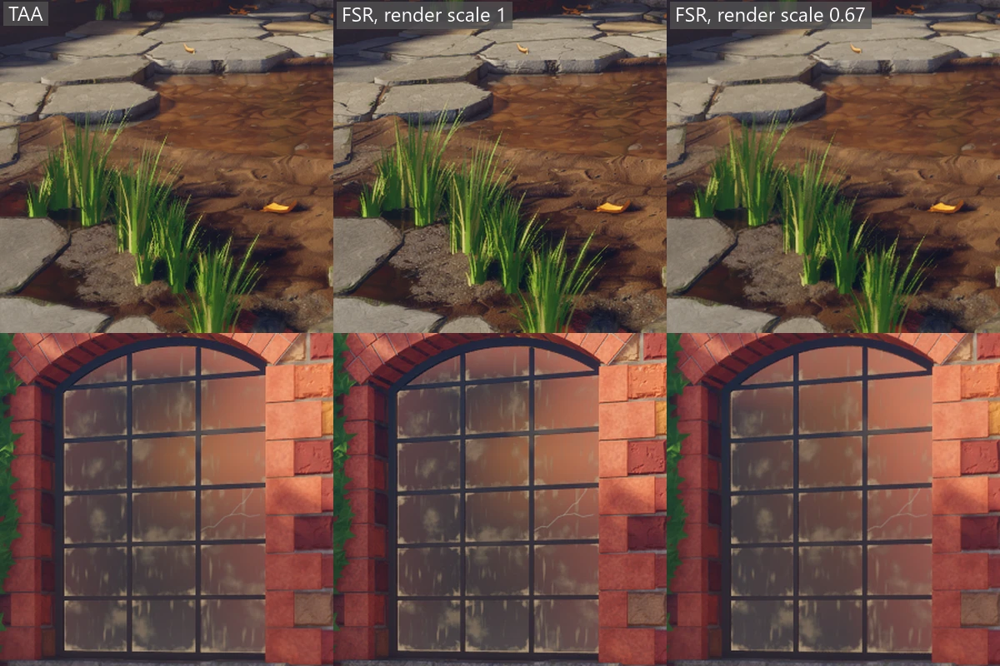

Only FSR is supported. NVIDIA's DLSS is not, see the [roadmap](roadmap.md).

`Materials` is for looking, not for speed, so `Graphics.Fastest()` leaves it on. A key that
flips it while the game runs makes a handy lighting check:

```csharp
internal sealed class MyGame(Graphics graphics, Input input) : IGame
{
    public void Update(GameTime time)
    {
        if (input.Pressed(Key.M))
        {
            graphics.Materials = !graphics.Materials;
        }
    }
}
```

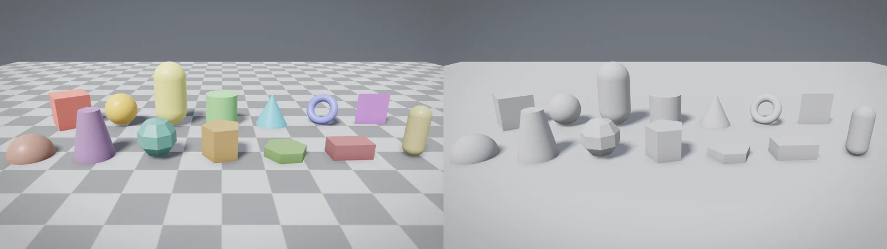

An effect turned off skips its work on the GPU, not only its look. In the Crypt, the
GPU time of a frame halves:

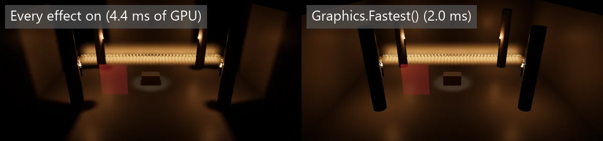

Screenshots, recordings and profiles keep vsync and ignore the frame limit, so they come
out the same on every machine, but they do follow the effect switches. The one exception is
the frames a screenshot draws while it waits for the light probes to settle: nobody sees those,
so they don't wait for the display, and the shot comes out the same. Turning
`AntiAliasing` on or off waits for the GPU to finish once, so do it from a menu rather than
every frame.

### Ray tracing

On a GPU that supports ray queries (`VK_KHR_ray_query` with `VK_KHR_acceleration_structure`,
`VK_KHR_deferred_host_operations` and `bufferDeviceAddress`) the renderer turns them on when it
makes the device, and `Renderer.CanTrace` is true. Some players have a GPU that
can't, so nothing requires it: those players get the same game without tracing. So far rays
update the [light probes](#bounced-light), many more a frame than drawing them can, and draw the
debug view below; nothing else uses them.

`--no-trace` makes the device without ray queries even on a GPU that has them, so you can see
what a player without them gets. It works in the window and with `--screenshot`, `--record`
and `--profile`.

`--debug-view trace` shows what rays can see instead of the lit scene: each surface's base colour,
unlit, and sky blue where a ray hits nothing. Use it to check that the ray tracing layer holds the
scene you expect. Leaves in cut-out materials show holes, wind-swayed parts sit at rest, and skinned
characters, swimming draws and ghosts are missing, because rays don't see them yet. From code, set
`FrameView.DebugView` to `DebugView.Trace`; `Renderer.Render` throws on a GPU that can't trace, and
`Renderer.NoTraceReason` says why. See [the command line](command-line.md).

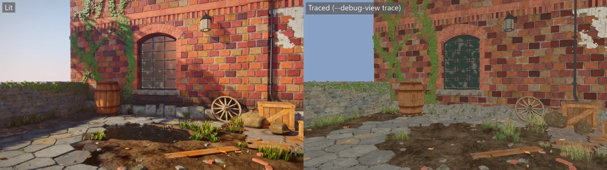

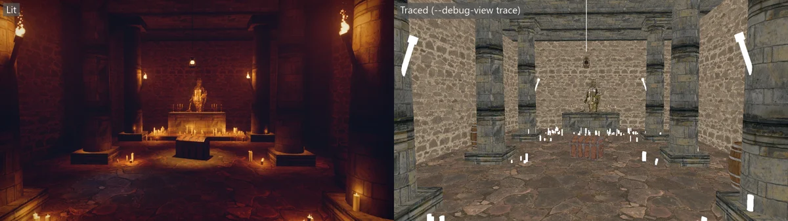

## Lights

```csharp
view.Sun(direction: new Vector3(1f, 2f, 1f), color: new Vector3(3f));
view.Sun(direction: new Vector3(-1f, 0.5f, -1f), color: new Vector3(0.4f, 0.5f, 0.8f));
```

`direction` points towards the light. Colours are linear, so a bright light goes well
past 1. One sun casts the shadows: the first, unless you pick another with
`shadows: true`:

```csharp
view.Sun(new Vector3(-1f, 0.5f, -1f), new Vector3(0.4f, 0.5f, 0.8f));
view.Sun(new Vector3(1f, 2f, 1f), new Vector3(3f), shadows: true);
```

Marking two suns in one frame throws.

### Point and spot lights

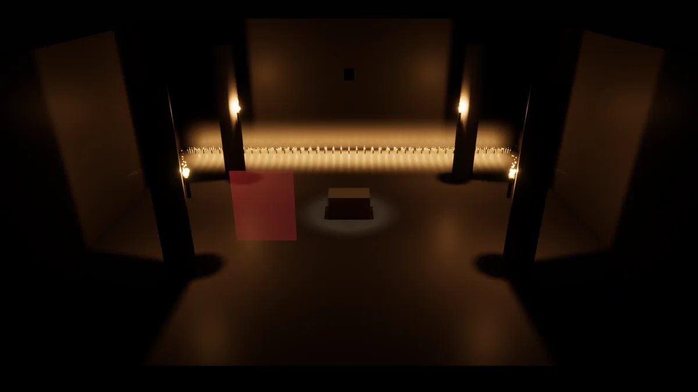

```csharp
view.PointLight(torch.Id, torch.Flame, color: new Vector3(3.2f, 1.5f, 0.5f), range: 9f, radius: 0.5f);
view.PointLight(candle.Id, candle.Wick, new Vector3(0.12f, 0.06f, 0.02f), range: 1.4f, shadows: false);
view.SpotLight(lantern.Id, lantern.Position, direction: -Vector3.UnitY, new Vector3(6f, 5.5f, 4.5f),
    range: 7f, innerAngle: 0.25f, outerAngle: 0.4f);
```

A point light shines every way from a spot, like a candle or a torch, and a spot light
shines in a cone, like a lantern's beam. The colour is how bright the light is a metre
away. It dims with the square of the distance and fades smoothly to nothing at the
range, so a small range is cheaper and keeps a candle's light on its own table. A spot
is full inside its inner angle and fades out by its outer one. Both angles are measured
from the direction, in radians, and the outer one must be under a right angle.

A light also has a radius, the size of its glowing part, 0.1 m unless you pass
`radius:`. No surface gets much brighter than it would be that far from the light. On
its own, the square of the distance makes a torch a hand from a wall blow the stone out
white while the room stays dim. A bigger radius calms the wall but leaves the light
just as bright a metre away and beyond, so raise it for lights in brackets, sconces and
lamps against walls. The Crypt's torches use 0.5. A bigger light also casts softer
shadows. The radius must be less than the range.

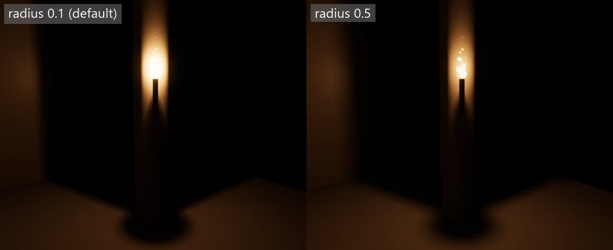

Draw lights in `Draw` like everything else, each frame, so a torch can flicker by
changing its colour. The key names the light from frame to frame, the same as a model's
key, and keeps its shadow steady as the camera moves. Use the ID of the thing holding it.

Lights cast soft shadows unless `shadows: false` is passed. Shadows are sharp where an
object touches the ground and blur further away, as the sun's do. All the lights share
one shadow atlas, and a light that is bigger on screen gets a sharper shadow. A point
light costs six times as much shadow as a spot. When the atlas is full, the lights that
are smallest on screen lose their shadows. Shadows are what cost the most, so leave
them off on small lights, such as rows of candles.

A frame can have up to 1,024 lights, and one more throws. Lights are culled to what the
camera sees, and each part of the screen only works through the lights that reach it, so
a frame can have hundreds of small lights. 256 can reach any one spot on the screen,
and more than that are dropped there. The `Crypt` example has four torches, five
candelabras, a lantern, a beam from a grate and 126 candles, about 150 lights. The
`Hamlet` example has about 200 at night: 56 lamps with shadows and 144 lit windows
without.

Point and spot lights light models, glass and [particles](views.md#particles). Glass and
particles get no shadows from them. They aren't seen in reflection probes. In
[fog](#fog) they glow with a halo; `volumetric:` sets how strongly, and 0 leaves a light
out of the fog (see [volumetric fog](#volumetric-fog)).

### Light modes

Every sun, point light and spot light takes a `mode:` of `LightMode.Mixed`, `Realtime` or
`Baked`. `Mixed` is the default and changes nothing about how a light looks. The mode only
says how a bake will treat the light: `Realtime` is never part of a bake, `Baked` is only
part of one, and `Mixed` is both. Until a [bake](#baked-lighting) exists, every light is lit
live whatever its mode, so every frame looks the same. A mode that isn't one of the three
throws.

A baked space keeps the shadows of its Mixed lights in a shadow mask with four channels. The
sun takes one when it is Mixed, and Mixed point and spot lights whose ranges overlap need
different channels, so a space has at most four Mixed lights reaching the same place. A light
that finds none left keeps its real-time shadows only.

While the bake is drawn, a Mixed light on a lightmapped surface is shadowed by its channel. A
light with a real-time shadow takes the darker of the two, so something that moves still casts
its shadow, and the baked one covers what the shadow map doesn't: past the sun's last
[cascade](#shadows) the mask takes over, so a sun lights a baked space with shadows however far
it reaches. A light with no shadow map, or one that didn't get a [tile](#point-and-spot-lights),
takes the mask alone, so a light with `shadows: false` is still shadowed by the walls the
bake saw. A light without a channel, a surface without a lightmap, and every light while
[`BakedLighting`](#graphics-settings) is off or the bake is stale are lit as before.

## Shadows

```csharp
view.Shadows(40f, cascades: 3);
```

The first number is the radius of the sharpest shadow map, in metres. Each extra cascade
covers three times the radius of the one before. The cascades are laid along what the
camera sees: the sharpest one starts at the camera, and each next one picks up where the
last ends, so no part of a map is spent behind the camera. A cascade keeps its size as the
camera turns and moves in whole shadow texels, so shadow edges don't shimmer or crawl.

Where two cascades meet, points hand over to the coarser one gradually, so there's no line
where the sharpness changes. Shadows fade out over the last part of the furthest cascade
instead of stopping at an edge.

An orthographic camera centres every cascade on its target instead, and widens its
shadows to cover the screen.

Things out of frame still cast into it. A tree behind the camera or off to the side, up-sun
of what you see, throws its shade into the picture, up to six cascade radii away.

```csharp
view.Shadows(7f, cascades: 3, sunSize: 0.02f);
```

`sunSize` is how wide the sun looks, in radians, from 0 to 0.5. It sets how fast a shadow
blurs with distance from what casts it. The default of 0.12 is a soft, hazy sun that keeps
shadows gentle. The real sun is about 0.01, and something near that lets a canopy several
metres up throw crisp dappled light, where the default blurs it into one soft patch.
0 gives hard edges everywhere.

Each map is 2048 texels across unless `Graphics.ShadowResolution` asks for 1024 or 4096, so
a 7 m radius gives texels about 7 mm wide. That's too coarse for the last centimetre where
a barrel stands on the floor, so the sun also has contact shadows. Each pixel looks towards
the sun through what the camera sees, and darkens where something is in the way, which
draws a thin dark line where things touch the ground:

```csharp
view.Shadows(7f, cascades: 3, sunSize: 0.02f, contact: 0.3f);
```

`contact` is how far each pixel looks, in metres. The default of 0.25 suits barrels, crates
and people; a longer one reaches under bigger things and costs no more. 0 turns them off, as
`Graphics.ContactShadows` does. They're drawn only inside the first cascade's radius, fading
out over its last tenth, since further away a centimetre is less than a pixel. They can only
see what's on screen, so something just out of frame or hidden behind another object casts
none. Something more than 15 cm in front of a surface never counts, so a near object puts no
dark outline on the wall behind it. Materials marked `foliage` get none, because the camera
only sees the front leaf.

## Ambient occlusion

```csharp
view.AmbientOcclusion(radius: 1.2f, strength: 0.7f);
```

Corners, creases and the ground under things get less of the soft light from the sky,
because the surfaces around them hide part of it. `radius` is how far, in metres, a point
looks for those surfaces, and must be above 0. `strength`, from 0 to 1, is how dark they
make it: 0 turns the darkening off and 1 is all of it. The defaults, a radius of 0.6 and a
strength of 0.9, suit rooms and streets seen from head height. A wider radius darkens
whole alcoves and the space under a cart, at the cost of losing fine creases.

A point in a corner also sees the sky only through the opening, so the soft light it gets
comes from that way rather than straight off the surface. Reflections of the sky fade in
the same corners, most on rough surfaces, so a gap behind a barrel doesn't shine.
It only knows what the camera sees, plus what stands over a point in the sun's shadow map.

## Bounced light

Sunlight that lands on a brick wall doesn't stop there: some of it bounces off and lights
the ground and everything near it, tinted the colour of the brick. A lamp in a white room
lights the whole room, not only what faces it. Without bounced light, shade gets its soft light
from the sky alone, so a yard in shadow looks blue and flat and a room lit by a lamp is black
wherever the lamp doesn't reach.

The renderer keeps light probes round the camera for you, with no setup. Each probe records the
light reaching it from every direction, and surfaces take their soft light from the probes
round them instead of from the sky, so the shade under a sunlit wall takes on its warmth, a red
wall tints the floor beside it, and the inside of a closed room stays dark however bright the
sky is. The probes see the sun, the sky, point and spot lights (inside their cones), glowing
surfaces and the light already bounced, so light bounces again with every update.

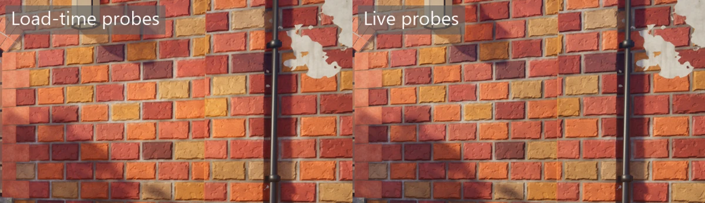

Where a probe sees nothing it sees the same sky that lights the scene without probes, so in a
scene with no [`view.Sky`](#the-sky) it sees the soft studio light rather than the plain
background colour drawn behind the scene. Out in the open, a probe gives the light the
scene would have had without it.

The probes sit in four nested boxes centred on the camera, 0.5, 1, 2 and 4 metres apart, so
detail is finest close by and the far boxes still reach a long way. On a GPU that can
[trace rays](#ray-tracing), each update sends 128 rays out from the probe, and 256, 512 or 1,024
probes are updated a frame by [`Graphics.ProbeQuality`](#graphics-settings): `Low`, `Medium` or
`High`, the default. Nothing turns this on; it is used whenever the GPU can. Each traced update
moves a probe a quarter of the way to what its rays saw, so a little noise averages away, but a
big change, well above the probe's own noise, comes in whole, so a lamp turned on near the
probe fills in within a few updates. A small change, or one at a probe lit mostly by a small,
noisy light, still moves a quarter of the way an update. At `High` the near probes are all
traced within the first few dozen frames, and each is then redone about every second at 60 fps
for 12 more updates, as each update adds one more bounce of light between walls: in a white
room the bounce is about 80% there after 12 seconds. After that only a quarter as many are
redone a frame, to save GPU time, so every probe is redone about every four seconds and the
last of the bounce takes a minute or two to come in. A changed light or a new probe starts the
full count again.

Without tracing, each update draws the scene round the probe six times instead, so far fewer
fit in a frame: 8, 16 or 32 by `ProbeQuality`, and fewer in a dense scene, since a frame draws
at most 8 million triangles round its probes, which is about 9 probes in Courtyard. Either
way there is no pause while loading: the scene starts lit by the sky and fills in over the
first frames, nearest probes first. Drawn this way at `High`, the near probes have all been
drawn after about a thousand frames in a light scene (nearer four thousand in Courtyard).
Without a `view.LightProbes` box of your own, the first seconds after a load can look blotchy,
as neighbouring probes have been drawn different numbers of times, until each has been redone
a few times and they even out.
After that the oldest probes are redone in turn, so objects that move or appear show up in the
bounce within about 2,000 frames at `High`. A point or spot light that moves, turns, changes
colour or is switched off marks the probes in its range for an update, and a change to the sun,
the sky or the `Materials`, `SunShadows` or `LightShadows` switches marks them all (probes
don't draw wear and dirt, so `WearAndDirt` leaves them be); until it is redone, a probe keeps its old light, so a change fades in rather than flashing.
As the camera moves, the boxes slide with it a row at a time: probes it keeps stay as they were,
and the new row starts dark and is drawn next.


```csharp
view.LightProbes(min: new(-1f, 0f, -4f), max: new(1f, 2.5f, 4f), spacing: 0.25f);
```

`view.LightProbes` adds a box of probes of your own on top, for a place that needs finer
detail than the camera's probes give, such as a narrow corridor at 0.25 metres. Inside it,
and up to a spacing round it, its probes win over the camera's. The box may hold at most 4,096
probes, so 1 metre spacing covers about 15 by 15 by 15 metres; a bigger box throws when it is
set. `spacing` must be more than zero, and `max` above `min` on every axis. A new box starts
its probes again. Gallery keeps one over the whole building: in its rooms the camera's probes
alone left the walls and floors blotchy in a screenshot, and the box's probes, 1.65 metres
apart, light them smoothly.

Each probe also notes how far away the surfaces it sees are, so a point behind a wall from a
probe gets nothing from it, and light doesn't leak into a room from the probes outside. Traced
probes also send a shadow ray towards every point or spot light that casts shadows, so a lamp
behind a wall doesn't light them. Without tracing, the probes take a lamp's shadow from its
shadow map, which only lamps that light the view have, so a lamp out of view lights the probes
through walls as if it cast no shadow. A probe that ends up inside a wall or under the ground sees mostly the backs of surfaces, and
is left out. Where no probe can see a point yet, the soft light comes from the sky as before.
Reflections don't change; probes give only the soft, diffuse light. See-through, skinned and
swimming things don't show in the probes or shade them from the sun, as they would spoil them or
move on their own. Without tracing, glass still shades the probes from a lamp that lights the view.

A surface in a [baked space](#with-a-fresh-bake) whose bake is fresh takes its soft light from its
lightmap instead, which is finer than any probe grid.

`Graphics.LightProbes` turns all of this off and frees the probes' memory, about 170 MB at
`High`. Switching it back on starts every probe again. `Graphics.ProbeQuality` trades the
probes' reach and speed for memory and GPU time; see [graphics settings](#graphics-settings).
A [screenshot](command-line.md#screenshots) waits for the probes near the camera to be drawn,
up to 2,048 frames, so it shows the bounce as it will be rather than still filling in.

`--debug-view probes` shows the probes themselves, over the lit scene. Every probe of the finest
box and of your `view.LightProbes` box is a small sphere; the three coarser boxes aren't shown.
Each point of a sphere shows the
light that probe gives a white surface facing the same way, so a probe beside a red wall is red
on the wall's side. The spheres are 0.15 of their probes' spacing in radius, 7.5 cm in the
finest box, so they read clearly from a few metres away while neighbours stay well apart and
leave the scene visible between them. A probe not drawn yet is a grey wireframe, and a probe
left out for being inside a wall isn't shown. Where your box covers the finest box, only your
box's probes are shown, as only they light that space. It works with or without tracing, and
shows no spheres while `Graphics.LightProbes` is off. From code, set `FrameView.DebugView` to
`DebugView.Probes`. See [the command line](command-line.md).

## Baked lighting

```csharp
view.BakedLighting("crypt", min: new(-8f, -1f, -12f), max: new(8f, 6f, 12f), probeSpacing: 1f);

foreach (var house in village.Houses)
{
    view.BakedChunk("house-garden", house.Transform, min: new(-6f, 0f, -8f), max: new(6f, 7f, 8f));
}
```

A frame can name the parts of the world whose lighting is baked. [`Renderer.Bake`](#making-a-bake)
bakes a space, and the game finds the bake in its content and checks it against the frame. Once
the bake is fresh, its surfaces are lit from their lightmap; until a space is baked, naming it
changes nothing on screen.

`BakedLighting` names a space: one fixed place, baked as it stands, sun included. Its box also
holds baked probes `probeSpacing` metres apart, at most 4,096 of them, counted the same way as
[light probes](#bounced-light), so 1 metre spacing covers about 15 by 15 by 15 metres. A frame
has at most one space, and naming a second throws with both names. Its bake is
`lighting/<name>.lightbake`. `texelsPerMetre`, 20 by default (5 cm texels), sets how fine its
lightmap is, from 1 to 200; anything else throws with the value. `view.BakedChunk` takes the same
parameter for a chunk.

`BakedChunk` places a chunk: a piece of the world, such as a house, baked once in its own
space and placed with `transform`. `min` and `max` are its box in its own space, before
`transform`. One chunk can be placed many times in a frame, so its name may repeat, and every
copy with the same contents will share one bake, kept in `lighting/<name>/<hash>.lightbake`
with the 16 hex digits of a hash of its contents. A frame places at most 256 chunks. The
transform may only turn and move the chunk: its first three rows must be unit length and
square to each other within 0.0001, without a mirror, and its last column (0, 0, 0, 1). One
that scales, shears or mirrors throws, since one bake serves every copy.

A name is one or more letters, digits, `-` or `_`, since it names a file; a slash, a dot or a
space throws. Each box must reach further than it starts on every axis, and `probeSpacing`
must be more than zero. Everything else throws when it's named, with the value and the limit.
For Rendition alone, `FrameView.BakedSpace` and `FrameView.BakedChunks` carry the same, and
`Renderer.Render` throws for more than 256 chunks or a chunk transform that isn't only a turn
and a move. `BakeFiles` has the limits, the file names and the checks.

### Without a bake

Every frame that names a space or a chunk, the renderer works out what each area's bake would
be made from and asks whether a bake of exactly that exists. A light that a fresh bake holds is
then left to the bake: a `Baked` light is no longer drawn live, and a `Mixed` one is. A light
in no baked area, a `Realtime` light, and a light that is [moving](#moving-lights) are always
drawn live.

An area's texel density is part of what its bake is made from, so changing the
`texelsPerMetre` an area is named with makes its bake stale. The bake's quality (`Preview` or
`Final`) does not: it only decides how long a bake takes, so a Preview bake is as fresh as a
Final one.

A Super game looks for each bake in its cooked content, where [`--bake`](command-line.md#baking-lighting)
puts it, reading only the header of each file once and keeping it, so asking every frame reads
and allocates nothing. A missing bake is quietly lit live, since most areas start unbaked. A
stale one is lit live too, and the game writes one line to the error output the first time it
meets it, naming what changed:

```
The bake lighting/crypt.lightbake is stale, since its draws and lights changed, so its area is lit live until it is baked again.
```

A file that can't be read, because it is damaged or because opening it fails, as it can while a
cook is replacing it, is reported once the same way, with the reason, and lit live. When the
content reloads, every bake is read again and each stale one is reported again.

A frame with no bake, or only stale ones, looks exactly as it would without its baked areas, to
the byte, and a frame that names none does no bake work at all.
[`Graphics.BakedLighting`](#graphics-settings) off treats every bake as missing.

### With a fresh bake

When the space's bake is fresh, the renderer reads the whole file once, puts its pages on the
GPU and keeps them until another bake is loaded or the content reloads, even through frames
that don't name the space. Every draw the bake holds then takes its soft light from its lightmap: the light that
reached it from the sky, the sun and the bake's lights, bounced around the space, with no leaks
through walls. That replaces the sky and the [light probes](#bounced-light) for those surfaces.
The lightmap also notes where most of that light came from, so a normal map still shows its
bumps under baked light. Live lights, `Mixed` ones included, and reflections are drawn over
it as usual. Ambient occlusion still darkens
the corners, at half strength, since the bake already holds most of the shade there.

A draw the bake doesn't hold, such as something moved in after the bake or a moving
character, is lit as before, from the probes or the sky. A file whose header is fresh but whose
pages can't be read is reported once to the error output and its area lit live, as if it had
no bake. Only the space is drawn from its bake so far; a fresh chunk's lights are left to its
bake but its lightmap isn't drawn yet, so a fresh chunk is darker than it should be.

For Rendition alone, `Renderer.Bakes` is where the renderer asks. It starts as
`NoBakes.Instance`, which has no bakes. A `LightBakeStore` reads bakes through a function that
gives a file's bytes, or null when there is none, and reports stale and damaged ones to a
`TextWriter`; any other `IBakeStore` can stand in for it. `LightBakeStore.Forget` drops what it
has read, for after the files change, and `LightBakeStore.Load` reads a whole bake.

### Making a bake

```csharp
byte[] bake = renderer.Bake(view, draws, new BakeSettings(quality: BakeQuality.Preview));
File.WriteAllBytes("lighting/crypt.lightbake", bake);
```

`Renderer.Bake` path traces the frame's space into a lightmap and its light probes, and returns
the `.lightbake` file's bytes. It takes the same view and draws as `Render`, waits for the GPU,
and draws nothing. A view without a space throws "Bake needs a baked space in the frame; call
view.BakedLighting first." A space with more than 4,096 probes, which only a hand-made
`FrameView.BakedSpace` can have, throws with its name and count. The settings' `TexelsPerMetre`
must be the space's, since no frame would find a bake at another density fresh; one that differs
throws with both. Chunks aren't baked yet.
A game doesn't need to call it itself: [`--bake`](command-line.md#baking-lighting) bakes the
frame's space and saves it, and `--bake-check` says whether the saved bake is fresh.

The lightmap covers the static draws the space owns, apart from ones that sway in the wind or
are see-through, at the space's texel density. Each texel holds the light reaching it from every
direction, the direction most of it comes from, and a shadow mask. What a light gives depends
on its mode:

- A `Baked` light is in the lightmap in full, both its direct light and the light it bounces.
- A `Mixed` light gives only its bounced light, since it stays drawn live. Its direct shadow
  goes in a shadow mask channel instead, so the live light is shadowed by what the bake saw
  (see [light modes](#light-modes)). There are four channels: a `Mixed` sun takes the first, and local lights whose ranges
  overlap get different ones.
- A `Realtime` light, a light that is [moving](#moving-lights), and a local light in no
  baked area are left out, as is the sun when it is `Realtime` or moving.
- Emissive surfaces light their surroundings, and the sky lights them at
  `view.EnvironmentIntensity`. Glass and other see-through surfaces let light through, dimmed
  by their opacity but not tinted.

The bake also holds the space's probes, one every `probeSpacing` metres in its box, laid out
as [light probes](#bounced-light) are, so the bake's probes can stand in for live ones there.
Each records the light from every direction and how far away the surfaces it sees are, by the
same rules as the lightmap: a `Mixed` light gives a probe only its bounced light, and `Baked`
lights, emissive surfaces and the sky count in full. A probe inside a closed room with no light
in it reads black. The probes aren't drawn from yet.

A `Preview` bake sends 64 paths from each texel and a `Final` one 1024, so Preview is about
16 times quicker and noisier. Probes take a sixteenth of that per direction, 4 and 64, since
each probe direction already averages many. The file's report gives the time taken, the share
of texels found inside walls, and the lights that didn't get a mask channel.

Before the lightmap is written, an edge-aware filter smooths out the path tracer's noise. It
follows the surfaces, so it doesn't blur light across a crease or a step, and it never mixes
two charts, so light from one wall doesn't leak onto the floor beside it in the lightmap. It
also stops where the light changes by more than the noise explains, so a `Baked` light's
shadow edge stays sharp to within a texel or two, and the sky seen past the rim of a wall isn't
carried in under it. Where the light is noisy it spreads it over up to about 8 texels either
way (40 cm at 20 texels a metre). A penumbra that is itself noisy, as at `Preview`, can soften
a little, and blotches larger than about 8 texels stay. The shadow mask isn't smoothed, so the
shadows of `Mixed` lights stay sharp. Then the edges of each chart are grown
by up to 8 texels, which fills texels inside walls from their neighbours and gives bilinear
filtering and mips something right to read at a chart's edge. A path that came out as not a
number or past a half float's range is cleared first, so one bad sample can't spoil a patch.
`new BakeSettings(filter: false)` turns the smoothing off to show the raw trace; the edges are
still grown and bad values still cleared. Like the quality, it doesn't make a bake stale.
Probes aren't filtered.

From code, `Renderer.LastBakeFrame` shows what the last frame decided. It is null after a
frame that named no baked area. Otherwise its `Space` and `Chunks` hold the inputs of each
area, `SpaceFresh` and `ChunkFresh` say which bakes were found, `ModeOf(key)` gives the mode
each light was drawn with: the light's own mode, or `Realtime` when it is moving or no fresh
bake holds it, and `DroppedLocalLights`
and `DroppedSuns` list the lights left to a bake, by their place in the frame's lists.

## Reflections

```csharp
view.ReflectionProbe(key: 1, position: new(3.5f, 1.6f, -1.5f), boxMin: new(-3f, -1f, -10f), boxMax: new(10f, 6f, 7f));
```

Shiny surfaces first mirror what's on screen. What they'd see off the edge of the screen, and
everything glass sees, comes from the sky unless a reflection probe covers it. A reflection
probe is a photograph of the scene in every direction from one spot, so a window in a yard
reflects the walls and the house opposite rather than a sky it can't see. Put it at about head
height in the middle of the space, and make the box match the space's walls, ground and
roof: a reflected ray runs on to the box before it looks the probe up, so what it shows lands
where it would really be and doesn't slide as the camera moves. Towards the sides of its box a
probe fades out over `blend` metres, 0.5 by default, into the sky or the next probe.

The key names the probe across frames, so place it every frame like a light. It is
photographed the first frame it's placed and again only when it moves, its box changes or the
lighting does: the sun's direction or colour, the sky, the shadow softness or cascades, the
ambient occlusion settings, the `SunShadows`, `Materials` or `AmbientOcclusion` switches. Moving
the camera doesn't, because the photograph frames the sun's shadow on the probe's own box, and
nor does moving or adding objects, so probes suit what stands still. Once the [light
probes](#bounced-light) round the camera have first settled, each probe is photographed once more.
Each photograph waits for the GPU and takes a moment, so a sun that moves every frame keeps
them drawing. Point and spot lights aren't in the photograph, so a lantern's glow doesn't show in
a reflection. A probe left out of a frame is dropped, and the rest are photographed again.

At most 4 probes fit in a frame, and a fifth throws. The position must be inside the box,
`boxMax` above `boxMin` on every axis, `blend` 0 or more, and each key used once a frame.
With `Graphics.Reflections` off, no probes are photographed and shiny surfaces and glass
reflect only the sky.

## The look of the picture

```csharp
view.Finish(new PostSettings
{
    Exposure = 0.2f,     // stops: +1 is twice as bright
    Contrast = 0.1f,
    Saturation = 0.1f,   // -1 is black and white
    Vignette = 0.3f,
    Sharpen = 0.4f,
    Grain = 0.01f,
    Bloom = 0.1f,                              // more glow round bright things
    Lift = new Vector3(0.03f, 0.02f, 0.05f),   // lilac in the shade
    Gain = new Vector3(0.05f, 0.02f, -0.04f),  // cream in the highlights
});
```

Leaving a value at zero leaves that part unchanged. `Lift` adds colour to the dark parts
and fades out towards white, so shade takes a tint and white stays white. `Gain` makes
each channel that much brighter, by its share, so it shows most in the highlights.

| Setting | What it does |
| --- | --- |
| `Tonemapper` | The curve that fits the scene's light into what a screen shows. `Tonemapper.Agx`, the default, or `Tonemapper.Aces` for the older, punchier look. See [tone mapping](#tone-mapping) |
| `AgxLook` | The look on top of AgX. `AgxLook.Punchy`, the default, deepens the mid-tones and strengthens colour; `AgxLook.Base` is the plain, softer curve. ACES ignores it |
| `Temperature` | White balance, from -1 to 1. Above 0 warms the picture, as if the camera were balanced for light bluer than daylight: 1 balances for 12000 K. Below 0 cools it, down to 4000 K at -1. 0.1 is a gentle afternoon warmth |
| `Tint` | White balance the other way, from -1 to 1. Above 0 pulls the picture towards magenta, below 0 towards green |
| `FocusDistance` | Where the lens is focused, in metres from the camera. See [focus](#focus) |
| `Aperture` | The lens's f-number, such as 2.8 or 8. Smaller opens the lens wider and blurs more. 0, the default, is no depth of field |
| `FocalLength` | The lens's focal length in millimetres, for the blur only. 0, the default, means 35. It doesn't change the field of view, which the camera sets |

A view refuses a `Temperature` or `Tint` outside -1 to 1, or one that isn't a number.
Rendition used on its own holds them at the nearest end instead, and counts a value that
isn't a number as 0. White balance works on the light, after exposure and before contrast and the
curve, the way a camera's does, so white surfaces in the sun take the warmth and the
highlights still fade to white.

### Tone mapping

The scene's light runs far brighter than a screen can show, so a curve squeezes it in.
AgX, the default, is the curve Blender 4 uses. It moves bright, strongly coloured light
gradually towards white, so a sunlit brick wall keeps the difference between its bricks.
ACES, the older look, is punchier in the mid-tones but takes saturated highlights to one
flat colour.

On its own AgX reads soft and pale, so it comes with Blender's Punchy look by default,
which deepens the mid-tones and strengthens colour. Punchy also puts middle grey about
0.8 of a stop darker on screen than ACES or the plain curve, so a scene moving over from
ACES wants more `Exposure`: the Courtyard uses 1.05 with auto exposure, with `Contrast`
0.25 and `Saturation` 0.15. `AgxLook.Base` is the plain curve, which keeps middle grey where
ACES puts it and leaves the most room in the highlights.

```csharp
view.Finish(new PostSettings { Tonemapper = Tonemapper.Aces });   // the older look
view.Finish(new PostSettings { AgxLook = AgxLook.Base });         // AgX without the Punchy look
```

Both curves and both looks cost about the same, so `Graphics.Fastest()` leaves the choice alone.

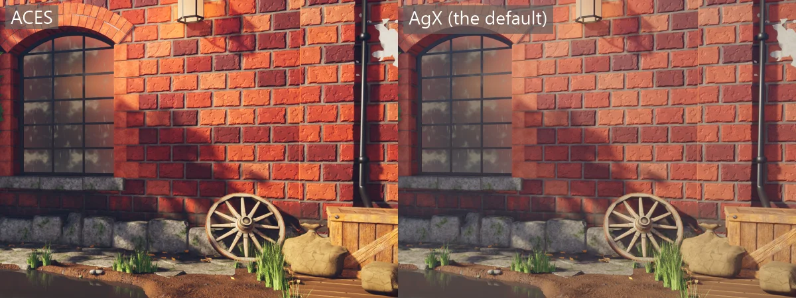

`Sharpen` gives back the crispness anti-aliasing blends away, from 0 to 1. It sharpens fine,
faint detail such as a texture's grain the most and edges that already stand out hardly at
all, so they get no bright halos. While anti-aliasing is on, textures are also read a little
sharper than their size on screen asks for. One frame alone would shimmer, but anti-aliasing
blends the frames and they settle. Reflection probes are captured without it, since nothing
blends their frames.

### Auto exposure

```csharp
view.Finish(new PostSettings
{
    AutoExposure = true,
    Exposure = -0.3f,        // now compensation: a third of a stop darker than metered
    AdaptationSpeed = 2f,    // stops a second; 0 means the default of 2
});
```

With `AutoExposure` on, the camera meters the picture and sets the brightness itself, so a
scene lit much brighter or dimmer comes out about the same. It sorts the lit picture's pixels
by brightness, before bloom, leaves out the darkest 40 per cent and the brightest 5 per
cent, and puts the average of the rest at middle grey. Deep shade and the sun's disc so don't
pull the picture one way or the other. `Exposure` then shifts that, in stops, for a
brighter or darker picture than the meter picks.

When the scene gets brighter or darker the exposure follows at `AdaptationSpeed` stops a second,
the way eyes adjust walking out of a cellar. The first frame starts at the metered brightness,
not from black, and so does the first after `AutoExposure` or [`Graphics.AutoExposure`](#graphics-settings)
is turned back on, or after time goes backwards, as when the game restarts. A speed must be above 0, or 0 for the
default. A view refuses anything else; Rendition used on its own takes the default instead. The meter sees from about 1/256 to 65000 times a white of 1. Anything darker or
brighter counts as the darkest or brightest it sees.

Screenshots and recordings step time a tick at a fixed rate, so the same `--seed` and `--ticks`
give the same exposure and the same picture every run. Reflection and light probes don't
use it: they hold light, and exposure is applied after lighting.

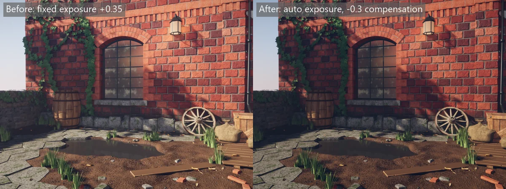

### Focus

```csharp
view.Finish(new PostSettings
{
    FocusDistance = 11f,   // metres to what should be sharp
    Aperture = 8f,         // the f-number; 0, the default, keeps everything sharp
    FocalLength = 35f,     // millimetres; 0 means 35
});
```

With an aperture set, the picture blurs nearer and further than the focus distance, as a
camera lens does. The blur is worked out from a thin lens on a 36 mm full-frame sensor: a
point d metres away spreads into a circle (f / N) * |d - S1| / d * f / (S1 - f) across,
where f is the focal length, N the aperture and S1 the focus distance. A smaller f-number, a
longer lens or a nearer focus blurs more. A 50 mm lens at f/2.8 focused at 10 m spreads a
point at 5 m, or at the horizon, over 0.09 mm, about 4 pixels of a 1600 pixel picture.
The blur is measured in the scene's own pixels, so it looks the same at any
[render scale](#graphics-settings). No circle grows past 16 pixels in radius (32 across).

`FocalLength` only sizes the blur. The field of view still comes from the camera, so set
them to match if it matters. The sensor is 36 mm across the picture's width, so in a 16:9
picture 35 mm sees about 0.56 radians top to bottom, the camera's `fieldOfView`, and 50 mm
about 0.40.

Small apertures blur gently. The Courtyard is focused on its window at f/8, so the window and
the wall stay sharp, and the flagstones and grass at the camera's feet soften a little, by
about a pixel. A portrait look wants f/1.4 to f/2.8 and a longer lens; cutscenes can change
the focus each shot to pull attention.

What's out of focus behind blurs only with other things behind, so a sharp thing never
smears into the background. A blurred thing in front spreads over what's behind it, past its
own edge, as a branch close to the lens veils the scene. The blur is gathered at half size
and drawn back at full size, so edges in focus stay crisp.

The blur goes by the depth of solid surfaces, so glass and particles take the blur of what's
behind them: a window pane is as sharp or as soft as the room through it, and smoke in front
of a blurred wall blurs with the wall. Where a sharp edge in front sits on a blurred
background, the background can pick up a pixel-wide fringe of the edge's colour, since each
half-size pixel mixes the four pixels under it.

A view refuses a negative or broken `FocusDistance`, `Aperture` or `FocalLength`, and a focus
distance no further than the focal length while the aperture is open. Rendition used on its
own draws no depth of field for those instead. [`Graphics.DepthOfField`](#graphics-settings)
turns it off for every view, and `Graphics.Fastest()` turns it off. Probes never see it, so
changing the focus never captures them again.

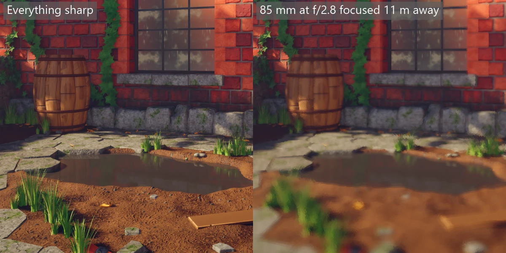

The picture above uses a stronger lens than the Courtyard's own f/8 and 35 mm, so the blur shows.

## The sky

Without a sky the world sits in a plain grey studio. `view.Sky` gives it a gradient from
the ground up through the horizon to straight up, which shows behind everything, lights
the scene from all around and shows in reflections:

```csharp
view.Sky(new SkySettings
{
    Zenith = new Vector3(0.18f, 0.36f, 0.85f),   // straight up
    Horizon = new Vector3(1f, 0.62f, 0.32f),
    Ground = new Vector3(0.22f, 0.2f, 0.13f),    // below the horizon
    Brightness = 0.9f,                           // 0 counts as 1
    HazeStart = 25f,                             // metres
    HazeEnd = 110f,
});
```

Haze fades things into the sky behind them, from nothing at `HazeStart` to all sky at
`HazeEnd`, so the far edge of a world melts away instead of stopping. Leave both at
zero for no haze. A negative brightness, or haze that ends nearer than it starts, throws.

`HazeFromFocus` measures the haze across the ground from the point the camera looks at
instead of from the camera. Use it with a far-off camera, such as an isometric one: from there everything on
screen is about the same distance away, so haze from the camera fades everything evenly.
Haze from the focus leaves the middle clear and fades the edges of the view. `HazeColor`
sets what things fade into; zero fades them into the sky behind them, which for a camera
looking down is the dark ground below the horizon.

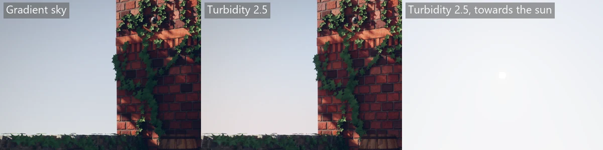

`Turbidity` swaps the gradient for a clear sky worked out from the sun, after Preetham,
Shirley and Smits (1999). It is brighter and whiter towards the sun, a deeper blue
straight up and away from it, and paler at the horizon, and the sun itself shows as a
disc:

```csharp
view.Sun(direction: new Vector3(-0.75f, 0.5f, 0.42f), color: new Vector3(7.2f, 6.7f, 5.8f));
view.Sky(new SkySettings
{
    Ground = new Vector3(0.2f, 0.17f, 0.14f),
    Brightness = 1f,
    Turbidity = 2.5f,   // 1.7 is a very clear day, 10 a hazy one
});
```

Turbidity is how hazy the air is, from 1.7 to 10; 2 to 3 is a clear day. Zero, the
default, keeps the gradient, and is the way to turn the clear sky off: there is no
switch for it in `Graphics`. Any other value throws. The sky follows the sun that casts
the shadows, or the first sun when none does. Its disc is as wide as `sunSize` in
`view.Shadows` and as bright as the sun's colour spread over it, so a smaller sun is a
brighter disc, held under what the screen can store. `Zenith` and `Horizon` are not used;
`Ground` still colours what is below the horizon, and `Brightness` still scales the
whole sky, disc included. A sun below the horizon is treated as on it, so this is a
daytime sky.

The disc shows in the background and in sharp reflections from the sky, but not in the
soft light, in rough reflections or in what [probes](#bounced-light) capture: the sun's
own light already gives those their highlight and their warmth. Moving the sun or
changing the turbidity rebuilds the sky's lighting, the same as changing its colours.

Changing the colours rebuilds the sky's lighting, which takes a moment, so keep them
steady rather than animating them every frame. [Water](#water), when set, takes over the
sky. The [Archer example](../examples/Archer) uses a golden-hour sky, and the
[Courtyard example](../examples/Courtyard) a clear one.

### Fog

Fog is air you can see: it thickens towards the ground, so the far side of a yard sits
back in it while the near ground stays crisp. Set it on the sky:

```csharp
view.Sky(new SkySettings
{
    Turbidity = 2.5f,
    Fog = new FogSettings(Density: 0.004f, Height: 0f, Falloff: 0.15f, SunScatter: 0.6f),
});
```

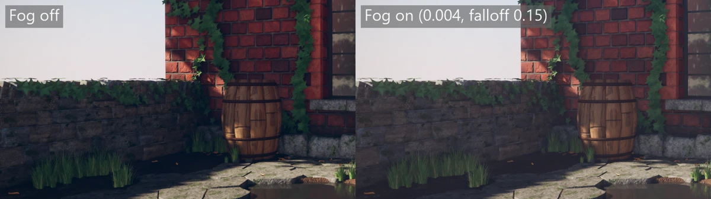

`Density` is how much light the air takes per metre at `Height`, so 0.004 hides about 4%
of what is 10 m away and a third of what is 100 m away. Above `Height` the fog thins by e
every 1 / `Falloff` metres, 6.7 m at 0.15, and below it thickens the same way, so a
valley fills and a tower's top stands clearer than its foot. A `Falloff` of 0 is fog of
one density at every height. The default, a density of 0, is clear air.

Fog takes its colour from the sky behind what it hides, without the sun's disc. Looking
down, it takes the sky's colour at the horizon that way, since fog is lit by the sky all
round it, not by the ground. Looking towards a sun it glows, by `SunScatter` times the
sun's colour, in a lobe that narrows to nothing a right angle away; 0 gives no glow.
Lit surfaces, glass and particles all sit in the same fog. The sky itself is drawn
clear, apart from the light of the [volumetric fog](#volumetric-fog) in front of it, as is
everything under [water](#water).

Haze and fog work side by side. Haze fades things into the sky between two distances,
which hides the edge of a world; fog is worked out along each line of sight and gives
depth inside it. A negative density, falloff or sun scatter throws, as does a height that
isn't a number. Fog is drawn for the camera only: [light probes](#bounced-light) and
[reflection probes](#reflections) capture clear air, so changing the fog captures nothing
again and costs nothing but its pixels. `Graphics.Fog` turns it off.

#### Volumetric fog

Near the camera the fog is lit by the light that really reaches it. Sunlight falls
through it in shafts beside the shadows of walls and leaves, and point and spot lights
glow in it with soft halos. It is on by default and needs nothing but a fog with some
density; two more settings tune it:

```csharp
Fog = new FogSettings(Density: 0.004f, Height: 0f, Falloff: 0.15f, SunScatter: 0.6f)
{
    VolumetricDistance = 48f,
    Anisotropy = 0.6f,
},
```

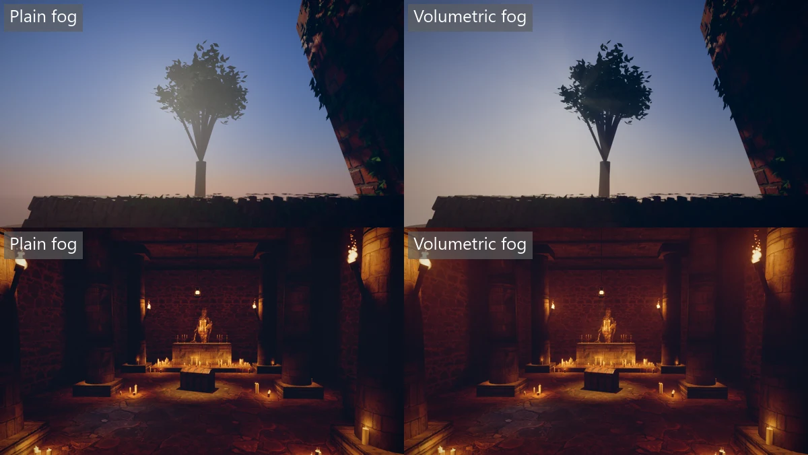

Above, looking past the Courtyard's tree towards the sun: the plain fog washes the
leaves with the sun's glow, while the volumetric fog leaves them dark and lets the light
through between them in shafts. Below, the Crypt's faint, dusty air, with a density of
0.008: the torches glow in the air round them, where the plain fog only darkens. The
torches pass `volumetric: 2f`, so their halos read without thicker air hazing the far
end of the room.

`VolumetricDistance` is how far from the camera, in metres, the fog is worked out this
way, 48 by default. Past it the plain fog carries on, seen through the volumetric part,
so the far distance looks as it did. 0 is the plain fog only, and a negative or endless
distance throws. `Anisotropy` is which way the air scatters light, from -0.9 to 0.9, 0.6
by default: 0 sends it every way alike, more sends it onwards, so the air glows most
looking towards a light, as real haze does, and less sends it back. Anything outside
that range throws. In the volumetric part the anisotropy shapes the sun's glow, and
`SunScatter` only shapes it past `VolumetricDistance`.

Each light lights the fog at full strength unless asked otherwise.
`view.PointLight` and `view.SpotLight` take a `volumetric:` strength: 1 is as much as the
air really scatters, 0 leaves the light out of the fog, and more makes its halo
stronger. A negative strength throws. A light's halo is cut by its own shadow where it
casts one, so a lantern's beam shows as a cone.

The fog near the camera is kept in a grid of cells, one for every 8 by 8 pixels of the
scene and 64 deep: one cell for the first metre, then thin cells that get deeper further out. Each frame lights
every cell at a different point of its depth and keeps 90% of what the cell held last
frame, so a light that moves or switches on takes a few frames to settle in the fog.
Screenshots and recordings that fix the frame come out the same every time. The grid
follows [`RenderScale`](#graphics-settings), not the window. Like the plain fog, it is
drawn for the camera only and is left out under water. `Graphics.VolumetricFog` turns it
off, which gives the plain fog exactly, and `Graphics.Fastest()` turns it off.

## Water

`view.Water` puts the camera underwater, with light absorbed by depth, moving caustics on
sunlit surfaces and shafts of light:

```csharp
view.Water(new UnderwaterSettings
{
    Absorption = new Vector3(0.075f, 0.026f, 0.018f),   // per metre; red should be largest
    ShallowColor = new Vector3(0.11f, 0.42f, 0.55f),
    DeepColor = new Vector3(0.01f, 0.09f, 0.17f),
    SurfaceHeight = 30f,
    CausticStrength = 2.2f,
    CausticScale = 0.11f,
    ShaftStrength = 0.11f,
    ShaftDistance = 55f,
});
```

Leaving `Absorption` at zero means there's no water. The [Reef example](../examples/Reef)
uses this.

## Puddles

`view.Puddles` lets water stand in the low places of the ground, with no mesh for the water.
It takes the water's height in metres and, optionally, how far above it the ground is damp,
8 cm unless given:

```csharp
view.Puddles(-0.045f);          // water at 4.5 cm below 0, damp for 8 cm above it
view.Puddles(0.2f, band: 0.03f); // higher water and a narrower damp band
```

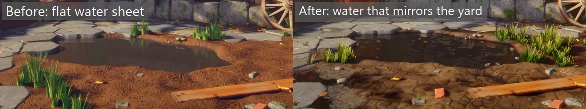

Only materials that ask for it get wet: a model sidecar's rule with `"puddles": true`, or a
`Surface` with `Puddles = true`. Each pixel's height is where it is in the world, less how
deep its height map sinks it (the material's `heightDepth` times how far below white the
height is), so the mortar between flagstones and the hollows in mud fill before the tops.
A pixel below the level is water. It mirrors the sky and what's on screen with roughness
0.03 and no metalness, its normal points straight up but for two layers of ripples 1 mm
high that drift and change, at 0.4 and 0.9 cycles a second, so the wind breaks the reflection
up a little. It reflects as water does: 2% of the light looking straight down, about a quarter
from a standing eye a few metres off, and nearly all of it at grazing. Its colour is the
ground's, turning to the near-black brown of turbid water as the water deepens to 4 cm, and it
shows only through the light the reflection leaves, so the ground under shallow water shows
most near your feet, deep water hides it, and the sky and what stands round the puddle read in
it as reflections on a dark sheet, not as wet mud. Above the level, the surface is
damp: at the waterline its colour is squared, which darkens it the way water darkens soil,
and its roughness halved, fading in a straight line to dry at the band's top. A band of 0
leaves only the water.

The water is drawn on the ground, but it is lit as if at the level: its reflections start
from the water's surface, so the sides of the hollow don't get in their way, and the sky
reflects in it wherever nothing on screen stands in the way. Anything in the puddle
with the rule, such as a plank or a wheel's rim, is wet and mirror-smooth below the level
too. Puddles still apply with [`Graphics.Materials`](#graphics-settings) off: the plain clay
gets wet at the height of its mesh, as there is no height map to sink it.

The damp band is measured up from the water, so it is only a fringe where the ground rises
well above the level. Where the ground sits only centimetres above the water, as round a
shallow hollow, a band wider than that gap darkens all of it. Give a narrower band there, a
little less than the ground's height above the water, so the ground round the puddle stays dry
and only the slope down into it darkens.

Without a level, the rule does nothing. [`Graphics.Puddles`](#graphics-settings) turns
it off, and `Graphics.Fastest()` turns it off. The Courtyard uses it for its puddle, on the
mud, the flagstones, the plank, the deck, the barrel's hoops and the wheel, with water 4.5 cm
below the yard and a band of 3.5 cm.

## Wind

`view.Wind` sets a breeze that bends grass and leaves. It takes the way the wind blows, how
strong it is and, optionally, how gusty, from 0 for steady to 1 for gusty, 0.5 unless given:

```csharp
view.Wind(new Vector3(0.6f, 0f, -0.3f), 0.35f);         // a fresh breeze, gusty by half
view.Wind(Vector3.UnitX, 0.1f, gustiness: 0f);         // a light, steady air from the west
```

The strength is how far, in metres, it leans the tip of a blade of grass 1 m tall. Only the
way along the ground counts, so a wind's direction needs some x or z, and a strength of 0 is
a calm with no direction needed. Each frame starts calm, like the other view settings.

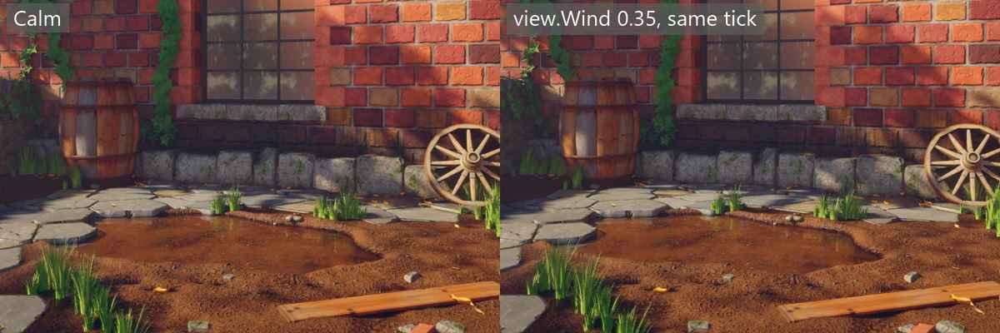

Only materials that ask for it move: a model sidecar's rule with `"wind": true`, or a
`Surface` with `Wind = 1`. A rule can give a share of the lean instead, as
`"wind": { "sway": 0.08 }`, for something stiffer than grass, such as ivy on a wall or a
tree's crown, which would otherwise lean as far as a blade of grass of its height. A vertex
moves downwind by the strength times its share times the square of its height above the
lowest point of its part of the model, so the foot stays put and the tip bends most. The
height counts up to 1 m, so a tall plant leans no further than a blade 1 m tall. Gusts swing
the lean: noise 3 m across drifts downwind at 15 cm/s, and at the default gustiness a lull
leans the grass 60% as far as a gust. On top, leaves flutter 2 cm either way at their tips,
once every two and a half seconds, out of step from one place to the next. The flutter is the same at any
share of the lean, and comes in fully from a strength of 0.25.

The sway happens as the mesh is drawn, so its shadows sway with it, and a part that sways
must be a separate part in the model, standing on its own foot: the lowest point of the whole
part is what stays still. A copy can be moved, scaled or turned about the vertical and still
sway from its own foot, but one tipped over sways from the wrong height, because the height
is measured straight up. Culling knows how far a swaying part can reach, so grass at the
edge of the screen or of a shadow doesn't pop in or out as it leans.
[`Graphics.Wind`](#graphics-settings) turns it off, and
`Graphics.Fastest()` turns it off. The Courtyard blows a breeze of 0.35 across its grass, with
a share of 0.08 for the ivy and 0.4 for the tree's crown.

## Motion vectors

Anti-aliasing blends each pixel with where its surface was last frame. Every model draw
also records how far it moved on screen since then: its own movement, its animation, the
swim of a fish and the sway of grass in the wind, as well as the camera's. So a swinging
lantern, a running character or a blade of grass keeps its edge instead of leaving a faint
trail. There's nothing to turn on, and no setting.

Super finds where a model stood last frame by its [key](views.md#keys). A model drawn for
the first time, one whose key drew another model last frame, or one whose key is shared by
models in different places, moves with the camera alone, which softens it a little while it moves. Still scenes look exactly as they did
before. Glass and particles don't record their motion.

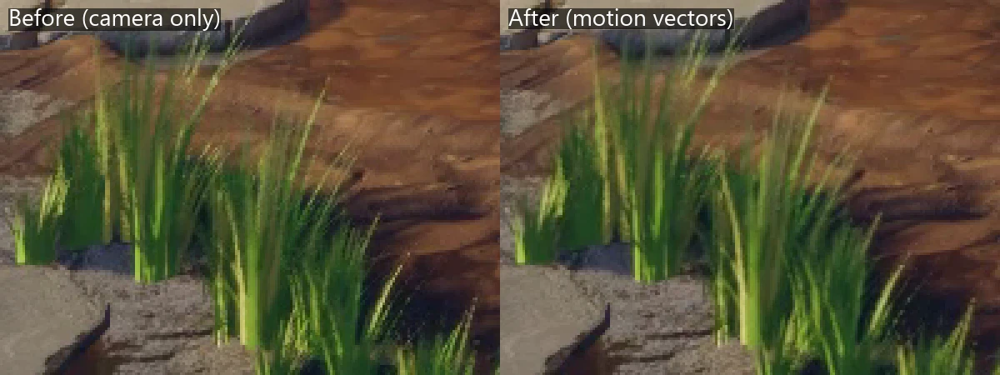

Using Rendition alone, set `DrawItem.Key` to a number that names the thing drawn, the same
every frame, on every part of it. The motion is kept in the G-buffer, in scene pixels, for
anything that reads it later; [design.md](design.md#motion-vectors) has the encoding.

## Models

Models are cooked from FBX, glTF or OBJ into Rendition's `.rmodel` format by the model
cooker in `Super.Cook.Models`, through the asset pipeline. Its settings are the ones
below, read from the model's `<file>.cook.json` sidecar, and a `parts` entry cooks named
pieces of one file, each as `file#part`. [`super-cook`](command-line.md#cooking-content)
runs it, and so does a build that imports `Super.targets`. The game reads only the
cooked content.

A game names a model by its source's [name](content.md#names), the path from the
content root:

```csharp
readonly ModelRef coral = content.Model("reef/coral/coral.glb");
```

A name that wasn't cooked, or that isn't a model, stops with a `ContentException` when
it's named.

Naming a model starts loading it. A model drawn before it's ready is waited for, so
nothing pops in; to show a loading screen instead, see
[Game states](states.md#loading-screens). `ModelRef.Cube` and the other
[built-in shapes](#built-in-shapes) need no file.

The sidecar sets the model's size and fixes materials by name. Each rule
applies to every material whose name contains `match`:

```json
// models/fir.glb.cook.json
{
  "targetLength": 6.0,
  "materials": [
    { "match": "bark", "roughness": 0.9 },
    { "match": "leaves", "alphaCutoff": 0.5, "foliage": true }
  ]
}
```

`alphaCutoff` cuts out pixels whose opacity is below it. Opacity is the colour texture's
alpha times the surface texture's alpha, so leaves with alpha in their colour texture
need nothing else, and a glTF file's own `MASK` cutoff is read without a rule. The
import fails if the cutoff would cut out nothing, or everything, instead of quietly
giving you solid cards. With a `graph`, the graph's `Opacity` is what gets cut.

A cut-out keeps its shape in the distance. Plain mips average a thin opaque thread with the
clear pixels round it, so its alpha falls under the cutoff a few levels down and it
vanishes. The cook instead scales each smaller level's alpha so as large a share of its
pixels passes the cutoff as on the full-size texture. When the colour and surface textures
both carry opacity, it's the share where their product passes that is kept, by scaling the
colour's alpha alone. Compression keeps that share too: a cut-out's smaller levels are
checked once compressed, and encoded again with their alpha pushed away from the cutoff when
more than 1% of their pixels moved across it. When both textures carry opacity, the colour
is checked against the product, pixel by pixel, and the surface is compressed as it is. This
is only done for materials with a cutoff: blended, dithered and opaque textures keep their
mips as before. Changing the cutoff cooks the textures again. When two cut-out materials
share a texture but want different coverage from it, such as two different cutoffs, the
first material's wins and the cook warns.

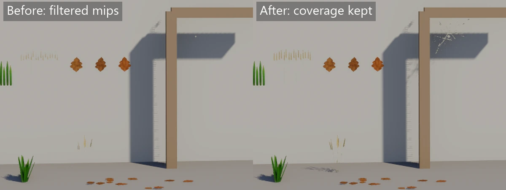

`foliage` is for a tree's leaves. It points their normals out of the crown so it's lit
as one rounded shape instead of speckled cards, lets sunlight through the back of the
leaves, and draws both sides. Every material the rule matches counts as one crown, so
give the trunk its own material. How much sunlight comes through is the leaves' own: 0.6
with `"foliage": true`, or set as `"foliage": { "translucency": 0.85 }` for thin, bright
leaves, down to 0 for leaves no light gets through. Anything outside 0 to 1 stops the cook.
Leaves that aren't one rounded shape, such as ivy on a wall or grass across a yard, take
`"foliage": { "crown": false }`. That keeps the normals the model gives, so bend them out of
the surface the leaves grow on in your modelling tool. As one crown, ivy whose rule also
covers ivy spilling into the yard would have its wall leaves facing into the wall, and
lit dark.
A `Surface` sets the same with `Foliage = true` and `Translucency`, and a Rendition `Material`
with `MaterialFlags.Foliage` and `Translucency`; both start at 0.6. To make the leaves move,
add a [`wind`](#wind) rule.

Textures are looked for beside the source file, then in any folder under it, as
Poly Haven's downloads keep them in `textures`. Some plants ship their leaf cut-outs
as a separate grey image beside a colour JPEG with no alpha; name it with `alpha`, and
its red becomes the colour texture's opacity. A mesh without UVs whose material uses a
texture warns, since every read lands on one texel; an untextured mesh needs no UVs. A
texture a rule names that can't be found stops the cook; one the model file links to only
warns.

Every cooked model has a second UV set for lighting and for [wear and dirt](#wear-and-dirt),
checked and made for each material on its own. Each material's set is in its own 0 to 1, in
which no two places on that material's meshes share a texel, and two materials may overlap
each other there. The cook keeps the file's own `TEXCOORD_1` for a material when every mesh
of it has one and it fits a lightmap: inside 0 to 1, no overlaps, two empty texels at 512
between islands, and texel density within four times from island to island. Otherwise it
makes one for that material only and says why in a note. A note isn't a warning, since
nothing needs fixing: it doesn't fail a build that treats warnings as errors, and MSBuild
shows it as a plain message, such as
`C:\game\content\props\crate.glb: note: made a second UV set for lighting: the file has none`.
These are the forms it takes:

```text
made a second UV set for lighting: the file has none
made a second UV set for lighting: Triangles 0 and 2 are in different charts with only 1 empty texel between them at texel (230, 51), less than the 2-texel gutter.
made a second UV set for lighting: materials bark and moss have none
material leaf: made a second UV set for lighting: 2 of its 5 meshes have none
```

The first two are for a model of one material, or one where no material had a set. Meshes
are counted after the cook joins a material's meshes that share the same attributes, unless
`keepMeshes` is on, so the count can be lower than the one in Blender. A
material with so many separate pieces that their islands don't fit a 512 page is laid on
1024, then 2048, and stops the cook if they don't fit that either. The made set is kept in
the cook cache, so it's made again, and noted, only when the material's shape changes. A
cook that takes the model from the cache prints no note.

A texture path must match the file's name exactly, case included, even on Windows,
so a model that cooks there cooks on every OS:

```json
// props/fern_02/fern_02.gltf.cook.json
{
  "node": "fern_02_a",
  "materials": [
    { "match": "fern_02", "alpha": "fern_02_alpha_1k.png", "alphaCutoff": 0.5, "foliage": true }
  ]
}
```

`node` keeps only what's under the nodes whose name contains it, for files that hold
several variants side by side, as Poly Haven's plant sets do. The cook fails if no
node with meshes matches. It's not for rigged models.

`keepMeshes` keeps each mesh of a static model as its own part, named by the node that holds
it, instead of merging the meshes that share a material. It's `false` by default, so a static
model has one part per material and no mesh names. Set it to `true` to
[show some of its meshes](#showing-some-meshes-of-a-model). Each kept mesh is its own draw
call, so a model of hundreds of small meshes costs more to draw with it. Rigged models always
keep their meshes.

`keepOrigin` keeps the file's own origin. The model is still turned by `rotateY` and scaled by
`targetLength`, but about that origin: it isn't centred or stood on the ground, so it stays where
the file put it. Use it when the origin means something, such as a character whose file also holds
a few hundred alternative weapons, heads and shields spread around. Those would move the bounds,
and the character would end up shifted by an amount you can't predict. A rigged model's skeleton
stays in the same place as its mesh. It's `false` by default.

`compressTextures` block-compresses the model's textures, which is on by default. Normal maps
become BC5, height maps BC4 and the rest BC7, so a texture takes a quarter of the memory or less.
Compressing is quick: BC7 takes about a tenth of a second for a 2048-pixel texture, and the
whole Courtyard cooks from nothing in about 2 minutes, most of it running material graphs.
Each compressed texture is kept in the cook cache by its pixels, so editing one graph
compresses only the textures that graph changed. Set it to `false` to keep every pixel
exactly. The cook checks textures before it compresses them, so its warnings are the same
either way. Plain textures and material graphs take the same setting in their own `texture`
and `material` rules, also on by default; see [Rules and sidecars](content.md#rules-and-sidecars).

To use several pieces of one file, list them as `parts`. Each part is cooked as its own
model, named `file#part`, and takes every setting written beside `parts` unless it sets
that one itself. A file with parts cooks only its parts:

```json
// props/dandelion_01/dandelion_01_1k.gltf.cook.json
{
  "materials": [
    { "match": "dandelion_01", "alpha": "dandelion_01_alpha_1k.png", "alphaCutoff": 0.5, "foliage": true }
  ],
  "parts": {
    "a": { "node": "dandelion_01_a" },
    "b": { "node": "dandelion_01_b" }
  }
}
```

```csharp
var flowers = new[] { content.Model("props/dandelion_01/dandelion_01_1k.gltf#a"), content.Model("props/dandelion_01/dandelion_01_1k.gltf#b") };
```

### Showing some meshes of a model

One file can hold many looks: several bodies, heads and weapons for one character, of which
each draw shows one of each. A rigged model keeps every mesh in its source file, named by the
node that holds it, the name an artist sees in the outliner. A static model keeps them too,
but only with `"keepMeshes": true` in its sidecar, since by default its meshes that share a
material merge into one part with no name. Cook the model again after adding it. Pick the
meshes by name with `content.Meshes` once, and keep the mask. Each draw then shows only
those meshes. This is different from the `#part` files above, which are separate models cut
at cook time:

```csharp
MeshMask mask = content.Meshes(model, "Body_03a", "Head_05b");
view.Model(key, model, transform, mask);
```

A mask fits only the model it was made for, so make it from the model you draw. See
[Mesh names](content.md#mesh-names) for the rules and the error when a name isn't there,
and [Showing some meshes](views.md#showing-some-meshes) for how a draw uses it.

The textures a model uses are read while it cooks, so they don't need to be assets of
their own. Turn cooking off for them with a rule in a [`cook.json`](content.md#rules-and-sidecars),
as the shared `assets` folder does for Poly Haven's `textures` folders:

```json
// assets/cook.json
{
  "rules": [
    { "match": "**/textures/**", "cook": false },
    { "match": "reef/**/*.png", "cook": false }
  ]
}
```

Other options are the `baseColor`, `normal`, `surface` and `emissive` textures,
`color`, `emissiveColor`, `metallic`, `roughness`, `clearcoat`, `subsurface`, `heightDepth`,
`detailScale`, `detailMask`, `twoSided`, `transparent`, `opacity`, `ior`, `noNormalMap`,
`worldVariation`, `dithered`, `puddles`, `wind` and `rotateY`, and `graph`, `graphSize`, `detailGraph` and
`detailGraphSize`, and `shader`, `shaderParameters` and `shaderTextures`, below; see
`src/Super.Cook.Models/ImportSettings.cs`.

`worldVariation` darkens and lightens the colour in broad patches a few metres across, laid by
where the surface is in the world rather than by its UVs, with a little more roughness in the
dark patches. A texture repeated across a big wall or floor then doesn't show its repeats. It's
on the Courtyard's bricks, stone, flagstones and mud.

`dithered` fades a material out softly by its opacity instead of cutting it at `alphaCutoff`.
Each frame a share of its pixels as large as its opacity is drawn, a different share each
time, and anti-aliasing blends them into a smooth fade. Its shadow fades the same way. With
`AntiAliasing` off the pattern shows as grain. Like any opaque surface, a dithered one
replaces the normal and roughness of what's behind it. For grime, damp or a stain on a
wall, use a [decal](views.md#decals) instead of a dithered quad in front of it: a decal
blends its colour and roughness into the wall and lays its bumps over the wall's own, so
the bricks still show through, and it never floats off the surface or flickers against it.
Keep `dithered` for things that should fade as a whole, such as a leaf or a cobweb.

`puddles` lets water stand on the material wherever it lies below the level the game sets
with `view.Puddles`, and makes it damp for a band above. See [Puddles](#puddles).

`wind` sways the material in the breeze the game sets with `view.Wind`: `true` for grass, or
`{ "sway": 0.08 }` for a share of the lean, for something stiffer. A share below 0 stops the
cook. See [Wind](#wind).

### A material graph on a model

A rule's `graph` gives the materials it matches a [material graph](materials.md), so a
model exported from Blender can wear procedural bricks, dirt or wood. The path is from the
model's folder and names a `.material.cs` graph or a `.material.json` variant:

```json
// models/courtyard.glb.cook.json
{
  "materials": [
    { "match": "graph_bricks", "graph": "../materials/bricks.material.cs" },
    { "match": "graph_dirt", "graph": "../materials/dirt.material.cs", "graphSize": 512 }
  ]
}
```

The graph runs while the model cooks, at `graphSize` pixels across, 1024 unless you give
one. Like a graph's own [size](materials.md#size), it must be a power of two from 16 to
4096, and anything else stops the cook:

```text
material graph_dirt: graphSize must be a power of two from 16 to 4096, not 500.
```

The graph's colour, normal and surface textures go into the model like any other textures.
The material's colour is white and its `metallic` and `roughness` are 1, because they
multiply the textures. Set `color`, `metallic` or `roughness` in the rule to tint or scale
them. The model file's own colour and factors are ignored, since they were meant for its
own textures. Since the graph makes the textures, a rule that also sets `baseColor`,
`normal`, `surface` or `alpha` stops the cook. `emissive`, `noNormalMap`, `alphaCutoff` and
the other switches work as usual. A graph's `Opacity` goes into the surface texture's alpha.
With `alphaCutoff` it goes into the colour texture's alpha instead, and the surface alpha is
left whole, so a graph can cut out leaves, lace or a torn edge. Otherwise it stays in the surface alpha,
so for glass whose grime clouds it, add `"transparent": true` and the graph's opacity
scales the tint, as the Courtyard's window does. With `"dithered": true` the opacity fades the
material out instead. A stain such as the Courtyard's `grime.material.cs` looks better as a
[decal](views.md#decals): `content.Surface` loads the graph on its own, and its opacity
fades the decal.

A graph that sets a `Height` also gives the material a height map, so its grooves sink in
with [parallax](#height-and-detail-maps) up close. The depth is the graph's `Depth`. A rule's
`heightDepth` sets another, and `"heightDepth": 0` turns the parallax off. A rule's own
`height` texture wins over the graph's.

A rule's `detailGraph` names a second, small graph to lay over the first as its detail
textures, for grain that still holds up when the camera is a step away and the main graph's
pixels run out. Its normal map becomes the detail normal. Its colour becomes the detail
colour, divided by its average brightness so it brightens and darkens without changing the
main graph's colour on the whole. It tiles at its own `Width`, so a 0.25 m grit graph over
a 2 m brick graph repeats 8 times across each repeat of the bricks; a rule's `detailScale`
sets another. It runs at `detailGraphSize`, 1024 by default:

```json
{
  "match": "graph_bricks",
  "graph": "../materials/bricks.material.cs",
  "detailGraph": "../materials/grit.material.cs",
  "worldVariation": true
}
```

A detail graph needs a main graph, and it makes the detail textures, so a rule can't also
give `detailColor` or `detailNormal`:

```text
material bark: detailGraph tiles at a size the main graph's width sets, so it needs a graph.
material bark: detailGraph makes the detail textures, so it can't be used with detailColor or detailNormal.
```

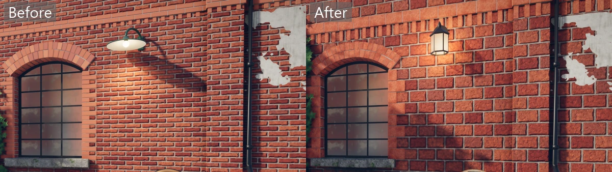

A graph material reads its UVs in metres. The cook divides the UVs of every mesh that uses
it by the graph's `Width`, so a 2 m brick graph repeats once every 2 units of UV. In
Blender, unwrap the surfaces at real-world scale, one UV unit to a metre, and a tile starts
at the UV origin, so a wall unwrapped from its foot starts a row of bricks there. The
division happens before `targetLength` is applied. A model cooked with `targetLength`
changes size but keeps its UVs, so its bricks grow or shrink with it.

Errors in the graph stop the model's cook and name the material, and the graph and its
line where there is one:

```text
material graph_bricks: ../materials/bricks.material.cs line 12: scale must be at least 1, not 0. (Parameter 'scale')
material graph_dirt: materials/dirt.material.cs isn't in the source root.
```

Editing the graph, its variant or an image it reads cooks the model again. A graph that
several materials or parts use runs once per model cook at each size. The graph is a
source of its own too, so it also cooks to its own textures. If only models use it, turn
that off with a `"cook": false` rule in `cook.json`, as you would for a model's textures.

### Wear and dirt

A rule with `"bakeMasks": true` has the cook bake masks from the material's own meshes, and
its `wear` and `dirt` are laid over the surface by them. Wear pales and polishes a band about
two centimetres wide along the convex edges, where hands and knocks rub a barrel's staves,
in patches, so some of an edge is rubbed and some not. Dirt darkens the hollows the sky
can't reach and the foot of each mesh, its lowest 0.3 m or, on a mesh shorter than that,
its lower part, where mud splashes, but not over wear:

```json
{
  "match": "graph_wood",
  "graph": "../materials/wood.material.cs",
  "bakeMasks": true,
  "wear": { "color": [0.86, 0.85, 0.82], "roughness": 0.45, "amount": 0.6 },
  "dirt": { "color": [0.6, 0.55, 0.5], "roughness": 0.95, "amount": 0.65 }
}
```

A layer tints the surface rather than covering it, so the grain and the stone's pattern show
through. Each layer's `color` is red, green and blue from 0 to 1 as a colour picker shows it
(sRGB), and the surface's own colour is multiplied by twice its linear value: 0.735 leaves
the colour as it is, more pales it and less darkens it. This differs from the rule's own
`color`, which is a plain linear multiplier on the graph or texture, so 0.5 there halves it.
`amount`, from 0 to 1, is how far the layer goes where its mask is full. `roughness` is the
layer's own, from 0 to 1. Leave it out and the surface keeps its roughness under the layer.
A rule may give only one of the two. It works with or without a graph, so a downloaded
model's textures can wear too. A transparent material doesn't show wear and dirt, so the
cook warns and ignores `bakeMasks` on one. [`Graphics.WearAndDirt`](#graphics-settings)
turns them off everywhere.

The masks are baked into the material's second UV set, the one lighting uses, where every
texel stands for one place on the mesh. Each material has its own 0 to 1 there. The first set
stays free to tile, as a graph's metric UVs do. The cooker keeps the file's own `TEXCOORD_1`
for a material when it's fit for a lightmap and makes one otherwise (see [Models](#models)),
so a model needs no second UV map for its masks. To lay out the masks yourself, add a second
UV map in Blender, unwrap it with Smart UV Project with an island margin of 0.004 or more,
and keep the first map active for rendering; the glTF exporter writes both. A rule that's
wrong stops the cook:

```text
material graph_wood: wear and dirt need bakeMasks, since they're laid by the masks it bakes.
material graph_wood: dirt amount must be from 0 to 1, not 1.5.
```

The masks are 1024 pixels across for each material, whatever its size, so a material that
spreads over many meshes gets fewer pixels for each. The Courtyard's stone, on the sill, the
plinth and all the loose stones, is the coarsest. Every mesh of the material is baked
together, and the rest of the model within half a metre shades it, so the deck darkens where
the crates stand on it. Off its islands the mask reads as clean, so a mip that reaches past
an island's edge adds neither wear nor dirt. See [Mask bakes](design.md#mask-bakes) for how they're made.

### A surface shader on a model

A rule's `shader` gives the materials it matches a [surface shader](#surface-shaders), named
by its file name as with `content.Shader`. `shaderParameters` are its parameters, up to 8 of
up to 4 numbers each, with missing numbers read as 0. `shaderTextures` are up to 4 cooked
textures for its texture slots, by their path from the model's folder:

```json
// models/courtyard.glb.cook.json
{
  "materials": [
    {
      "match": "graph_flagstones",
      "graph": "../materials/flagstones.material.cs",
      "shader": "puddles",
      "shaderParameters": [[0.6], [0.2, 0.3, 0.35, 1]],
      "shaderTextures": ["../textures/ripples.png"]
    }
  ]
}
```

The cook writes the names and numbers into the model. When the model loads, the shader is
read from the game's `shaders` folder and the textures from the cooked content, and the
model's material gets them as if a `Surface` had named them. A texture a rule names must be
cooked, so a `"cook": false` rule over it makes the model fail to load with the usual
missing-content message. When a game cooks part of a root with `Only`, its globs must pick
each texture a rule names as well as the model. The cook stops when a rule asks for too
much, names a texture that isn't there or that `Only` leaves out, gives parameters or
textures without a shader, or names a shader by a path
rather than a file name. A transparent material can't use a surface shader yet, the same as
with a `Surface`:

```text
material bark: shader "water/puddles" must be the file name of a shader in the shaders folder, such as "puddles", with no /, \ or "..".
material bark: shaderParameters has 9 entries, but a surface shader takes at most 8.
material bark: shaderParameters[2] has 5 numbers, but a parameter holds at most 4.
material bark: shaderTextures has 5 entries, but a surface shader takes at most 4.
material bark: shaderTextures[0] ../textures/missing.png isn't in the source root.
material bark: shaderTextures[0] textures/ripples.png isn't cooked, because the source root's Only leaves it out. Pick it in Only too, such as "textures/ripples.png".
material bark: shaderParameters and shaderTextures are read by a shader, so they need one.
material bark: transparent materials can't use a surface shader yet.
```

A rigged model keeps its skeleton, bone weights and clips, and `animations` adds clips
from other files of the same rig, such as Mixamo's:
`"animations": [{ "file": "walk.fbx", "name": "Walk" }]`. See [Animation](animation.md).

A colour passed when drawing a model tints it and keeps its textures, so one tree model
can be drawn in many autumn shades at no extra cost.

Draw a model as many times as you like. After culling, the renderer draws copies of one
part that look the same (same level of detail, material, tint, ghost and swim) as one
instanced draw, so a forest of one tree or a grid of tiles costs a few draws, not
thousands. Only where each copy stands can differ. A different tint splits copies into
separate draws but still works. Skinned models are drawn one at a time.

The Archer, Fox and Reef examples share their models through the `assets` folder at the
top of the repository, which each lists as a content root. Only `assets/cook.json`,
the sidecars and its README are in git; the models themselves aren't, because of their
licenses or their size ([CREDITS.md](../CREDITS.md)). [assets/README.md](../assets/README.md)
says where each one comes from and the name to save it under. Without them the examples
still build: the cook warns `No source file <name>; skipped.` for each sidecar whose model
is missing, and the game reports a missing model when it names it.

## Glass

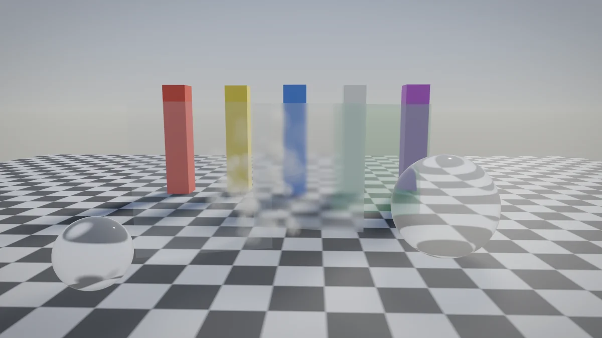

A surface below full opacity is glass. Its colour shows by its opacity, and the rest
lets through what's behind it. Roughness frosts it, blurring what's seen through, and
`Ior` bends it. Leave `Ior` at 1 for a thin pane, which hardly bends light, and use
about 1.5 for solid glass such as a marble or a bottle.

```csharp
var window = new Surface { Color = new Vector3(0.75f, 0.85f, 0.95f), Roughness = 0.05f, Opacity = 0.12f };
var frosted = new Surface { Color = new Vector3(0.9f), Roughness = 0.45f, Opacity = 0.2f };
var marble = new Surface { Color = new Vector3(0.95f), Roughness = 0.02f, Opacity = 0.08f, Ior = 1.5f };
```

A cooked model's material is glass with `"transparent": true` and an `opacity`, and
bends with `"ior": 1.5` in its [material rule](#models).

Glass and particles are drawn together, furthest first, so a pane in front of dust
covers it and dust in front of a pane covers that. Glass sees the scene through a copy
of the picture, made again before a pane that something drawn since overlaps, at most
four times a frame. Past that, overlapping glass still blends but doesn't bend or
frost. What's behind is bent once, at the near side, and followed half a metre at
most, so solid glass looks right but isn't exact. Glass casts a lighter shadow, by how
much light it lets through, and even clear glass keeps a quarter of its shadow, as
bent light spreads. Glass reflects [reflection probes](#reflections) where they cover it and the sky elsewhere, but not what's on screen.
The `Glass` example shows each kind, and `--flat` draws it all without bending or
frosting.

## Skin and wax

Light goes a little way into skin, wax, jade and marble before it comes back out, so
shadow edges on them are soft and warm instead of sharp and grey. A `Subsurface` on the
material turns this on:

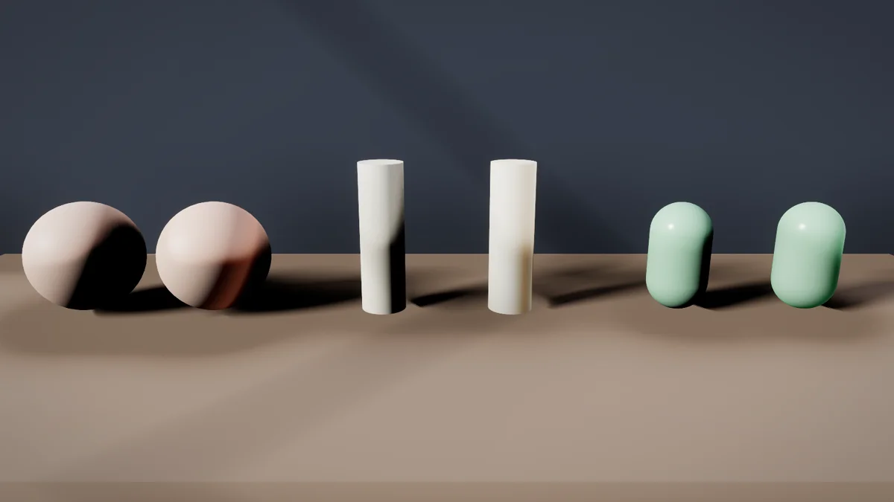

```csharp
var skin = new Surface
{
    Color = new Vector3(0.85f, 0.6f, 0.48f),
    Subsurface = new Subsurface
    {
        Radius = 0.012f,                     // metres
        Color = new Vector3(1f, 0.4f, 0.25f), // red travels furthest
        Transmission = 0.3f,                 // light from behind through thin parts
    },
};
```

`Radius` is how far light travels under the surface, in metres: about 0.01 for skin, a
few centimetres for wax. `Color` is how far red, green and blue each go, as fractions of
the radius; leave it out and they all go the same distance. `Transmission`, from 0 to 1,
lets light from behind shine through thin parts such as ears or a candle's rim, tinted by
the colour and by `Color`.

A model sets it per material in its cook settings:

```json
{ "match": "skin", "subsurface": { "radius": 0.01, "color": [1, 0.4, 0.25], "transmission": 0.3 } }
```

Subsurface can't be combined with `clearcoat` or `foliage`. The renderer refuses such a
material and the cook stops with an error naming it. Under water the light isn't spread.
When no material in the world scatters light the blur doesn't run, so it costs nothing.
The [Wax](../examples/Wax) example puts each kind beside a plain twin.

## Ghosts

`view.Ghost` draws a model as a preview, such as a building the player is about to
place: green where it fits and red where it doesn't.

```csharp
var fits = new Vector3(0.2f, 1f, 0.3f);
var blocked = new Vector3(1f, 0.15f, 0.1f);
view.Ghost(PreviewKey, cabin, Matrix4x4.CreateTranslation(cursor), canPlace ? fits : blocked, opacity: 0.6f);
```

A ghost leaves out the model's own colours, textures and tint, and is one matte colour
that glows a little, so it reads the same over a dark model or a light one, in sun or
in shadow. Its shape still shows through the light. The colour is linear, from 0 to 1.
Opacity is 1 by default, and below 1 the world shows through, as with glass. It must be
more than 0 and at most 1. A ghost casts no shadow. Pass a
[mesh mask](#showing-some-meshes-of-a-model) before the colour to preview only some of a
model's meshes, such as a unit in the look it will have.

## Built-in shapes

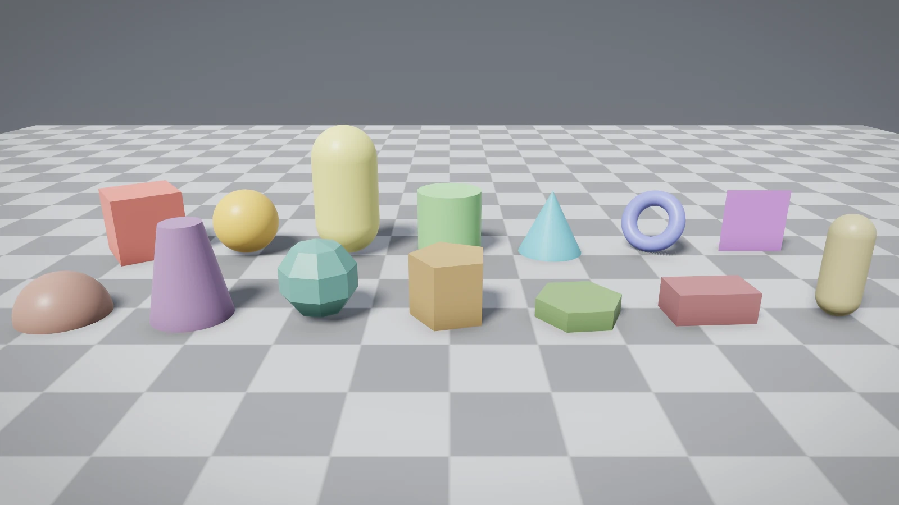

Every game has eight ready shapes that need no file and no loading, handy for trying out
an idea: a capsule as the player, spheres as resources, cylinders as trees. Each is one
unit wide and centred on zero, and comes out light grey unless the draw gives a colour.

```csharp
view.Model(1, ModelRef.Capsule, Matrix4x4.CreateTranslation(player.Position + Vector3.UnitY), playerColor);
```

| Shape | Size |
| --- | --- |
| `ModelRef.Cube` | 1 × 1 × 1 |
| `ModelRef.Sphere` | 1 across |
| `ModelRef.Capsule` | 1 wide, 2 tall, standing up |
| `ModelRef.Cylinder` | 1 wide, 1 tall, standing up |
| `ModelRef.Cone` | 1 wide at the base, 1 tall, pointing up |
| `ModelRef.Plane` | 1 × 1, lying flat and facing up. One-sided |
| `ModelRef.Quad` | 1 × 1, standing up and facing along +z. One-sided |
| `ModelRef.Torus` | 1 across, with a tube 0.25 thick, lying flat |

They can't be unloaded, and `content.IsReady` is always true for them.

For other sizes, more or fewer segments, or a surface of their own, `Shapes` builds the
same shapes and more as a `GeneratedMesh` to hand to `content.Mesh`:

```csharp
ModelRef pillar = content.Mesh(Shapes.Cylinder(topRadius: 0.3f, bottomRadius: 0.4f, height: 3f));
ModelRef tile = content.Mesh(Shapes.Hex(radius: 1f, height: 0.2f, new Surface { Color = grass }));
ModelRef rock = content.Mesh(Shapes.Flat(Shapes.Sphere(0.5f, segments: 7, rings: 5)));
ModelRef floor = content.Mesh(Shapes.Plane(new Vector2(20f, 20f), surface: tiles, uvPerMetre: 0.5f));
```

| Call | Makes |
| --- | --- |
| `Shapes.Box(size)` | A box of that width, height and depth |
| `Shapes.Sphere(radius, segments, rings)` | A sphere. Segments go round the middle, rings from pole to pole |
| `Shapes.Hemisphere(radius, segments, rings)` | The top half of a sphere, closed underneath, with its base at zero |
| `Shapes.Capsule(radius, height, segments, rings)` | A capsule. The height is end to end, at least twice the radius; rings are per end |
| `Shapes.Cylinder(topRadius, bottomRadius, height, segments)` | A cylinder closed at both ends. A top radius of 0 is a cone |
| `Shapes.Cone(radius, height, segments)` | A cone standing on its base |
| `Shapes.Plane(size, subdivisions)` | A one-sided square on x and z, facing up, split into squares |
| `Shapes.Quad(size)` | A one-sided rectangle on x and y, facing along +z |
| `Shapes.Torus(radius, tube, segments, sides)` | A ring lying flat. The radius is to the middle of the tube, which must be thinner |
| `Shapes.Prism(sides, radius, height)` | A column with that many flat sides. The radius is to a corner |
| `Shapes.Hex(radius, height)` | A six-sided tile with corners along x, for hex maps |
| `Shapes.Flat(mesh)` | Any mesh with hard edges: each triangle lit as one flat face, for a low-poly look |

Every shape is centred on zero apart from the hemisphere, faces outwards, and has normals,
tangents and UVs, so normal maps work on it. Curved shapes are smooth, while the box,
prism and hex have sharp edges. Every call also takes a `Surface`, which defaults to matte
grey. UVs stretch once across each part, such as each face of a box or the side of a
cylinder, unless `uvPerMetre` is given; then they count metres, so a tiled texture is the
same size on every shape whatever its size. Round shapes measure round their widest point.
A surface from `content.Surface` (a material graph) tiles at its graph's width when
`uvPerMetre` is not given, and `uvPerMetre` wins when it is. Ribbons, tubes and extrusions
follow the same rule. A `uvPerMetre` or `TileWidth` must be a finite number above zero, or
the shape throws an `ArgumentOutOfRangeException` naming it.

Every shape also has a second UV set for lighting, like a cooked model's. Each part of the
shape, such as a face of a box, the side of a cylinder or one of its ends, gets its own
island in 0 to 1, laid out by the part's own rows and columns and sized by its size in
metres, so every part gets about the same texels per metre. Islands have two empty texels
between them at 512. Ribbons, tubes and extrusions get one the same way, and `Shapes.Flat`
keeps the set of the mesh it's given.

## Meshes made by code

A mesh built in code, such as ground from a height function, is handed over with
`content.Mesh`. Its `Surface` says how it looks: a colour, roughness and metalness,
optional colour, normal and surface textures, opacity and IOR for [glass](#glass), and
optionally a surface shader with its own parameters and textures.

```csharp
var mesh = new GeneratedMesh(vertices, indices, new Surface
{
    Color = new Vector3(0.8f, 0.3f, 0.2f),
    Roughness = 0.6f,
});

ModelRef rock = content.Mesh(mesh);
```

A mesh you build yourself has no second UV set for lighting unless you set each vertex's
`Uv2`. `mesh.WithLightmapUvs()` gives it one: it returns the mesh itself when its `Uv2`
already fits a lightmap by the same rules as a cooked model's (inside 0 to 1, no overlaps,
two empty texels at 512 between islands, and texel density within four times from island
to island), and otherwise a copy unwrapped into islands, with vertices split where islands
meet. Your own set is checked at 512 only, so one laid out for a 1024 page, whose gutters
are one texel at 512, is replaced. A mesh with so many pieces that its islands don't fit a
512 page is laid on 1024, then 2048, and `WithLightmapUvs` throws an
`InvalidOperationException` if they don't fit that either. Shapes, ribbons, tubes,
extrusions and terrain chunks already have one; a bent mesh keeps the one it had.
A mesh that will be [drawn static](views.md#static-draws) is handed over with
`content.Mesh(mesh, isStatic: true)`, which calls `WithLightmapUvs` for you before uploading
it. See [Code meshes drawn static](content.md#code-meshes-drawn-static).

Textures come from a cooked image (PNG, JPEG or TGA), or from pixels you made. Whether a
cooked one is a normal map or linear data is a cook setting, set by a
[`cook.json` rule](content.md#rules-and-sidecars) such as
`{ "match": "**/*-normal.*", "texture": { "normalMap": true } }`, so code names only the file:

```csharp
TextureRef bark = content.Texture("textures/bark.png");
TextureRef bump = content.Texture("textures/bark-normal.png");
TextureRef noise = content.Texture(new GeneratedTexture(256, rgbaPixels), TextureKind.Linear);
TextureArrayRef ground = content.TextureArray(sand, grass, rock, snow);
```

A cooked normal map is BC5, which keeps only red and green, so its blue reads as 0. The
renderer's own shaders rebuild the third axis from the other two, and a
[surface shader](#surface-shaders) that reads a normal map must too, with `normalFrom`.
A texture made from your own pixels, a `GeneratedTexture`, stays RGBA8 with all four
channels.

The layers of a texture array must match in size, in colour or linear, and in format:
cooked colour or linear textures are BC7, cooked normal maps BC5, material heights BC4, and
textures cooked with `compressTextures` off or made from a `GeneratedTexture` are RGBA8. So
a `GeneratedTexture` can't share an array with cooked layers unless they're cooked
uncompressed. Otherwise the array fails to load with an error that gives the index of the
first layer that differs, such as `Layer 2 is 512x512 Linear Rgba8 with 10 mips, but layer
0 is 512x512 Linear Bc5 with 10 mips.`

A mesh or texture you're done with is let go with `content.Unload`, which frees it after
the frames in flight. `content.IsReady(model)` says whether a mesh is on the GPU yet, so a
game can skip one still loading instead of waiting. A texture is freed after every mesh
that names it; a texture array keeps its own copy of each layer, so the single layers can
go as soon as the array is made.

## Height and detail maps

A height map sinks the low parts of a flat surface, such as the mortar between bricks or
the joints of a street, so they move with the view as deep ones would instead of looking
painted on. It's a linear texture where white is the top and black is `HeightDepth`
metres down. Pair it with the normal map of the same height, which shades the grooves.

A detail map adds grain finer than a surface's own textures, such as grit on stone or the
weave of cloth, without a bigger texture. `DetailColorTexture` is linear and multiplies
the colour, with mid grey (128) leaving it as it is, so a detail colour around mid grey
keeps the surface's own colour on average. `DetailNormalTexture` is a normal map laid
over the surface's own normal. Both repeat `DetailScale` times (8 if left out) for each
time the surface's textures repeat. With `DetailMask`, the surface texture's blue
channel says how strongly the detail shows, from none at 0 to full at 1.

```csharp
TextureRef height = content.Texture("textures/bricks-height.png");
TextureRef grit = content.Texture("textures/grit.png");
TextureRef gritNormal = content.Texture("textures/grit-normal.png");

ModelRef wall = content.Mesh(Shapes.Box(new Vector3(16f, 3f, 0.4f), new Surface
{
    ColorTexture = bricks,
    NormalTexture = bricksNormal,
    HeightTexture = height,
    HeightDepth = 0.025f,
    DetailColorTexture = grit,
    DetailNormalTexture = gritNormal,
    DetailScale = 6f,
}, uvPerMetre: 1f / 0.9f));
```

A cooked model takes the same textures and values in its sidecar, as `height`,
`heightDepth`, `detailColor`, `detailNormal`, `detailScale` and `detailMask` on a material
rule. These textures are cooked as linear data, and `detailNormal` as a normal map.
`detailScale` is 8 unless given, or, with a [`detailGraph`](#a-material-graph-on-a-model),
the main graph's width over the detail graph's. A graph material gets its height map from
its graph.

The depth shows up close: it fades out between 15 and 25 metres from the camera, where
the normal map alone looks the same and costs less. Keep `HeightDepth` to a few
centimetres. Deeper looks stretched at low angles, because the surface's edge and its
shadows stay flat. Transparent surfaces ignore height and detail maps. The [Bricks
example](../examples/Bricks) shows a wall and a street; P turns the height maps off and D the detail.

## Meshes along a spline

`Shapes` can also build meshes that follow a [spline](splines.md), such as a road, a
river, a rail or a cable:

```csharp
Vector2[] bank = [new(3.8f, -1.6f), new(3f, 0f), new(-3f, 0f), new(-3.8f, -1.6f)];
ModelRef road = content.Mesh(Shapes.Extrude(path, bank, step: 1f, surface: tarmac));
ModelRef river = content.Mesh(Shapes.Ribbon(path, width: 6f, surface: water));
ModelRef rail = content.Mesh(Shapes.Tube(path, radius: 0.05f, sides: 8));
ModelRef deck = content.Mesh(Shapes.Bend(Shapes.Plane(new Vector2(4f, 20f), subdivisions: 40), path));
```

| Call | Makes |
| --- | --- |
| `Shapes.Extrude(spline, outline, closedOutline, smooth, step)` | Sweeps an outline along the spline |
| `Shapes.Ribbon(spline, width, step)` | A flat strip facing up, centred on the spline |
| `Shapes.Tube(spline, radius, sides, step)` | A round pipe with smooth sides |
| `Shapes.Bend(mesh, spline)` | Bends a generated mesh so its +z runs along the spline |

The outline is in metres, seen looking along the spline from its start: x to the right
and y up. Each edge faces to the right of the way it runs. So an outline that goes
anticlockwise faces outwards, and a flat road listed from right to left faces up.
`closedOutline` joins the last point back to the first. Edges are sharp across the
outline unless it's `smooth`, as for a pipe. The ends are left open. A ring of vertices
goes every `step` metres. UVs are in metres: u runs across the outline and v runs along
the spline, scaled by `uvPerMetre`, which is 1 unless the surface has a `TileWidth`.

`Bend` measures along the spline from the back of the mesh (its lowest z). Each vertex
keeps its x and y across the spline, so the mesh keeps its length. Past the end of an
open spline the mesh carries on straight. Only vertices move, so give the mesh plenty of
them along z, such as a `Shapes.Plane` with many subdivisions. The bent mesh keeps the
lighting UV set of the mesh you gave it, which stretches with the bend; after a tight
bend, call `WithLightmapUvs` on the result to get a fresh one.

An outline folds over itself where the spline turns tighter than the outline is wide.
Keep half the width narrower than the tightest turn. Only generated meshes can be bent;
a loaded model can't be.

## Terrain

`Super.Terrain.Heightfield` builds chunk meshes from a height function on a shared grid,
so neighbouring chunks meet exactly:

```csharp
var field = new Heightfield((x, z) => Noise.Hills(x, z) * 30f, spacing: 1f);

var ground = content.Mesh(field.Chunk(chunk.X, chunk.Z, quads: 32, new Surface
{
    Shader = content.Shader("terrain"),
    Parameters = [new Vector4(snowHeight, snowFade, rockSteepness, rockFade)],
    ShaderTextures = [splat],
    ShaderArrays = [groundColors, groundNormals],
}, uvPerMetre: 0.125f));
```

`field.Height(x, z)` and `field.Normal(x, z)` answer gameplay questions about the same
ground. Each chunk's second UV set, for lighting, is its vertices' places on the chunk's
grid, from (0, 0) at its first corner to (1, 1) at the far one. The
[Terrain example](../examples/Terrain) loads chunks around the camera and unloads the ones
left behind.

## Surface shaders

A surface shader is your own fragment shader for the G-buffer pass. It decides what a
surface is made of (colour, metalness, roughness, normal, glow), and Rendition's
lighting, shadows, reflections and post-processing treat the result like any other
surface.

```glsl
// Shaders/pulse.frag
#version 460
#extension GL_GOOGLE_include_directive : require
#include "surface.glsl"

void main() {
    Surface surface = materialSurface();
    surface.emissive += materials[draw.material].shaderParameters[0].rgb * sin(frame.time);
    writeSurface(surface);
}
```

`materialSurface()` gives the surface the material's textures and values describe, so a
shader only changes what it cares about. A shader can also read `inUv`, `inPosition`,
`inNormal`, `inTangent` and `frame`.

| From the `Surface` | In the shader |
| --- | --- |
| `Parameters`, up to 8 `Vector4` | `materials[draw.material].shaderParameters[i]` |
| `ShaderTextures`, up to 4 | `shaderTexture(slot, uv)` |
| `ShaderArrays`, up to 4 | `shaderLayer(slot, uv, layer)`, where a fractional layer blends two |

A shader that moves its UVs can still use the material: `materialUv()` is `inUv` moved by
the material's height map, and `materialSurface(uv)` reads the material at any UV.
`parallaxUv(slot, uv, depth)` does the same depth trick with a shader texture as the height
map, and `blendNormals(base, detail)` lays one tangent-space normal over another.

A cooked normal map read with `shaderTexture` or `shaderLayer` holds only red and green;
its blue is 0, because it's stored as BC5. Turn a texel into a tangent-space normal with
`normalFrom(texel)`, which rebuilds the third axis, rather than `texel.xyz * 2.0 - 1.0`,
which gives normals pointing into the surface and leaves it dark. The Archer clearing does
this:

```glsl
bump += normalFrom(shaderLayer(1, inUv, float(i))) * weights[i];
```

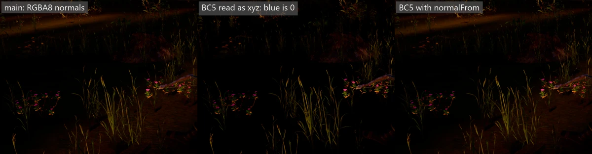

Unset slots read white. To compile shaders, put them in a `Shaders` folder in your game
project and import the targets file, which runs `glslc` from the Vulkan SDK:

```xml
<Import Project="..\..\src\Shaders.targets" />
```

Then name the shader by its file name:

```csharp
var surface = new Surface
{
    Shader = content.Shader("pulse"),
    Parameters = [new Vector4(1f, 0.4f, 0.1f, 0f)],
};
```

`examples/Terrain/Shaders/terrain.frag` blends four ground layers by height, slope and a
splat texture. More detail is in [design.md](design.md#custom-shaders).

## Using Rendition alone

Rendition knows nothing of Super and can be used directly, with your own loop and
window. Its [README](../src/Rendition/README.md) covers the API and the sample, and [design.md](design.md#rendition-design) explains the frame structure.

## Moving lights

A light that moves can't be baked, since the bake would hold it where it stood. Rendition
watches every Mixed or Baked light and keeps one that moves out of the bake until it holds
still. A light counts as moving from the frame its bake hash first differs from the last
frame's, so a torch that sways, a lamp on a cart or a sun that turns with the clock all
count. A light that stands still never changes its hash, so it stays in.

A moving light returns to the bake once a full second of game time has passed since it last
changed. If it moves again before then, the second starts over. A light seen for the first
time, or back after a frame it was missing from, is a new light and not a moving one.

Each light is logged once, the first time it moves, with a line such as "The point light 7 is
moving, so it is kept out of the bake and lit live. It returns to the bake once it holds still
for 1 second." Lights are told apart by their `Key`, so give each light its own: two lights
that share a key look like one light that jumps every frame, so both are kept out. The log
says which key they share, unless that key was already logged as moving. A sun is told apart
by its place in the frame's list of suns. If the game clock goes back, as it does after a
restart, every light is treated as new.

Lights are only watched on frames that name a [baked area](#baked-lighting). A light that
moves while no frame names one isn't seen to move.
