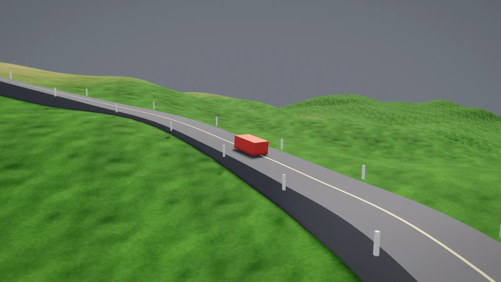

# Splines

A **spline** is a smooth path through space: a camera rail, a road, a river, a fence, a
patrol route or a rollercoaster. You can ask where a spline is, which way it faces and
how far along it something is. You can move things along it at a steady speed, and
build meshes that follow it.



```csharp
var path = Spline.Through([
    new Vector3(0f, 0f, 0f),
    new Vector3(10f, 0f, 4f),
    new Vector3(20f, 2f, 0f),
    new Vector3(30f, 2f, 8f),
]);

Vector3 middle = path.PointAtDistance(path.Length / 2f);
SplinePose pose = path.FrameAtDistance(12f);   // a position and a rotation
```

The [Terrain example](../examples/Terrain) builds its road, posts and cart from one
spline. Press F there for a flyover camera that rides a second spline.

## Making a spline

`Spline.Through(points)` draws a smooth curve through every point. It is a centripetal
Catmull-Rom spline, so it stays close to its points: it doesn't overshoot sharp turns
or tie itself in loops. Give it at least two points.

`Spline.Bezier(knots)` is the kind in a drawing program. Each `SplineKnot` is a point
with two handles, `In` and `Out`. Each handle is an offset from the point. The curve
arrives from the way `In` points and leaves the way `Out` points, and a longer handle
pulls harder. `SplineKnot.Smooth(position, tangent)` makes a knot whose two handles are
opposite, so the curve passes through the point without a corner.

```csharp
var arch = Spline.Bezier([
    new SplineKnot(new Vector3(0f, 0f, 0f), Out: new Vector3(0f, 4f, 0f)),
    new SplineKnot(new Vector3(10f, 0f, 0f), In: new Vector3(0f, 4f, 0f)),
]);
```

Pass `closed: true` to join the last point back to the first, as for a race track or a
patrol loop. A closed spline needs at least three points.

## Asking where

There are two ways to say where on a spline you are:

- **t** runs from 0 at the start to 1 at the end. Each piece between two points takes
  an equal share of t, however long it is, so t doesn't move at an even speed.
- **Distance** is in metres along the spline, so equal steps are an equal distance
  apart. Use it for anything that moves or is spaced out.

| Call | Gives |
| --- | --- |
| `Position(t)` | The point at t |
| `Tangent(t)` | The way the spline heads at t, one unit long |
| `Frame(t)` | A `SplinePose`: the point at t and which way it faces |
| `PointAtDistance(metres)`, `FrameAtDistance(metres)` | The same, a distance along |
| `DistanceAt(t)`, `TAt(metres)` | Turns t into a distance and back |
| `Length` | The whole length in metres |
| `Nearest(point)` | A `SplineHit`: the nearest place on the spline, with its `T`, `Distance`, `Position` and `Gap` to the point |
| `Scatter(spacing, start)` | A pose every `spacing` metres, for posts, lamps or trees |

A distance past the end stops at the end on an open spline, and goes round again on a
closed one. `Scatter` on a closed spline changes the spacing a little so the last pose
meets the first evenly.

`Nearest` answers "how far along the track is the player?" and "how far is the player
from the road?". It checks every stored sample (16 per piece) and then narrows down, so
it costs more on a long spline. A few calls per tick are fine.

A `SplinePose` has a `Position` and a `Rotation`. It also has `Forward` (along the
spline), `Up` and `Right` (to the right when looking forward), and a `Matrix` for
drawing. A model that faces +z faces along the spline when drawn with it. In the ECS,
`Transform.From(pose)` makes a `Transform`.

## Which way is up

A pose needs an up as well as a forward. `SplineUp` picks how it is chosen:

| Up | What it does | Use it for |
| --- | --- | --- |
| `World` (the default) | Up leans towards the sky (+y), so nothing tilts sideways | Roads, rails, rivers and patrols |
| `Minimal` | Up turns as little as it can along the spline, so it never flips | Loops, corkscrews, tunnels and flight paths |

`World` has no sky to lean towards where the spline goes straight up or down, so use
`Minimal` for a loop-the-loop. A closed `Minimal` spline might end with up twisted from
where it started. That twist is spread evenly round the spline, so the join has no snap.

Roll tips the top to the right, in radians. A spline through points takes one roll for
each point, as `Spline.Through(points, roll: [...])`. A Bézier knot has its own `Roll`.
Roll is added on top of either kind of up, so a road can bank into a corner.

```csharp
var coaster = Spline.Through(track, closed: true, roll: banking, up: SplineUp.Minimal);
```

## Moving along a spline

`SplineFollower` moves something along a spline at a steady speed in metres per second,
such as a cart on a rail or a guard on a patrol. It is a struct that you keep in your
state and move in `Update`, so a seed replays the same. It always faces the way it is
going.

```csharp
// In Load:
_cart = new SplineFollower(path, speed: 14f, SplineLoop.Loop);

// In Update:
_cart.Update(time);

// In Draw:
view.Model(1, cartModel, _cart.Smooth(view.Blend).Matrix);
```

| `SplineLoop` | At the end |
| --- | --- |
| `Once` | Stops. `Completed` turns true |
| `Loop` | Goes round again. On an open spline it jumps back to the start |
| `PingPong` | Turns round and comes back. `Backwards` is true on the way back |

A negative `Speed` goes the other way, and you can change `Speed` at any time.
`Distance`, `Pose` and `Position` say where the follower is now. `Smooth(view.Blend)`
gives the pose between the last tick and this one, for smooth drawing. `Update` follows
`GameTime.Scale`, so slow motion slows it too.

## Camera rails

`Shot.Along(seconds, rail)` rides a cutscene camera from the start of a spline to its
end. It eases on distance, so the speed stays even however the points are spaced.
Without a subject the camera looks ahead along the rail. With one, it watches the subject:

```csharp
director.Play(new Cutscene().Then(Shot.Along(8f, rail, () => cart.Position, look: new Vector3(0f, 1f, 0f))));
```

See [Cutscenes](cutscenes.md).

## Meshes along a spline

`Shapes.Extrude`, `Shapes.Ribbon` and `Shapes.Tube` sweep a shape along a spline, as a
road, a river or a rail. `Shapes.Bend` bends a mesh you already have to follow a spline.
See [Meshes made by code](rendering.md#meshes-along-a-spline).

## Splines in content

A `Spline` field in a [JSON content](content.md) record is written as points or knots.
A point is a list of three numbers:

```json
{ "id": "harbour", "path": { "points": [[0, 0, 0], [12, 0, 4], [20, 1, 0]], "closed": true } }
```

```json
{
  "id": "loop",
  "path": {
    "knots": [
      { "position": [0, 0, 0], "out": [4, 0, 0] },
      { "position": [10, 6, 0], "in": [0, -3, 0], "out": [0, 3, 0], "roll": 0.5 }
    ],
    "up": "minimal"
  }
}
```

`closed`, `roll` (one per point) and `up` are optional. A spline with both points and
knots is a mistake, and so is a spline with neither. Mistakes are reported when the
content loads, with the file, and with the line too for a point that isn't three numbers.

## Limits

- An outline swept along a spline folds over itself where the spline turns tighter than
  the outline is wide. Keep half the width of a road narrower than its tightest turn.
- Only generated meshes can be bent. A loaded model can't be.
- Splines can't be drawn as lines for debugging yet.
- Moving a point means building a new spline. That measures it again, which is cheap but
  allocates, so don't do it every tick.
