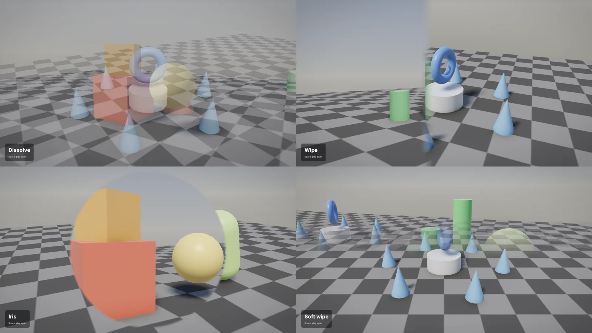

# Transitions

A transition covers a change of camera: a fade to black while the player goes through a
door, a dissolve between two shots of a cutscene, or a wipe that slides one view off the
screen. The same `Transition` works in play and in [cutscenes](cutscenes.md).



The [Transitions example](../examples/Transitions) shows every one. It opens with a
showreel, then the number keys move between stations with each transition.

```
dotnet run -c Release --project examples/Transitions
```

## The transitions

| Transition | What it does |
| --- | --- |
| `Transition.Cut` | Jumps to the new camera. This is what happens with no transition |
| `Transition.Blend(seconds, easing)` | Moves the camera from where it was to where it's going: its position, target and field of view. Eases `InOut` by default |
| `Transition.Fade(seconds, color)` | Fades out to a colour and back in. The change happens halfway, while the screen is all colour. Black by default |
| `Transition.Dissolve(seconds, easing)` | Fades the old picture out over the new one. `Linear` by default |
| `Transition.Wipe(seconds, direction, softness, easing)` | Slides an edge across the screen, showing the new picture behind it. `WipeDirection.Right` moves the edge from left to right |
| `Transition.Iris(seconds, center, softness, easing)` | Opens a circle on the new picture, from a point on the screen. The middle of the screen by default |

Seconds must be more than zero. Softness is how wide the edge of a wipe or iris is, as a
share of the way the edge travels: 0 is a hard edge, 0.05 a little blur, 0.3 a long
blend. An iris's centre has x and y from 0 to 1, with 0, 0 at the top left. It opens
until it covers the furthest corner, whatever the screen's shape.

Dissolve, wipe and iris need the old picture. They keep the last frame from before the
change and show it still while the new shot plays, so anything moving in the old shot
stops. Most films do the same over a short dissolve, but keep them under a second or two.

The [interface](interfaces.md) is drawn on top and isn't part of a transition, so
captions and menus stay sharp through it.

## In play

Ask for the `Transitions` service in your game's constructor, then play one and put the
change in `atCut`:

```csharp
public sealed class MyGame(Transitions transitions, Input input) : IGame
{
    private Room _room = Room.Hall;

    public void Update(GameTime time)
    {
        if (input.Pressed(Key.E) && !transitions.IsPlaying)
        {
            transitions.Play(Transition.Fade(0.8f), () => _room = Room.Cellar);
        }
    }
}
```

A fade runs `atCut` halfway, at the start of the tick when the screen is all colour, so
the player never sees the jump. The other transitions run it straight away: the old
picture is already kept, and the camera `Draw` sets next is the new one. A blend moves
from the camera last shown to whatever `Draw` sets, every frame, so it follows a moving
target.

| Member | What it does |
| --- | --- |
| `Play(transition, atCut)` | Starts a transition, ending any that's playing |
| `Stop()` | Ends it now. A fade that hasn't reached its change yet runs `atCut` first |
| `IsPlaying` | Whether a transition is on screen |
| `Playing` | The transition on screen, or none |

Transitions count real ticks, so [slow motion](cutscenes.md#slow-motion) doesn't
stretch them.

## In cutscenes

`Then(shot, transition)` goes into a shot with a transition, and `End(transition)` leaves
the cutscene with one:

```csharp
director.Play(new Cutscene()
    .Then(Shot.Hold(4f, wide), Transition.Fade(1f))        // fades in from black
    .Then(Shot.Orbit(5f, () => hero.Position, 6f, 2f, 0f, 1f), Transition.Dissolve(0.8f))
    .Then(Shot.Hold(3f, close), Transition.Wipe(0.6f, WipeDirection.Left))
    .End(Transition.Fade(1f)));                            // fades out to black
```

A fade between two shots is centred on the change: it starts half its length before the
next shot and ends half its length into it, so the cutscene keeps its length. A fade on
the first shot starts all colour and fades in. The others start at the change, and run
over the first part of the next shot.

`End` with a fade starts half its length before the cutscene ends, so the last shot fades
out to the colour, then the game's own camera fades in. Any other transition plays as the
cutscene ends, from its last frame into the game, and only when it runs to its end:
`Director.Stop` skips it.

A cutscene checks that its transitions fit: a fade's first half must fit in the shot
before it, and the rest of any transition must fit in its own shot. `End` comes after
every shot.

## Limits

- Dissolve, wipe and iris show the old shot as a still picture.
- If the window changes size during a dissolve, wipe or iris, the old picture turns
  black for the rest of it.
- There's one transition at a time. Starting another ends the first.
- There are no custom transition shaders, push or slide moves, or transitions that blur.
