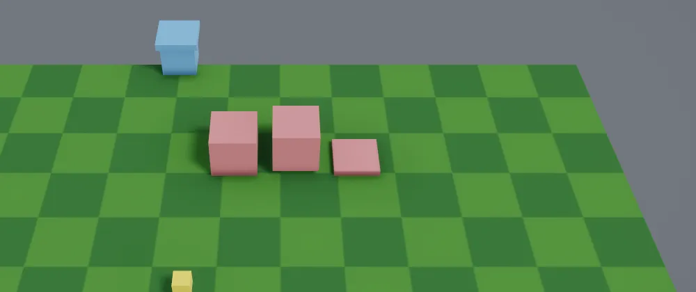

# Tweens and curves

A **tween** moves one value from a start to an end over some seconds, such as a height,
a colour or a rotation. An **easing** or a **curve** shapes how it gets there. Tweens
are plain structs that you keep in your state and update each tick, so they play the
same way on every run of a seed.



```csharp
var drop = Tween.Between(5f, 0f, seconds: 0.6f, Easing.BounceOut);

// In Update:
drop.Update(time);
crate.Position = crate.Position with { Y = drop.Value };
```

## Easings

`Easing` names a shape, and `Ease.Apply(easing, amount)` gives how far along a move is
for an amount of its time from 0 to 1. Time outside 0 to 1 is held at the ends.

| Easing | How it moves |
| --- | --- |
| `Linear` | The same speed all the way |
| `In`, `Out`, `InOut` | Cubic: starts slow, slows to a stop, or both |
| `Sine…`, `Quad…`, `Quart…`, `Quint…`, `Expo…`, `Circ…` | The same idea, from gentle (`Sine`) to strong (`Expo`) |
| `BackIn`, `BackOut`, `BackInOut` | Pulls back a little before going, or goes a little past and settles |
| `ElasticIn`, `ElasticOut`, `ElasticInOut` | Springs and wobbles |
| `BounceIn`, `BounceOut`, `BounceInOut` | Lands and bounces like a dropped ball |

Each family comes as `In`, `Out` and `InOut`, for example `QuadIn`, `QuadOut` and
`QuadInOut`. They are the usual Penner curves. `Back` and `Elastic` go past 0 and 1 on
the way, so a tween using them overshoots its end before it settles.

## Curves

When no easing has the shape you want, draw one. A `Curve` is a list of keys, each a
time and a value, joined smoothly:

```csharp
var rise = new Curve(
    new CurveKey(0f, 0f),
    new CurveKey(0.6f, 1.15f),
    new CurveKey(0.8f, 0.95f),
    new CurveKey(1f, 1f));

float height = rise.Evaluate(0.7f);   // at a time
float along = rise.Sample(0.5f);      // halfway from the first key to the last
```

Keys must be in order of time. Before the first key and after the last, the curve holds
their values. How a curve leaves and enters each key is its tangent:

| Tangent | What it does |
| --- | --- |
| `Auto` | Smooth. The first and last keys are flat, and the rest point from the key before to the key after |
| `Linear` | Heads straight for the next key, and comes straight from the one before |
| `Constant` | Holds its value until the next key, then jumps |
| `Custom` | Uses the key's own `In` and `Out` slopes, in value per second |

```csharp
new CurveKey(0.5f, 1f, CurveTangent.Custom, In: 2f, Out: 0f)
```

`Curve.From(Easing.BackOut)` makes a curve from an easing, for code that takes either.

### Curves in content

A record can hold a `Curve`, so designers can shape motion in [JSON content](content.md)
and tune it while the game runs. Write either keys or an easing:

```json
// content/motions/rise.json
{
  "id": "rise",
  "seconds": 0.8,
  "curve": {
    "keys": [
      { "time": 0, "value": 0 },
      { "time": 0.6, "value": 1.15 },
      { "time": 0.8, "value": 0.95 },
      { "time": 1, "value": 1 },
    ],
  },
}
```

```json
{ "id": "drop", "seconds": 0.5, "curve": { "easing": "bounceOut" } }
```

```csharp
public record Motion(string Id, float Seconds, Curve Curve);
```

A key also takes `tangent`, `in` and `out`. A curve with keys out of order, both keys and
an easing, or slopes on a key that isn't `custom` is reported like any other content
mistake, with the file's path.

## Tweens

`Tween.Between(from, to, seconds, easing)` makes a tween for a `float`, `Vector2`,
`Vector3`, `Vector4`, `Quaternion` (turned the short way with `Slerp`) or `Color`. The
rest is set by calls that each give a new tween:

| Call | What it does |
| --- | --- |
| `.Ease(easing)` | Shapes it with an easing |
| `.Ease(curve)` | Shapes it with a curve, read from its first key to its last. 0 is `from` and 1 is `to` |
| `.After(seconds)` | Waits this long before it starts |
| `.Loop(times)` | Plays again from the start. `0` means forever |
| `.Yoyo(times)` | Goes there and back. Each way counts as one, and `0` means forever |

```csharp
var pulse = Tween.Between(1f, 1.2f, 0.4f, Easing.SineInOut).Yoyo();
var fadeIn = Tween.Between(Color.White with { A = 0f }, Color.White, 1f).After(0.5f);
```

Each tick, call `Update(time)` to move it on by the tick's game time, so slow motion
slows it too. `Advance(seconds)` moves it by any amount. Then read it:

| Member | What it gives |
| --- | --- |
| `Value` | The value now |
| `Smooth(blend)` | The value between the last tick and this one, for drawing. See [smooth motion](views.md#smooth-motion) |
| `IsPlaying` | True once the delay has passed, until it's done |
| `Completed` | True once it's done. A tween that repeats forever never is |
| `Elapsed`, `Duration` | Seconds so far and in total, counting the delay and every repeat |
| `Restart()` | Goes back to the start |
| `At(seconds)` | The value at any time, without changing it |

A tween is a struct, so store it in a field or a component and update it by `ref`; a
copy moves on its own.

### Sequences and groups

`Tween.Sequence` plays tweens one after another, and its duration is theirs added up.
`Tween.Parallel` plays them all at once and finishes with the longest:

```csharp
var hop = Tween.Sequence(
    Tween.Between(0f, 1f, 0.2f, Easing.QuadOut),
    Tween.Between(1f, 0f, 0.3f, Easing.BounceOut));

var opening = Tween.Parallel(
    Tween.Between(0f, 90f, 0.5f, Easing.BackOut),
    Tween.Between(0f, 1f, 0.3f).After(0.2f));
float angle = opening[0];
float glow = opening[1];
```

A sequence has the same members as a tween. A group gives each tween's value by index,
and `Smooth(index, blend)`. A tween that repeats forever can only be the last step of a
sequence, because the steps after it would never play.

## With the ECS

Put the tween in a component and update it in a query. `examples/Rooms` raises a hut out
of the ground when you press E outside, using the curve in `content/motions/rise.json`:

```csharp
public struct Rising(Tween<float> height)
{
    public Tween<float> Height = height;
}

world.Add(hut, new Rising(Tween.Between(-1.3f, 0.1f, rise.Seconds).Ease(rise.Curve)));

foreach (var row in world.Query<Transform, Rising>())
{
    ref var height = ref row.Second.Height;
    height.Update(time);
    row.First.Position = row.First.Position with { Y = height.Value };
}
```

The component needs a field, not a property, so `ref` reaches the tween itself. When a
tween is `Completed`, remove its component after the query so finished entities aren't
visited. The `Smoothed` component blends the transform between ticks.

## Tweens or `view.Animate`?

A tween is part of the game's state: it replays with the seed, slows with the game and can
end something, such as letting a building work once it's up. `view.Animate` in a
[view](views.md#view-memory) is for looks only, and follows whatever target it's given.
