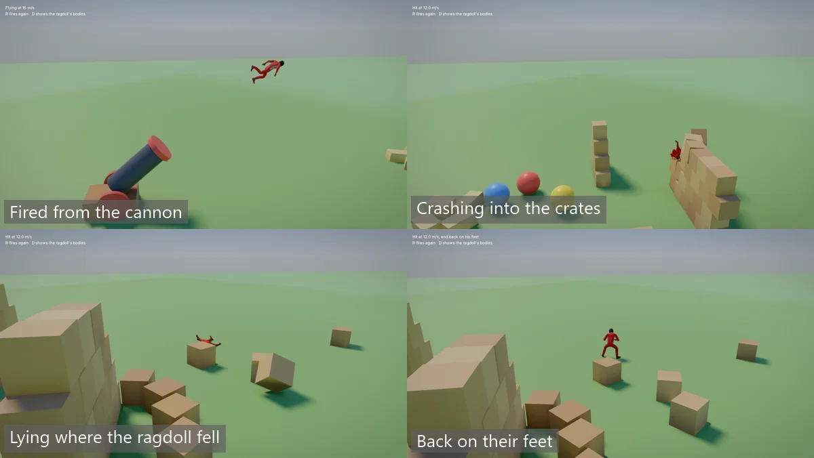

# Cannonball

A human cannonball, to show [ragdolls](../../docs/physics.md#ragdolls). A stuntman is fired
from a cannon, flailing as they fly, and goes limp at the first hard hit. They tumble
through a wall of crates, pyramids, balls and hay bales, and once they lie still they get
up from where they fell, with a get-up clip picked by whether they lie face up or down.
They rally the crowd, and then the cannon fires again. The screen blurs while they fly and
flashes red at the hit.



```
dotnet run -c Release --project examples/Cannonball
```

R loads the cannon again. D draws the ragdoll's bodies over the stuntman as
[debug wireframes](../../docs/debugging.md) in the `bodies` channel, orange while
simulated and blue while animated, faint where the world hides them:


`--debug bodies` starts with them shown, and `--script bodies` presses D.

## Getting the assets

The stuntman and the clips are from Mixamo and aren't in the repository. See
[the shared assets](../../assets/README.md#cannonball) for what to download and where to
save it. The tests need them too, so they carry `[Trait("Needs", "Assets")]`, and CI, which
doesn't have them, leaves them out.

## What it shows

- A `RagdollBody.Humanoid` made from the rig and a `Ragdoll` on the stuntman, `Off`
  while loaded.
- Switching to `Simulated` with some `Strength`, so the flailing clip still waves the
  arms, then `physics.Bodies.SetVelocity` and `SetAngularVelocity` to fire.
- `physics.Contacts` finding the first hit harder than 4 m/s, which drops `Strength` to 0.
- `physics.Ragdolls.IsFaceUp` to pick a get-up clip, played in the same Update as switching to
  `Off`, so the clip is laid over where the body lies.
- `physics.Ragdolls.Shapes` to draw the bodies, with `view.Debug` in a channel that
  `DebugDraw.Toggle` turns on and off.
- A `ScreenEffects` component, in `CrashEffects`, driven every tick: a
  [speed blur](../../docs/rendering.md#screen-effects) that grows with how fast they fly, and on
  the hit a white flash, a red edge and colour fringes, each eased back to 0.
