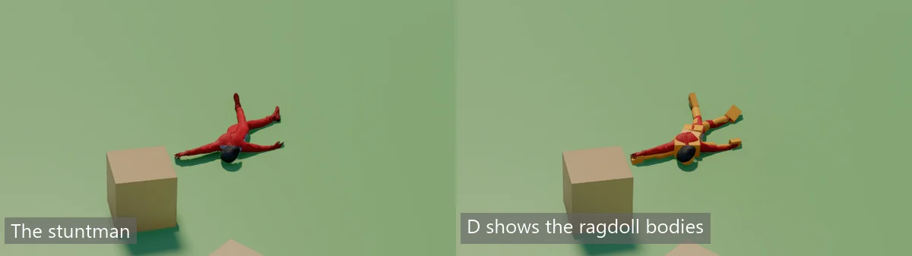

# Cannonball

A human cannonball, to show [ragdolls](../../docs/physics.md#ragdolls). A stuntman is fired
from a cannon, flailing as they fly, and goes limp at the first hard hit. They tumble
through a wall of crates, pyramids, balls and hay bales, and once they lie still they get
up from where they fell, with a get-up clip picked by whether they lie face up or down.
Then the cannon fires again.


```
dotnet run -c Release --project examples/Cannonball
```

R loads the cannon again. D draws the ragdoll's bodies over the stuntman, orange while
simulated:



`--script bodies` presses D, for a screenshot of the bodies.

## Getting the assets

The stuntman and the clips are from Mixamo and aren't in the repository. See
[the shared assets](../../assets/README.md#cannonball) for what to download and where to
save it.

## What it shows

- A `RagdollBody.Humanoid` made from the rig and a `Ragdoll` on the stuntman, `Off`
  while loaded.
- Switching to `Simulated` with some `Strength`, so the flailing clip still waves the
  arms, then `SetVelocity` and `SetAngularVelocity` to fire.
- `physics.Contacts` finding the first hit harder than 4 m/s, which drops `Strength` to 0.
- `physics.IsFaceUp` to pick a get-up clip, played in the same Update as switching to
  `Off`, so the clip is laid over where the body lies.
- `physics.RagdollShapes` to draw the bodies.
