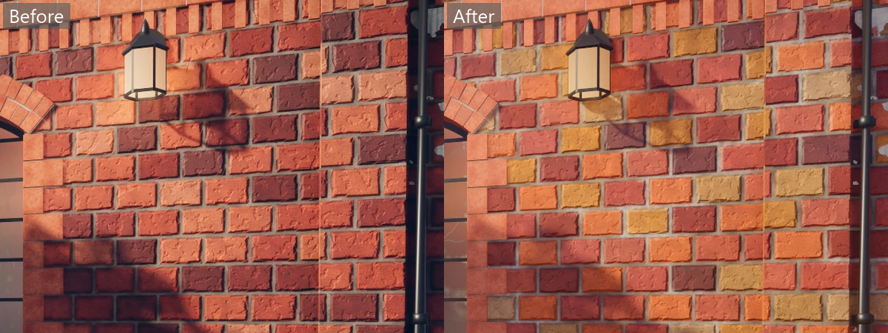
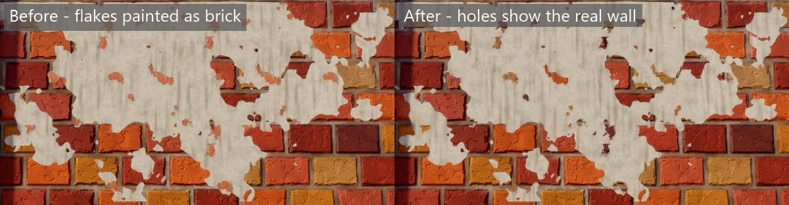
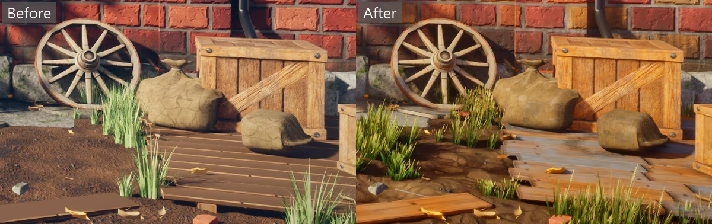
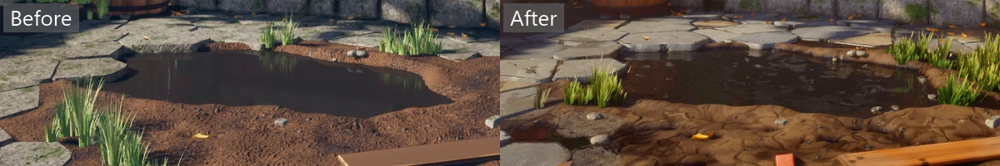

# Courtyard

Materials made in code, on a scene made in Blender. A sunlit courtyard has a brick wall
with a pier and a deep-set arched window, ivy, a peeling patch of whitewash, a glass wall
lantern and a cast-iron drainpipe that runs down past the pier onto a splash stone. Above the
window a string course of one projecting course and a row of dentils runs across the wall
and round the pier, the window's jambs are edged with long and short quoins, and two iron
anchor plates hold the wall in. Along the wall's foot is a plinth of dressed stone blocks of
mixed heights with crisp edges, a few with a chipped corner, and a cart wheel leans against
it. The dry-stone wall is built of split, rough-squared stones in uneven courses with tight
joints: big footing stones low down, now and then a tall jumper that rises through two
courses, through-stones that stick out of the face, and pinning stones in the joints. Each
stone has broken corners, sharp arrises and a face tipped its own way, stands out by its own
amount, and is warm brown, blue-grey or pale, darker along the damp bottom course. It is
capped with slabs set on edge that lean together.


A path of flat flagstones, laid flush with tight joints, forks round a puddle of standing water with
a raised bank. One arm runs out towards the camera through mud marked with a rut and boot
prints with water standing in them, past a barrel, a plank dropped in the mud, scattered
rubble and broken bricks, small curled leaves and grass that grows in patches along the
walls, the path's edges and the joints, to a deck. On the deck are a big crate, a smaller
one, and three slumped grain sacks: one tied at the neck with a ragged ruffle above the
twine, and two with their mouths folded flat. Behind the window is a small room. Out of
frame, up-sun to the left, stands a tree. Its bricks, stone, mud, wood, sacking, whitewash,
rusty hoop iron and window glass are [material graphs](../../docs/materials.md) that are
cooked into textures when the game builds. A fresh breeze from `view.Wind` sways the grass,
and a little of it reaches the ivy and the tree's leaves, and their shadows sway with them.
See [Wind](../../docs/rendering.md#wind).

Up close the wall shows its age. Damp rises above the plinth and fades out in streaks,
dirty water has run down from the sill, and rust has washed down from the anchor plates.
They are [decals](../../docs/views.md#decals) the game projects onto the wall, so the
grime darkens the bricks and the mortar and makes them rougher, and each brick's edges
still show through the wet. Gravel kicked off the path lies in the mud along both arms'
edges and round the barrel's foot, and is laid the same way. `GravelSpills` places it at
random along the path's edges, each with its sharp, thick edge just on the paving and the
rest thinning out over the mud, but never in or by the puddle or out on the middle of the
path.
The rest are placed by hand in `content/decals/courtyard.json`: dark dirt trodden in round
the barrel, the wheel, the crates and the sacks, rust run down the barrel from its hoops,
moss on the plinth, at the foot of the dry-stone wall and in a joint of the path, wet
ground under the drainpipe, by the barrel and on the path, and a trail of four boot prints
that fade as the mud comes off the boot. Each names its material, and the game loads the list with
`content.LoadAll` and lays each one with `content.Surface`, so a list that names a material
that wasn't cooked stops the game as it loads. D turns them all off and on. The mortar sinks in with
parallax, a grit graph laid over the bricks and stones keeps them grainy a step away, and
broad patches of light and dark laid by world position hide where the textures repeat.



Where the whitewash has flaked away, its graph cuts holes in the coat, so the wall's own
bricks and mortar show through instead of a brick pattern painted onto the whitewash.



The lantern, the crates and the wheel are models from Sketchfab, kept in `art/assets`. The
script imports them, places them and puts them in the model with their own textures. They
are used under [CC BY 4.0](http://creativecommons.org/licenses/by/4.0/):

- [Outdoor wall lamps](https://skfb.ly/oxOIo) by rsg3tank. The lantern is one of its four
  lamps, given the window frames' dark metal, the window glass and the glowing bulb.
- [Wooden Crate](https://skfb.ly/oyqQN) by Memorie.
- [Wooden_wheel](https://skfb.ly/6XMBR) by DOMNIN. Its metalness map is left out, since
  it made the grey, weathered wood shine like metal, and the sidecar warms the wood a little.




It's a clear afternoon. The sun is high on the left and a little in front of the wall, still
low enough to rake across the bricks and the plinth, and the tree's canopy breaks it into
dappled light across the wall and the window. `view.Shadows(7f, 3, sunSize: 0.02f, contact: 0.3f)`
sets the sun close to its real size, so the leaves' shade stays crisp though they are 10 m
from the wall, and its contact shadows of 0.3 m seat the stones, the barrel and the sacks on
the ground. Above full HD the sun's shadow maps double to 4096, so their texels don't show
in a large picture. See [Shadows](../../docs/rendering.md#shadows). The sky is a clear one
worked out from the sun with `Turbidity = 2.5f`: blue overhead, paler at the horizon and
bright round the sun's disc, so the shade is cooler than the sunlight. It is at its full
`Brightness = 1f`, so the shade is lit by the whole open sky and the low wall's stones still
read in it, while the sun keeps it a clear step darker than the light, as on a real clear
day. See [The sky](../../docs/rendering.md#the-sky).

The light probes that follow the camera fill the yard, so light bounced off the sunlit brick
and flagstones warms the shade round it. The courtyard needs no box of probes of its own:
with one a metre apart the shot looked the same. See
[Bounced light](../../docs/rendering.md#bounced-light).
Ambient occlusion over 0.8 m at full strength darkens the corners and the foot of each wall.
A reflection probe at head height in the middle of the yard lets the window and the puddle
mirror the wall, the deck and the house rather than only the sky. Water stands 4.5 cm below
the yard's zero with `view.Puddles(-0.045f, band: 0.035f)`, so the hollow dug in the mud
fills, the deepest boot prints hold a little, and the mud darkens for the last 3.5 cm down to
it. A wider band would darken the flagstones round the puddle too. See
[Puddles](../../docs/rendering.md#puddles).



The lantern is a point light at its bulb, left on but dim in daylight, that warms the wall
just round it. It casts no shadows, since the bulb and the lantern round it would hide it. A
point light at the back of the room makes the old glass glow, as if someone is home.

The camera meters the courtyard with auto exposure, and `Exposure = 1.15f` adds a little over
a stop to what it picks, so the shade stays open and the sunlit wall reads bright through
AgX's Punchy look, the default. See [Auto exposure](../../docs/rendering.md#auto-exposure).
The rest of the finish is light: a touch more contrast and saturation, a warm white balance,
a little sharpening, a little bloom round the lamp and a vignette. The lens is a 35 mm
focused on the window, 11 m off, and stopped down to f/8, so the flagstones at your feet
soften a little and the window and the wall stay crisp. See [Focus](../../docs/rendering.md#focus).


```
dotnet run -c Release --project examples/Courtyard
dotnet run -c Release --project examples/Courtyard -- --screenshot shots/courtyard.png --validate --seed 1 --ticks 60 --size 1600x900
```

The model is `content/models/courtyard.glb`, written by `art/courtyard.py` in Blender.
The script builds everything but the three downloaded models from code into its own
scene, called Courtyard, and unwraps the UVs in metres. A material named `cy_graph_*` is only a placeholder. The model's
sidecar, `courtyard.glb.cook.json`, gives it a graph, and the cooker divides its UVs by
the graph's `Width`, so the bricks, stones and planks keep the size their graph gives
them however big the surface is. See [A material graph on a model](../../docs/rendering.md#a-material-graph-on-a-model).
To change the scene, edit the script, run it in Blender and cook again.

The sidecar sets `keepOrigin`, so the model keeps Blender's origin and a point in the script
is the same point in the game, with Blender's z as y and its y as -z. That's how
`CourtyardGame.cs` places its lights at the lantern's bulb and in the room.

Press M to turn the materials off and on. Without them, the whole courtyard is plain grey
clay, so you can judge the sunlight, the shadows and the shapes of the models without the
textures in the way. It flips [`Graphics.Materials`](../../docs/rendering.md#graphics-settings).
The `plain` script presses M for a screenshot:

```
dotnet run -c Release --project examples/Courtyard -- --script plain --screenshot shots/courtyard-plain.png --validate --seed 1 --ticks 60 --size 1600x900
```

Press F to turn the fog off and on. The sky sets a light fog,
`Fog = new FogSettings(Density: 0.004f, Height: -0.1f, Falloff: 0.15f, SunScatter: 0.6f)`, thickest
on the ground, so the far wall and the window sit a touch back in the air behind the near
flagstones. See [Fog](../../docs/rendering.md#fog). It flips
[`Graphics.Fog`](../../docs/rendering.md#graphics-settings), and the `clear` script presses F
for a screenshot in clear air:

```
dotnet run -c Release --project examples/Courtyard -- --script clear --screenshot shots/courtyard-clear.png --validate --seed 1 --ticks 60 --size 1600x900
```

Press V to turn the [volumetric fog](../../docs/rendering.md#volumetric-fog) off and on. On,
the default, the fog near the camera is lit through the sun's shadows. The courtyard's
fog is light, so from the usual camera the difference is slight: the air in the sun is a
touch milkier than in the shade. The lantern is too faint against the daylight to show a
halo. Off, it is the plain height fog.
It flips [`Graphics.VolumetricFog`](../../docs/rendering.md#graphics-settings), and the
`plain-fog` script presses V for a screenshot with the plain fog:

```
dotnet run -c Release --project examples/Courtyard -- --script plain-fog --screenshot shots/courtyard-plain-fog.png --validate --seed 1 --ticks 60 --size 1600x900
```

Press E to turn auto exposure off and on. Off, the finish's `Exposure = 1.15f` is a fixed
exposure instead of compensation on what the camera metered. It flips
[`Graphics.AutoExposure`](../../docs/rendering.md#graphics-settings), and the `fixed` script
presses E for a screenshot at the fixed exposure:

```
dotnet run -c Release --project examples/Courtyard -- --script fixed --screenshot shots/courtyard-fixed.png --validate --seed 1 --ticks 60 --size 1600x900
```

## Baked lighting

The yard is a baked space named `courtyard`, a box 31 m by 10.5 m by 31 m round the whole model with
probes 1.6 m apart. The model never moves, so it is drawn static (`isStatic: true`) and its light is
baked into `content/lighting/courtyard.lightbake`, 6.4 MB at the default 20 texels a metre. The
decals, grass and the rest of the yard's detail stay live.

The lights are all `Mixed`, so the bake adds the light that bounces and soft shade, and the live
lights keep their crisp shadows:

| Light | Mode | Shadows |
| --- | --- | --- |
| The sun | Mixed | Real-time cascades near the camera, and the bake's mask past the last |
| Wall lantern | Mixed | No shadow tiles, and the bake's mask |
| Lamp in the room | Mixed | Real-time, and the bake's mask. Its light reaches the yard through the window glass |

Every light found a mask channel, so the bake lists none without one.

### Rebaking

Bake again after changing the model, a light, the sky or the light modes:

```
dotnet run -c Release --project examples/Courtyard -- --bake
dotnet run -c Release --project examples/Courtyard -- --bake-check
```

The last bake took 7.5 seconds, traced 1,024 samples a texel, found 11.85% of texels invalid and
printed 0 validation messages. The share falls as the density rises, to 7.2% at 40 texels a metre,
but the file then grows to 15.4 MB. `--bake-check` prints `fresh` and exits 0.

## The lineup

`--lineup` shows the graphs one by one instead: a row for each, with a sphere, a cube and
a flat tile 1 m across. Each shape takes its surface from `content.Surface` with no
`uvPerMetre`, so it tiles at the graph's own `Width`. A low sun from the right lets the
bumps in the normal maps catch the light.


```
dotnet run -c Release --project examples/Courtyard -- --lineup
```

## The leaves

`--leaves` shows the graphs that are cut out by their opacity, on the cards the courtyard
will wear them on. Along the back wall each hangs whole and flat: the two ivy leaves, the
meadow, broad and dry grasses, and the three dead leaves. In front, ivy climbs the wall,
a tuft of each grass stands on the ground, dead leaves lie in front of them and a cobweb
fills the corner of a frame, all cooked with the courtyard sidecar's own rules for them,
in a light breeze. The cards are `content/models/cards.glb`, written by `art/cards.py`.


```
dotnet run -c Release --project examples/Courtyard -- --leaves
dotnet run -c Release --project examples/Courtyard -- --leaves --screenshot shots/leaves.png --validate --seed 1 --ticks 60 --size 1600x900
```

The courtyard's model wears them too. `art/courtyard.py` lays the ivy as leaf cards 6 to
12 cm across along its wandering stems, turned up to 25° about the wall's normal and tilted
10 to 40° off it. They overlap into a mat up to 0.6 m wide low down on the old stems,
thinning towards each stem's growing tip, where the stem shows, and spill over the top of
the dry-stone wall, with 8% of them dead and brown (`graph_ivy_dead`, the ivy leaf tinted in
the sidecar). The grass is tufts of blade cards 0.1 to 0.5 m tall, its species picked by
where it grows: long meadow grass at the foot of both walls and thick in the corners, a few
dense patches of broad grass with some meadow grass among it on the puddle's wet bank, and
dry grass at the deck's edge, and one tuft in ten carries a seed head. The trodden mud and
the path stay bare, but for tufts in a few joints and now and then a small one at a
flagstone's edge. Weeds grow where the path meets something, as single blades and
dandelion rosettes.

The leaf and blade cards' normals are bent out of the surface they grow on, the wall for
the ivy and the ground for the grass, which is how foliage cards are usually lit: each
card's normal leans twice as far towards the wall's as its own, and the grass a little less
than its own, so it keeps some light and shade between blades. Their sidecar rules say
`"crown": false`, so the cook keeps those normals instead of pointing them out of one crown.
As one crown the ivy, whose rule also covers the ivy spilling into the yard, had its wall
leaves facing into the wall, and they were lit almost black. On the ground lie 40 dead leaf cards in three tints, 12 twigs, 6 bits of
broken brick and a scatter of wet pebbles (`graph_pebble_wet`, the stone graph with
puddles). The leaves, twigs and bricks are kept clear of the barrel, the crates, the sacks
and the wheel's foot by `KEEP_OUT` in `art/courtyard.py`, so none of them pokes through a
prop. Three old cobwebs hang in the yard, two in upper corners of the window's panes and
one strung from the pier to the drainpipe, and 6 mm nail heads in `graph_hoop` hold the
crates' frames and the deck boards' ends. The tree's leaves and the small curled leaves
under the walls are still plain `cy_tree_leaf` and `cy_dead_leaf` quads. The model's own
stain quads are gone: `WallStains` lays the damp, the drip and the rust as decals.


## Files

| File | What's in it |
| --- | --- |
| `Program.cs` | Starts the courtyard, or the lineup with `--lineup` and the leaves with `--leaves` |
| `CourtyardGame.cs` | The courtyard model, the camera, the sun and its shadows, the sky and its fog, the reflection probe, the puddle level, the wind, the lantern and the room's light, and the finish. It loads the hand-placed decal list, lays it with the wall's stains and the gravel, and turns the materials, fog, volumetric fog, auto exposure and decals off and on with M, F, V, E and D |
| `WallStains.cs` | Where the grime decals lie on the wall: the damp along its foot, the dirty water under the sill and the rust under the anchor plates |
| `GravelSpills.cs` | Where the gravel decals lie: spills along both edges of both arms of the path and round the barrel's foot, kept off the middle of the path, the puddle and the wall |
| `DecalCatalog.cs` | `DecalList` and `PlacedDecal`, the shape of a hand-placed decal list, and how a decal's position, size, facing and turn make its box |
| `content/decals/courtyard.json` | The hand-placed decals, each with a unique name and the cooked material it is laid with: the dirt round the things that stand on the ground, the rust on the barrel, moss, wet ground and the boot prints. `DecalCatalogTests` cooks it and checks that every material it names was cooked and that no two decals share a name |
| `content/.schemas/decals.schema.json` | The JSON schema for decal lists, which Super writes when the game runs from source, so an editor can check a list as you type. See [Your editor can help](../../docs/content.md#your-editor-can-help) |
| `content/materials/stain.material.cs` | Small stains for decals that fade out well inside the image, every kind faded to nothing over the band from 15 % to 5 % of the image in from each edge so the decal's box never cuts one off in a line, picked by `Kind`: a ring of dirt round something's foot, round or `Square`, a cushion of moss, a patch of wet ground and one muddy boot print with its tread |
| `content/materials/stain-square.material.json`, `stain-moss.material.json`, `stain-water.material.json`, `stain-boot.material.json` | Variants of the stain: the square ring under the crates, the moss, the wet ground and the boot print |
| `LineupGame.cs` | The lineup |
| `LeavesGame.cs` | The leaves |
| `art/cards.py` | Writes `content/models/cards.glb`, the leaves' cards, in plain Python with no Blender: each graph whole on the wall, ivy leaves 6 to 12 cm, grass tufts of one-column blade cards, dead leaves on the ground and a triangular cobweb card. Its UVs are in metres like the courtyard's |
| `content/models/cards.glb.cook.json` | The cards' rules: the courtyard's own rules for its `graph_*` names, and `swatch_*` rules that show each graph whole, cut out but not lit as foliage |
| `art/courtyard.py` | The Blender script that builds and exports the courtyard. It lays each board, stave and plank on one of the wood graph's boards, its width across the graph board and its two sawn ends on the graph board's two ends of end grain, so end grain shows only where a board really ends. The deck is laid in boards of 0.75 to 1.5 m, one graph board each, butted end to end in staggered joints, and no board at a run's end is shorter than 0.75 m. A deck board's width takes only the flat of its graph board, so the graph's rounded edge doesn't add a bright second edge beside the board's own bevel. Two iron nail heads are driven into each bearer a deck board crosses. It also lays the ivy's leaf cards, the grass's blade cards, the weeds, the cobwebs, the fallen leaves, twigs, brick bits and wet pebbles, and the 6 mm nails at the deck boards' ends and the crates' corners, which it finds by casting rays at the crates. The second UV set, `mask`, that the cook bakes wear and dirt into is unwrapped per material by Smart UV Project at 66° with a margin of 0.002 |
| `art/assets/` | The lantern, crate and wheel from Sketchfab, with their textures, that the script imports |
| `content/models/courtyard.glb.cook.json` | Which graph each of the model's materials wears, each cooked at `graphSize` 2048 so they hold up close (4096 for the bricks and the flagstones, which cover the most of the screen), the wood's two variants for the barrel's staves and the deck, with a wear tint on their edges that is only a little paler than the wood on the staves, and a little darker and dull on the deck, so worn edges don't read as bright lines, a warmer tint for the wheel's weathered wood, five tints of the dry-stone graph for the wall's stones, plus the bulb, the leaves, grass and whitewash that are seen from both sides, the whitewash cut out at `alphaCutoff` 0.5 where it has flaked, the grit detail graph and `worldVariation` on the bricks, stone, dry stone and flagstones, `worldVariation` on the mud, `puddles` on the mud, the flagstones, the plank, the deck, the hoops, the wheel and the stone graph's wet pebbles (`graph_pebble_wet`), `wind` on the grass, with a share of 0.08 for the ivy and 0.4 for the tree's leaves so they sway less, rules for the leaf, blade, cobweb and dead-leaf cards that cut them out at `alphaCutoff` 0.5 and draw both sides, with `foliage` translucency 0.7 for the ivy and 0.85 for the grass blades and `"crown": false` so the cards keep the bent normals the model gives them, wind like the plain ivy and grass but none for the cobweb, which is strung between things that don't move and would sway through them, and three tints of dead leaf, the ivy leaf tinted brown and less translucent for the dead ivy (`graph_ivy_dead`), `bakeMasks` with a `wear` and a `dirt` tint on the stone, the wood, the staves, the deck, the hoops and the crates' wood, so their edges rub pale and their hollows darken, and `keepOrigin` |
| `content/models/courtyard.glb`, `content/models/cards.glb` | The courtyard and the leaves' cards, as `art/courtyard.py` and `art/cards.py` write them |
| `content/materials/whitewash.material.cs` | Old limewash, 1 m wide, for the flakes on the wall. Off-white Perlin patches with grime streaks from `Noise.Directional` running down, heavier in some places than others. About a fifth of it has flaked away, in Perlin patches through `HistogramScan` whose edges `SlopeBlur` with Perlin bites jagged. There its opacity is 0, so the sidecar's `alphaCutoff` cuts holes in the coat and the wall's own bricks and mortar, 7 mm behind it, show through. The coat's edge lifts a little round each hole and is lined with dirt |
| `content/materials/glass.material.cs` | Old window glass, 3.7 m wide and transparent: a `Tiles.Grid` of 6 by 8 panes, each the size of a pane of the window. `art/courtyard.py` gives the model's glass UVs in metres from the frame's inner bottom-left corner, so the grid's corner lies in the window's and its joints fall on the glazing bars without moving it, and `GlassTests` checks both the UVs and that the dust packs into the panes' corners where the bars cross. Clean glass is a faint green tint with ripples from `Noise.Directional` that bend the reflection, from one of two seeds per pane, picked by the pane's `FloodFill` island, so neighbours don't carry the same ripples on. Dust packs into each pane's corners, from an inverted `Gradient.Radial` laid over the pane by its island's own gradients, and along its foot. Dust from Perlin, faint rain streaks running down, mostly in the lower half of each pane, and specks from blurred white noise raise its opacity, from 0.05 to 0.8, and roughness. One pane is cracked: a jagged hairline with a branch, widened by `Distance`, pale where the broken edges catch the light, with the glass on one side tipped a fraction |
| `content/materials/bricks.material.cs` | Big old bricks 43.75 cm long and about 29 cm high in grey lime mortar, 3.5 m wide, cooked at `graphSize` 4096. Each brick is found with `FloodFill` and takes one of eight tones from dark plum through the reds and orange-browns to ochre and pale buff, most of them reds and orange-browns, a third the two middle reds, and the plum and buff rare accents. Their lightness rises steadily, the buff about twice the red. The tones are dealt once from a fixed shuffle so that no brick matches any brick it touches, and `BrickToneTests` checks it. Each brick also gets its own tilt and hardness: hard bricks are smooth with a slight sheen, soft ones undulate, are pitted with pores from small cells and are dull. Over about a fifth of the wall, in patches from low Perlin through `HistogramScan`, salts have dried to a white rim along the joints, bleeding about 4 cm into the soft bricks and over the mortar, from `Distance` on the mortar and broken up by a fine Perlin grain. Soot from a `Gradient.Linear` darkens a band under the string course, broken into streaks by `Noise.Directional`. `SlopeBlur` with cells chips the edges, and a second, coarser pass bites bigger chips out of one brick in five. Perlin through a narrow `Levels` spalls flakes off a few faces. The mortar is grey and dirty, filled to an uneven level and lightened and darkened by its own Perlin, and weathered back to a deep recess in patches from cells. Its height map gives the mortar parallax depth |
| `content/materials/brick-face.material.cs` | The face of one rubbed brick, 1 m wide and with no mortar, for the arch, the quoins, the string course and the broken bricks, which the model builds one by one. Patchy, slightly greyed orange from Perlin, with pores from cells and grit from blurred white noise, and a slight sheen, since rubbed bricks are hard. The sidecar tints its three materials lighter and darker |
| `content/materials/drystone.material.cs` | Split walling stone, 1 m wide, for the dry-stone wall. Faint bands of bedding from `Noise.Directional` run across each face, with a few long cracks along them where a stretched noise crosses its middle, flat scars where flakes split off, crusts of pale lichen and a few ochre spots from cells, and moss in the hollows and cracks. The wall's stones use five material slots that the sidecar tints warm, cool, pale, damp and dark for the hearting, so each stone takes its own colour from one cooked graph |
| `content/materials/stone.material.cs` | Weathered grey stone, 1 m wide, for the plinth and the sill. Perlin lumps, pits from cells, hairline cracks from cell edges, flecks of blurred white noise and spots of pale lichen, so it has detail at every size, and moss in the low places. Spalls flake off the face, and `EdgeDetect` gives each of their sharp rims a 1 cm highlight; the high spots of the height are rubbed 5% lighter |
| `content/materials/grit.material.cs` | Fine grain 0.25 m wide, laid over the bricks, the stone and the flagstones as their `detailGraph`: sand-sized grains of blurred white noise, small pits from cells and a faint Perlin mottle, so a surface keeps its texture a step away |
| `content/materials/grime.material.cs` | A stain for decals, 2 m wide: dark grime solid along one edge that fades out in streaks of `Noise.Directional` torn by Perlin. `Streak` fades it at the sides too, and `Rust` makes it orange-brown. Used as it is for the damp along the wall's foot |
| `content/materials/grime-streak.material.json`, `rust-streak.material.json` | Variants of the grime: the dirty water run down from the sill, and the rust washed down from the anchor plates and the barrel's hoops |
| `content/materials/mud.material.cs` | Wet mud, 4 m wide. Coarse churned clods from warped cells, pebbles in three sizes stamped with `Splatter` and `HeightBlend`, straw from `Noise.Directional`, a dark organic Perlin layer, fallen leaves laid with `Splatter`, and dark brown to pale earth (#3a2a1c to #7a6248) that goes from rough when dry to glossy in the hollows |
| `content/materials/gravel.material.cs` | Gravel kicked off the path, 0.5 m wide, for decals. 400 stones 2 to 8 mm across in three greys on coarse grit, in a ragged spill that thins out a whole grain and a whole stone at a time so no square edge shows. It lies thick from about V 0.11 to 0.75, with a sharp edge towards V 0, where the border fade trims the spill, and a softer one towards V 1. `GravelSpillsTests` checks that profile and lays the spills to suit it |
| `content/materials/flagstones.material.cs` | Old worn flagstones, 5.2 m wide, cooked at `graphSize` 4096: an 8 by 8 grid of stones, one for each cell. The path's slabs are modelled one by one, and `art/courtyard.py` maps each slab onto one cell, its outline on the cell's edge and its middle on the cell's middle, so the texture's edges and crown follow the real stone. The edges are chamfered by `Distance` from the joint through a `Curve` and nicked by `SlopeBlur`. A third of the stones have one or two hairline cracks running across them, a straight line through the stone bent by `Warp`, with a branch off it on the cracked stones that have two. The joints fill with dirt and fine gravel through `HeightBlend`, and moss grows in them and creeps onto the low parts of the stones. Each stone, found with `FloodFill`, takes one of five close greys or, one in eight, a warm sandstone, dealt from a fixed shuffle, and `FlagstoneTests` checks the shares. Roughness runs 0.7 to 0.9, polished to 0.5 on the crowns by a tiled `Gradient.Radial`, where feet go |
| `content/materials/dirt.material.cs` | Packed dirt, 2 m wide. Perlin noise and white grit, pebbles stamped with `Splatter`, and cracks from cell edges |
| `content/materials/wood.material.cs` | Old boards, 1 m wide: six boards down the image, each a metre long. Each board takes one of six tones from grey `#6a665e` to warm brown `#8a5a34`, equally light so that no board reads as a pale or dark stripe, dealt by row so that no board is within a stop of the boards beside it, and `FloodFill` gives each its own rings and a slight lift or shade. Rings are a repeated `Gradient.Linear` bent by `Warp`, and the grain is `Noise.Directional`. About three knots to the metre, from a `Splatter` of `Gradient.Radial`, are dark and smooth, and the rings and grain bend round them. Short checks open along the grain from a fine `Noise.Directional` through a narrow `Levels`, more of them the more weathered. `Weathering`, from 0 to 1, silvers the wood in Perlin patches through `HistogramScan`, paler, greyer and 0.9 rough. The last few centimetres of each board are dark, rough end grain. `Tone` moves every board that share of the way towards the warm end (up to 1, where every board is the warm brown) or the grey end (down to -1), and `RustAt` lists where iron bands cross the boards, from which rust runs 20 cm down the grain in streaks. `WoodTests` checks the tones, the knots, the ends, the silvering and the rust |
| `content/materials/barrel-staves.material.json`, `deck-boards.material.json` | Variants of the wood: the barrel's staves at `Weathering` 0.2 and `Tone` 0.85, warm oak, close to the warm brown so no stave reads as a pale grey band, with rust bleeding down from under their four hoops, and the deck's boards at `Weathering` 0.45 and `Tone` 0.05, weathered warm timber, silvered in patches, with each board still its own tone. `WoodVariantTests` cooks both the way the game does and checks that each setting reaches the graph |
| `content/materials/leather.material.cs` | Leather, 0.5 m wide. Broad Perlin folds and creases from warped cell edges over a fine grain of blurred cells, smoother and paler where Perlin wear is high |
| `content/materials/burlap.material.cs` | Coarse jute sacking, 0.5 m wide, for the sacks, in a mid brown (`#6b5338` to `#89704e`) dark enough that the sunlit sacks don't wash out. A plain weave of 96 round threads each way, each one thicker and thinner along its length from stretched `Noise.Directional`, with dark gaps between them, loose fibres, creases from warped cell edges and grubby Perlin patches. A square of older, finer sacking from `Shape.Square` is sewn over a hole, its weave turned a few degrees and started part of a thread over, with a turned-under hem and a running stitch. Two Perlin blotches stain it, a dark wet one (`#4a3f2e`) with a darker tide mark and a pale dusting of flour on the tops of the threads, and loose threads, stamped with `Splatter`, lie across it in curls. A gradient from the foot darkens it where it has stood on the ground, so `art/courtyard.py` lays the sacks' UVs from their foot. Roughness runs 0.85 to 0.95 |
| `content/materials/hoop-iron.material.cs` | Old forged iron, 0.5 m wide, for the barrel's hoops and the deck's nail heads. Mostly dark rust from Perlin through `HistogramScan`, crusted with scale from cells, with bare iron, metalness 1, only in small worn patches. Fresher orange-brown rust runs down it in streaks from `Noise.Directional`. Rust is 0.9 rough and bare iron 0.35, and the sidecar's wear pales the hoops' rubbed edges and polishes them to the bare iron's 0.35, though it leaves their metalness as the graph has it. `HoopIronTests` checks the roughness and that the streaks run down |
| `content/materials/rusty-metal.material.cs` | Steel plate, 1 m wide, shown in the lineup. Perlin patches through `HistogramScan` are rust, rough with metalness 0, and the rest is brushed steel with metalness 1 |
| `content/materials/ivy-leaf.material.cs` | An ivy leaf, 0.2 m wide, on its stalk, cut out by its opacity. Five lobes, a long one at the top, two at the sides and two small ones low down, each a tapering field joined to a round palm with a smooth union, and a notch where the stalk joins. Five main veins and side veins that wander with `Noise.Directional` ridge the height. Dark `#2f4a1e` at the base to `#6f9a3a` at the tips, a tenth of it yellowed on a Perlin mask, paler veins and margin, and roughness 0.55 with a smoother 0.42 sheen band across it, rough enough that a leaf seen edge on doesn't mirror the sky white |
| `content/materials/ivy-leaf-large.material.json` | The ivy leaf at seed 1, for the larger leaves: each seed turns and stretches the lobes a little |
| `content/materials/grass-blade.material.cs` | Grass blades, 0.3 m wide: a row of blades side by side, one to a column, each standing on the image's foot. A card wears one column. Each blade is a strip that tapers to a point in the opacity, folded along a rib that shows in the normal, a slightly yellow olive green, darker at its foot and drying to straw towards its tip, each blade a little yellower or bluer than the next, with fine veins and a few rust spots. The leaves let the sun through, which deepens their green again, so it is a muted one. `Species` picks meadow, 24 long narrow blades; broad, 12 short wide lush ones; or dry, 16 straw stalks that end in a seed head of spikelets with awns. The dry stalks lean less than the blades, at most 6 % of a column, because their heads fill most of the column and would be cut off at its edge |
| `content/materials/grass-blade-broad.material.json`, `grass-blade-dry.material.json` | The broad and dry species |
| `content/materials/cobweb.material.cs` | An old cobweb, 0.5 m wide, for a triangular card whose right angle is the image's top-left corner: anchor threads along the two sides, a frame thread across, 18 spokes holding a spiral torn away in patches, loose threads and dust. The threads are about a millimetre thick, far thicker than a spider's, and everything else is cut out. Even so they only read up close: a thread is under a pixel wide once the web is more than a metre or two from the camera, so from the default camera the webs in the window and on the pier barely show, and what does show breaks up into dots |
| `content/materials/dead-leaf.material.cs` | A fallen oak leaf, 0.15 m wide, on its stalk: rounded lobes down both sides, a midrib with a vein out to each lobe, a crumbled margin and a few holes, dry tan with brown blotches and a paler margin, its edges curled up in the height |
| `content/materials/dead-leaf-dark.material.json`, `dead-leaf-red.material.json` | The dead leaf at seeds 1 and 2, which the sidecar tints darker and redder |

The graphs and the model pass the cook's checks with no warnings: the colours stay
between sRGB 30 and 240, metalness is 0 or 1, and roughness varies. `tests/Courtyard.Tests`
cooks the content folder and fails on any warning, so they stay good examples.
