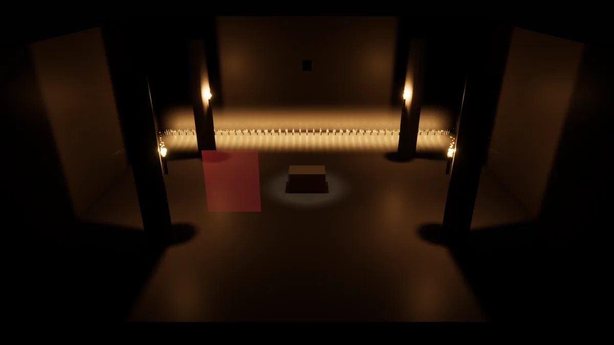
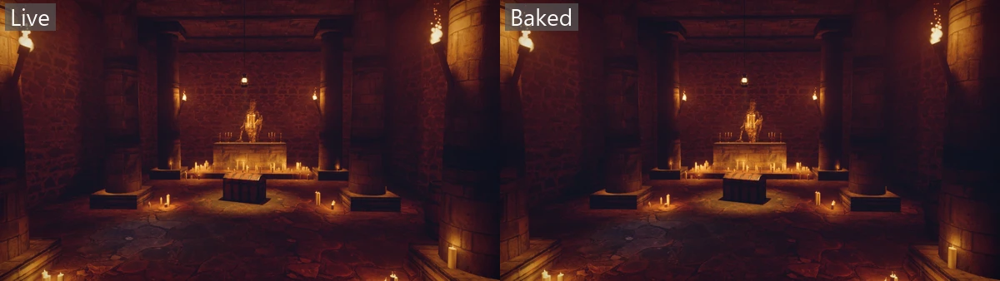

# Crypt

A stone hall lit only by fire and two beams. Four torches cast shadows, five brass
candelabras stand on the altar, 126 loose candles sit on the floor, a lantern swings
over a chest, and a cold beam falls from a grate. That's about 150 lights a frame.
The air is faintly dusty, a [volumetric fog](../../docs/rendering.md#volumetric-fog) of
0.008, so the torches glow in it.

```
dotnet run -c Release --project examples/Crypt
```



## Getting the assets

The models aren't in git, because of their size. The statue, the chest, the barrels, the
lantern and the candelabras come from the shared `assets` folder, which the build cooks:
[assets/README.md](../../assets/README.md#crypt) says where to download each one.

The stone is this example's own. Download these Poly Haven textures and save them in
`content/textures`, inside this folder:

| Saved as | Poly Haven texture |
| --- | --- |
| `floor.jpg`, `floor-normal.jpg`, `floor-surface.png` | [monastery_stone_floor](https://polyhaven.com/a/monastery_stone_floor) at 2k |
| `wall.jpg`, `wall-normal.jpg`, `wall-surface.png` | [old_stone_wall](https://polyhaven.com/a/old_stone_wall) at 2k |
| `blocks.jpg`, `blocks-normal.jpg`, `blocks-surface.png` | [large_sandstone_blocks](https://polyhaven.com/a/large_sandstone_blocks) at 1k |

The `.jpg` is the diffuse JPEG and `-normal.jpg` the OpenGL normal map. The
`-surface.png` is made from the roughness map, put into the green channel with no metal
and full opacity:

```
ffmpeg -i floor-rough.jpg -vf "format=gray,geq=r=0:g='p(X,Y)':b=0:a=255,format=rgba" floor-surface.png
```

`content/cook.json` cooks the `-normal` files as normal maps and the `-surface` files as
linear data.

See [CREDITS.md](../../CREDITS.md) for who made what.

## Baked lighting

The hall is a baked space named `crypt`, in a box a little larger than the walls and the vault, with
probes 0.8 m apart. Everything that stands still is drawn static (`isStatic: true`): the floor, walls,
vault, pillars, altar, statue, chest, barrels, candelabras, the loose candles and the torches' sticks.
The shapes made in code are made static too, so they get lightmap UVs. The lantern and its chain swing,
so they stay dynamic, and the probes light them as they move. The bake is
`content/lighting/crypt.lightbake`, 4.1 MB at the default 20 texels a metre.



The two look nearly the same. What the bake gains is cost, because the bounced light is no
longer traced every frame.

The fire stays real-time and flickers, so each flame is a `Mixed` light. A `Baked` light is drawn
from the lightmap alone and cannot flicker, and a `Realtime` one would lose the bounce:

| Light | Mode | Why | Shadows |
| --- | --- | --- | --- |
| The four torches | Mixed | They flicker, so the flame must stay live, and the bake adds the bounce | Real-time shadow tiles, and the bake's mask for the rest of the hall |
| Grate beam | Mixed | It is steady and could be `Baked`, but its beam is narrow and a lightmap at 20 texels a metre would blur the edge that real-time shadows keep sharp | Real-time shadow tiles. It found no mask channel |
| Altar glow and the altar's candelabra flames | Mixed | They are fire and flicker like the torches | The glow has real-time tiles. The 15 flames have none, and no mask channel |
| Loose candles | Mixed | They are fire and flicker | No shadow tiles and no mask channel, so they light the floor with no shadows, as before |
| Lantern spot and flame (swing) | Mixed | They swing, so the bake can't hold their light | Real-time. They move, so the bake leaves them out and logs it |

The bake's shadow mask has four channels, and the four torches take them. Every other `Mixed`
light found none, and the bake lists them: 143 lights, the grate (340), the altar's flames and glow
(600 to 614 and 699) and the 126 candles (1000 to 1125). They keep the real-time shadows they had
before, or none.

### Rebaking

Bake again after changing the hall, a light, the sky or the light modes:

```
dotnet run -c Release --project examples/Crypt -- --bake
dotnet run -c Release --project examples/Crypt -- --bake-check
```

The last bake took 5 seconds, traced 1,024 samples a texel, found 1.14% of texels inside walls
and printed 0 validation messages. `--bake-check` prints `fresh` and exits 0. A bake that is stale
isn't drawn and the hall is lit live; `--bake` needs the models and textures from
[Getting the assets](#getting-the-assets).
