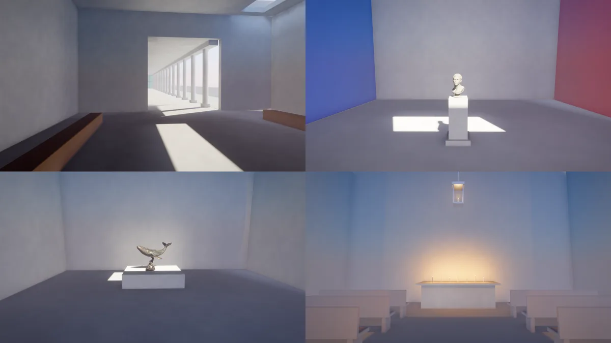
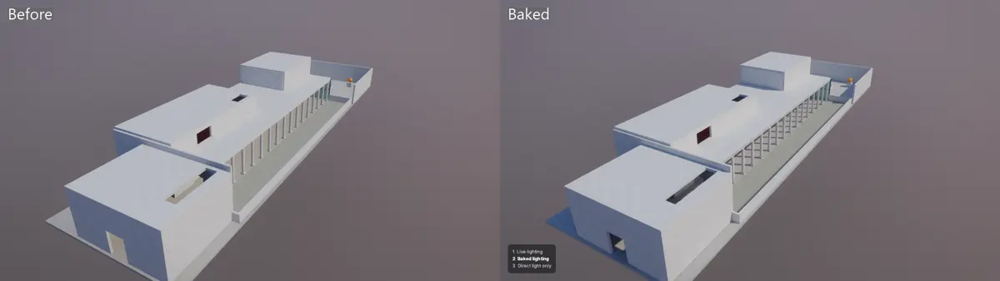
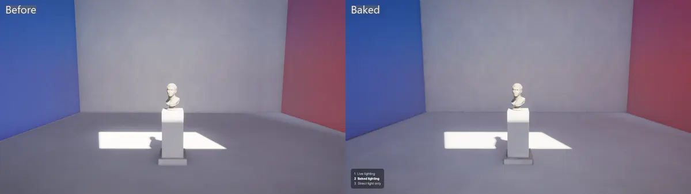

# Gallery

Plaster rooms along one corridor, lit by a sun, the sky,
[light probes](../../docs/rendering.md#bounced-light),
[reflection probes](../../docs/rendering.md#reflections) and point lights, and by a
[bake](../../docs/rendering.md#baked-lighting) of all of them that ships with it. Keys 1, 2
and 3 switch between live lighting, the bake, and direct light alone, so you can see what each
adds.

```
dotnet run -c Release --project examples/Gallery
```



The entrance hall has a long skylight, and a colonnade throws its shadows down a corridor
42 m long, further than the sun's last shadow cascade reaches. Off the corridor are four
rooms:

- A colour room, with a red wall, a blue wall and a white floor, where sun from a high
  window falls on a marble bust on a plinth.
- A whale room, with a bronze whale under a skylight.
- A dark lamp room, with a strip of glowing floor panels, three hanging lamps with large
  soft lights, and a brass sphere rolling back and forth under them.
- A chapel, lit by a lantern swinging on its chain and a row of flickering candles on the
  altar.

At the end of the corridor a tinted glass screen closes off an open courtyard.

Everything except the two statues is built in code from boxes, cylinders and spheres in
`Building.cs`, with flat matte materials: light-grey plaster with a faint noise and a few
strong colours. The glowing discs and panels use a small surface shader,
`Shaders/glow.frag`, because a `Surface` has no emissive colour of its own. The glow
doesn't light anything; the point lights under the lamps do.

The camera walks a slow, fixed tour from `Tour.cs`, worked out from time alone, so the same
tick always gives the same picture. Press F to fly it yourself: W, A, S and D move, E and
Q go up and down, and the mouse looks around. F again goes back to the tour.

## Baked lighting

The Gallery is a baked space named `gallery`, over the same box as its light probes. The
building's boxes, cylinders and spheres are drawn static (`isStatic: true`), so they get
lightmap UVs; the statues, the rolling sphere, the lantern and the candles stay dynamic. Its
bake is `content/lighting/gallery.lightbake`, made at the final quality.





The current lighting shows in the bottom-left corner. The keys switch between:

| Key | Lighting | What's on |
| --- | --- | --- |
| 1 | Live lighting | Every light live, and bounced light from the live light probes, as if nothing were baked (`Graphics.BakedLighting` off) |
| 2 | Baked lighting | The bake: lightmaps on the building and its probes for everything else. The default |
| 3 | Direct light only | No bake and no bounced light (`BakedLighting` and `LightProbes` off) |

Each light has the mode that suits it:

| Light | Mode | Shadows |
| --- | --- | --- |
| Sun through the skylight | Mixed | Real-time cascades; the bake's mask past the last |
| Lamp room, lamps 1 and 2 | Mixed | Real-time, so the sphere shades the floor; the bake's mask for the building |
| Lamp room, lamp 3 | Baked | Soft, baked; the rolling sphere casts none from it |
| Chapel lantern (swings) | Mixed | Real-time. It moves, so it is never baked; made Baked it is logged as moving |
| Chapel candles (flicker) | Mixed | No shadow tiles. The first three have the bake's mask; the other four have no shadows |

The bake's shadow mask has four channels, and the sun takes one. Lights whose ranges don't
overlap can share a channel, so the chapel's candles reuse the lamps' channels. The seven candles
sit close together and overlap each other, so only the first three find a channel. The bake
reports the other four, and they light the altar with no shadows at all.

### Rebaking

Bake again after changing the building, a light, the sky or the light modes:

```
dotnet run -c Release --project examples/Gallery -- --bake
dotnet run -c Release --project examples/Gallery -- --bake-check
```

`--bake` writes `content/lighting/gallery.lightbake` and prints a report. The last bake took
16 seconds, traced 1,024 samples a texel and found 5.74% of texels inside walls. It listed
candles 123 to 126 as Mixed lights without a shadow mask channel. `--bake-check` builds first,
so it reads the new bake, and prints `fresh`. A stale bake isn't drawn: the Gallery is lit
live, as with key 1, and the log says what changed. `--bake-quality preview` traced 64
samples a texel in 13 seconds and looks blotchy.

The glow pieces (`Shaders/glow.frag`) are static too: their surface shader is hashed into the
bake's identity from `shaders/glow.frag.spv` beside the program.

## Shots

Each room's hold is halfway through at these ticks, which make repeatable shots:

| Room | `--ticks` |
| --- | --- |
| Overview from above | 150 |
| Entrance hall | 660 |
| Colour room | 1065 |
| Whale room | 1515 |
| Lamp room | 1965 |
| Chapel | 2415 |
| Courtyard, through the glass | 2820 |

```
dotnet run -c Release --project examples/Gallery -- --seed 1 --ticks 1065 --size 1280x720 --screenshot colour.png
```

## Models

The marble bust and the bronze whale are Poly Haven models, kept in `content/models` with
their textures, at their real sizes of about 0.5 m and 1.1 m. See [CREDITS.md](../../CREDITS.md).
