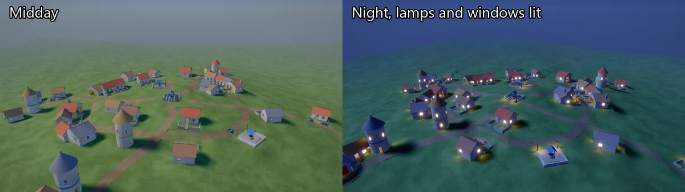

# Hamlet

A village on a hill, made from the seed, through a day that lasts two minutes. Forty
buildings stand at any angle along winding paths: cottages with garden walls, workshops
with a big open door and a forge, round towers, and wells in small paved yards. The sun
crosses the sky and the sky's colours follow it. At dusk each building's lamps come on
and flicker, and its windows glow and throw a little warm light onto the ground. A cart
rolls round the ring road with a lantern at night.

Every building is a baked chunk, so the light bounced round its rooms comes from a bake
made once for its kind and shared by every copy. At night the village has about 200
lights a frame: lamps and forge fires with shadows, lit windows without, the cart's
lantern and the moon.

```
dotnet run -c Release --project examples/Hamlet
```



The camera circles the village for forty seconds, then comes down to a cottage's garden
gate, walks in at the door and turns to the window the sun comes through. The day is two
tours long, so it visits the same cottage once by day and once by lamplight. All of it is
worked out from the tick, so `--ticks` always gives the same shot. Press `R` for a new
village from the next seed.

Every building is built in its own space and drawn under one placement, and the code
that builds each kind (`Cottage`, `Workshop`, `Tower`, `Well`) is apart from the code
that places them (`Village`). Cottages put the bed, table and shelf against different
walls. There are no textures: only built-in shapes with flat, matte materials, a light
grey plaster with faint noise, and a few strong colours on doors, roofs and bands. Each
kind, and each cottage layout, always has the same roof and strong colours, so every
copy of it is the same chunk. The village never lets one building's box reach into
another's: a part inside two boxes would be baked into the wrong one.

## Baked lighting

Each building calls `view.BakedChunk` with its kind's name (`cottage`, `workshop`,
`tower` or `well`), its plan's box and its placement, at 10 texels a metre. The well and
the tower are narrow, so their edge blend is 0.4 metres; the others keep the default
0.5. Every part is drawn static except the glowing bulbs and coals, which brighten and
dim through the day, and the lit window panes. The ground and the cart stay dynamic and
are lit by the probes.

The bakes are in `content/lighting/<kind>/<hash>.lightbake`, made from seed 1: one well,
one workshop, one tower and the four cottage layouts seed 1 uses, about 8 MB in all.

The current lighting shows in the bottom-left corner. The keys switch between:

| Key | Lighting | What's on |
| --- | --- | --- |
| 1 | Live lighting | Every light live, and bounced light from the live light probes, as if nothing were baked |
| 2 | Baked lighting | The chunks' bakes where they are fresh. The default |
| 3 | Direct light only | No bake and no bounced light |
| R | A new village | The next seed |

There is no key for the probe debug view yet; `--debug-view probes` shows it.

Each light has the mode that suits it:

| Light | Mode | Why |
| --- | --- | --- |
| Sun and moon | Mixed (the default) | They move across the sky, so the bake leaves them out and they are lit live; the bake's sky and sun transfer relights every copy instead |
| Lamps | Realtime | They come on at dusk and go out at dawn, and a bake can't hold light that isn't always there |
| Forge fires | Mixed | They burn all day, so their bounced light is baked, while their shadows stay live |
| Window lights | Realtime, no shadows | They come and go with the lamps |
| Cart lantern | Realtime | The cart moves, so it is never in a bake |

Other seeds place cottage layouts that seed 1 doesn't use. Those have no bake yet, so
they are lit live, as with key 1, until a later plan bakes every layout.

### Rebaking

Bake again after changing a building, a light, the sky or the light modes:

```
dotnet run -c Release --project examples/Hamlet -- --bake --seed 1
dotnet run -c Release --project examples/Hamlet -- --bake-check --seed 1
```

`--bake` writes one file per chunk that differs and prints a report for each. The last
bake listed no Mixed lights without a shadow mask channel. `--bake-check` prints `fresh`
for each chunk. Run with `--seed 2` it reports one cottage layout as missing, which is
expected.
