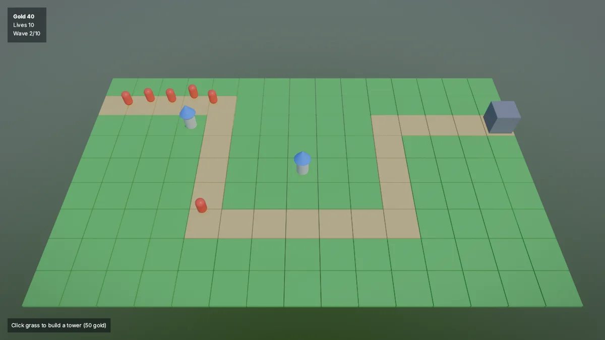

# Outpost

A small tower defense, made only from Super's built-in shapes. Ten waves of walkers, runners
and brutes follow a winding road to your base. Click grass to spend gold on a tower, and the
towers shoot whatever is furthest along the road. Every enemy that gets through costs a life;
hold out through all ten waves to win. It's the game the
[tower defense guide](../../docs/guides/tower-defense.md) builds, one chapter at a time.



```
dotnet run -c Release --project examples/Outpost
dotnet test tests/Outpost.Tests -c Release
```

Space or a click starts the game, and R plays again after you win or lose. `--script towers`
starts a game and builds two towers, for screenshots; `--script start` only starts it.

| File | What's in it |
| --- | --- |
| `OutpostGame.cs` | The screens, the build click, the order the parts update and draw in, and the field and base |
| `Field.cs` | The grid of tiles, the road and where the base stands |
| `Enemies.cs` | The three kinds of enemy, walking the road, taking hits, reaching the base, and drawing them |
| `Towers.cs` | Building towers, picking a target, and drawing them |
| `Shots.cs` | Shots flying to their target, and drawing them |
| `Waves.cs` | Which enemies each wave sends, and when |
| `Player.cs` | Gold and lives |
| `Hud.cs` | The HUD and the banner for the title and the end of a game |
| `Controls.cs` | The controls and the screens |
| `OutpostServices.cs` | `AddOutpost`, shared by `Program.cs` and the tests |
