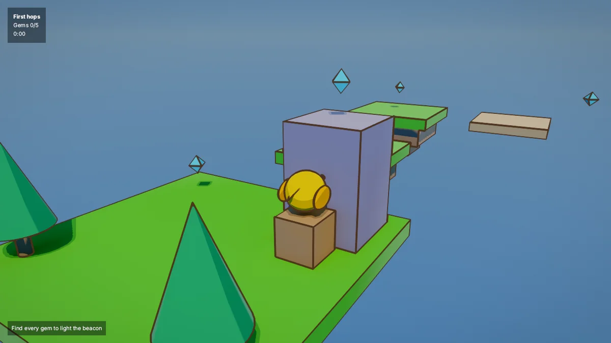

# Skylark

A small 3D platformer, made only from Super's built-in shapes, drawn as a cartoon. You play
a round yellow bird on a string of islands in the sky. Hop between them, ride the lifts,
push a crate to reach a high ledge, and find every gem to light the beacon that takes you
to the next level. There are two levels and a best time to beat. It's the game the
[platformer guide](../../docs/guides/platformer.md) builds, one chapter at a time.



```
dotnet run -c Release --project examples/Skylark
dotnet test tests/Skylark.Tests -c Release
```

Space starts the game and jumps, WASD or the arrows walk, the mouse turns the camera, and R
starts again. A gamepad works too. `--script hop` starts a game, walks to the edge and hops
to the next island, for screenshots; `--script start` only starts it.

| File | What's in it |
| --- | --- |
| `SkylarkGame.cs` | The screens, moving to the next level, the best time, and the order the systems update in |
| `Levels.cs` | The two levels as data, and which one is being played |
| `Scenery.cs` | Building a level into a scene: light, islands, lifts, gems, crates, trees, the beacon and the bird |
| `Palette.cs` | The colours everything is painted with |
| `Look.cs` | The cartoon shapes everything is drawn with: toon shaded, with an ink outline |
| `Bird.cs` | Walking, jumping, riding lifts and going home after a fall |
| `Chase.cs` | The camera on an arm behind the bird |
| `Lifts.cs` | Lifts gliding there and back |
| `Gems.cs` | Collecting gems, their sparkles, and lighting and reaching the beacon |
| `Crates.cs` | Putting a crate that fell off back where it started |
| `Journey.cs` | The level, gems, time and falls of a run, and the saved best time |
| `Hud.cs` | The HUD and the banner for the title and the end of a run |
| `Components.cs` | The hero, lift, gem, goal and crate components each entity carries |
| `Controls.cs` | The controls and the screens |
| `SkylarkServices.cs` | `AddSkylark`, shared by `Program.cs` and the tests |
