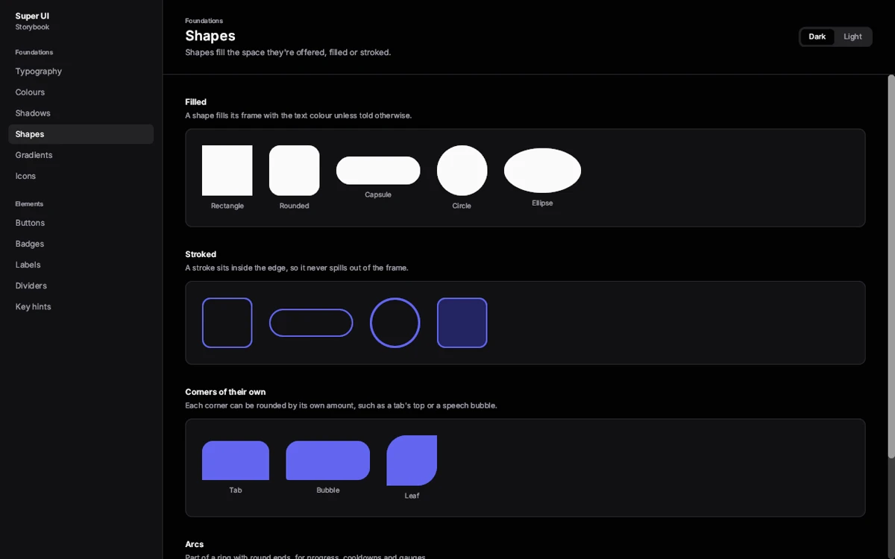

# Storybook

Every interface element Super has built in, each on its own page: alone, in its variations
and sizes, turned off, and next to the others, in the dark theme, the light one and one drawn from art. Pick a
page in the sidebar, and switch the theme in the top right. It's the place to see what an
element looks like before you use it, and a test bed for changing one.



```
dotnet run -c Release --project examples/Storybook
dotnet test tests/Storybook.Tests -c Release
```

`--story badges` opens a page by its name in lower case with dashes, such as `key-hints`,
and `--theme light` starts in the light theme. `--theme textured` starts in a theme whose
cards, buttons and popups are drawn from art, painted in `Textured.cs`. Both options work with `--screenshot`, so a shot
of one element is one command:

```
dotnet run -c Release --project examples/Storybook -- --story badges --theme light --screenshot badges.png
```

| File | What's in it |
| --- | --- |
| `Program.cs` | Reading the options and starting the game |
| `Story.cs` | What a page is, `--story` and `--theme`, and the list of pages in sidebar order |
| `StorybookGame.cs` | The sidebar, the theme switch and the open page |
| `Specimen.cs` | The titled cards each variation sits on, and the layouts for them |
| `Foundations.cs` | Pages for text styles, colours, shadows, shapes, gradients and icons |
| `Elements.cs` | Pages for badges, labels, dividers and key hints |
| `Controls.cs` | Pages for buttons, toggles, sliders, steppers, pickers, progress and gauges |
| `Typing.cs` | Pages for text fields and for moving focus with the keys and the gamepad |
| `Touching.cs` | The touch page: a quest list to tap, hold, drag and fling, and a strip that scrolls sideways |
| `Popping.cs` | Pages for menus, context menus, alerts, confirmation dialogs, sheets, popovers and toasts |
| `Arranging.cs` | Pages for overlays, offsets, hiding, aspect ratios, grids, flows, views that fit and lazy lists |
| `Containing.cs` | Pages for cards, labelled content, forms, disclosure groups, tab views and navigation stacks |
| `Moving.cs` | The animation page: controls that move, spinners, transitions, a health bar of your own, and motion turned off |
| `Feeling.cs` | The game feel page: presses that squash, springs, counting gold, a gauge's trail, a quest card that leaves and pages that slide |
| `Dressing.cs` | The art panels page: cards, buttons and a dialog drawn from the theme's art, and an image drawn as a 9-slice |
| `Textured.cs` | The textured theme, with its card, popup and button pictures painted in code |
| `Showcases.cs` | Whole screens a game would have, the frame they sit in, the main menu and the heads-up display |
| `ShowcaseScreens.cs` | The settings screen, the inventory and the character creator |
| `Openings.cs` | The title screen ("Press any button") and the loading screen with tips |
